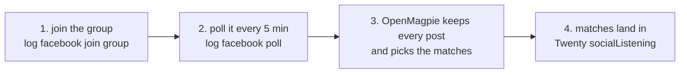

# Listening to local Facebook groups

This is the log play `facebook/groups`. Before anything else, call the log MCP tool `getGuide({ useCase: "facebook/groups" })`: it returns this page and makes it the session's play, so every log tool's answer says which step you are on and a send with no play loaded is refused (rules 157, 158). Then follow the steps in order.

Draft every message from that person's own thread and matt's real replies (`voice` with no text, `search`), never from memory, and never send two that read alike (`sameAsSent`).

The same accounts can join the local groups in their town and hear when someone asks for what the business sells ("anyone know someone who can take away an old sofa?"). This page shows the parts.

How the owner asks for it: "join the local facebook groups in <town>", "listen to the facebook groups for people asking for <service>", "read the posts in the facebook group", "poll the facebook group for new posts", "find the business owners in the facebook group".

## How it runs

An account asks to join a neighbourhood group in its town. Once in, each poll brings back the group's newest posts as a step in the account's open browser, nothing clicked and no comments opened. A read by hand (`read group`) can add their comments; without `--live`, on a numeric group id, it runs on the direct-API engine (fbk) first when the account has a saved session, and falls back to the open browser. What each part must do is in the spec, [Facebook groups](https://github.com/matthewdonsemail-lab/log/blob/main/docs/specs/facebookGroups.md).

## The commands

| # | Step | MCP tool | What decides it | Command |
| --- | --- | --- | --- | --- |
| 1 | Join | `facebookJoinGroup`, `facebookJoinGroupLive` | the group's own join state | `log facebook join group --account <a> --group <url or id> [--live]` |
| 2 | Read | `facebookReadGroup` | the feed's answer; the direct API first, the browser behind it | `log facebook read group --account <a> --group <id>` |
| 3 | Poll | `facebookPoll` | each read's answer; OpenMagpie's watch picks the matches | `log facebook poll <group> <account> <how long>` |
| 4 | Members | `facebookReadMembers` | the members list's answers, about 10 more per scroll | `log facebook read members --account <a> --group <g> --count 40 --owners` |

`read members --owners` keeps people whose bio says owner, founder, CEO or self-employed, or who run a page, saved under `~/.logCli/members/`.

## Next

- [#40](https://github.com/matthewdonsemail-lab/log/issues/40) acts on a match: a comment or a message from the same account.

Sources: `docs/groupListening.md`, `docs/groupMembers.md`, `docs/commandNaming.md`.
