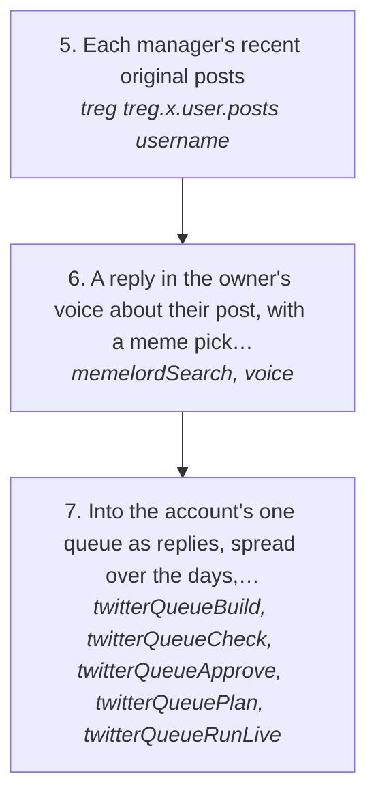
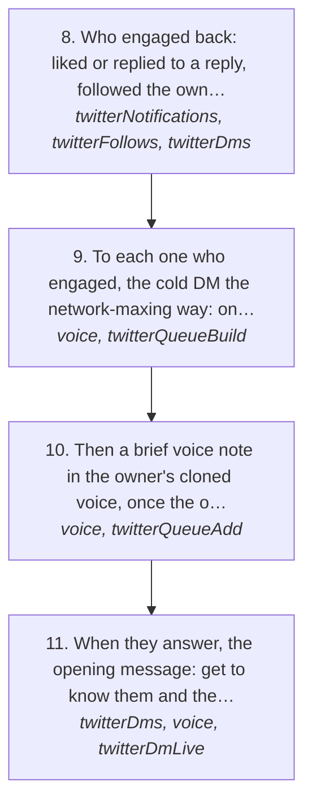

# Manager maxxing: the managers of the biggest Kick streamers

This is the log play `twitter/managerMaxxing`. Before anything else, call the log MCP tool `getGuide({ useCase: "twitter/managerMaxxing" })`: it returns this page and makes it the session's play, so every log tool's answer says which step you are on and a send with no play loaded is refused (rules 157, 158). Then follow the steps in order.

Draft every message from that person's own thread and matt's real replies (`voice` with no text, `search`), never from memory, and never send two that read alike (`sameAsSent`).

The owner's go-to-market, in his words (https://x.com/matthewsoldit/status/2118285429674017268): "find every single kick streamers managers on twitter, reply guy them for a few days then cold dm them to use log and show claviculars twitter". The pitch, once they're talking: if Claude Code explains the sponsor deals a streamer does, with tracked links, sign-up rates go up, which means more affiliate money. Letting AI use your social media increases your surface area of luck.

The people this is for (the ICP) are the managers of Kick streamers, category by category, starting with the streamers with the most viewers. It runs on the network-maxing logic ([networkMaxing.md](../log-twitter-network-maxing/SKILL.md)): every touch is about them and what they're doing, and the ask comes only once they're talking.

How the owner asks for it: "manager maxxing", "find every kick streamer's manager on twitter", "reply guy the kick managers with memes", "the managers that engaged, send them their tweet, a message and a voice note".

## Run it from a fresh context

Say: **"go on docs/useCases/twitter/managerMaxxing.md for <category, or all of them>"**. The agent reads this page, [README.md](https://github.com/matthewdonsemail-lab/log/blob/main/docs/useCases/twitter/README.md) and [networkMaxing.md](../log-twitter-network-maxing/SKILL.md), loads `getGuide({ topic: "xSending" })` and `getGuide({ topic: "extensions" })`, and runs the steps.

## The steps

### Find the agencies, their talent and their managers

The way in is the agency. Category by category, the top streamers lead to the agencies that manage them, each agency leads to the rest of its talent, and its staff are the managers. Agencies sit next to other agencies (talent they follow is managed by another), so each one found opens the next.

| # | Step | Tool | Done when |
| --- | --- | --- | --- |
| 1 | The top Kick streamers by viewers, grouped by category. StreamerStats ranks the last 30 days at `streamerstats.com/kick/channels?period=30d` (pages 1 to 3, the top 75, are open without a login), each row with its category, and each channel's page at `streamerstats.com/kick/channels/<name>` links the streamer's X. A category's own page only shows who is live now. Streams Charts is behind Cloudflare and KickStats renders with JavaScript | the built-in browser on StreamerStats (rule 53: the source is named) | `~/.logCli/managerMaxxing/streamers.json`: rank, category, viewers and X handle per streamer |
| 2 | Each streamer's agency from their X bio: a business email's domain (`@loaded.gg`, `@mythictalent.com`, `@evolved.gg`), an agency's handle (`@POWReSports`), or a named manager ("Contacto y Publicidad @CesarCeraLive") | [treg](https://treg.to/?ref=matthewdonse-aebsh) `treg.x.user.profile` | each streamer's agency, and how it was found |
| 3 | Each agency's roster from its own site (the creators it lists), and its own X account | the built-in browser on the agency's site, treg `anyapi.twitter.search_users` { query: "<agency name>" } | the agency's talent and its X handle |
| 4 | The agency's people: who the agency's X account follows, kept where the bio names a role there ("Senior Talent Manager @loadedgg", "Talent Manager @MythicTalent", "Agent @evolvedtalent"). The same list shows more of its talent (their business emails on its domain) and the agencies next to it (talent it follows managed by another domain), which go back into step 3 | treg `tikhub.x.twitter-web-fetch-user-followings` { screen_name } | `~/.logCli/managerMaxxing/agencies.json`: per agency its talent, its people with their role, and the adjacent agencies |

### Reply guy them for a few days, with memes

<!-- stepsDiagram: written by `bun run docs:build` from the steps table below, not edited by hand -->

<!-- /stepsDiagram -->

| # | Step | Tool | Done when |
| --- | --- | --- | --- |
| 5 | Each manager's recent original posts | treg `treg.x.user.posts` { username } | a post per manager worth replying to |
| 6 | A reply in the owner's voice about their post, with a meme picked to his taste for that moment, uploaded as media. Gate every reply | `memelordSearch`, `voice` { to, context, text } | every reply passes |
| 7 | Into the account's one queue as replies, spread over the days, a few minutes apart (rules 104, 107). Each reply likes the post and follows them first | `twitterQueueBuild` { action: "reply" }, `twitterQueueCheck`, `twitterQueueApprove`, `twitterQueuePlan`, `twitterQueueRunLive` | X's answer is `sent` |

### Who engaged, then the DM

<!-- stepsDiagram: written by `bun run docs:build` from the steps table below, not edited by hand -->

<!-- /stepsDiagram -->

| # | Step | Tool | Done when |
| --- | --- | --- | --- |
| 8 | Who engaged back: liked or replied to a reply, followed the owner, or messaged him | `twitterNotifications` { account }, `twitterFollows`, `twitterDms` { account, with } | the managers who engaged |
| 9 | To each one who engaged, the cold DM the network-maxing way: one of their own tweets forwarded first, then one line about it. The opener only, never the ask (rule 98) | `voice` { to, context, text }, then `twitterQueueBuild` { action: "dm" } | every opener passes |
| 10 | Then a brief voice note in the owner's cloned voice, once the openers have gone: one spoken question that goes a step further on their tweet (rule 156) | `voice` { to, context, text, spoken: true }, then `twitterQueueAdd` { action: "voice" } | X's answer is `sent` for each voice note |
| 11 | When they answer, the opening message: get to know them and the streamers they run, then, in the conversation, log: Clavicular's X as the example, Claude Code explaining sponsor deals with tracked links, more sign-ups, more affiliate money | `twitterDms` { account, with }, `voice`, `twitterDmLive` | the conversation is going |

## What to know

- **The ICP is the manager, not the streamer.** A streamer only matters here as the way to their manager.
- **Never guess a manager.** Only a bio that names the role at the agency counts. Searching X posts for "<streamer> manager" or "<agency> talent manager" brings up jokes, fans and recruiters (on 2026-11-05 both did), and X's people search matches names, not bios; the agency's own following list is what finds its staff.
- **Reply guy first, for a few days,** then the DM only to the ones who engaged. Someone who never engaged isn't DMed yet.
- **The opener is never the ask** (rule 98). log, Clavicular's X and the affiliate money come up once they're talking.
- Replies go to authors with 1500 followers or fewer (rule 121); a bigger manager needs the owner to name them.
- Every send goes through the account's one queue, gated against his voice, and a refusal from X stops the run (rules 94, 104, 118).

## Next

- Steps 1 to 4 are read by hand from StreamerStats, the agencies' sites and treg for now; a command that builds `streamers.json` and `agencies.json` would make them repeatable.
- StreamerStats shows only the top 75 without a login; a deeper ranking per category needs the owner signed in there.
