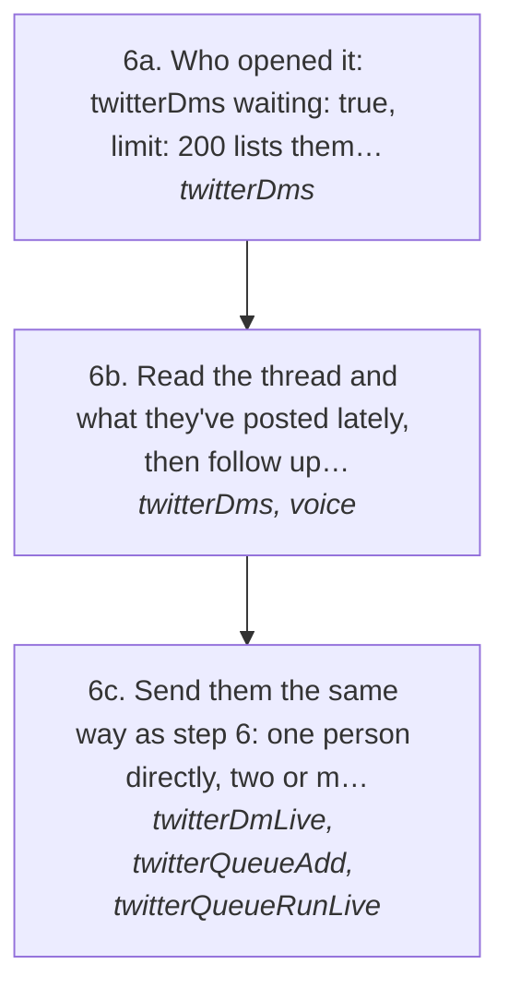
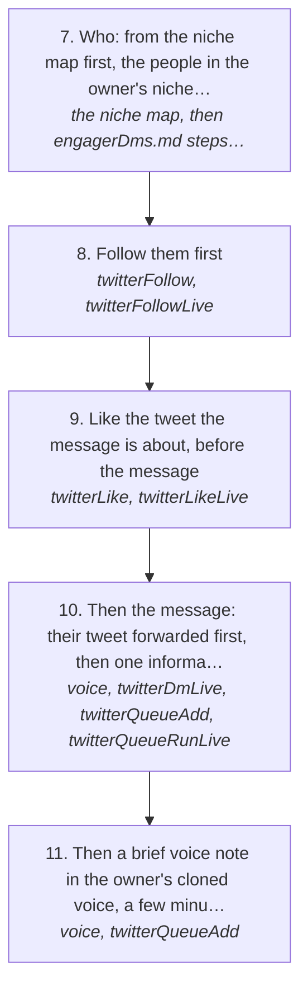

# Network maxing: grow the network, the niche map

This is the log play `twitter/networkMaxing`. Before anything else, call the log MCP tool `getGuide({ useCase: "twitter/networkMaxing" })`: it returns this page and makes it the session's play, so every log tool's answer says which step you are on and a send with no play loaded is refused (rules 157, 158). Then follow the steps in order.

Draft every message from that person's own thread and matt's real replies (`voice` with no text, `search`), never from memory, and never send two that read alike (`sameAsSent`).

The point is to expand the owner's network, and the network is his niche map: the people around the communities and creators in his niche, each with their role, whether they follow him, and how close they sit to him. Network maxing grows it, one real conversation at a time. Every conversation is about getting to know them and what they're doing: what they're building, how they work, what's going on for them. It is never about what the owner sells.

The goal is the network, not a deal. Everyone who messaged the owner gets something nice back that keeps the conversation going, with nothing asked of them. That holds even when they said it doesn't line up as a business thing: it isn't a business thing yet. Warm the relationship first, and the business comes later, from a follow-up and a good conversation. New people get pulled in the same way, through small positive interactions: on their phone they see that the owner followed them, liked their tweet, then messaged.

How the owner asks for it: "all them people messaging me, just message them something nice, get the ball moving with the networking", "we're not even trying to get anything out of these people, network max", "throw some new people in the mixer", "network max ... look at the nicheMap", "the whole point of it is to expand our network, which is the niche map", "follow them before you cold message them, and like the tweet you send them".

## Run it from a fresh context

Say: **"go on docs/useCases/twitter/networkMaxing.md"**. The agent reads this page and [README.md](https://github.com/matthewdonsemail-lab/log/blob/main/docs/useCases/twitter/README.md), loads `getGuide({ topic: "xSending" })`, and runs the steps.

## The steps

### Everyone who messaged

| # | Step | Tool | Done when |
| --- | --- | --- | --- |
| 1 | Who wrote last, message requests included; anyone who opened the owner's message without replying is listed apart, for "Everyone who opened it" | `twitterDms` { account, waiting: true, limit: "50" } | the list, newest first |
| 2 | Read each in full, old DM thread and X Chat merged. Drop spam, pitches and bots: a real person who said something real stays | `twitterDms` { account, with: "<handle>" } | what each one said, and whether they're real |
| 3 | How the owner writes to this person | `voice` { to, with, context: "<what they said>" } | the owner's own lines to draft from |
| 4 | Draft something nice that keeps it going and asks for nothing: answer what they said, say something true about them or their work, and get to know them (what they're doing, how it's going). Leave the door open. Never a pitch, never "let's hop on a call". Every draft reads differently | the agent | one draft per person |
| 5 | Gate each draft, rewrite until it passes | `voice` { to, with, context, text } | the gate passes |
| 6 | Send them, one message per line. One person: dry run, then live. Two or more go into the account's one queue, never a loop of sends (rule 105): `twitterQueueAdd` { queue, targets, action: "dm", by } adds them, even while it runs, at least minGap apart; if no run is going, `twitterQueueRunLive` { queue, keepOpen: true, confirmLive: true } starts it. Right before each send the queue reads that person again and holds the item when anything changed (rule 109) | `twitterDm`, then `twitterDmLive` { userId, text, approvedBy, confirmLive: true }, or `twitterQueueAdd` and `twitterQueueRunLive` | X's answer is `sent` for every part |

### Everyone who opened it

Someone who opened the owner's message without typing back is an open door, so they get a follow-up. They opened it when they reacted to it, or when their read receipt is past it (X Chat sends one each time a person reads, and some old DM threads show how far the other person has read). Only people who keep read receipts on show the second kind.

<!-- stepsDiagram: written by `bun run docs:build` from the steps table below, not edited by hand -->

<!-- /stepsDiagram -->

| # | Step | Tool | Done when |
| --- | --- | --- | --- |
| 6a | Who opened it: `twitterDms` { waiting: true, limit: "200" } lists them apart, after the people waiting on a reply (the default 20 only looks at the newest threads) | `twitterDms` { account, waiting: true, limit: "200" } | the opened list |
| 6b | Read the thread and what they've posted lately, then follow up about them and what they're doing: pick up where it left off, never repeat the opener, never the ask | `twitterDms` { with }, [treg](https://treg.to/?ref=matthewdonse-aebsh)'s posts read, `voice` | the gate passes |
| 6c | Send them the same way as step 6: one person directly, two or more through the account's one queue (rule 105) | `twitterDmLive`, or `twitterQueueAdd` and `twitterQueueRunLive` | X's answer is `sent` |

### New people in the mixer

<!-- stepsDiagram: written by `bun run docs:build` from the steps table below, not edited by hand -->

<!-- /stepsDiagram -->

| # | Step | Tool | Done when |
| --- | --- | --- | --- |
| 7 | Who: from the niche map first, the people in the owner's niche he hasn't talked to yet. Real roles only (founders, agency owners, operators, creators; never `bot_or_spam`), 1500 followers or fewer (bigger accounts aren't worth it yet), the closest first: they follow him, then one hop from his creators, then strong ties. Or another source the owner named (people who engaged with his post, a topic search) | the niche map, then [engagerDms.md](../log-twitter-engager-dms/SKILL.md) steps 2 to 4 | a short list, each with a user id and one recent post of theirs to open on |
| 8 | Follow them first. Never send a cold message to someone the owner doesn't follow | `twitterFollow`, then `twitterFollowLive` { userId, approvedBy, confirmLive: true } | X's answer is `sent` (or already followed) |
| 9 | Like the tweet the message is about, before the message | `twitterLike`, then `twitterLikeLive` { tweet, approvedBy, confirmLive: true } | X's answer is `sent` |
| 10 | Then the message: their tweet forwarded first, then one informal line about it, the cold DM way in [engagerDms.md](../log-twitter-engager-dms/SKILL.md). The opener only, always relevant to them, never an ask (no pitch, no "you using `<tool>`"). Gated like every send, and sent the same way as step 6: two or more people through the account's one queue | `voice`, then `twitterDmLive`, or `twitterQueueAdd` and `twitterQueueRunLive` | X's answer is `sent` |
| 11 | Then a brief voice note in the owner's cloned voice, a few minutes after the opener: one spoken question that goes a step further on what they posted, never the ask. Gate it as speech, then add it to the same queue once the openers have gone, so it lands after its own opener | `voice` { to, context, text, spoken: true }, then `twitterQueueAdd` { queue, targets, action: "voice", by } | X's answer is `sent` for the voice note |

## What to know

- **Where the niche map lives** is in the owner's notes and agent memory, not on this page. It is the source of new people, and every person brought into a conversation is that much more of it reached.
- **Keep it about them.** After the opener, the next messages follow what they're doing: what they're working on, how they got there, what they're stuck on. The owner's work only comes up when they ask, or later in a real conversation.
- Follow, like and message are each a write, and they all count against the account's writes for the day (each line of a message is one). Spend today's writes on the people who messaged first, then new people with what's left.
- Never act on the account in quick succession: a few minutes between people, the follow, like and message to one new person spread out, never back to back. A drop or a 429 stops the run, and the next action waits for the owner (rule 94).
- **The opener is never the ask.** A first message to someone new is about them and what they posted, nothing else. The ask comes once they've answered. On 2026-10-31 five openers went out ending "you using treg for anything", and the owner said: go in with the opener, never for the jugular.
- Answer what they actually said. Read far enough back first, and never ask something they already told the owner.
- A message the owner already sent, with them not answering yet, isn't waiting on him: leave it.

## Next

- [#38](https://github.com/matthewdonsemail-lab/log/issues/38) writes back to the niche map who the owner is now talking to, so it shows how much of the network is reached.
