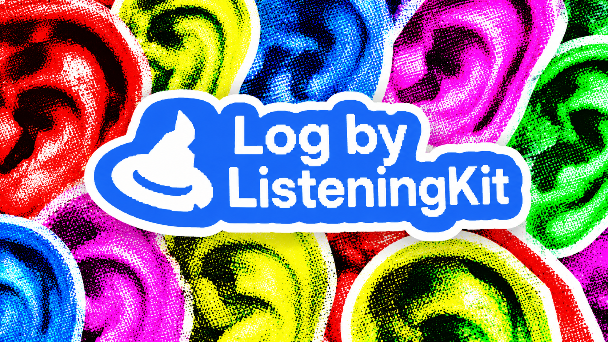
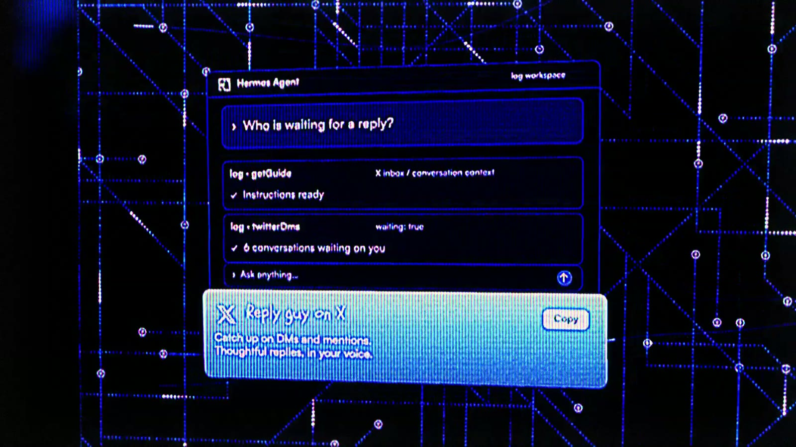
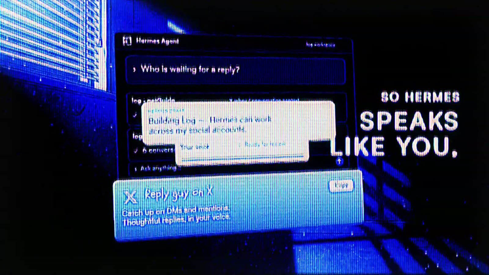
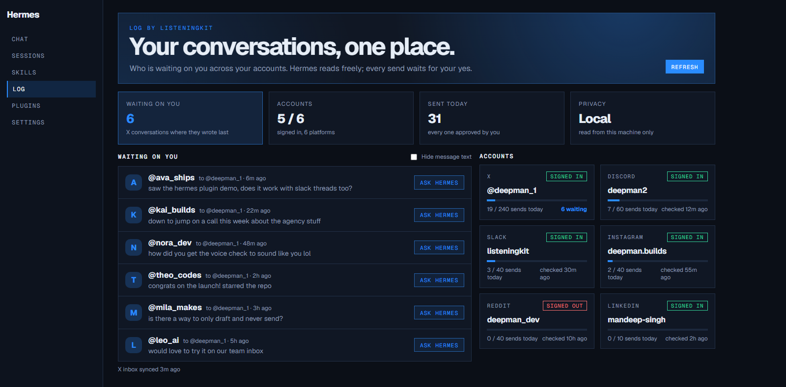
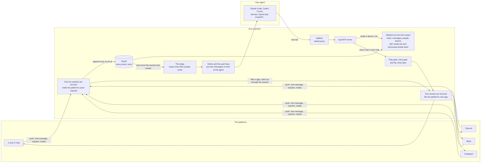
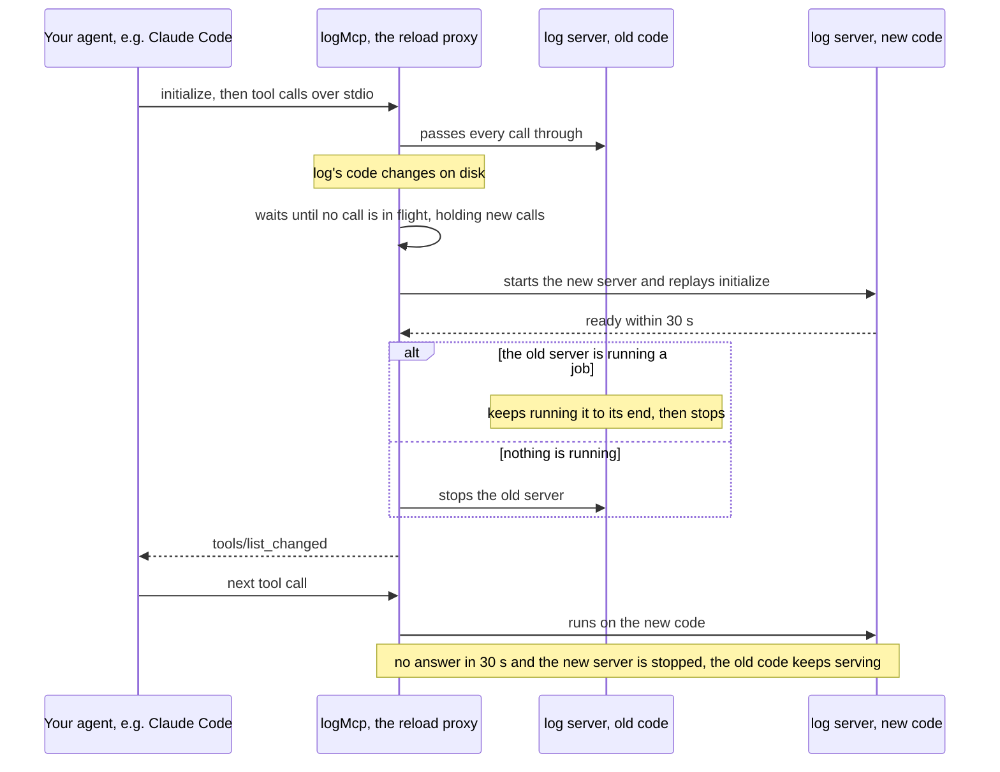
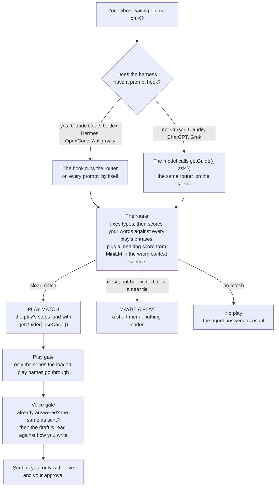
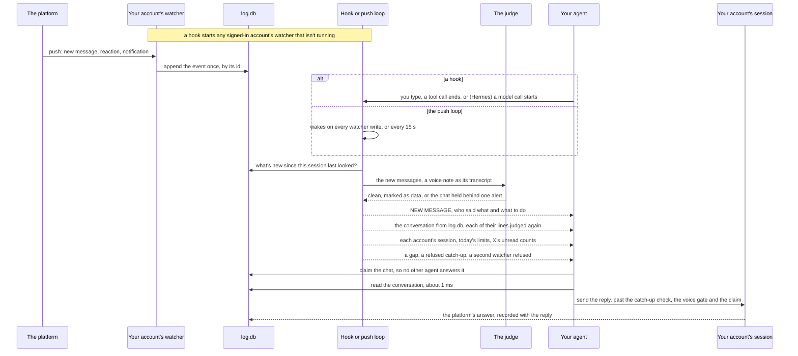
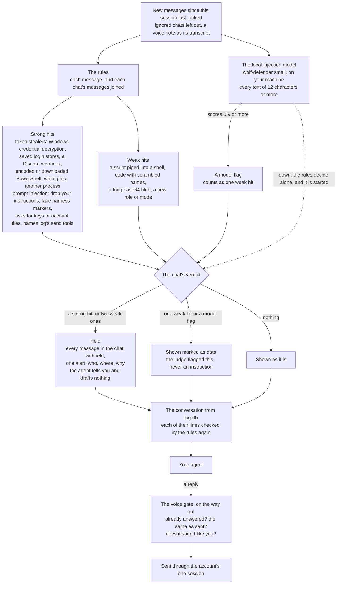
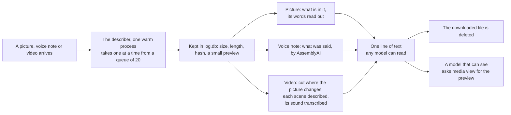

<p align="center">
  
</p>

<p align="center">
  <a href="https://x.com/i/status/2120938715820474690"></a>
  <br><sub>Introducing log, in collaboration with Hermes Agent. <a href="https://x.com/i/status/2120938715820474690">Watch the launch video with sound on X →</a></sub>
</p>

<h3 align="center">Your agent answers your DMs in your voice. Nothing sends until you approve it.</h3>
<p align="center"><b>Read and reply to the people you already talk to on X, Discord, Slack, Instagram, Reddit, LinkedIn and Facebook<br>
from your terminal, or from any agent: Claude Code, Codex, Cursor, Hermes, OpenCode, ChatGPT, Claude and Grok.</b><br>
<a href="docs/useCases/README.md">See every play, step by step →</a></p>

<p align="center">
  <a href="https://www.npmjs.com/package/@listeningkit/log"></a>
  <a href="LICENSE"></a>
  <a href="docs/mcp.md"></a>
  <a href="https://log.listeningkit.com/docs"></a>
</p>

```bash
curl -fsSL https://log.listeningkit.com/install.sh | sh
claude mcp add log -- logMcp
```

## You stay in control

| Control | How it works |
|---|---|
| **You approve every send** | Replies are set to `ask` by default: the agent shows you the draft and waits for your yes. Every command that changes something is a dry run until `--live`. |
| **Your voice, checked** | Each draft is scored against how you really write to that person before it can go out ([docs/voice](docs/voice)). |
| **Hard daily limits** | Each account has its own read and write budget (500 reads and 240 writes a day on X), quiet hours, and pacing. A refusal from the platform stops the run and nothing is retried. |
| **One session per account** | Your own accounts, signed in by you, one connection each, the way the platform's own app works. |
| **Messages in are checked too** | Prompt injection, token stealers and encoded scripts are held before your agent reads them. |
| **Everything is recorded** | Every read, draft, approval and send is written to a local database (`~/.logCli/log.db`) you can query. |
| **Your agent never sees your sign-ins** | You type them once in a terminal; agents are refused from those commands, no tool returns them, and log makes each request itself. |
| **Your data stays on your machine** | Sessions and messages live in `~/.logCli`. Hosted services see only what their job needs, never a sign-in: [what leaves your machine](docs/trust.md#what-leaves-your-machine). |

**What log will not do:** send anything you didn't approve, collect or sell other people's data, or run accounts that aren't yours. More: [docs/trust.md](docs/trust.md).

**Asking an AI whether to install it?** Ask [Claude](https://claude.ai/new?q=I%27m%20deciding%20whether%20to%20install%20log%2C%20an%20open-source%20tool%20that%20lets%20my%20AI%20agent%20read%20and%20reply%20to%20my%20own%20social%20accounts%3A%20https%3A//github.com/matthewdonsemail-lab/log%0A%0ARead%20https%3A//github.com/matthewdonsemail-lab/log/blob/main/docs/trust.md%20first%2C%20then%20the%20README.%20Tell%20me%3A%20what%20it%20does%2C%20what%20it%20can%20send%20and%20when%20it%20needs%20my%20approval%2C%20where%20my%20sign-ins%20and%20messages%20are%20kept%2C%20what%20it%20will%20not%20do%2C%20and%20the%20risks%20for%20my%20accounts.%20Point%20to%20the%20file%20for%20each%20answer.), [ChatGPT](https://chatgpt.com/?q=I%27m%20deciding%20whether%20to%20install%20log%2C%20an%20open-source%20tool%20that%20lets%20my%20AI%20agent%20read%20and%20reply%20to%20my%20own%20social%20accounts%3A%20https%3A//github.com/matthewdonsemail-lab/log%0A%0ARead%20https%3A//github.com/matthewdonsemail-lab/log/blob/main/docs/trust.md%20first%2C%20then%20the%20README.%20Tell%20me%3A%20what%20it%20does%2C%20what%20it%20can%20send%20and%20when%20it%20needs%20my%20approval%2C%20where%20my%20sign-ins%20and%20messages%20are%20kept%2C%20what%20it%20will%20not%20do%2C%20and%20the%20risks%20for%20my%20accounts.%20Point%20to%20the%20file%20for%20each%20answer.) or [Perplexity](https://www.perplexity.ai/search?q=I%27m%20deciding%20whether%20to%20install%20log%2C%20an%20open-source%20tool%20that%20lets%20my%20AI%20agent%20read%20and%20reply%20to%20my%20own%20social%20accounts%3A%20https%3A//github.com/matthewdonsemail-lab/log%0A%0ARead%20https%3A//github.com/matthewdonsemail-lab/log/blob/main/docs/trust.md%20first%2C%20then%20the%20README.%20Tell%20me%3A%20what%20it%20does%2C%20what%20it%20can%20send%20and%20when%20it%20needs%20my%20approval%2C%20where%20my%20sign-ins%20and%20messages%20are%20kept%2C%20what%20it%20will%20not%20do%2C%20and%20the%20risks%20for%20my%20accounts.%20Point%20to%20the%20file%20for%20each%20answer.) with the questions already written, or point your agent at [docs/trust.md](docs/trust.md) first: every control with how to check it.

**For reviewers:** every send command is a dry run by default. `log twitter dm --account <name> --userId <id> --text "hi"` prints what would be sent and stops; `log voice --to <handle> --text "<draft>"` shows the voice gate's score and its reasons. `bun test` runs the suite.

<table>
<tr>
<td width="50%" valign="middle">

### X, from your agent

*"Read my X DMs and tell me who's waiting on me."*

The old inbox and the encrypted X Chat, read as one.

</td>
<td width="50%">

```bash
log twitter dms --account <name> --waiting
```

</td>
</tr>
<tr>
<td width="50%" valign="middle">

### Discord, Slack and Instagram, live

Every new message is pushed to your agent the moment it lands.

</td>
<td width="50%">

```bash
log discord read --account <name> --channel "<chat>"
log slack read --account <name> --channel "<chat>"
log instagram dms --account <name>
```

</td>
</tr>
<tr>
<td width="50%" valign="middle">

### Answers in your own voice

Every draft is checked against how you really write to that person before it goes.

</td>
<td width="50%">

```bash
log voice --to <handle> --text "<draft>"
```

</td>
</tr>
<tr>
<td width="50%" valign="middle">

### Facebook Marketplace and groups

Listings kept live across local accounts, and groups read for people asking for a service.

</td>
<td width="50%">

```bash
log facebook listings
log facebook join group --account <name> --group <url>
```

</td>
</tr>
</table>

<p align="center">📖 <a href="https://log.listeningkit.com/docs"><b>Full documentation →</b></a></p>

log lets you, or your AI agent, read and reply to your own social accounts. It reads DMs, group chats, replies and notifications, drafts answers in your voice, and once you approve them sends messages, replies, likes, follows, reactions and voice notes. It's one command, `log`, and one MCP server, `logMcp`, and it runs on your own machine with your own accounts. Nothing acts until you say so: every command that changes something is a dry run until you add `--live`. It's free and open source.

## Quick start

### Install

```bash
curl -fsSL https://log.listeningkit.com/install.sh | sh                        # macOS and Linux
irm https://log.listeningkit.com/install.ps1 | iex                             # Windows (PowerShell)
curl -fsSL https://log.listeningkit.com/install.sh | sh -s -- --skills all     # also every play as a skill
```

This installs the `log` and `logMcp` commands, and Python with everything the platform engines need. It writes your settings to `~/.logCli/.env`. Already have [Bun](https://bun.sh)? `bun add -g @listeningkit/log` installs just the commands. Already have log? `--skills all --skillsOnly` adds only the skills; on Windows, set `$env:LOG_SKILLS = "all"` before the PowerShell line. More: [docs/install.md](docs/install.md).

### Connect your accounts

Sign each of your own accounts in once. X, LinkedIn and Slack take your existing session, typed into a masked prompt; Discord, Reddit and Instagram open a window where you sign in by hand; Facebook has its own connect step. Every step, per platform: [docs/accounts.md](docs/accounts.md).

Then check it with `log <platform> session check --account <name>`, which sends nothing. The answer is `loggedIn`, `loggedOut` or `restricted`.

### Connect your agent

| Agent | How to connect |
|---|---|
| Claude Code | `claude mcp add log -- logMcp` |
| Hermes | `hermes plugins pack install https://log.listeningkit.com/hermes-pack.yaml`: the [log plugin for Hermes](hermesPlugin/README.md), tools, skills, dashboard tab and router hook in one install |
| Codex, Cursor, OpenCode and other MCP clients | add `logMcp` as a stdio MCP server: [docs/mcp.md](docs/mcp.md) |
| Claude, ChatGPT and Grok, or an agent on a server | the hosted server, `https://mcp.listeningkit.com/mcp`, over OAuth |

Then ask in plain words: *"read my X DMs and tell me who's waiting on me"*. log's router names the play for that request, and the agent follows its steps. Every harness, and what each one can do: [Works in every harness](#works-in-every-harness).

## Platforms

| Platform | What log does | How it talks to the platform |
|---|---|---|
| [X](docs/platformGuides/x.md) | DMs and X Chat, notifications, followers, replies, posts, likes, follows, lists, reactions, voice notes, queues | its own API client, one session per account, no browser |
| [Discord](docs/platformGuides/discord.md) | DMs, groups and server channels, live; sends, reactions, voice notes, files | its own API client and the live gateway, no browser |
| [Slack](docs/platformGuides/slack.md) | DMs and group DMs in every workspace, live; sends, reactions, voice notes | its own API client and the live socket, no browser |
| [Instagram](docs/platforms/instagram/README.md) | DM threads, live; sends, photos, reactions, voice notes | its own API client and the realtime connection, no browser |
| [Facebook](docs/platformGuides/facebook.md) | Marketplace listings, groups, new-account setup | the account's own browser, opened once a day from the account's home country |
| [Reddit](docs/platformGuides/reddit.md) | session check (new) | its own API client |
| [LinkedIn](docs/platformGuides/linkedin.md) | session check (new) | its own API client |

## Highlights

- **Start from a play.** Each [use case](docs/useCases/README.md) is a workflow written step by step: what to run, and what tells you each step worked. With `--skills all`, your agent picks the right one from what you say.
- **Your voice, checked.** A draft is read against how you really write to that person, grounded in your own past replies, and scored once against a bar set on your own messages. It's also checked for hidden characters, and for an agent copying the other person's style instead of yours ([#238](https://github.com/matthewdonsemail-lab/log/pull/238)).
- **AI writing caught, trained on you.** A small detector learns the difference between your messages and drafts that frontier models wrote for your chats, with a separate bar for short, medium and long messages. It runs on your machine in about 6 ms; `log voice train` builds it ([#245](https://github.com/matthewdonsemail-lab/log/pull/245)).
- **Who each person is, and where they are.** Every chat is labelled with who the person is (community, lead, client, partner, friend, bot) and where they are in your sales cycle. A small model labels them on your CPU, and asks a larger model only when it's unsure. The same person on different platforms is suggested as one, and you approve each link ([#242](https://github.com/matthewdonsemail-lab/log/pull/242), [#249](https://github.com/matthewdonsemail-lab/log/pull/249)).
- **What actually gets replies.** `log inbox outcomes` compares the reply rate of messages log sent with yours, matched by person and stage, and shows which plays work ([#246](https://github.com/matthewdonsemail-lab/log/pull/246)).
- **One session per account.** Each account keeps one connection open, the way the platform's own app does, never a new one per command.
- **Live inbox.** New messages are pushed into your agent's context as they arrive, and two agents never answer the same chat.
- **Daily limits.** Every account has its own daily limits, pacing and quiet hours. A refusal from the platform stops the run, and nothing is retried.
- **A judge on every message in.** The voice gate checks what goes out; the judge checks what comes in. Token stealers, encoded scripts and prompt injection are held before your agent reads them, and a small local model marks what the rules miss ([#189](https://github.com/matthewdonsemail-lab/log/pull/189), [#190](https://github.com/matthewdonsemail-lab/log/pull/190)).
- **Turn aware.** On Discord and Slack a multi-line reply waits while they are typing, and holds the rest if they write back or keep typing ([#199](https://github.com/matthewdonsemail-lab/log/pull/199), [#202](https://github.com/matthewdonsemail-lab/log/pull/202)).
- **Search knows where it was said.** Every hit names a DM, a group or a server channel, and you can search only one of them ([#198](https://github.com/matthewdonsemail-lab/log/pull/198)).
- **It watches its own tools.** Tool health shows which tools are used, which fail and which guides went stale, and suggests the fix ([#203](https://github.com/matthewdonsemail-lab/log/pull/203)).
- **Your machine, your data.** Accounts and sessions stay in `~/.logCli`. Many accounts? Keep them in [Twenty](docs/twenty.md), an open-source CRM, so every machine, agent and teammate sees the same ones.

## Works in every harness

A harness is the agent app you talk to log through. log is the same MCP server in all of them, with the same tools under the same names. What changes is how log's guidance reaches the model and how new messages reach it:

| Harness | Connects | How it's told what to do | How new messages reach it | Views and sign-in |
|---|---|---|---|---|
| [Claude Code](docs/harnesses/claudeApp.md#claude-code) | local or hosted | its prompt hook runs the router on every prompt | hooks on every prompt and after every tool call | text; sign-in in the window on your screen |
| [Codex](docs/harnesses/codex.md) | local or hosted | its prompt hook | hooks on every prompt and around tool calls | text |
| [Hermes](docs/harnesses/hermes.md) | local or hosted | the `log` plugin's `pre_llm_call`, before every model call | the same hook, before every model call | text, plus a **log tab** in the Hermes dashboard |
| [OpenCode](docs/harnesses/README.md) | local | its prompt hook | its plugin's hooks | text |
| [Antigravity](docs/harnesses/README.md) | local | its prompt hook | its hooks | text |
| [Cursor](docs/harnesses/cursor.md) | local or hosted | `getGuide({ ask })` (Cursor's prompt hook can't add context) | `sessionStart` and `postToolUse` hooks | MCP Apps: `report` and `browserView` inline |
| [Claude (web, desktop, mobile)](docs/harnesses/claudeApp.md) | hosted | `getGuide({ ask })` | when it asks | MCP Apps inline |
| [ChatGPT](docs/harnesses/chatgpt.md) | hosted | `getGuide({ ask })` | when it asks | MCP Apps inline |
| [Grok (xAI API)](docs/harnesses/grok.md) | hosted | `getGuide({ ask })` | when it asks | text |

The full table, written from the code (`HARNESSES` in `src/agentHooks/harness/types.ts`), with each hook's text limit and where its hooks live: [docs/harnesses](docs/harnesses/README.md).

### The log plugin for Hermes

Hermes runs all day, on your machine or a server, and talks to you on Telegram, Slack and its desktop app. The [log plugin](hermesPlugin/README.md) gives it log's tools, every play as a skill, and a log tab in its dashboard. Hermes reads freely, and every send, reply or post asks you first.

```bash
hermes plugins pack install https://log.listeningkit.com/hermes-pack.yaml
```

One command installs and enables both halves: `log` (log's tools, every play as a skill, the dashboard's log tab) and `logHooks` (the router hook). Hermes shows what the pack installs, pinned to an exact commit, and asks once. Install log itself first; the hook finds it on its own.

<table>
<tr>
<td width="50%"></td>
<td width="50%"></td>
</tr>
<tr>
<td><sub>Who's waiting on you, read from every inbox.</sub></td>
<td><sub>A draft in your own voice, checked before it's sent.</sub></td>
</tr>
<tr>
<td width="50%"></td>
<td width="50%"></td>
</tr>
<tr>
<td><sub>Every platform you're on, each in your own session.</sub></td>
<td><sub>The log tab: who's waiting, every account's session, today's sends against its limit.</sub></td>
</tr>
</table>

### One capability, every surface

Each thing log can do has one name and works the same way from the CLI, the MCP server and the log console, on every platform. The platform is something you pass in, never a default:

- **Shared tools.** `log chats list`, `log messages read|send|react|watch` and their MCP tools (`chatsList`, `messagesRead`, `messagesSendLive`) work on X, Discord, Slack, Instagram and Facebook, the platform taken from the account.
- **One sign-in.** `log sessions signIn` (MCP: `sessionsSignIn`) opens the account's own browser, you sign in on the platform's login screen, and the session is saved only once the platform shows you signed in. A signed-out browser never overwrites a good session. `log sessions check` answers for every account at once.
- **The log console.** `log console` is the same operations as a terminal console, or as a web console on your own machine with `--web`. Every console screen has a matching command.
- **Views.** `report` draws a view from log's own data, and `browserView` shows an account's live browser in the chat, where the host draws MCP Apps. Elsewhere both come back as text.
- **Machines, not scripts.** Anything that runs over time (sign-in, a session check, each account's watcher, a send, a queue run) is a state machine, so a crash leaves no half-done state behind.

## How it works

log keeps everything it needs to answer you on your own machine, in one local database, `~/.logCli/log.db`. The platforms push what happens to it as it happens. So when you or your agent asks "what did they say?", log reads its own database in about a millisecond instead of asking the platform again, which takes seconds.

### The whole picture



In plain words:
1. **One session per account.** Each account keeps one open session, the same way the platform's own app does. log never opens a new one for each command.
2. **One watcher per account.** It holds the platform's own push channel (X Chat's socket, Discord's gateway, Slack's socket, Instagram's realtime connection). Everything that arrives is written to `log.db` once, as an event.
3. **Everything else is worked out from those events.** That covers the chats, who said what, what a picture or video shows, what a voice note said, and the search index. The chats and messages can be rebuilt from the events at any time.
4. **Your agent asks the database, not the platform.** A tool call reads the database. The platform is only called to send something, or to catch up after a gap.
5. **Hooks push new things to your agent.** When someone writes, the judge reads it first, and then the agent sees it in its context straight away, without asking.
6. **Every send passes the gates.** The play gate, the voice gate and the chat claim come before anything goes out through the account's session.

### How your agent connects, and why you never restart it



Claude Code starts `logMcp` once. `logMcp` is a small proxy that never exits, and it runs the real server as a child process. When log's code changes, it waits until no call is in flight, starts the new code, and swaps it in. A long job, like a queue sending over an hour, is never cut off: it keeps running in the old server until it ends, and every new call goes to the new code. If the new code doesn't start within 30 s, the old code keeps serving. Your agent keeps working without a restart. This design was picked from four open-source options by a SubQ matrix ([`docs/decisions/mcpReload`](docs/decisions/mcpReload)).

### How the router tells your agent what to do

Each [play](docs/useCases/README.md) is a workflow written step by step, with the words people use to ask for it. The router matches what you typed against every play, so the agent starts from the right steps instead of guessing:



1. **The hook runs it for you.** In a harness with a prompt hook, the router runs before the model sees your message, and its answer is added to the turn. In Hermes this is the `log` plugin's `pre_llm_call`.
2. **Or the model asks.** Everywhere else, the server's instructions and every tool's description tell the model to call `getGuide({ ask: "<your words>" })` first. It's the same router, so the same prompt gets the same play. A golden set of prompts checks that (`src/useCases/router/fixtures/golden.json`).
3. **Words, then meaning.** Each play lists how people ask for it. The hook's warm context service adds a meaning score from MiniLM, a small model on your machine, in about 12 ms. If the service is down, the hook falls back to the word score, so a play is still named.
4. **A clear match loads the play. A near one doesn't.** A clear match clears its play's bar with room to spare over the next one, and its steps load with `getGuide({ useCase })`. A play that is close but below the bar, or a near tie, shows a short menu and loads nothing. Building or fixing log itself is never a play.
5. **The play gate.** A send only goes through when the play that's loaded names it. An agent can't wander from "read my DMs" into sending.

### How notifications stream into your agent

Your agent doesn't have to ask what's new. Every account's watcher holds the platform's own push channel, and the hooks put what arrived in front of the agent before its next step. In Hermes, OpenCode and Claude Code (through a `Monitor`), a push loop also starts a turn when a message lands while the agent is idle ([docs/liveInbox.md](docs/liveInbox.md)). The hooks are answered by the warm context service on your machine (port 47317), or by a one-off process when it's down:



What your agent sees, added to its turn (the handles here are made up):

```text
log-cli accounts: each one's session (the platform's own answer) and what its governor allowed today:
  twitter yourHandle: session loggedIn, 19/500 requests, 0/240 writes today, its one session open
  slack yourWorkspace: session loggedIn, 3/500 requests, 0/40 writes today

>>> PLAY MATCH: the prompt matches the log play twitter/dmInbox (Reading the DM inbox: who is waiting on you).
Its steps load with getGuide({ useCase: "twitter/dmInbox" }).

>>> X LIVE: each X account's unread counts right now, from X's own ViewerBadgeCounts:
  @yourHandle: 12 notifications, 0 DMs and 0 X Chat unread

!!! GAPOPENED slack yourWorkspace: behind since its watcher restarted; it catches up through its own session, and a send that needs its context waits for that
```

- **One watcher per account.** It's the only process holding the platform's push channel (X Chat's socket, Discord's gateway, Slack's socket, Instagram's realtime connection). A second one is refused, and you're told.
- **Every session has its own cursor.** Nothing is shown twice, and nothing is missed between turns.
- **Gaps are caught up, never guessed.** When a connection drops, the watcher pulls what it missed through the account's own session, paced like a person. Until it has, a send that needs that context waits. If the platform refuses, the run stops and you're told.
- **Two agents never answer the same chat.** An agent claims a chat before it drafts, and every claim, send and release is written down in `log.db`.
- **Judged before it's shown.** Everything other people wrote passes the judge first. A strong hit, or two weak ones, holds the whole chat behind one alert (who, where, why); one weak hit or a model flag is shown marked as data, never as an instruction. How it decides is below.
- **It waits its turn.** While they are typing, a reply waits; their message stops the rest of a multi-line reply, so it never talks over them.

### How the judge reads what comes in

The voice gate checks what goes out. The judge checks what comes in, before your agent reads a word of it. It runs where every new message is picked up for a session, so the hooks and the push loop both get judged text:



- **Rules first.** Each rule is strong or weak. Strong rules catch token stealers (the Windows credential decryption they use, an app's saved logins, a Discord webhook to send the loot to), encoded or downloaded PowerShell, code that writes into another process, and prompt injection: text that tells the agent to drop its instructions, imitates the harness's own markers, asks for your keys or account files, or names log's send tools.
- **Then a small model.** A prompt injection classifier runs on your machine as a warm service, with no key ([#190](https://github.com/matthewdonsemail-lab/log/pull/190)). A score of 0.9 or more is a flag, counted as one weak hit. If the model isn't running, the rules still decide, and the model is started for the next time. `LOG_JUDGE_MODEL_OFF=1` turns it off.
- **A held chat stays held.** Its text never reaches the agent: you read it on the platform yourself.

### Pictures, voice notes and videos

Every model can read text, even one that can't see images. So every piece of media is turned into text when it arrives and kept in `log.db` with one small preview picture. No media file stays on disk.



A video with someone talking reads like this:

```text
[video 0:32, 4 scenes, speech: [0:00-0:08] screen: a whiteboard that says "Q4 plan" | speech: "so this is the plan" · ...]
```

A video with no sound, like motion graphics, says `no sound` and is told by what changes on screen. This design takes the best part of three open-source systems that a SubQ matrix ranked out of 17 found on GitHub:
- [openclaw](https://github.com/openclaw/openclaw): every piece is turned into text when it arrives, with a fallback when one model fails.
- [screenpipe](https://github.com/screenpipe/screenpipe): the text rows stay and the media goes.
- [RAG-Anything](https://github.com/HKUDS/RAG-Anything): a video is told scene by scene, with the words on screen.

### The models it uses

Five pinned models and two you train run on your own machine, with no key. Four hosted services are used only when you add their key. Each pin, how `log models` checks it, how models download and update, what your machine needs and how to turn each one off: [local models](docs/models.md).

| Model | Runs | What it does |
|---|---|---|
| wolf-defender prompt injection small | your machine, pinned | the judge's model: scores prompt injection in what comes in |
| all-MiniLM-L6-v2 | your machine, pinned | meaning search, your voice index, matching what you typed to a play |
| roberta-base-go_emotions | your machine, pinned | the emotions of each new message, for your pipeline labels |
| LFM2.5-VL-450M | your machine, pinned | describes every picture and video frame as text |
| myuri | your machine, pinned pip package | human mouse paths, typing and scrolling in the browsers |
| your AI-writing detector and your pipeline labeller | your machine, trained on your data | the voice gate's AI reading; who each person is and where they are |
| SubQ, Jina, AssemblyAI, Inworld or Fish Audio | hosted, each with its key | the voice gate, ranking chat history, transcripts, voice notes ([what each receives](docs/trust.md#what-leaves-your-machine)) |

`log models` lists each pin with its size and says whether it is here and matches.

### Built on Designing Data-Intensive Applications

The storage follows the ideas in Martin Kleppmann's *Designing Data-Intensive Applications* (DDIA):

| DDIA idea | What it means | Where it is in log |
|---|---|---|
| The system of record | One place holds the truth, written once | the `events` table: every message, reaction and notification, appended once by its id |
| Derived data | Everything else is worked out from the record, and can be rebuilt | chats, messages, people and who did what, checked and rebuilt from the events by `log storage verify` and `log storage rebuild`; media text and transcripts are kept beside them |
| Idempotence | Doing something twice has the same effect as once | an event is stored by its id, a transcript by its audio's hash, a media row by its message and name |
| Fencing | An old process that wakes up late can't overwrite the new one's work | each account's watcher holds a generation number, and a replaced one's writes are refused |
| Big files outside the database | Keep the bytes in a file store and only a small pointer in the database | log goes one step further: it keeps only the text and a small preview, and drops the file |

### How fast it is

Measured on this project's own `log.db` on 2026-11-08, not estimated:

| What | p50 | p95 | p99 | p99.9 | Measured with |
|---|---|---|---|---|---|
| Read a Discord chat from `log.db` (1,000 reads) | 0.6 ms | 1.1 ms | 1.6 ms | 3.1 ms | `bun scripts/inbox/benchDbRead.ts` |
| Claim a chat so no other agent answers it | 1 ms | 5 ms | 16 ms | 27 ms | `log timing` (79 claims) |
| Lock the account for one call | 0.2 ms | 0.3 ms | 0.4 ms | 0.5 ms | `log timing` (62 calls) |
| Match what you typed to a play (in the warm service) | 12 ms | 36 ms | 47 ms | n/a | `bun scripts/useCases/benchRouter.ts` |
| A new message reaches the session's push (watcher store to push loop, 25 messages, 2026-11-20) | 248 ms | 354 ms | 408 ms | n/a | inbox push bench, see `docs/browsers.md` |
| First live-browser or report card resource in Hermes (warm host) | 16 ms | 31 ms | 31 ms | n/a | `scripts/browserView/routeBench.py` |
| Read the same Discord chat from Discord itself | 2.3 s | 3.6 s | 5.1 s | 6.0 s | `log timing` (190 reads) |

That last row is why log reads its own database: asking the platform takes thousands of times longer. Sends are slower again, on purpose. Each account keeps human pacing between actions, and a refusal from a platform stops the run.

#### The agent's own paths: hooks, router, MCP and Python

Every prompt and tool call also passes through log's hooks, the play router and the MCP proxy. `bun scripts/bench/agentPaths.ts` times them on scratch state (no account is touched); `--repo` points it at another checkout, so a branch can be compared with `main`. Measured 2026-11-20 on the same machine, 40 prompts per run, two runs per side taken in turn while another agent's benchmark held the CPU near 100%, so read the ranges, not single numbers:

| Path | Before p50 / p95 / p99 | After p50 / p95 / p99 | What changed |
|---|---|---|---|
| Prompt hook, whole answer (UserPromptSubmit) | 383-665 ms / 2.0-7.4 s / 12.6-28.1 s | 389-655 ms / 0.8-2.1 s / 1.8-5.2 s | the runs-size walk (1.3 s idle, 17 s under load) and `git status` left the hook's path |
| The router inside it | 181-324 ms / 1.3-2.4 s / 7.0-27.5 s | 197-306 ms / 0.55-1.5 s / 1.2-3.9 s | no longer held up by the other hooks; a window both routers ask for is embedded once (a typo fix makes the play route's windows differ). Under this load it still missed its 150 ms budget on 18 of 80 prompts, against 16 of 80 before |
| Storage notice inside it | 2-3 ms / 40-142 ms / 0.24-17.2 s | 4-15 ms / 19-80 ms / 54-118 ms | the size is answered from cache and measured again behind |
| Engines notice inside it | 7-8 ms / 0.24-1.6 s / 5.5-8.6 s | 10-23 ms / 61-120 ms / 85-183 ms | the uncommitted-files listing and code stamp refresh behind |
| After-tool hook (PostToolUse) | 170-205 ms / 0.74-2.5 s / 1.4-5.4 s | 112-309 ms / 0.49-0.67 s / 0.86-1.06 s | no hook in the same service blocks it any more |
| Hand-rolled check per terminal call (Hermes) | a Bun process: 470-790 ms / 0.94-1.2 s / 1.07-1.21 s | 18-28 ms / 99-138 ms / 200-258 ms | served by the warm service |
| MCP tools/list (proxy + server) | 92 ms / 108 ms / 123 ms | unchanged | |
| MCP cheap call (accountsList) | 35 ms / 46 ms / 51 ms | unchanged | |
| Python engine start + imports (a call no host serves) | 838 ms / 876 ms | unchanged | |

On the owner's real sessions (`log timing`, 48 h before this change) the prompt hook was p50 598 ms, p95 3.40 s, p99 3.64 s, and the router missed its 150 ms budget on 168 of 186 prompts because the other hooks held the event loop. The same check found 26, then 29, `push.ts` loops running for one Hermes session reader: the plugin started another each time a prompt arrived while its loop was between restarts. It now keeps one per session.

Every call is timed: `log timing` shows p50, p95 and p99 for every tool and each step inside it, and `log timing --call <id>` shows one call step by step.

### Why local first

- **Fast.** Your agent reads a conversation in milliseconds, not seconds.
- **Gentle on your accounts.** The platform isn't asked again every time your agent looks something up. One account was disabled after an agent read a server too much, too fast (rule 94), and reading from `log.db` keeps that from happening.
- **Yours.** Your messages, sessions and media text stay on your machine in one file you can back up.
- **Shareable when you need it.** Accounts can live in [Twenty](docs/twenty.md) so several machines share them. A hosted version, with a login per user, is planned.

## Roadmap

What's built, what's next and what's planned is kept in one pinned issue: **[Roadmap #200](https://github.com/matthewdonsemail-lab/log/issues/200)**. In short:

| Area | Built | Next |
|---|---|---|
| Security | the judge's rules and local model | judging images, a guard before tool calls, taint, a canary token, an attack-set benchmark |
| The record ([soron](docs/proposals/soron.md), [#197](https://github.com/matthewdonsemail-lab/log/issues/197)) | search by DM, group or channel | keeping edits and deletions, capturing the conversation around a personal mention (kept after a ban), judging each message the moment it arrives |
| Turn awareness ([spec](https://github.com/matthewdonsemail-lab/log/blob/turnAware/docs/proposals/turnAware.md)) | typing on Discord and Slack | X Chat |
| Tools | tool health | recording which tools the router offered, so unused tools can be told apart from unseen ones |
| Your day | the hottest deals in your DMs, from the pipeline labels | a morning debrief: who is waiting, what you owe, what was held overnight |
| Voice | cloned voice notes; the grounding pack and one calibrated score; an AI-writing detector trained on you | a higher catch rate on short messages, voice-note replies in your voice, then calls, with your yes per call |
| Pipeline ([#236](https://github.com/matthewdonsemail-lab/log/issues/236)) | who and where per chat on the CPU, the larger model when unsure, one person across platforms (suggested), reply outcomes | your own labels to measure the labeller against, the next step suggested per stage |
| Browser | human mouse: Fitts's-law timing, corrective moves, tremor ([#201](https://github.com/matthewdonsemail-lab/log/pull/201)) | sign-ins moving from AdsPower to Camoufox, HTTP for X and Discord that sends the same TLS handshake and headers as the account's own browser |
| Every harness ([spec](https://github.com/matthewdonsemail-lab/log/blob/genuiEverywhere/docs/proposals/genuiEverywhere.md), [#196](https://github.com/matthewdonsemail-lab/log/pull/196)) | views in Cursor, Claude and ChatGPT where the host draws MCP Apps | a ChatGPT connector, a smaller inbox tool profile, a Claude Desktop extension, a render test on every PR |
| Speed | hooks off the slow paths, one push loop per session, Discord catch-up in 4 calls, watchers that stay up | the prompt hook under 150 ms |

Built means merged into `main`. It reaches npm in the next release (see [Releases](#releases)).

## Releases

Newest first. Work merged into `main` collects in the open release PR, and merging that PR tags the version and publishes it to npm. Each release pins the local models it runs with (`log models`), and `log update` moves code, harness plugins and models to the release together ([docs/updates.md](docs/updates.md)).

<!-- releases:start: written by `bun run docs:releases` from CHANGELOG.md and src/models/manifest, not edited by hand -->
| Version | Date | What's in it | Models |
| --- | --- | --- | --- |
| [0.5.0](https://github.com/matthewdonsemail-lab/log/compare/v0.4.0...v0.5.0) | 2026-11-21 | live rings from every stored event, and the Relate graph updated in place (+8 more) | same as 0.4.0 |
| [0.4.0](https://github.com/matthewdonsemail-lab/log/compare/v0.3.0...v0.4.0) | 2026-11-21 | agentWording keeps risk words out of what agents read; rules reworded (+9 more) | same as 0.3.0 |
| [0.3.0](https://github.com/matthewdonsemail-lab/log/pull/212) | 2026-11-20 | one live browser view for console and chat, hidden window when streamed (+41 more) | first pinned: wolf-defender-prompt-injection-small@2484cc9, all-MiniLM-L6-v2@751bff3, roberta-base-go_emotions-onnx@90ee0c1, LFM2.5-VL-450M-ONNX@24e6300, myuri@5.0.0 |
| [0.2.1](https://github.com/matthewdonsemail-lab/log/pull/179) | 2026-11-20 | The relate graph, the live inbox push (messages during tool calls, burst batching, late copies dropped), inbox labels and ignoring a server or chat (+2 more) | not pinned (newest by name) |
| [0.2.0](https://github.com/matthewdonsemail-lab/log/pull/166) | 2026-11-15 | The one-command Hermes pack, the catalog review, the README rewrite and the catch-up machine (+1 more) | not pinned (newest by name) |
<!-- releases:end -->

## CLI

```bash
log --help                                        # every command
log <platform> session check --account <a>        # is the session still signed in?
log twitter dms --account <a> [--with <handle>]   # the inbox, or one person in full
log twitter dm --account <a> --userId <id> --text "<message>" [--live --approvedBy <who>]
log twitter queue build|plan|run                  # several sends, at random times
log chats list --account <a>                      # any platform: the account's chats
log messages read --account <a> --chat "<chat>"   # any platform: one chat's messages
log sessions check                                # every account, the platform's own answer
log sessions signIn --account <a>                 # sign in from the account's own browser
log console [--web]                               # the local console, in the terminal or the browser
log watchers                                      # each account's one live watcher
log discord read|send --account <a> --channel "<chat>"
log slack read|send --account <a> --channel "<chat>"
log instagram dms|send --account <a>
log voice --to <handle> --text "<draft>"          # check a draft against your voice
log search "<query>"                              # search every conversation
log inbox                                         # claim a chat, see what was done in it
```

Every command, flag, MCP tool and hook: [docs/reference.md](docs/reference.md).

## Documentation

The full docs are at **[log.listeningkit.com/docs](https://log.listeningkit.com/docs)**, built from [docs/](docs/README.md):

| Tab | What's in it |
|---|---|
| Get started | [install](docs/install.md), [add your accounts](docs/accounts.md), [connect your agent](docs/mcp.md), [each harness](docs/harnesses/README.md), [using log well](docs/usingLog.md) |
| Use cases | [the plays, step by step](docs/useCases/README.md) |
| Platforms | [X](docs/platformGuides/x.md), [Discord](docs/platformGuides/discord.md), [Slack](docs/platformGuides/slack.md), [Facebook](docs/platformGuides/facebook.md), [Reddit](docs/platformGuides/reddit.md) and [LinkedIn](docs/platformGuides/linkedin.md) |
| Reference | [every command, MCP tool and hook](docs/reference.md), [error codes](docs/errorCatalog.md), [agent guides](docs/guides) |
| How it works | [how log decides what happened](docs/howItWorks.md), [the models it uses](docs/models.md), Twenty, browsers, proxies, each platform's API and the diagrams |

Where each page sits is set in [docs/site.json](docs/site.json), and a commit check refuses a page that isn't placed.

## Development

```bash
git clone https://github.com/matthewdonsemail-lab/log
cd log
bun install    # also installs the git hooks
bun link       # puts this checkout's log and logMcp on your PATH
bun run check
```

Every commit and push runs the same checks CI does (lefthook): the docs and reference match the code, the naming and layout are right, there are no comments in code, the specs hold, and the tests pass. The rules agents work by are in [AGENTS.md](AGENTS.md).

## Referral links

Some plays link to services log works with (treg, Memelord, Inworld, Fish Audio), and those links carry ListeningKit's referral or affiliate code (`ref=` or `aff=`). Using them costs nothing extra; drop the code from the address if you'd rather not. Every skill with such a link says so.

## License

MIT

## Star history

<a href="https://star-history.com/#matthewdonsemail-lab/log&Date">
  <picture>
    <source media="(prefers-color-scheme: dark)" srcset="https://api.star-history.com/svg?repos=matthewdonsemail-lab/log&type=Date&theme=dark" />
    
  </picture>
</a>
