<p align="center">
  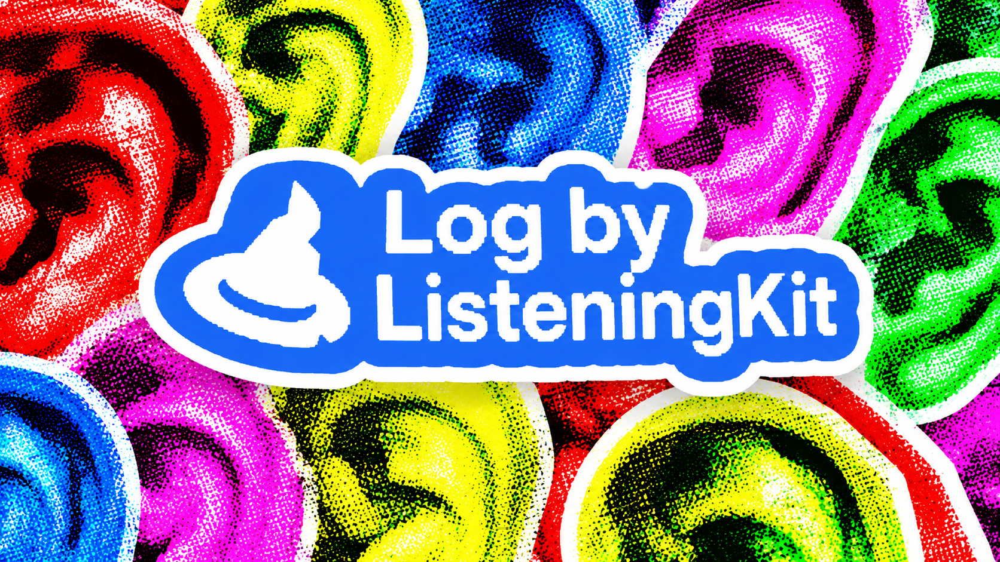
</p>

<p align="center">
  <a href="https://x.com/matthewsoldit/status/2120938715820474690"></a>
  <br><sub>Introducing log, in collaboration with Hermes Agent. <a href="https://x.com/matthewsoldit/status/2120938715820474690">Watch the launch video with sound on X →</a></sub>
</p>

<h3 align="center">One command for every social account you run.</h3>
<p align="center"><b>Read and answer X, Discord, Slack, Instagram, Reddit, LinkedIn and Facebook<br>
from your terminal, or from any agent: Claude Code, Codex, Cursor, Hermes, OpenCode, ChatGPT, Claude and Grok.</b><br>
<a href="docs/useCases/README.md">See every play, step by step →</a></p>

<p align="center">
  <a href="https://www.npmjs.com/package/@listeningkit/log"></a>
  <a href="LICENSE"></a>
  <a href="docs/mcp.md"></a>
  <a href="https://log.listeningkit.com/docs"></a>
</p>

```bash
curl -fsSL https://log.listeningkit.com/install.sh | sh
claude mcp add log -- logMcp
```

<table>
<tr>
<td width="50%" valign="middle">

### X, from your agent

*"Read my X DMs and tell me who's waiting on me."*

The old inbox and the encrypted X Chat, read as one.

</td>
<td width="50%">

```bash
log twitter dms --account <name> --waiting
```

</td>
</tr>
<tr>
<td width="50%" valign="middle">

### Discord, Slack and Instagram, live

Every new message is pushed to your agent the moment it lands.

</td>
<td width="50%">

```bash
log discord read --account <name> --channel "<chat>"
log slack read --account <name> --channel "<chat>"
log instagram dms --account <name>
```

</td>
</tr>
<tr>
<td width="50%" valign="middle">

### Answers in your own voice

Every draft is checked against how you really write to that person before it goes.

</td>
<td width="50%">

```bash
log voice --to <handle> --text "<draft>"
```

</td>
</tr>
<tr>
<td width="50%" valign="middle">

### Facebook Marketplace and groups

Listings kept live across local accounts, and groups read for people asking for a service.

</td>
<td width="50%">

```bash
log facebook listings
log facebook join group --account <name> --group <url>
```

</td>
</tr>
</table>

<p align="center">📖 <a href="https://log.listeningkit.com/docs"><b>Full documentation →</b></a></p>

log runs your social accounts from the command line, or from your AI agent. It reads DMs, group chats, replies and notifications, and it sends messages, replies, likes, follows, reactions and voice notes for you. It's one command, `log`, and one MCP server, `logMcp`, and it runs on your own machine with your own accounts. Nothing acts until you say so: every command that changes something is a dry run until you add `--live`. It's free and open source.

## Quick start

### Install

```bash
curl -fsSL https://log.listeningkit.com/install.sh | sh                        # macOS and Linux
irm https://log.listeningkit.com/install.ps1 | iex                             # Windows (PowerShell)
curl -fsSL https://log.listeningkit.com/install.sh | sh -s -- --skills all     # also every play as a skill
```

This installs the `log` and `logMcp` commands, and Python with everything the platform engines need. It writes your settings to `~/.logCli/.env`. Already have [Bun](https://bun.sh)? `bun add -g @listeningkit/log` installs just the commands. Already have log? `--skills all --skillsOnly` adds only the skills; on Windows, set `$env:LOG_SKILLS = "all"` before the PowerShell line. More: [docs/install.md](docs/install.md).

### Connect your accounts

Add the account once, sign it in, then check that the platform still accepts it:

| Platform | How to sign in |
|---|---|
| X | `log twitter cookies save --account <handle>`: paste `auth_token`, `ct0` and `twid` from a cookie-export extension |
| LinkedIn | `log linkedin cookies save --account <publicId>`: paste `li_at` and `JSESSIONID` |
| Slack | `log slack cookies save --account <name>`: paste the `d` cookie |
| Discord, Reddit, Instagram | `log localAccount add --platform <platform> --account <name>`, then `log inspect start --account <name>`, sign in by hand in the window that opens, and `log inspect do stop --account <name>` to save the session |
| Facebook | `log localAccount add --platform facebook --account <name>`, then `log facebook connect --account <name>` |

Then check it with `log <platform> session check --account <name>`, which sends nothing. The answer is `loggedIn`, `loggedOut` or `restricted`. Cookies are always typed into a masked prompt and never passed as flags. More: [docs/accounts.md](docs/accounts.md).

### Connect your agent

| Agent | How to connect |
|---|---|
| Claude Code | `claude mcp add log -- logMcp` |
| Hermes | `hermes plugins install listeningkit-log --enable`: the [log plugin for Hermes](hermesPlugin/README.md) |
| Codex, Cursor, OpenCode and other MCP clients | add `logMcp` as a stdio MCP server: [docs/mcp.md](docs/mcp.md) |
| Claude, ChatGPT and Grok, or an agent on a server | the hosted server, `https://mcp.listeningkit.com/mcp`, over OAuth |

Then ask in plain words: *"read my X DMs and tell me who's waiting on me"*. log's router names the play for that request, and the agent follows its steps. Every harness, and what each one can do: [Works in every harness](#works-in-every-harness).

## Platforms

| Platform | What log does | How it talks to the platform |
|---|---|---|
| [X](docs/platformGuides/x.md) | DMs and X Chat, notifications, followers, replies, posts, likes, follows, lists, reactions, voice notes, queues | its own API client, one session per account, no browser |
| [Discord](docs/platformGuides/discord.md) | DMs, groups and server channels, live; sends, reactions, voice notes, files | its own API client and the live gateway, no browser |
| [Slack](docs/platformGuides/slack.md) | DMs and group DMs in every workspace, live; sends, reactions, voice notes | its own API client and the live socket, no browser |
| [Instagram](docs/platforms/instagram/README.md) | DM threads, live; sends, photos, reactions, voice notes | its own API client and the realtime connection, no browser |
| [Facebook](docs/platformGuides/facebook.md) | Marketplace listings, groups, warm-up | the account's own browser, opened once a day through a proxy in its home country |
| [Reddit](docs/platformGuides/reddit.md) | session check (new) | its own API client |
| [LinkedIn](docs/platformGuides/linkedin.md) | session check (new) | its own API client |

## Highlights

- **Start from a play.** Each [use case](docs/useCases/README.md) is a workflow written step by step: what to run, and what tells you each step worked. With `--skills all`, your agent picks the right one from what you say.
- **Your voice, checked.** A draft is read against how you really write to that person, for AI phrasing and for hidden characters, before it can be sent.
- **One session per account.** Each account keeps one connection open, the way the platform's own app does, never a new one per command.
- **Live inbox.** New messages are pushed into your agent's context as they arrive, and two agents never answer the same chat.
- **Kept human.** Every account has its own daily limits, pacing and local waking hours. A refusal from the platform stops the run, and nothing is retried.
- **Your machine, your data.** Accounts and sessions stay in `~/.logCli`. Many accounts? Keep them in [Twenty](docs/twenty.md), an open-source CRM, so every machine, agent and teammate sees the same ones.

## Works in every harness

A harness is the agent app you talk to log through. log is the same MCP server in all of them, with the same tools under the same names. What changes is how log's guidance reaches the model and how new messages reach it:

| Harness | Connects | How it's told what to do | How new messages reach it | Views and sign-in |
|---|---|---|---|---|
| [Claude Code](docs/harnesses/claudeApp.md#claude-code) | local or hosted | its prompt hook runs the router on every prompt | hooks on every prompt and after every tool call | text; sign-in in the window on your screen |
| [Codex](docs/harnesses/codex.md) | local or hosted | its prompt hook | hooks on every prompt and around tool calls | text |
| [Hermes](docs/harnesses/hermes.md) | local or hosted | the `logHooks` plugin's `pre_llm_call`, before every model call | the same hook, before every model call | text, plus a **log tab** in the Hermes dashboard |
| [OpenCode](docs/harnesses/README.md) | local | its prompt hook | its plugin's hooks | text |
| [Antigravity](docs/harnesses/README.md) | local | its prompt hook | its hooks | text |
| [Cursor](docs/harnesses/cursor.md) | local or hosted | `getGuide({ ask })` (Cursor's prompt hook can't add context) | `sessionStart` and `postToolUse` hooks | MCP Apps: `report` and `browserView` inline |
| [Claude (web, desktop, mobile)](docs/harnesses/claudeApp.md) | hosted | `getGuide({ ask })` | when it asks | MCP Apps inline |
| [ChatGPT](docs/harnesses/chatgpt.md) | hosted | `getGuide({ ask })` | when it asks | MCP Apps inline |
| [Grok (xAI API)](docs/harnesses/grok.md) | hosted | `getGuide({ ask })` | when it asks | text |

The full table, written from the code (`HARNESSES` in `src/agentHooks/harness/types.ts`), with each hook's text limit and where its hooks live: [docs/harnesses](docs/harnesses/README.md).

### The log plugin for Hermes

Hermes runs all day, on your machine or a server, and talks to you on Telegram, Slack and its desktop app. The [log plugin](hermesPlugin/README.md) gives it log's tools, every play as a skill, and a log tab in its dashboard. Hermes reads freely, and every send, reply or post asks you first.

```bash
hermes plugins install listeningkit-log --enable   # from the Hermes catalog
log launch --setup                                 # pick Hermes: installs the router hook
hermes plugins enable logHooks
```

<table>
<tr>
<td width="50%">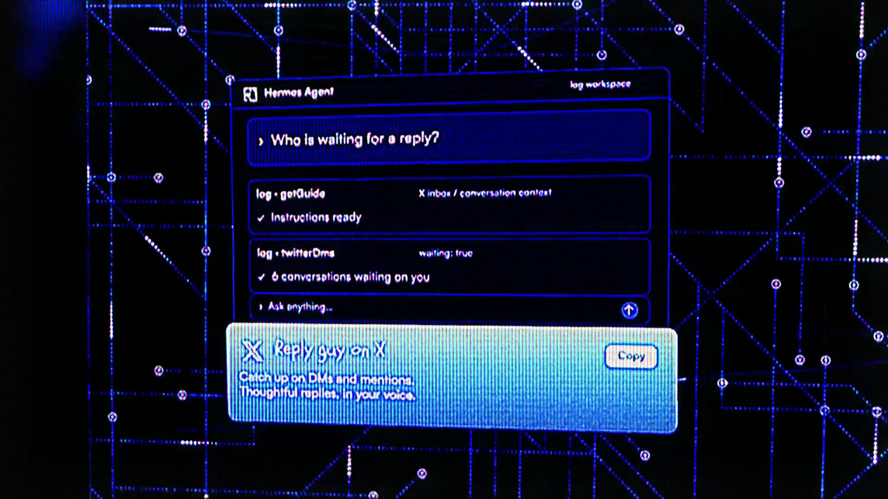</td>
<td width="50%">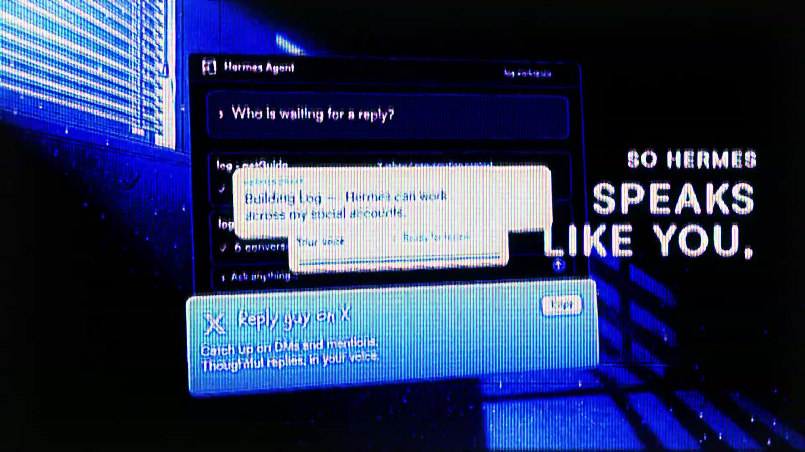</td>
</tr>
<tr>
<td><sub>Who's waiting on you, read from every inbox.</sub></td>
<td><sub>A draft in your own voice, checked before it's sent.</sub></td>
</tr>
<tr>
<td width="50%">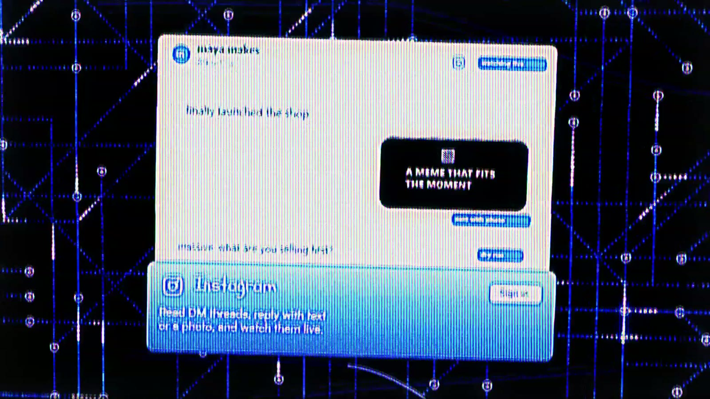</td>
<td width="50%">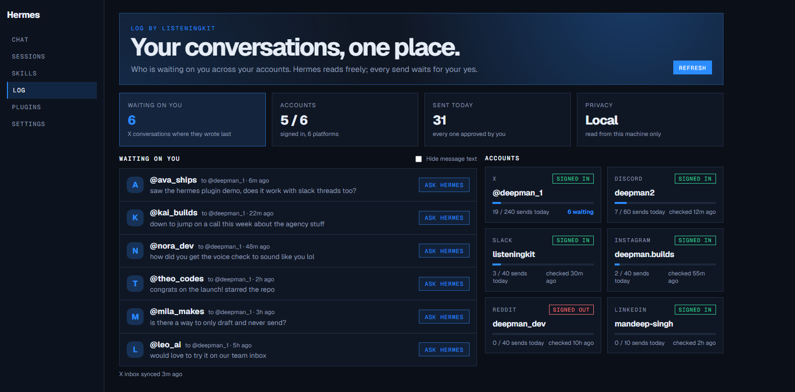</td>
</tr>
<tr>
<td><sub>Every platform you're on, each in your own session.</sub></td>
<td><sub>The log tab: who's waiting, every account's session, today's sends against its limit.</sub></td>
</tr>
</table>

### One capability, every surface

Each thing log can do has one name and works the same way from the CLI, the MCP server and the log console, on every platform. The platform is something you pass in, never a default:

- **Shared tools.** `log chats list`, `log messages read|send|react|watch` and their MCP tools (`chatsList`, `messagesRead`, `messagesSendLive`) work on X, Discord, Slack, Instagram and Facebook, the platform taken from the account.
- **One sign-in.** `log sessions signIn` (MCP: `sessionsSignIn`) opens the account's own browser, you sign in on the platform's login screen, and the session is saved only once the platform shows you signed in. A signed-out browser never overwrites a good session. `log sessions check` answers for every account at once.
- **The log console.** `log console` is the same operations as a terminal console, or as a web console on your own machine with `--web`. Every console screen has a matching command.
- **Views.** `report` draws a view from log's own data, and `browserView` shows an account's live browser in the chat, where the host draws MCP Apps. Elsewhere both come back as text.
- **Machines, not scripts.** Anything that runs over time (sign-in, a session check, each account's watcher, a send, a queue run) is a state machine, so a crash leaves no half-done state behind.

## How it works

log keeps everything it needs to answer you on your own machine, in one local database, `~/.logCli/log.db`. The platforms push what happens to it as it happens. So when you or your agent asks "what did they say?", log reads its own database in about a millisecond instead of asking the platform again, which takes seconds.

### The whole picture

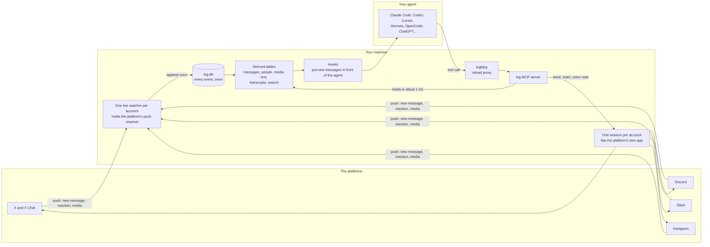

In plain words:
1. **One session per account.** Each account keeps one open session, the same way the platform's own app does. log never opens a new one for each command.
2. **One watcher per account.** It holds the platform's own push channel (X Chat's socket, Discord's gateway, Slack's socket, Instagram's realtime connection). Everything that arrives is written to `log.db` once, as an event.
3. **Everything else is worked out from those events.** That covers the chats, who said what, what a picture or video shows, what a voice note said, and the search index. The chats and messages can be rebuilt from the events at any time.
4. **Your agent asks the database, not the platform.** A tool call reads the database. The platform is only called to send something, or to catch up after a gap.
5. **Hooks push new things to your agent.** When someone writes, the agent sees it in its context straight away, without asking.

### How your agent connects, and why you never restart it

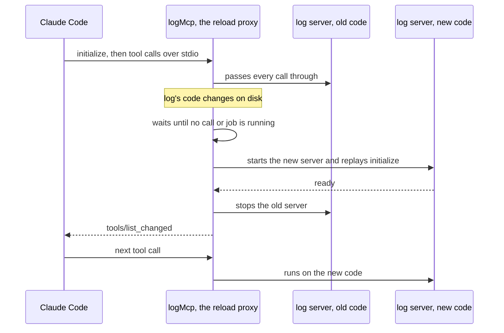

Claude Code starts `logMcp` once. `logMcp` is a small proxy that never exits, and it runs the real server as a child process. When log's code changes, it waits until nothing is running, starts the new code, and swaps it in. A long job, like a queue sending over an hour, is never cut off. Your agent keeps working without a restart. This design was picked from four open-source options by a SubQ matrix ([`docs/decisions/mcpReload`](docs/decisions/mcpReload)).

### How the router tells your agent what to do

Each [play](docs/useCases/README.md) is a workflow written step by step, with the words people use to ask for it. The router matches what you typed against every play, so the agent starts from the right steps instead of guessing:

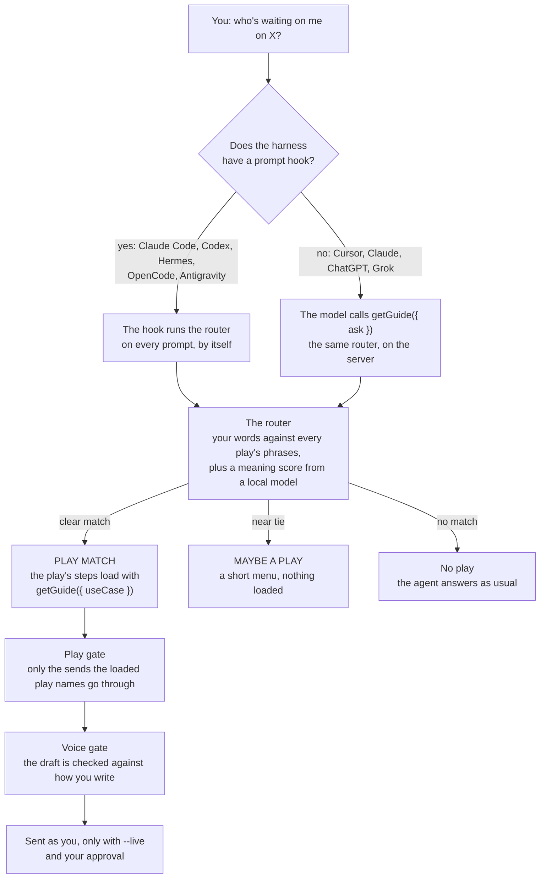

1. **The hook runs it for you.** In a harness with a prompt hook, the router runs before the model sees your message, and its answer is added to the turn. In Hermes this is the `logHooks` plugin's `pre_llm_call`.
2. **Or the model asks.** Everywhere else, the server's instructions and every tool's description tell the model to call `getGuide({ ask: "<your words>" })` first. It's the same router, so the same prompt gets the same play. A golden set of prompts checks that (`src/useCases/router/fixtures/golden.json`).
3. **Words, then meaning.** Each play lists how people ask for it. The hook's warm context service adds a meaning score from MiniLM, a small model on your machine, in about 12 ms. If the service is down, the hook falls back to the word score, so a play is still named.
4. **A clear match loads the play. A near tie doesn't.** A clear match names the play and its steps load with `getGuide({ useCase })`. A near tie shows a short menu and loads nothing. Building or fixing log itself is never a play.
5. **The play gate.** A send only goes through when the play that's loaded names it. An agent can't wander from "read my DMs" into sending.

### How notifications stream into your agent

Your agent doesn't have to ask what's new. Every account's watcher holds the platform's own push channel, and the hooks put what arrived in front of the agent before its next step:

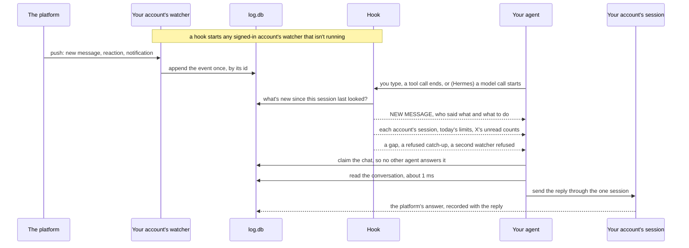

What your agent sees, added to its turn (the handles here are made up):

```text
log-cli accounts: each one's session (the platform's own answer) and what its governor allowed today:
  twitter yourHandle: session loggedIn, 19/500 requests, 0/240 writes today, its one session open
  slack yourWorkspace: session loggedIn, 3/500 requests, 0/40 writes today

>>> PLAY MATCH: the prompt matches the log play twitter/dmInbox (Reading the DM inbox: who is waiting on you).
Its steps load with getGuide({ useCase: "twitter/dmInbox" }).

>>> X LIVE: each X account's unread counts right now, from X's own ViewerBadgeCounts:
  @yourHandle: 12 notifications, 0 DMs and 0 X Chat unread

!!! GAPOPENED slack yourWorkspace: behind since its watcher restarted; it catches up through its own session, and a send that needs its context waits for that
```

- **One watcher per account.** It's the only process holding the platform's push channel (X Chat's socket, Discord's gateway, Slack's socket, Instagram's realtime connection). A second one is refused, and you're told.
- **Every session has its own cursor.** Nothing is shown twice, and nothing is missed between turns.
- **Gaps are caught up, never guessed.** When a connection drops, the watcher pulls what it missed through the account's own session, paced like a person. Until it has, a send that needs that context waits. If the platform refuses, the run stops and you're told.
- **Two agents never answer the same chat.** An agent claims a chat before it drafts, and every claim, send and release is written down in `log.db`.

### Pictures, voice notes and videos

Every model can read text, even one that can't see images. So every piece of media is turned into text when it arrives and kept in `log.db` with one small preview picture. No media file stays on disk.

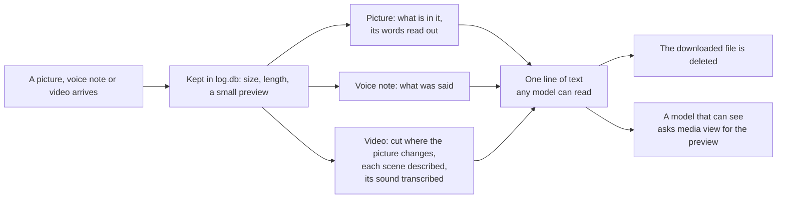

A video with someone talking reads like this:

```text
[video 0:32, 4 scenes, speech: [0:00-0:08] screen: a whiteboard that says "Q4 plan" | speech: "so this is the plan" · ...]
```

A video with no sound, like motion graphics, says `no sound` and is told by what changes on screen. This design takes the best part of three open-source systems that a SubQ matrix ranked out of 17 found on GitHub:
- [openclaw](https://github.com/openclaw/openclaw): every piece is turned into text when it arrives, with a fallback when one model fails.
- [screenpipe](https://github.com/screenpipe/screenpipe): the text rows stay and the media goes.
- [RAG-Anything](https://github.com/HKUDS/RAG-Anything): a video is told scene by scene, with the words on screen.

### The models it uses

Two models run on your own machine, with no key. Four are hosted, and each needs its key:

| Model | Runs | What it does |
|---|---|---|
| all-MiniLM-L6-v2 (23 MB) | your machine | meaning search over every conversation, your voice index, matching what you typed to a play |
| LFM2.5-VL-450M (352 MB) | your machine | describes every picture and video frame as text |
| SubQ `subq-snap-1.1` | hosted, `SUBQ_API_KEY` | the voice gate: does a draft sound like you |
| Jina embeddings v5 and reranker v3.5 | hosted, `JINA_API_KEY` | the AI tells check, and ranking a chat's history for the gate |
| AssemblyAI | hosted, `ASSEMBLYAI_API_KEY` | what was said in a voice note or a video |
| Inworld or Fish Audio | hosted, `INWORLD_API_KEY` or `FISH_API_KEY` | a voice note in your cloned voice, only when you ask |

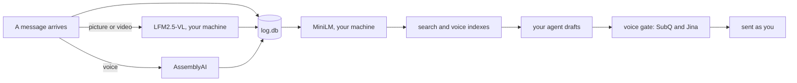

**What your machine needs,** measured here on 2026-11-09 (16 threads, CPU only):
- **A 64-bit machine.** There's no GPU: both local models run on the CPU.
- **About 2 GB of free memory.** The picture model peaked at 1.25 GB and takes 6 to 7 s a picture. It stops itself past 4 GB.
- **About 400 MB of disk** for the two models, downloaded the first time they're needed.
- **ffmpeg on your PATH** for videos and voice notes.

**Building the indexes** on a new machine, in this order:
1. `log search index` reads every conversation once and builds the keyword and meaning indexes.
2. `log voice index` builds your voice from what step 1 saved.
3. `log voice aiIndex` builds the AI tells check.

After that, new messages are added as they arrive, and pictures are described as they land.

Each model, its numbers and how each index works: [docs/models.md](docs/models.md).

### Built on Designing Data-Intensive Applications

The storage follows the ideas in Martin Kleppmann's *Designing Data-Intensive Applications* (DDIA):

| DDIA idea | What it means | Where it is in log |
|---|---|---|
| The system of record | One place holds the truth, written once | the `events` table: every message, reaction and notification, appended once by its id |
| Derived data | Everything else is worked out from the record, and can be rebuilt | chats, messages, people and who did what, checked and rebuilt from the events by `log storage verify` and `log storage rebuild`; media text and transcripts are kept beside them |
| Idempotence | Doing something twice has the same effect as once | an event is stored by its id, a transcript by its audio's hash, a media row by its message and name |
| Fencing | An old process that wakes up late can't overwrite the new one's work | each account's watcher holds a generation number, and a replaced one's writes are refused |
| Big files outside the database | Keep the bytes in a file store and only a small pointer in the database | log goes one step further: it keeps only the text and a small preview, and drops the file |

### How fast it is

Measured on this project's own `log.db` on 2026-11-08, not estimated:

| What | p50 | p95 | p99 | p99.9 | Measured with |
|---|---|---|---|---|---|
| Read a Discord chat from `log.db` (1,000 reads) | 0.6 ms | 1.1 ms | 1.6 ms | 3.1 ms | `bun scripts/inbox/benchDbRead.ts` |
| Claim a chat so no other agent answers it | 1 ms | 5 ms | 16 ms | 27 ms | `log timing` (79 claims) |
| Lock the account for one call | 0.2 ms | 0.3 ms | 0.4 ms | 0.5 ms | `log timing` (62 calls) |
| Match what you typed to a play (in the warm service) | 12 ms | 36 ms | 47 ms | n/a | `bun scripts/useCases/benchRouter.ts` |
| Read the same Discord chat from Discord itself | 2.3 s | 3.6 s | 5.1 s | 6.0 s | `log timing` (190 reads) |

That last row is why log reads its own database: asking the platform takes thousands of times longer. Sends are slower again, on purpose. Each account keeps human pacing between actions, and a refusal from a platform stops the run.

Every call is timed: `log timing` shows p50, p95 and p99 for every tool and each step inside it, and `log timing --call <id>` shows one call step by step.

### Why local first

- **Fast.** Your agent reads a conversation in milliseconds, not seconds.
- **Gentle on your accounts.** The platform isn't asked again every time your agent looks something up. One account was disabled after an agent read a server too much, too fast (rule 94), and reading from `log.db` keeps that from happening.
- **Yours.** Your messages, sessions and media text stay on your machine in one file you can back up.
- **Shareable when you need it.** Accounts can live in [Twenty](docs/twenty.md) so several machines share them. A hosted version, with a login per user, is planned.

## CLI

```bash
log --help                                        # every command
log <platform> session check --account <a>        # is the session still signed in?
log twitter dms --account <a> [--with <handle>]   # the inbox, or one person in full
log twitter dm --account <a> --userId <id> --text "<message>" [--live --approvedBy <who>]
log twitter queue build|plan|run                  # several sends, at random times
log chats list --account <a>                      # any platform: the account's chats
log messages read --account <a> --chat "<chat>"   # any platform: one chat's messages
log sessions check                                # every account, the platform's own answer
log sessions signIn --account <a>                 # sign in from the account's own browser
log console [--web]                               # the local console, in the terminal or the browser
log watchers                                      # each account's one live watcher
log discord read|send --account <a> --channel "<chat>"
log slack read|send --account <a> --channel "<chat>"
log instagram dms|send --account <a>
log voice --to <handle> --text "<draft>"          # check a draft against your voice
log search "<query>"                              # search every conversation
log inbox                                         # claim a chat, see what was done in it
```

Every command, flag, MCP tool and hook: [docs/reference.md](docs/reference.md).

## Documentation

The full docs are at **[log.listeningkit.com/docs](https://log.listeningkit.com/docs)**, built from [docs/](docs/README.md):

| Tab | What's in it |
|---|---|
| Get started | [install](docs/install.md), [add your accounts](docs/accounts.md), [connect your agent](docs/mcp.md), [each harness](docs/harnesses/README.md), [using log well](docs/usingLog.md) |
| Use cases | [the plays, step by step](docs/useCases/README.md) |
| Platforms | [X](docs/platformGuides/x.md), [Discord](docs/platformGuides/discord.md), [Slack](docs/platformGuides/slack.md), [Facebook](docs/platformGuides/facebook.md), [Reddit](docs/platformGuides/reddit.md) and [LinkedIn](docs/platformGuides/linkedin.md) |
| Reference | [every command, MCP tool and hook](docs/reference.md), [error codes](docs/errorCatalog.md), [agent guides](docs/guides) |
| How it works | [how log decides what happened](docs/howItWorks.md), [the models it uses](docs/models.md), Twenty, browsers, proxies, each platform's API and the diagrams |

Where each page sits is set in [docs/site.json](docs/site.json), and a commit check refuses a page that isn't placed.

## Development

```bash
git clone https://github.com/matthewdonsemail-lab/log
cd log
bun install    # also installs the git hooks
bun link       # puts this checkout's log and logMcp on your PATH
bun run check
```

Every commit and push runs the same checks CI does (lefthook): the docs and reference match the code, the naming and layout are right, there are no comments in code, the specs hold, and the tests pass. The rules agents work by are in [AGENTS.md](AGENTS.md).

## License

MIT

## Star history

<a href="https://star-history.com/#matthewdonsemail-lab/log&Date">
  <picture>
    <source media="(prefers-color-scheme: dark)" srcset="https://api.star-history.com/svg?repos=matthewdonsemail-lab/log&type=Date&theme=dark" />
    
  </picture>
</a>
