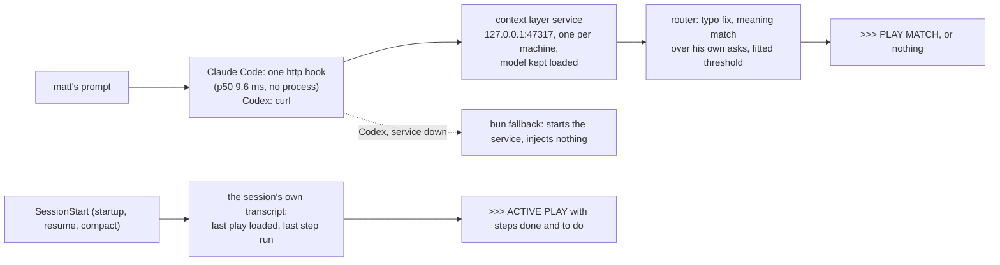

# The context layer: hook conventions

The context layer is what the agent sees before it acts: the hooks, the play that matches what matt asked for, and the play put back after a compaction. It has the same kind of conventions as [naming](namingConventions.md) and [layout](layout.md). They exist because the layer used to be built one hook at a time and nobody measured it. On 2026-11-07 it:

- matched 8% of matt's real prompts to a play, and most of those matches were wrong;
- started 8 `bun` processes on every prompt, each taking 210 to 520 ms;
- never put a play back after any of the 67 compactions in 42 sessions.

What it measures, and why: `RESEARCH/LOG_CONTEXT_AUDIT_2026_11_07.md`. How others solved it: `RESEARCH/PROMPT_ROUTERS_FOR_HOOKS_2026_11_07.md` and `RESEARCH/CLAUDE_CODE_CONTEXT_REINJECTION_2026_11_07.md`.

## How it runs

- **One service, kept warm.** `scripts/contextLayer/service.ts` (`src/contextLayer/service`) holds the embedding model and the route index, listens on `127.0.0.1:47317` (`LOG_CONTEXT_PORT`), and rebuilds itself when `docs/useCases` or the router fixtures change. A second copy exits, because the port is taken.
- **On Claude Code, every hook that only adds context is one `type: "http"` request per event to the service** (`/hooks/<event>`, `answerEvent`), and starts no process. Only the two refusing PreToolUse hooks start `bun`, directly, with no shell. On Codex, a hook on the per-prompt path is a curl to the service (`service` on its `AgentHook`, `serviceHookCommand`), with the `bun` script as the fallback after `||`. The fallback only starts the service. It never injects a guess.
- **SessionStart is the one `bun` hook a session pays for.** It starts the service if it's down, and puts the session's play back from its own transcript (`sessionPlayOf`, `playReminder`). That covers `startup`, `resume`, `clear` and `compact`.

## The conventions

1. **A hook is a provider with a contract.** It declares its event(s), its matcher, what it reads, its latency budget and its outcomes. It writes one timing line per run to `~/.logCli/contextLayer/timings.jsonl`: `event`, `provider`, `ms`, `chars` and `outcome`.
2. **Outcomes are named states, in camelCase.** A run ends in one of a fixed set. For the router these are `notAPrompt`, `trivial`, `serviceDown`, `serviceTimeout`, `none` or a play id. For the re-injection they are `noPlay` or `reinjected <play>`. A new outcome is added to the provider's types, never made up inline.
3. **Only matt's words are routed.** Task notifications, system text, compaction summaries and anything starting with `<` are `notAPrompt` (`NOT_A_PROMPT`). Before this, the router matched a research agent's report to `facebook/marketplaceListings`.
4. **Silence beats a guess.** Below the fitted threshold nothing is said. When two plays are within 0.03 of each other, both are named. The agent says which one it is following, or "none" for building or fixing the system, before it calls a tool.
5. **Budgets:**
   - per-prompt hooks: p95 under 100 ms inside the service, under 300 ms end to end;
   - SessionStart: under 1 s;
   - a provider injects at most 2,000 characters;
   - an event injects at most 4,000 in all, well under Claude Code's 10,000 cap;
   - a status line is said only when it changed.
6. **Hooks and tools read the .db, never the platform.** The owner of each account (rules 132, 135) is the only thing that reads a platform. Its push channel and its catch-up fill the .db. A hook, and a read for one person, answer from the .db. When the account is behind, they wait for the catch-up, then read the .db.
7. **Every change to the layer is benchmarked.** `bun scripts/useCases/benchRouter.ts`:
   - runs 5-fold over matt's labelled prompts (`~/.logCli/contextLayer/labelledPrompts.json`, kept on matt's machine and never committed because the repo is public, his own words with typos, 107 plays and 313 "none");
   - reports plays caught, wrong fires on "none", wrong plays and p50/p95/p99;
   - with `--fit`, writes the threshold that catches the most plays while staying under 3% wrong fires (`FALSE_FIRE_CAP`).

   A change that lowers plays caught or breaks the budgets doesn't ship.

## What moves next

On Claude Code this is done (issue #99): engines, inbox, queue, xLive, storage, pageState, knowledge and useCases all answer from the service, so a prompt or tool call costs one local http request. Measured on 2026-11-08: PostToolUse p50 8.0 ms, p99 12.2 ms, p99.9 14.3 ms (n=2000); UserPromptSubmit p50 9.6 ms, p99 15.0 ms, p99.9 17.4 ms (n=300). Before, four PostToolUse hooks through Git Bash took p50 472 ms and p99 1377 ms. A provider that reads the platform is changed to read the .db first (convention 6).
