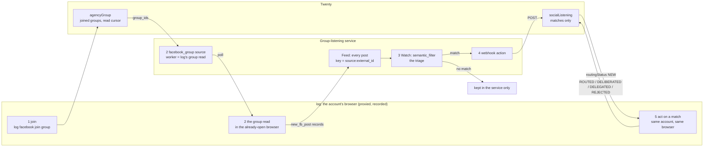

# Listening to Facebook groups

Group listening lets an account watch the Facebook groups it has joined and pick out the posts worth acting on. log joins the groups and reads them from the account's own browser; a separate group-listening service keeps every post and decides which ones match. Only the matches reach your Twenty server, so you can act on them from the same account. Read this if you want to understand how a group post goes from Facebook to a row you can act on.

This page is the current design. Where it differs from [Reading a Facebook group's posts](groupRead.md), this page wins.

## The one idea

**Everything is indexed, only the matches go on.** The group-listening service keeps every post a group shows, in its own feed. A watch there checks each post, and only the matches are sent to Twenty. log is the part that touches Facebook: it joins, reads and acts from the account's own browser. It doesn't store posts.

## The five steps

| Step | Who | What happens | Where it's kept |
|---|---|---|---|
| 1 Join | log | The account joins the group from its own browser (`log facebook join group`). | Twenty `agencyGroup`: the group on that account. |
| 2 Index | The service polls, log reads | Each poll, the service's `facebook_group` source runs its worker. The worker is log's group read: it opens the group in the account's already-open browser, scrolls, and reads the posts from the page's own responses. | **The service's feed**: every post, keyed `source:external_id`. Twenty only gets the read cursor on `agencyGroup`. |
| 3 Triage | The service | A watch's `semantic_filter` scores each post against a description of what's worth acting on. | Posts below the threshold go nowhere else. |
| 4 Deliver | The service | Its `webhook` action POSTs each match to Twenty. | Twenty `socialListening`: one row per `item.key` (`dedupeKey`), with `sourceKind` `facebook_group`, `platform` FACEBOOK, `watchId`, `actionId` and `routingStatus` NEW. |
| 5 Act | log | log reads the NEW rows, acts on each from the account that saw it, in the same browser, and moves `routingStatus` on (ROUTED, DELIBERATED, DELEGATED, REJECTED). | Twenty `socialListening`. |

**Twenty holds three things for this:** the joined groups and their read cursor (`agencyGroup`), the matches (`socialListening`), and the accounts (`socialAccounts`). Posts that didn't match are never written to Twenty.

## log's part

### Step 1: join (built)

`log facebook join group`, code in `src/facebook/group/join`, stored as an `agencyGroup` row.

### Step 2: the worker (built)

The service runs the script at `FACEBOOK_WORKER_PATH` with one JSON request on stdin, and gives up after 300 seconds.

- **Script:** `python/openMagpie/facebookWorker.py`. It calls `log facebook poll --request <request>`.
- **Input:** `{"action": "groups.search", "params": {"group_ids", "terms", "limit"}, "account_id", "cookies", "proxy"}`. The script drops `cookies`, `proxy` and `account_id`. log uses the session the account's open browser already holds, and takes the account, proxy and device from Twenty.
- **For each group:**
  1. **Pick the account.** It needs an `agencyGroup` row for the group (members first) whose account may run, is inside its active hours (never bypassed here), and has its browser open. Nothing is launched: with no open browser, that group answers an error.
  2. **Read in that browser** with the group read machine (`src/facebook/group/read/machine.ts`): open the group and scroll. It stops when the feed has shown 3 posts the cursor has already seen (about one scroll's worth), when the feed ends, or at the scroll limit (worked out from `limit`, about three posts a scroll, at most 6 scrolls). Nothing is clicked.
  3. **Answer** with every post this read saw, newest first, at most `limit`, keeping only those matching `terms` when terms are given. Repeats are fine: the service drops duplicates by `external_id`.
  4. **Move `agencyGroup.readCursor`.** Nothing else is written to Twenty.
- **What "already seen" means:** the cursor keeps the ids of the posts the latest reads saw (`seenIds`, newest first, at most 500). A post is new when its id isn't there, whatever Facebook's time on it says. So a post that goes live late with an earlier time is still caught. An old cursor saved before ids were kept is read by time once, then switches to ids.
- **Output:** `{"ok": true, "result": {"results": [record…], "errors": [{group_id, code, error}…]}, "new_cookies": []}`.
  - A record has the `NewFacebookPostPayload.from_record` shape: `external_id`, `group_id`, `content`, `url`, `author {name, id, url}`, `occurred_at`, `metrics {likes, comments, shares}`, `matched_terms`.
  - A checkpoint, login wall or video selfie is `auth_required`, which the service doesn't retry. Any other failure keeps log's own error code and is retried with backoff.
  - When no group could be answered: `{"ok": false, "code", "error"}`.
- **Checked:** the service's own `from_record` parsed the answer into `new_fb_post` / `facebook_group` items.

### Step 5: act (not built yet)

Reading NEW `socialListening` rows with `sourceKind` `facebook_group`, and acting from the account that saw the post, is its own piece of work. It needs the account for each row (the group's `agencyGroup` gives it) and an action built from a `log inspect` recording.

## What this changed

| Before | Now |
|---|---|
| The worker answered from Twenty | `log facebook poll --request` reads in the open browser on each poll, as in step 2. |
| The group read saved every post and comment to `agencyGroupPosts` / `agencyGroupComments` | It writes only `agencyGroup.readCursor`, `lastReadAt` and `lastReadReason`. |
| The host read every group on its own clock (`--groupMinutes`) | Removed: the service's poll drives the reads. |
| `log facebook read group --account --group` by hand | Kept. It prints the posts and moves the cursor, and saves no posts. |

## Decisions

1. **`agencyGroupPosts` and `agencyGroupComments`** stay in Twenty but nothing writes to them any more. Existing rows are left as they are.
2. **Comments** stay available for step 5 (reading a post's thread before acting on it). The poll never reads them. `log facebook read group` can, by hand, and saves nothing.
3. **Keyword scoring and alerts** are done as watches in the service (`semantic_filter`, `webhook`), not in log.

## Known limits

- **One browser, two callers.** The worker sends steps to the browser the account's host holds. If the host is doing its own step (a warm-up, a check) at the same moment, both act on one page. A per-account browser lock isn't built yet, so the worker should only read when the host is idle.
- **A missed poll can lose posts.** If the service fails to record an answer and more than `limit` new posts arrive before the next poll, the cursor has already moved past them.
- **Post times.** "Already seen" goes by post id, not time. Facebook's time still orders the feed, and it looks like the time a post went live: ids can run backwards against times, a couple of seconds apart, as when an admin approves a queue.
- **One extra scroll per read.** Stopping at 3 seen posts costs about one scroll beyond the first seen post.

## What the service needs on its side

- Its `facebook_group` source, with the worker contract above written down.
- A way to swap the worker by plugin (an entry point or `OPENMAGPIE_PLUGIN_HOOKS`), not only a sibling checkout.
- `NewFacebookPostPayload` carrying the author's id. Today `from_record` keeps only the author's name, which step 5 can't act on alone.

The rules behind this are in AGENTS.md.
