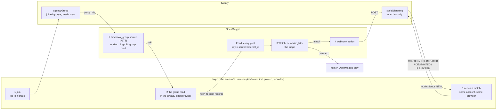

# Facebook group listening: the spec (from obris-dev/openmagpie#188)

Status: **approved by matt, 2026-10-22** (his four decisions below). It is rule 65, which replaces rules 61 and 62, and it wins over `docs/groupRead.md` where they differ.

Source: matt's issue [obris-dev/openmagpie#188](https://github.com/obris-dev/openmagpie/issues/188), "Facebook group listening as a triage job: an account joins, OpenMagpie indexes and triages, matches are acted on from the same account". On log-cli's side it is [#27](https://github.com/matthewdonsemail-lab/log-cli/issues/27), built in [PR #30](https://github.com/matthewdonsemail-lab/log-cli/pull/30).

## The one idea

**Everything is indexed, only the matches go on.** OpenMagpie keeps every post a group shows, in its own feed. A watch triages each one, and only the matches reach Twenty. log-cli is the Facebook group capability. It joins, reads and acts from the account's own browser, and it doesn't store posts.

## The five steps

| Step | Who | What | Where it's kept |
|---|---|---|---|
| 1 Join | log-cli | The account joins the group from its own browser (`log facebook join group`). | Twenty `agencyGroup`: the group on that account. |
| 2 Index | OpenMagpie polls, log-cli reads | Each poll cycle, the `facebook_group` source (#178) runs its worker. The worker is log-cli's group read: it opens the group in the account's already-open browser, scrolls, and reads the posts from the page's own responses. It answers with post records. | **OpenMagpie's feed**, every post, keyed `source:external_id`. Twenty: only the read cursor on `agencyGroup`. |
| 3 Triage | OpenMagpie | A Watch's `semantic_filter` scores each post against our description of what's worth acting on and gates the chain. | Below the threshold: nowhere else. |
| 4 Deliver | OpenMagpie | The `webhook` action POSTs each match to the intake that already takes the X connector's matches. | Twenty `socialListening`: one row per `item.key` (`dedupeKey`), `sourceKind` `facebook_group`, `platform` FACEBOOK, `watchId`, `actionId`, `routingStatus` NEW. |
| 5 Act | log-cli | log-cli reads the NEW rows, acts on each from the account that saw it, in the same browser, and moves `routingStatus` on (ROUTED, DELIBERATED, DELEGATED, REJECTED). | Twenty `socialListening`. |

**Twenty holds three things for this:** the joined groups and their read cursor (`agencyGroup`), the matches (`socialListening`), and the accounts as always (`socialAccounts`, rule 13). Posts that didn't match are never written to Twenty.

## log-cli's part

### Step 1: join (built)

`log facebook join group`, `src/facebook/group/join`, `agencyGroup` (rule 45). No change.

### Step 2: the worker (built, to be put back to this)

OpenMagpie's connector runs `FACEBOOK_WORKER_PATH` with one JSON request on stdin and gives up after 300 s.

- **Path:** `python/openMagpie/facebookWorker.py`, which calls `log facebook poll --request <request>` (rule 63).
- **In:** `{"action": "groups.search", "params": {"group_ids", "terms", "limit"}, "account_id", "cookies", "proxy"}`. #188 lists "the session" as an input. In log-cli the session is the one the account's open browser already holds, and the account, proxy and device come from Twenty (rules 12, 13, 35). So `cookies`, `proxy` and `account_id` are dropped by the script.
- **Per group:**
  1. Pick the account: an `agencyGroup` row for the group (a MEMBER first) whose account may run, is inside its hours (rule 18, never bypassed), and has its browser open (rule 35). No launch: without an open browser the group answers an error.
  2. Read in that browser with the group read machine (`src/facebook/group/read/machine.ts`): open the group and scroll. It stops when the feed has shown 3 posts the cursor has already seen (about one scroll's worth), when the feed ends, or at the scroll limit (from `limit`, about three posts a scroll, at most 6). Nothing is clicked (rule 8).
  3. Answer every post this read saw, newest first, at most `limit`, those matching `terms` when there are any. Repeats are fine: OpenMagpie's `external_id` dedup absorbs them.
  4. Move `agencyGroup.readCursor`. Nothing else is written to Twenty.
- **What "already seen" means:** the cursor keeps the ids of the posts the latest reads saw (`seenIds`, newest first, at most 500). A post is new when its id isn't there, whatever Facebook's time on it says. So a post that goes live late with an earlier time is still read. A new post between seen ones is still caught by its id; only the scrolling stops. A cursor written before the ids were kept (this morning's, on Bethlehem's group) is read by the time rule once, then keeps ids.
- **Out:** `{"ok": true, "result": {"results": [record…], "errors": [{group_id, code, error}…]}, "new_cookies": []}`. A record is `NewFacebookPostPayload.from_record`'s shape: `external_id`, `group_id`, `content`, `url`, `author {name, id, url}`, `occurred_at`, `metrics {likes, comments, shares}`, `matched_terms`. A checkpoint, a login wall or a video selfie is `auth_required` (OpenMagpie doesn't retry it). Any other failure keeps log-cli's own code (retried with backoff). `{"ok": false, "code", "error"}` when no group could be answered.
- **Checked already** (the first worker, 155dd56): OpenMagpie's own `from_record` (PR #178) parsed the answer into `new_fb_post` / `facebook_group` items.

### Step 5: act (not built)

Reading `socialListening` NEW rows with `sourceKind` `facebook_group` and acting from the account that saw the post is its own piece of work. It needs the account per row (the group's `agencyGroup` gives it) and an action built from a recording (rule 29). Out of this change.

## What changes in the code (after approval)

| Today | Becomes |
|---|---|
| The worker answered from Twenty (4f70c1c) | `log facebook poll --request` reads in the open browser per poll, as in step 2 (done with rule 63); the read still saves posts to Twenty until this spec is approved. |
| The group read saves every post and comment to `agencyGroupPosts` / `agencyGroupComments` (`saveRead`) | It writes only `agencyGroup.readCursor`, `lastReadAt` and `lastReadReason`. |
| The host reads every group on its own clock (rule 62, `--groupMinutes`) | Removed: OpenMagpie's poll drives the reads. |
| `log facebook read group --account --group` (by hand) | Kept, for reading a group by hand. It prints the posts and moves the cursor, and saves no posts. |
| Rules 61 and 62 | Replaced by one rule pointing here (needs matt: rules are never deleted without him). |

## Decided by matt (2026-10-22)

1. **Rules 61 and 62** are replaced by this spec, as rule 65. They stay in AGENTS.md, marked as replaced.
2. **`agencyGroupPosts` and `agencyGroupComments`** stay in Twenty, unused: nothing writes to them any more. Their 24 rows from 2026-10-22 stay as they are.
3. **Comments** are kept as a capability for step 5 (reading a post's thread before acting on it). The poll never reads them; `log facebook read group` by hand can, and saves nothing.
4. **#28** (keywords, intent scoring and alerts): its scoring and alerts become OpenMagpie watches (`semantic_filter`, `webhook`), as in #188.

## Known limits

- **One browser, two callers.** The worker sends steps to the browser the account's host holds. If the host is doing its own step (a warm-up, a check) at the same moment, both act on one page. #22 lists Listaro's per-account browser lock as "not yet". Until it's built, the worker should only read when the host is idle.
- **A missed poll can lose posts.** If OpenMagpie fails to record an answer and more than `limit` new posts arrive before the next poll, the cursor has already moved past them.
- **Post times.** "Already seen" goes by post id, not time (above). Facebook's time still orders the feed, and it looks like the time a post went live: in this morning's run the ids ran backwards against the times, about 2 s apart, like an admin approving a queue.
- **One more scroll per read.** Stopping at 3 seen posts costs about one scroll beyond the first already-seen post.

## On OpenMagpie's side (#188's "What this needs here", not log-cli's)

- #178 merged, with its worker contract written down.
- The worker swappable by plugin (an entry point or `OPENMAGPIE_PLUGIN_HOOKS`), not only the sibling `facebook-worker.py` checkout.
- `NewFacebookPostPayload` carrying the author's id. Today `from_record` keeps the author's name only, which step 5 can't act on alone.
