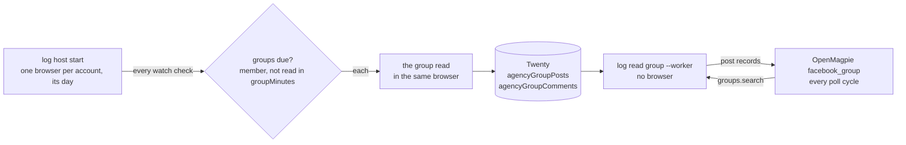

# Reading a Facebook group's posts (issue #27)

Status: **steps 1-7 built** (2026-10-22): recorded and documented (1-3b, 2026-10-20), then Twenty, the machine, `log read group` and its tests (4-7); not yet run live end to end. This file is the plan, kept up to date as each step is built. Issue: [#27](https://github.com/matthewdonsemail-lab/log-cli/issues/27), part of the epic [#22](https://github.com/matthewdonsemail-lab/log-cli/issues/22).

log-cli already joins a group and answers its questions (`src/group/join`, `src/group/answer`, rule 45), and keeps each group in Twenty as an `agencyGroup`. This adds reading the posts of a group an account is in.

## What it ports, and how

facebook-camofox-client built group listening first (pinned links in #27). It got the approach right, and we keep it:

| facebook-camofox-client | What it does | In log-cli |
|---|---|---|
| `domain_extraction/response_capture.py` | Reads the page's own responses while it scrolls, never calls Facebook's GraphQL itself | Every step already records every response in its own HAR (rule 22); the posts are read from that recording, so there is no second listener |
| `domain_extraction/post_extractor.py` | Posts out of the page's embedded Relay JSON, kept only with a `post_id`, the expected group and a `creation_time` | The same rules, in TypeScript, on the step's HAR and the first page's HTML, tested on a recorded run |
| `domain_records/normalization.py` | A post with no id or the wrong group is rejected, never filled in with made-up values | The same |
| `domain_posts/listen.py`, `domain_cursors/*` | A cursor per group (last post id and a time watermark): each read yields only new posts; posts are saved before the cursor moves | The same, the cursor on the `agencyGroup` in Twenty |
| `scripts/listen_group.py`, `listen_continuous.py` | Scroll a group, poll several | A flow from a recording, run as an XState machine in the account's open browser |

What changes is how it runs: on the account's browser through the driver, AdsPower first (rule 59), in the browser kept open for the day (rule 35), every step recorded and read with rea (rules 22, 25, 29), and every command a CLI command, an MCP tool and hooked (rules 55, 56).

## Steps

1. **Record a group read.** Done: `log inspect` (through the `log` MCP) on Bethlehem in "Recommendations of Bethlehem, PA and Greater Lehigh Valley Region" (4191018610937243), run `20261020T134155`: open the group, snapshot, three scrolls, every step's HAR read by rea. Read-only, no `--live`.
2. **Document what Facebook sends.** Done (`log capture --docs`): [`GroupsCometFeedRegularStoriesPaginationQuery`](platforms/facebook/groups/GroupsCometFeedRegularStoriesPaginationQuery.md), `doc_id 28956948070566246`. One query is the whole feed: on load and on scroll, `count: 3`, `CHRONOLOGICAL`, `DISCUSSION`, the group's `id` and a `cursor` whose position moves 2, 5, 8. Its answer is streamed (4-10 JSON chunks) and holds, per post: `post_id`, the group's id, `creation_time`, the author (`actors`), the text (`message.text`), the permalink, the `feedback` id, and the next `end_cursor` / `has_next_page`. The first 2 posts come embedded in the group page's HTML (2.3 MB), which the HAR now keeps whole (`MAX_DOCUMENT_BODY`).
3. **Read the posts from the recording.** Done for the feed query: `src/group/read` (`postsFromFeedResponse`, `feedResponses`, `newPosts`). It reads the streamed chunks (the first unit under `group_feed.edges`, each `$stream` chunk's `node`, the deferred `page_info`), keeps a post only with its `post_id`, its group (`target_group.id`, this group only) and `creation_time`, and counts every rejection; the cursor keeps only posts newer than the last read. On run `20261020T134155`: 9 posts over 3 pages, none rejected, each with its author, permalink and feedback id (text on 6: the rest are photo or shared posts). The page's own first posts are read from its HTML (`postsFromGroupPage`), recorded whole since `MAX_DOCUMENT_BODY`: its JSON script blocks carry the same chunk shapes, the feed under `data.group` instead of `data.node`, and the page starts with a "New posts" `GroupsSectionHeaderUnit`, which is skipped and counted (`skipped`), not rejected. Posts can share a second, so the cursor keeps every id at its watermark (`idsAtWatermark`). On run `20261020T143506` (load, a snapshot, three scrolls): 13 posts, 1 from the HTML and 12 over 4 feed pages, none rejected, newest first throughout; a second read with the cursor keeps 0.
3b. **Read the comments.** Done: `src/group/read` (`commentsFromResponse`, `commentsFromPostPage`, `commentResponses`, `COMMENT_QUERIES`), recorded live on run `20261020T151100` (matt: "I need to see the comments as well"). A post's comments come from three requests and the post's own page: opening the post (`CometSinglePostDialogContentQuery`), its page by link (`/groups/<id>/permalink/<post>/`, the first comments in its HTML), the sort switched to Newest (`CommentListComponentsRootQuery`, `commentsIntentToken: REVERSE_CHRONOLOGICAL_UNFILTERED_INTENT_V1`) and the dialog scrolled (`CommentsListComponentsPaginationQuery`, with `commentsAfterCursor`). The page shows "Most relevant" first, which hides some: Newest shows every comment but potential spam ("All comments" adds that). A comment is kept only with its `legacy_fbid`, its post (its relay id decodes to `comment:<postId>_<commentId>`), its group (`group_comment_info.group.id`, this group only) and `created_time`; a reply's parent is `comment_direct_parent`, and a reply's parent stub (`parent_object_ent`, no `legacy_fbid`) is never a comment. On the run: the post "Looking for someone to shovel snow…" has 16 comments by Facebook's count; 10 in its HTML (Most relevant), 10 on Newest and 5 more on scrolling, 15 distinct, none rejected, each with its author (one anonymous), link and time. Clicking the sort is a click (`--live`, matt asked); nothing was typed, reacted to or sent.
4. **Twenty.** Done (matt, 2026-10-22: objects of their own, Facebook groups only). `scripts/twenty/twentySetup.mjs --apply` added, and nothing else changed (rule 13):
   - on `agencyGroup`: `readCursor` (`{ lastPostId, watermark, idsAtWatermark }`), `lastReadAt`, `lastReadReason`;
   - `agencyGroupPost`, on its `agencyGroup` row: `facebookPostId` (the key, with the row), `facebookGroupId`, the author (`authorName`, `authorFacebookId`, `authorUrl`), `text`, `permalink`, `feedbackId`, `postedAt`, `commentCount` (the feed's count at the last read), `commentsReadAt` and `commentsReadCount` (the count when its comments were last read);
   - `agencyGroupComment`, on its `agencyGroupPost`: `facebookCommentId` (the key, with the post), `facebookPostId`, `parentCommentId` and `depth` (a reply), the author (with `authorAnonymous`), `text`, `permalink`, `feedbackId`, `commentedAt`, `replyCount`.
   The generated client is regenerated (`bun run twenty:client`), and `src/group/read/client.ts` reads and writes them: `readStateOf` before a read, `saveRead` after it.
5. **The machine.** Done: `groupReadMachine` (`src/group/read/machine.ts`, XState, rule 6), its one side effect the step in the account's open browser:
   - `opening`: goto the group; the first posts from its HTML, and the group's numeric id when it was given by name (`groupIdFromStep`).
   - `scrolling`: `scroll 2 700`, as recorded, until the last read's posts show (`reachedCursor`), the feed ends (`has_next_page: false`) or `--scrolls` run out. If the scrolls run out first, the output says so (`gap`).
   - `settled`: `newPosts` gives the new posts and the cursor after them. The posts whose comments are read are the ones whose feed count grew since their comments were last read (`commentTargets`), at most `--commentPosts`. Each unit's count comes from `comment_rendering_instance.comments.total_count`; on run `20261020T143506`, the snow post showed 15, which matches the 15 its comments gave.
   - Per post: goto its page (`/groups/<id>/permalink/<post>/`, the first comments in its HTML); with `--live`, "Most relevant" then "Newest" (the recorded menu item); then `scrollIn` its dialog ("<author>'s post") while Facebook says there are more, 4 scrolls at most.
   - A checkpoint or a login stops the read. A failed step on a post only ends that post's comments: they are not marked read, so the next read opens it again.
   The flows recorded on 2026-10-20 (`groupPostComments`, `groupPostDialog`) stay as they are: the read machine sends the same steps itself, so that it can decide between them from what each step's HAR held.
6. **The command.** Done: `log read group --account <a> --group <url|id> [--scrolls <n>] [--commentPosts <n>] [--live] [--bypass] [--json]`, and `--show` to read what Twenty holds (`src/cli/read`). `platform: "facebook"`. It refuses without the account's open browser (`groupBrowserNotOpen`) and outside its hours (rule 18). It is an MCP tool (`read`, a long run: watch its live log) with rules 8, 13, 18, 20, 22, 25, 26, 29, 35, 45 and 61, and it is in the generated README.
7. **Tests.** Done: `src/group/read/readMachine.test.ts` covers a first read, reaching the cursor, a gap, a checkpoint, `--live` with a failed post, the comment targets, and saving to Twenty twice (the second adds nothing, and a stopped read leaves the cursor). `src/cli/read/read.test.ts` covers the command end to end with the step folders' HARs. Every lefthook gate passes.

## The firehose (matt, 2026-10-22, rule 62)

log-cli reads the groups on its own; nothing has to ask it.



- **The host fills Twenty.** `log host start --account <a>` keeps the account's browser open for its day (rule 35). Each watch check (`--watchMinutes`, default 12) reads, one after another, every group the account is a member of whose last read is older than `--groupMinutes` (default 60; 0 reads none), the longest-unread first. It is the same read as `log read group` (`readGroupOnce`): new posts since the cursor, and the comments of posts whose count grew, nothing clicked. Most reads stop on the group's own page, where the last read's posts already show, so a read that finds nothing new costs one page load. A checkpoint or a sign-out on a group page is the account's issue (the lifecycle's issue router); a group that fails otherwise is tried again at the next check.
- **Everything else reads Twenty.** Nothing downstream drives a browser.

## OpenMagpie's worker (obris-dev/openmagpie#178, #188)

OpenMagpie's `facebook_group` source runs the script at `FACEBOOK_WORKER_PATH` once per poll cycle, with one JSON request on stdin, and gives up after 300 s. log-cli answers it from Twenty, at once:

```
FACEBOOK_WORKER_PATH=<log-cli>/python/openMagpie/facebookWorker.py
```

- **In:** `{"action": "groups.search", "params": {"group_ids": [...], "terms": [...], "limit": 20}, "account_id", "cookies", "proxy"}`. The script passes only `action` and `params` on to `log read group --worker <request>`. OpenMagpie's cookies, proxy and account are dropped (rules 12, 13, 35).
- **Per group:** the posts of every account in it (its `agencyGroups` rows), each once, newest first, at most `limit`, those matching a term when terms are given. OpenMagpie's watermark and `external_id` dedup drop what it already has. No browser opens.
- **Out:** `{"ok": true, "result": {"results": [record…], "errors": [{group_id, code, error}…]}, "new_cookies": []}`. A record is `NewFacebookPostPayload.from_record`'s shape: `external_id`, `group_id`, `content`, `url`, `author {name, id, url}`, `occurred_at`, `metrics {likes: null, comments, shares: null}`, `matched_terms`. `errors` names a group no account is in (`groupNoAccount`), one no host has read yet (`groupNotReadYet`) and one not read for 3 hours (`groupReadStale`: is its host running?). When no group asked for is in Twenty: `{"ok": false, "code", "error"}`.
- **Checked** (2026-10-22, while the worker still read in the browser): the script run with OpenMagpie's request against live Twenty, and its answer fed through OpenMagpie's own `NewFacebookPostPayload.from_record` (PR #178's `payloads.py`). It gave `new_fb_post` items from `facebook_group` with source slug 4191018610937243 and terms matched ("trash" gives the trash post with its 16 comments). The answer's shape is the same now.

## Next

- **A live run on Bethlehem** in "Recommendations of Bethlehem, PA" (`log inspect start --account <Bethlehem> --detach`, then `log read group`). Read its steps with rea before changing anything (rule 25).
- OpenMagpie on node01 calling this worker: it needs log-cli where OpenMagpie runs, or the worker reaching the Twenty the hosts fill. Since the worker only reads Twenty, it no longer needs the browser server.
- A host running live with its groups (it has run with the warm-up only so far).

## Decided by matt (2026-10-22)

- **Where the posts live in Twenty:** objects of their own for Facebook groups (`agencyGroupPost`, `agencyGroupComment`), not one posts object across platforms.
- **The command's name:** `log read group`.
- **How much a read covers:** the comments too (matt, 2026-10-20).

## Depends on

- [#21](https://github.com/matthewdonsemail-lab/log-cli/pull/21): `Command.platform`, which every new command declares. This branch is built on it.
