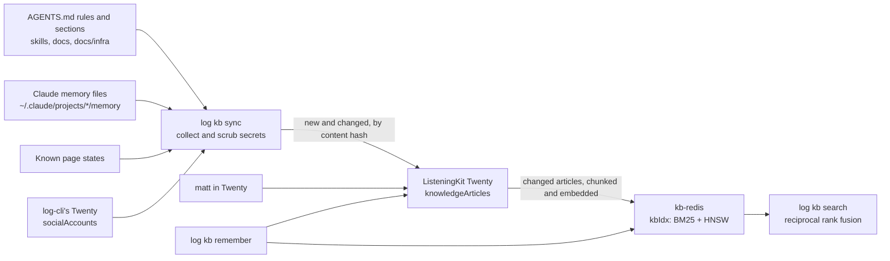

# Knowledge base

`log kb` keeps everything log-cli knows in one place that people and agents
both use (rule 90). ListeningKit's Twenty on node02 holds the articles, so
matt can read and edit them there. A Redis 8 on node02 searches them for
agents in milliseconds.

## Commands

| Command | What it does |
| --- | --- |
| `log kb search "<query>" [--kind <kind>] [--limit <n>]` | The best articles for the query, keyword (BM25) and meaning (HNSW over all-MiniLM-L6-v2) fused with reciprocal rank fusion, each article once |
| `log kb show <key>` | One article in full, from Twenty |
| `log kb remember "<text>" [--title] [--tags]` | Saves a note to Twenty and Redis at once |
| `log kb sync [--noAccounts]` | Collects every source, writes what changed to Twenty, re-indexes what changed into Redis |

Kinds: `rule`, `section`, `skill`, `doc`, `infra`, `memory`, `pageState`,
`account`, `note`. The skill `skills/knowledgeBase/SKILL.md` says where each
comes from.

## Where it runs

| Part | Where | Reached from log-cli |
| --- | --- | --- |
| Articles | Twenty v2.49.0 on node02, workspace ListeningKit, object `knowledgeArticles` | `https://node02.tail4fcf85.ts.net` (Tailscale Serve, tailnet only) with the API key in `~/.config/listeningkit/twenty-listeningkit-api-key.txt` |
| Search index | `kb-redis` on node02, `redis:8.2.11` with the search and JSON modules, append-only file on | `node02.tail4fcf85.ts.net:6380` (Tailscale Serve TCP) with the URL in `~/.config/listeningkit/kb-redis-url.txt` |
| Embeddings | this machine, `Xenova/all-MiniLM-L6-v2` (384 dimensions), the same model `log search` uses | local |

The public `twenty.listeningkit.com` sits behind nginx Basic Auth, which uses
the same `Authorization` header as Twenty's API key, so log-cli always goes
over the tailnet. node02's services and its logins are in
`docs/infra/node02.md`.

## Secrets

Nothing secret is written. Every body goes through `scrubSecrets` first:
named keys (`password=`, `token:`, `apiKey=`, `pin:`…), URLs with a login,
JWTs, private keys, and any long random string that mixes letters and digits
become `<redacted>`. `docs/vendors` is never collected. Accounts carry their
status and setup only: no cookies, proxy URL, device, email, password or 2FA
secret.

## Limits

- Twenty allows 100 API requests a minute. New articles go in batches of 60;
  a 429 waits a minute and retries.
- Redis keeps only the index: if `kb-redis` is lost, `log kb sync` rebuilds it
  from Twenty.
