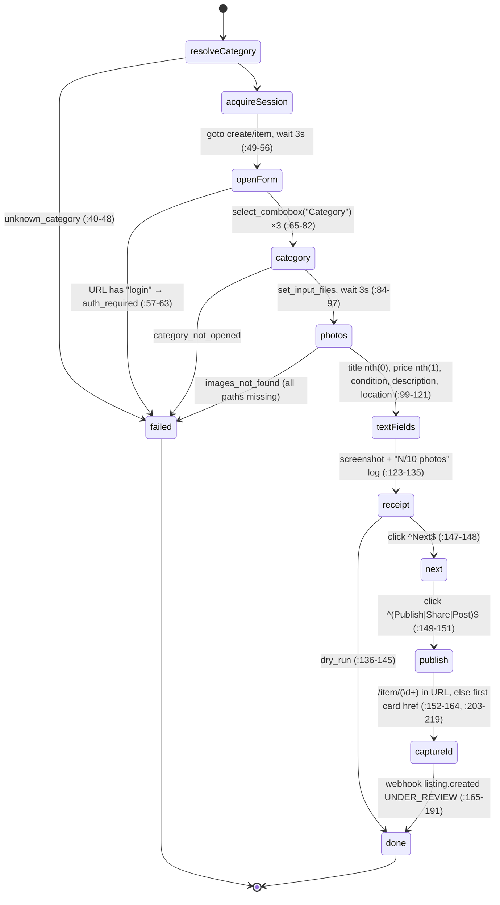
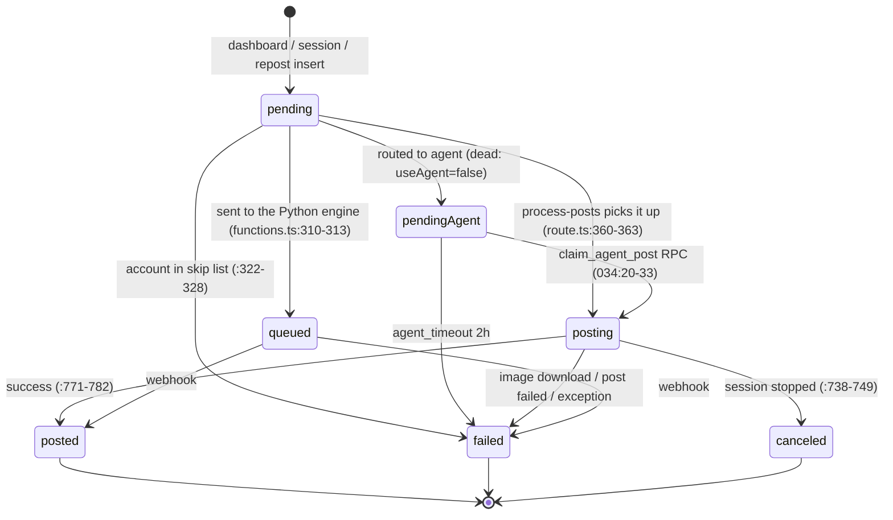
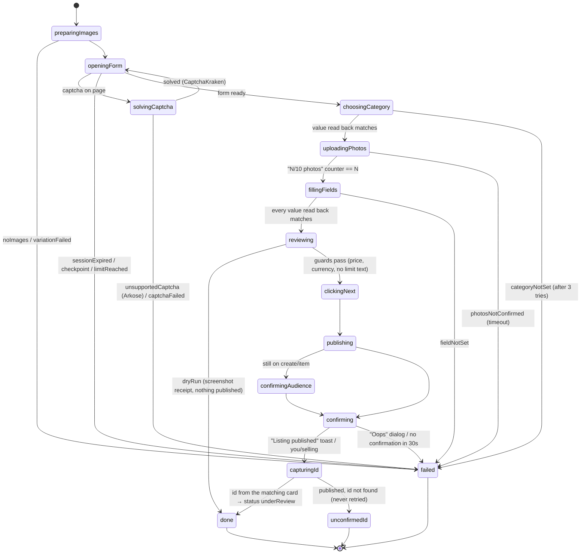

# The publish state machine

Posting a listing is a series of steps that can each fail: opening the form, picking a category, uploading photos, filling fields, publishing, and finding the new listing's id. This page writes out how each earlier project handled those steps, then the state machine log was designed from. Read it if you're changing `log facebook publish` or want to know why a publish stops where it does.

None of the three earlier projects had a real state machine for **posting**:

- **The Camoufox client:** create is one straight-line async function with early returns (`domain_marketplace/create.py:1-5`, `:40-201`).
- **The production poster:** posting is one 1,500-line function with chains of try-and-fall-back (`facebook-poster.ts:974-2443`). Its only machine is a status column in the database.
- **The dashboard:** its status machine starts *after* publishing (`underReview` and so on) and never touches a browser (`apps/web/src/lib/listings/machine.ts`, ported to `src/marketplace/listing/machine.ts`).

## 1. The Camoufox client: `MarketplaceCreateAction`

The session is released in `finally` (`:193-201`).

The **spike script** (`spike_marketplace_e2e.py`) is the run that published for real (`docs/okf/marketplace_create.md:47-49`). It adds steps that `create.py` is missing:

| Spike step | Where | Why it matters |
| --- | --- | --- |
| Check the Category value before and after setting it | `:303-312` | Facebook restores a saved draft, which can undo the choice. |
| Wait up to 15 s for `1/10` photos | `:329` | The only real proof the upload landed. |
| Read every input back; fall back to `fill` plus an `input` event | `:54-60` | Typed text can be dropped. |
| Pick the location from the listbox options | `:357-368` | `create.py` presses ArrowDown+Enter blind. |
| A second `Publish|Share|Post|Done` click on the audience step | `:388-397` | Without it the listing sits unpublished on `create/item`. |
| Open the matching `you/selling` card to read its id | `:232-283`, `:402-404` | Gets the id of *this* listing, not just the first card on the page. |

## 2. The production poster: a status column

The production poster's posting machine is a status column on its scheduled posts. Allowed values: `pending, queued, posting, posted, failed, canceled, pending_agent` (`031_desktop_agent.sql:21-23`).

(`route.ts` is `src/app/api/process-posts/route.ts`. `pendingAgent` is `pending_agent` in the database.)

How a post's result changed the account's status (`process-posts/route.ts`):

| Result | Account status | Line |
| --- | --- | --- |
| Success | `active` | `:793-801` |
| Identity check | `needsVerification` | `:857-864` |
| Daily limit text | `limited` (resets itself after 24 h, `:164-173`) | `:878-885` |
| "Oops / Something went wrong" | `limited` | `:987-994` |
| Login text | `needsRelogin` | `:955-962` |

Inside `postToFacebookMarketplace` the steps run in this fixed order (`facebook-poster.ts` line numbers; details in [The create form](formFill.md)):

1. Connect to AdsPower (1011).
2. Go to `create/item?locale=en_US` (1048); stop on a login or checkpoint URL (1081).
3. Force English (1092), close popups (1113), click "Item for sale" (1118), stop on daily-limit text (1159).
4. Wait for the Title input (1201).
5. Photos (1240), title (1293), price (1367), category (1489), condition (1551), description (1593), location (1778), hide from friends (1927).
6. Next, up to 3 pages (1982-2119); skip Boost (2125).
7. Check price and currency before publishing (2192).
8. Publish, up to 4 clicks (2243); check for "Oops" (2379).
9. Wait 8 s for a `/marketplace/item/` URL (2420), then report success with or without a URL (2432).

## 3. The dashboard: what happens after publishing

`apps/web/src/lib/listings/machine.ts`, ported to `src/marketplace/listing/machine.ts`. A new listing starts at `underReview` (`server.ts:114-131`). After that only the platform moves it: `underReview → active | underReviewDuplicate | removed`. The Camoufox client's webhook also sends `status: UNDER_REVIEW` after publishing (`create.py:165-191`), so both agree on where a fresh listing starts.

## 4. The machine log runs

This is the design `log facebook publish` was built from. It takes the spike's proven steps, the production poster's checks and photo variation, and the dashboard's starting status, and closes the gaps. File: `src/marketplace/publish/machine.ts` (XState v5, in the same style as `marketplace/monitor/machine.ts`). Every browser step is an actor the caller supplies with `machine.provide`, so tests never open a browser.

> The machine as built, with every error code and where it ends, is generated in the [error catalog](../errorCatalog.md) (`log graph publish`, `log errors`). The diagram below is the design.

What the machine guarantees, and where each guarantee comes from:

1. **Every value is read back.** Category, photo count, title, price and location must read back correctly before the next state (spike `:54-60`, `:303-312`, `:329`). Both earlier browser projects carried on after failures, which is how listings went out wrong.
2. **Photos wait for Facebook's counter**, not a fixed delay. See [Image pipeline](imagePipeline.md).
3. **A dry run stops at `reviewing`** with a screenshot receipt, like the Camoufox client's `dry_run`. A dry run still uploads photos and Facebook keeps a draft (spike `:307`), so it isn't entirely free of side effects.
4. **No automatic retry after `publishing`.** The production poster's desktop agent re-ran a failed post once (`agent/src/poll-loop.ts:79-83`); when Publish had actually gone through, that made duplicates. Once Publish is clicked, the machine only goes forward. `unconfirmedId` is for a person to check.
5. **The id comes from the card whose title matches**, never "the first `/marketplace/item/` link" (the Camoufox client's `create.py:203-219` and the desktop agent's `poster.ts:1270-1321` both got this wrong).
6. **Account issues stop the machine.** `checkpointed`, `rateLimited`, `sessionExpired` and every other `account` code in the error catalog end the run in `blocked`. Accounts with a `WRITE_BLOCKING_ISSUES` issue never start a publish.
7. **One publish per account at a time.** The production poster's per-account browser lock force-released after 3 minutes while a post can take 5 (`browser-lock.ts:26`). log's lock must last as long as the machine runs.
