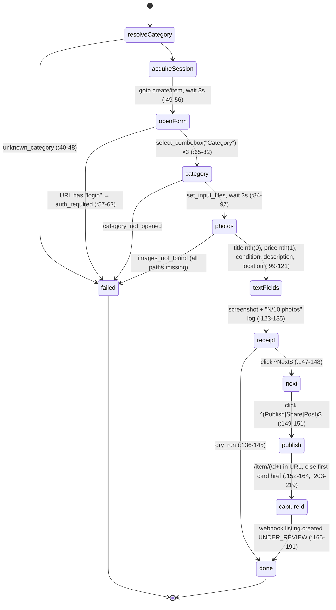
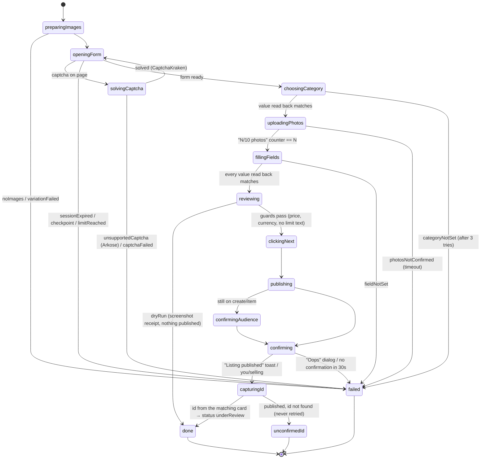

# The publish state machine

None of the three sources has a real state machine for **posting**:

- **FCC:** create is a straight-line async function with early-return exits
  (`domain_marketplace/create.py:1-5`, `:40-201`).
- **Listaro:** posting is one 1,500-line function with try/fallback chains
  (`src/lib/poster/facebook-poster.ts:974-2443`). The only machine is the
  `scheduled_posts.status` column in the database.
- **LKH:** the status machine starts *after* publish (`underReview` and so
  on) and never touches a browser (`apps/web/src/lib/listings/machine.ts`,
  ported to `src/marketplace/listing/machine.ts`).

Below, each source's flow is written out as states, then comes the machine
log-cli should run (rule 6: XState, watchable from the CLI).

## 1. FCC: `MarketplaceCreateAction` (Camoufox)

`facebook-camofox-client/src/facebook_camofox_client/domain_marketplace/create.py`

The session is released in `finally` (`:193-201`). The **spike**
(`scripts/spike_marketplace_e2e.py`) is the run that published for real,
listing `38629807913299080` (`docs/okf/marketplace_create.md:47-49`). It adds
five steps that `create.py` is missing:

| Spike step | Where | Why it matters |
| --- | --- | --- |
| Re-check the Category value before and after setting it | `:303-312` | FB restores a saved draft, which can undo the choice |
| Wait up to 15s for `1/10` photos | `:329` | The only real proof the upload landed |
| Read every input back, fall back to `fill` + `input` event | `:54-60` | Typed text can be dropped |
| Pick the location from the listbox options | `:357-368` | `create.py` presses ArrowDown+Enter blind |
| Second `Publish|Share|Post|Done` click on the audience step | `:388-397` | Without it the listing sits unpublished on `create/item` |
| Open the matching `you/selling` card to read its id | `:232-283`, `:402-404` | Gets the id of *this* listing, not just the first card on the page |

## 2. Listaro: the `scheduled_posts.status` machine

The posting machine in Listaro is the `scheduled_posts.status` column.
Allowed values: `pending, queued, posting, posted, failed, canceled,
pending_agent` (`supabase/migrations/031_desktop_agent.sql:21-23`).

(`route.ts` = `src/app/api/process-posts/route.ts`. `pendingAgent` is
`pending_agent` in their DB.)

Account side effects that come from the post result
(`process-posts/route.ts`):

| Result | Account status | Line |
| --- | --- | --- |
| Success | `active` | `:793-801` |
| Identity check | `needsVerification` | `:857-864` |
| Daily limit text | `limited` (auto-resets after 24h, `:164-173`) | `:878-885` |
| "Oops / Something went wrong" | `limited` | `:987-994` |
| Login text | `needsRelogin` | `:955-962` |

Inside `postToFacebookMarketplace` the steps run in this fixed order
(`facebook-poster.ts`). Details are in `formFill.md`:

`connect AdsPower (1011) → goto create/item?locale=en_US (1048) → login/checkpoint URL? fail (1081) → force English (1092) → close popups (1113) → "Item for sale" (1118) → daily-limit text? fail (1159) → wait for Title input (1201) → photos (1240) → title (1293) → price (1367) → category (1489) → condition (1551) → description (1593) → location (1778) → hide from friends (1927) → Next ×≤3 pages (1982-2119) → skip Boost (2125) → pre-publish price/currency guard (2192) → Publish ×4 (2243) → "Oops" check (2379) → wait 8s for /marketplace/item/ URL (2420) → success, with or without a URL (2432)`

## 3. LKH: what happens after publish

`apps/web/src/lib/listings/machine.ts`, ported to
`src/marketplace/listing/machine.ts`. A new listing starts at
`underReview` (`server.ts:114-131`). After that only the platform moves it:
`underReview → active | underReviewDuplicate | removed`. FCC's webhook sends
`status: UNDER_REVIEW` after publish too (`create.py:165-191`), so both repos
agree on where a fresh listing starts.

## 4. The machine log-cli should run

**Not built. This is a proposal.** It takes the spike's live-proven steps,
Listaro's guards and image variation, and LKH's starting status, and fixes
the gaps. File: `src/marketplace/publish/machine.ts` (XState v5, same style as
`marketplace/monitor/machine.ts`). Every browser step is an actor the
caller supplies with `machine.provide`, so tests never open a browser.

> The machine as built, and every error code with where it ends, is generated in
> [`docs/errorCatalog.md`](../errorCatalog.md) (`log graph publish`, `log errors`).
> The diagram below is the design it was built from.

Rules this machine enforces, and the source each one comes from:

1. **Every write is read back.** Category, photo count, title, price and
   location must read back before the next state (spike `:54-60`,
   `:303-312`, `:329`). Listaro and FCC both carried on after failures,
   which is how listings went out wrong.
2. **Photos are gated on FB's counter**, not on a sleep. See
   `imagePipeline.md`.
3. **Dry run stops at `reviewing`** with a receipt screenshot, the same as
   FCC's `dry_run`. Dry run still uploads photos and FB keeps a draft
   (spike `:307`), so dry runs aren't free of side effects.
4. **No automatic retry after `publishing`.** Listaro's agent re-runs a
   failed post once (`agent/src/poll-loop.ts:79-83`). When Publish had
   actually gone through, that made duplicates. Once Publish is clicked the
   machine only goes forward. `unconfirmedId` is for a person to check.
5. **The id comes from the card whose title matches**, never "the first
   `/marketplace/item/` link" (FCC `create.py:203-219` and Listaro
   `agent/src/poster.ts:1270-1321` both get this wrong).
6. **Account issues stop the machine.** `checkpointed`, `rateLimited`,
   `sessionExpired` and every other `account` code in the error catalog end
   the run in `blocked`. `WRITE_BLOCKING_ISSUES` accounts never
   start a publish.
7. **One publish per account at a time.** Listaro's per-account browser
   lock force-released after 3 min while a post can take 5 min
   (`src/lib/browser-lock.ts:26`). log-cli's lock must last as long as the
   machine runs.
