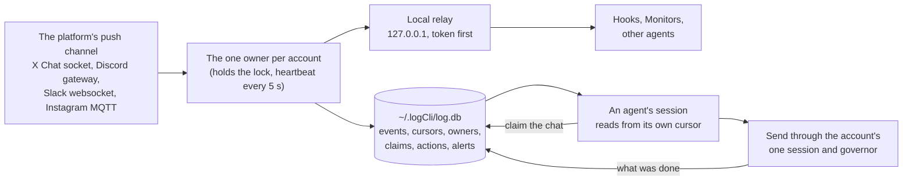

# The live inbox

Every account log runs keeps one live connection to its platform, and everything that comes in or goes out is recorded once, in one local database. Agents read from that database instead of asking the platform again, so many agents can follow the same account without anything being doubled, missed or answered twice. This page explains how it fits together.

## A real example

Abel writes "is this ai" on Discord while a reply to him is going out line by line.

1. Discord's gateway pushes his message to the account's one owner process.
2. The owner adds it to `events` with the next sequence number and passes it to everyone attached to the relay.
3. Before sending its next line, the send checks the database, sees Abel wrote, and holds the rest (`>>> INTERRUPTED`).
4. The agent's hook shows the new message from its own cursor. The agent claims the chat, reads what was already done in it (`actions`), and answers his question first.

## The parts

**One owner per account (rules 131, 132).** The first watch to take an account's lock opens the platform's push connection. Every later watch attaches to its relay instead of opening a second connection. An owner that stops sending heartbeats for 60 s is stopped and reported loudly, and the next start takes over.

**One database (rule 134).** `~/.logCli/log.db` is SQLite in WAL mode, and every write runs in one transaction. It holds:

| Table | What it holds |
|---|---|
| `events` | every incoming event, once, by its event id, with a sequence number |
| `cursors` | how far each session has read, so nothing is shown twice |
| `owners` | the one owner per account: pid, heartbeat, status, relay port |
| `claims` | which session holds which chat, with a generation number |
| `actions` | every claim, send and release, with what the chat looked like before |
| `alerts` | loud problems: a second owner, a hung owner, an unknown event type |
| `timings` | when each event was received, stored, relayed, claimed and acted on |
| `searchIndex` | full-text search over events and actions |

**Claim before acting (rule 133).** A session claims a chat before drafting a reply. Only one session can hold it. Every send claims the chat itself, checks before each line that it still holds it, and releases it when done.

**Unknown events (rule one).** An event type nobody has catalogued yet is stored with its raw payload and raised as an alert, so it can be named from rea, the docs and SubQ instead of being dropped.

## Being built now

- **Catch-up after a gap.** When a connection drops, the owner uses the platform's own position (X Chat's sequence id, Discord's resume, Slack's timestamp, Instagram's sequence id) to pull what it missed through the governor. While an account is behind, sends wait.
- **Context from the database.** The full context before a send (rule 109) is read from the database, not fetched from the platform again.
- **The voice gate on the database.** Every send runs every voice check (the watermark and scrambler readings, the AI-tells index, his phrasing, SubQ). Embeddings are stored in the database with their model name. Results are always worked out fresh at send time, never saved.

## Waiting on matt

- **The media describer:** a small local vision model (`LFM2.5-VL-450M`, SubQ's pick) kept warm from the start of the session. It turns pictures and video frames into text, so a reply answers what was actually sent. Audio already goes through AssemblyAI (rule 126).
- **Jina's newer models:** `jina-embeddings-v5-omni` (text and media in one space) and `jina-reranker-v3.5`, to rank the conversation, media, replies and likes that go into the voice step. These are paid calls, so they wait for his yes.

Specs: `docs/specs/agentHooks.md` (REQ-HOOKS-12 to 16). Code: `src/inbox/store`, `src/inbox/relay`, `src/inbox/watch`, `src/inbox/claims`.
