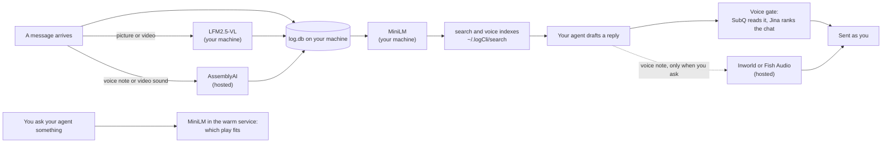

# The models log uses

log uses six models. Two run on your own machine, with no key and no internet once they are downloaded. Four are hosted services you add a key for. This page says what each one does, what your machine needs, and how the indexes they read are built.

## At a glance

| Model | Runs | What it does in log | Size | Key |
|---|---|---|---|---|
| [all-MiniLM-L6-v2](https://huggingface.co/Xenova/all-MiniLM-L6-v2) (8-bit) | your machine | turns text into meaning vectors: `log search`, your voice index, the knowledge base, matching what you typed to a play | 23 MB | none |
| [LFM2.5-VL-450M](https://huggingface.co/onnx-community/LFM2.5-VL-450M-ONNX) (4-bit) | your machine | describes every picture, gif and video frame someone sends you, as text | 352 MB | none |
| SubQ `subq-snap-1.1` | hosted | the voice gate (does a draft sound like you), reading an unknown page state, briefs, meme taste | n/a | `SUBQ_API_KEY` |
| Jina `jina-embeddings-v5-omni-small` and `jina-reranker-v3.5` | hosted | the AI tells index, and ranking a chat's history for the voice gate | n/a | `JINA_API_KEY` |
| AssemblyAI | hosted | what was said in a voice note or a video | n/a | `ASSEMBLYAI_API_KEY` |
| Inworld `inworld-tts-2` (or Fish Audio `s2.1-pro`) | hosted | speaks a voice note in your cloned voice, only when you ask | n/a | `INWORLD_API_KEY` or `FISH_API_KEY` |

The model names are in the code, so this table can be checked against it: `EMBED_MODEL` (`src/search/conversations/types.ts`), `VISION_MODEL` (`src/media/describer/types.ts`), `VOICE_MODEL` (`src/twitter/copy/voice/types.ts`), `JINA_EMBED_MODEL` and `JINA_RERANK_MODEL` (`src/voice/aiTells/types.ts`), and the voice providers in `src/extensions/inworld` and `src/extensions/fishAudio`.

## Where each one sits

Without the hosted keys, log still reads, searches and describes pictures. The voice gate, transcripts and voice notes need their keys.

## What your machine needs

Measured on this project's own machine on 2026-11-09 (Windows 11, 16 threads, CPU only, no GPU):

| | Load | Each use | Memory |
|---|---|---|---|
| MiniLM | 0.17 s | 2.8 ms p50, 9.8 ms p95 to embed one message (20 runs) | small, inside the process using it |
| LFM2.5-VL | 5.7 s | 6.3 to 7.4 s per picture (3 runs) | peaked at 1.25 GB |
| The describer idle, between pictures | n/a | n/a | about 100 MB |

So, at least:

- **A 64-bit machine.** Both local models run on the CPU, so no GPU is needed.
- **About 2 GB of free memory** for the picture model while it works. It stops itself, loudly, past 4 GB (`MEMORY_CEILING_MB`), and only one describer runs per machine.
- **About 400 MB of disk** for the two models. They download once, the first time they are needed, into `node_modules/@huggingface/transformers/.cache`.
- **ffmpeg and ffprobe** on your PATH, for videos and voice notes (`LOG_FFMPEG` and `LOG_FFPROBE` point elsewhere).
- **Bun and Python 3.12.** The installer sets both up ([install](install.md)).

A picture takes seconds to describe, so pictures queue (at most 20) and are described one at a time. Until one is described it shows as `[picture … not described yet]`, so nobody answers it blind.

## How the indexes are built

Every index is built from what is already in `log.db` or what log has saved, and each one is rebuilt in full by its command. Run them in this order on a new machine:

1. **`log search index`** reads every conversation once through each platform's own session and builds two indexes in `~/.logCli/search`: one by keyword (BM25) and one by meaning (MiniLM vectors, searched with HNSW). After that, each new read adds only what changed. `log search "<query>"` uses both and merges the results.
2. **`log voice index`** builds your voice from the conversations step 1 saved: each of your replies paired with what was said just before it, embedded with MiniLM, plus a profile per chat, person and platform. It reads nothing new.
3. **`log voice aiIndex`** embeds every phrase in the AI tells lists with Jina, and measures your own replies against them for your p50 and p99 closeness. The voice gate builds it itself when it is missing or older than step 2.
4. **`log kb sync`** (optional) puts the rules, skills, docs and agent memory into the knowledge base on Redis, searched the same two ways.

Pictures and videos are not indexed by a command. The describer (`log media describer`, started by the inbox hook) describes each one as it arrives, and its text is searchable like any message. `log media status` shows the queue.

The voice gate's embeddings are made once and kept in `log.db` by the text's hash and model, so each send only embeds what is new. An index made with a different model is rebuilt.

## Why these models

- **Small enough to run on any machine.** MiniLM and LFM2.5-VL run on a CPU, so reading, searching and describing never need the internet or a key.
- **Text for every model.** Every picture, voice note and video becomes text when it arrives ([how it works](howItWorks.md)), so an agent whose model can't see images still knows what was sent.
- **Hosted only where it pays.** The voice gate and transcripts are worth a hosted model, and each one's balance is in `log balance`.
