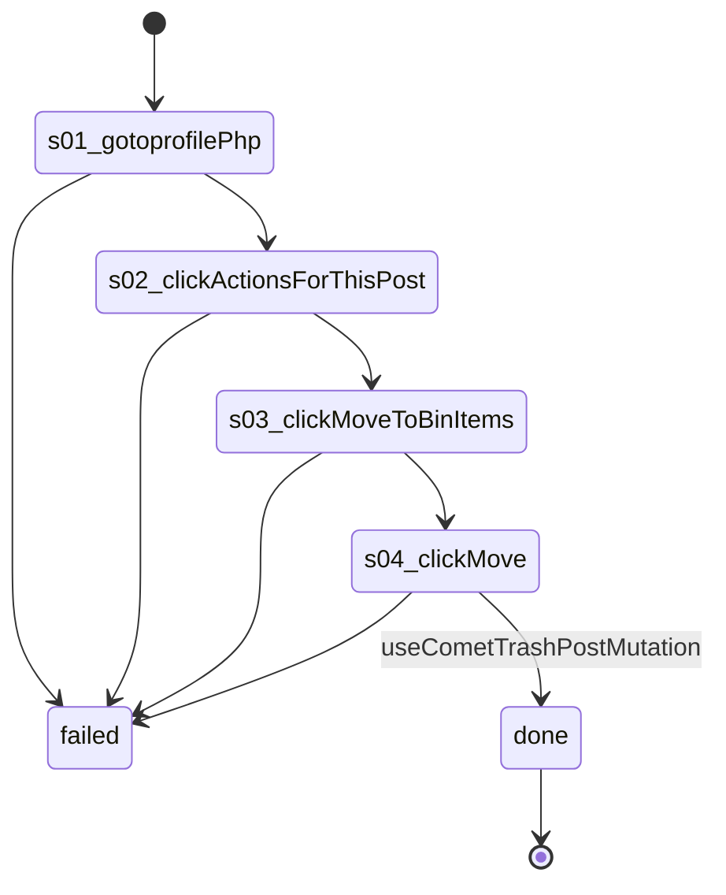

# Flow: `deletePost`

Delete the newest post on the account's own profile: its Actions menu, Move to bin, Move (useCometTrashPostMutation; Facebook empties the bin after 30 days). Writes on Facebook (--live).

Built by `log flow fromInspect` from the recording `C:/Users/0/.logCli/runs/inspect/20261020T162343_61594063207669/sequences/deletePost` (account deletePost). Run it on any account with `log flow run deletePost --account <a> --live`, or over MCP as the tool `flowDeletePost` (rule 31).

## Params

None.

## Steps

| # | Step | Does | Confirmed by | Recorded |
| --- | --- | --- | --- | --- |
| 1 | `s01_gotoprofilePhp` | open `https://www.facebook.com/profile.php?id={uid}` | — | 01_gotoHttpsWwwFacebook, 20672 ms, rea `ev_74b042e2afc0256a1336d27b608b10b6cf9940721c6ed74f02030277b7b8c36e` |
| 2 | `s02_clickActionsForThisPost` | click button "Actions for this post by {profileName}" | — | 14_clickroleButtonActionsFor, 6750 ms, rea `ev_304e9dbcab5a5fdccd5edf2244cda20c3db9fb9690b83426fea2aa3a4397e664` |
| 3 | `s03_clickMoveToBinItems` | click menuitem "Move to bin Items in your bin are deleted after 30 days." | — | 16_clickroleMenuitemMoveTo, 6547 ms, rea `ev_b1f7ae6817c311bb321ef267b89d0c1ec2eb608657ee1201582a69e8c3b31b0f` |
| 4 | `s04_clickMove` | click button "Move" | `useCometTrashPostMutation` | 17_clickroleButtonMove, 6609 ms, rea `ev_a79cff442b23243e114f8565e5ab5a9fde7ef334bb466f7a03b44714e563844f` |

## Machine

