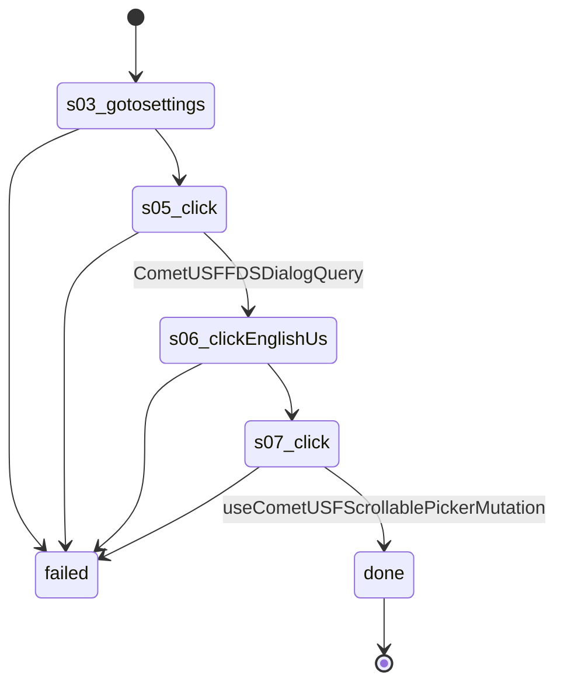

# Flow: `facebookLanguageEnglish`

Switch the account's Facebook language to English (US): Settings, Language and region, Account language, English (US), OK; decided by useCometUSFScrollablePickerMutation answering en_US. Recorded on Scranton 2026-10-25 from Arabic.

Built by `log flow fromInspect` from the recording `C:/Users/0/.logCli/runs/inspect/20261025T025641_61593881475391` (account 61593881475391). Run it on any account with `log flow run facebookLanguageEnglish --account <a> --live`, or over MCP as the tool `flowFacebookLanguageEnglish` (rule 31).

## Params

None.

## Steps

| # | Step | Does | Confirmed by | Facebook must answer (rule 73) | Recorded |
| --- | --- | --- | --- | --- | --- |
| 1 | `s03_gotosettings` | open `https://www.facebook.com/settings/?tab=language_and_region` | — | — | 04_gotoHttpsWwwFacebook, 17984 ms, rea `ev_5b224cc5f670d0212a58312fc528e6b978d2875d398479455f59dd1a0a7c8534` |
| 2 | `s05_click` | click button "لغة الحساب يمكنك رؤية الأزرار والعناوين والنصوص الأخرى بلغتك المفضلة. وستكون المراسلات التي تصلك، مثل رسائل البريد الإلكتروني الخاصة بالحساب أو الإشعارات بهذه اللغة." | `CometUSFFDSDialogQuery` | `CometUSFFDSDialogQuery` 2xx: `data.xfb_unified_settings.row_item.node_id` = `"ACCOUNT_AND_APP_LANGUAGE"` | 08_clickE968, 9515 ms, rea `ev_174bc48245d9c051d54507e9eec807b44608721e79a773d01d8fd76d5c9c6544` |
| 3 | `s06_clickEnglishUs` | click radio "English (US) الإنجليزية ( الولايات المتحدة الأمريكية )" | — | — | 09_clickE1091, 6578 ms, rea `ev_f3e5c92e8ecb0ff7a6903ed4592bb60e9cdf2f4c00e1003b9b06ac7e425e5787` |
| 4 | `s07_click` | click button "موافق" | `useCometUSFScrollablePickerMutation` | `useCometUSFScrollablePickerMutation` 2xx: `data.xfb_update_usf_scrollable_picker.headerOptions` is present | 10_clickE2992, 19782 ms, rea `ev_05d150abf0b46fcb7db56af9efa38e25fbd51e964dc449a5221007bcbfa30cdb` |

## Machine

