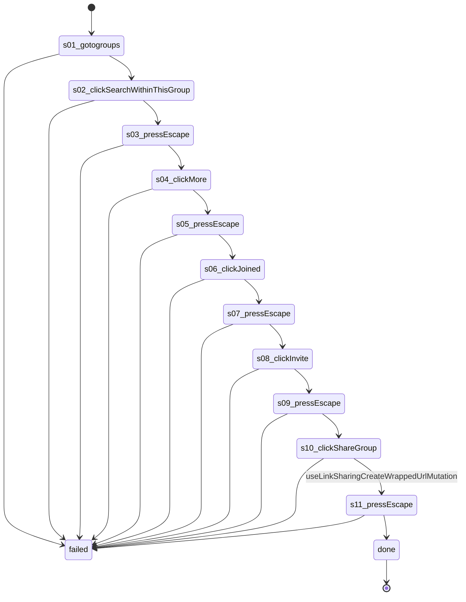

# Flow: `groupHeaderMenus`

Open and close the group header's search, More menu, Joined menu, Invite dialog and Share sheet; nothing inside them is picked

Built by `log flow fromInspect` from the recording `C:/Users/0/.logCli/runs/inspect/20261020T153648_61594063207669/sequences/groupHeaderMenus` (account groupHeaderMenus). Run it on any account with `log flow run groupHeaderMenus --account <a> --live`, or over MCP as the tool `flowGroupHeaderMenus` (rule 31).

## Params

- `groupId` (text): the group's numeric id, from its URL

## Steps

| # | Step | Does | Confirmed by | Recorded |
| --- | --- | --- | --- | --- |
| 1 | `s01_gotogroups` | open `https://www.facebook.com/groups/{groupId}/` | — | 01_gotoHttpsWwwFacebook, 27391 ms, rea `ev_08ee3372ed9790e46019fd8699391203ada2c19f39482b50711f064ea98496d9` |
| 2 | `s02_clickSearchWithinThisGroup` | click button "Search within this group" | — | 12_clickroleButtonSearchWithin, 8391 ms, rea `ev_c69ea049a10589fdb647d3c7949430f2a8e4e70940dd5ed3749256b3d3dd2024` |
| 3 | `s03_pressEscape` | press | — | 13_pressEscape, 9265 ms, rea `ev_a7b34caafa2bb28d05cfa086aff52ebe27e668842d01b2f5303ee7cd8f37425b` |
| 4 | `s04_clickMore` | click button "More" | — | 14_clickroleButtonMore, 9656 ms, rea `ev_ea31d5fcb66b56938cf3e695854f1909598db42cff680e1937e93558fd10011d` |
| 5 | `s05_pressEscape` | press | — | 15_pressEscape, 4875 ms, rea `ev_4a34d8c82a97cf8695516775f628febbf8ba954c822fefba2424c81feb4ac924` |
| 6 | `s06_clickJoined` | click button "Joined" | — | 16_clickroleButtonJoined, 7422 ms, rea `ev_89a85c860ed225d74646ad675f858ead193d86f1572478a8dbf89c61decf2bdc` |
| 7 | `s07_pressEscape` | press | — | 17_pressEscape, 6078 ms, rea `ev_f6ef0b09eb192500908d5fee7c506f9e267ac35fd3e1d5efc4adac23bc7500e5` |
| 8 | `s08_clickInvite` | click button "Invite" | — | 18_clickroleButtonInvite, 8125 ms, rea `ev_9c3d0701a87a7cfc7aa359f15bb7c71451660801abaaafe3ea2a510cf8fc4779` |
| 9 | `s09_pressEscape` | press | — | 19_pressEscape, 4750 ms, rea `ev_022dfecaaf2630a47762b81360075e77d48fcb99b5d1045603cf34b865a8c4fd` |
| 10 | `s10_clickShareGroup` | click button "Share group" | `useLinkSharingCreateWrappedUrlMutation` | 20_clickroleButtonShareGroup, 14656 ms, rea `ev_0b976565afc0e0dcd4479902f7a0ccaf454950c7e725d478ce5d1d717af6df68` |
| 11 | `s11_pressEscape` | press | — | 21_pressEscape, 6235 ms, rea `ev_a332fef8abbb2405bb0087468f16b531cd6d7a306f7585641c9a0bb29a70b349` |

## Machine

