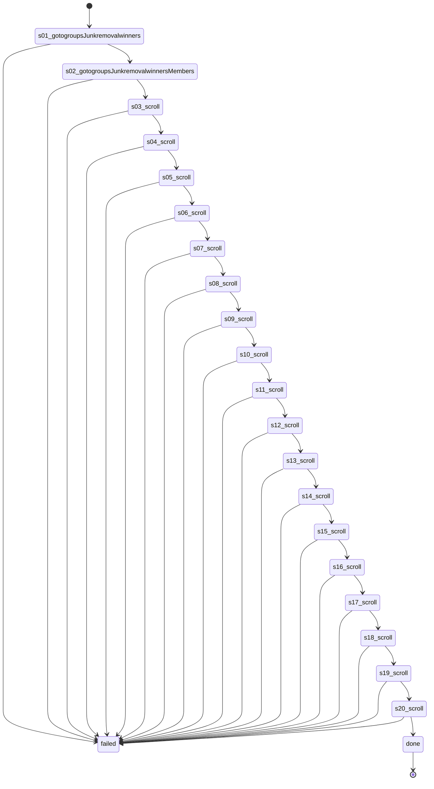

# Flow: `groupMembers`

Open a group's People tab and scroll it read-only so Facebook loads the member list (bio line, page category) for extraction

Built by `log flow fromInspect` from the recording `C:\Users\0\.logCli\runs\inspect\20261024T060921_61594063207669` (account 61594063207669). Run it on any account with `log flow run groupMembers --account <a> --live`, or over MCP as the tool `flowGroupMembers` (rule 31).

## Params

None.

## Steps

| # | Step | Does | Confirmed by | Facebook must answer (rule 73) | Recorded |
| --- | --- | --- | --- | --- | --- |
| 1 | `s01_gotogroupsJunkremovalwinners` | open `https://www.facebook.com/groups/junkremovalwinners` | — | — | 01_gotoHttpsWwwFacebook, 34031 ms, rea `ev_b94fa8ba71250b5979433c9c6ef392d896c6a8a2c533ce779a4c053f44b3b35e` |
| 2 | `s02_gotogroupsJunkremovalwinnersMembers` | open `https://www.facebook.com/groups/junkremovalwinners/members` | — | — | 03_gotoHttpsWwwFacebook, 18172 ms, rea `ev_5b68c26454a368478c8e606ca0366b33e18ffd9263dd51d345e7c070ab876dc6` |
| 3 | `s03_scroll` | scroll | — | — | 04_scroll35X, 18000 ms, rea `ev_1583c03bf2a1f641ff83daa06477ca1774a7c0b25feba7124dcf9df72d2bb76d` |
| 4 | `s04_scroll` | scroll | — | — | 05_scroll35X, 17562 ms, rea `ev_720f06159ebda00cb688301aa11b1d5495839248817c065676ace13df508af58` |
| 5 | `s05_scroll` | scroll | — | — | 06_scroll35X, 19407 ms, rea `ev_26999b1b305937e15e7144eae381d7bfbbef19be1e2c193d15cac76ba681dc2e` |
| 6 | `s06_scroll` | scroll | — | — | 07_scroll35X, 15219 ms, rea `ev_9cf12966e3b262954b490d565d9d4a3640e77506f598bad5006dbeb8594099d2` |
| 7 | `s07_scroll` | scroll | — | — | 08_scroll35X, 15156 ms, rea `ev_74f357fb1b338df417f56dc0b5b1645ca8211f0331a63f85265aea006fd312fa` |
| 8 | `s08_scroll` | scroll | — | — | 09_scroll35X, 19609 ms, rea `ev_8f44b0b13a2031bd78bdd348b579ea7d5cd71d22c584293f5a20e76adee4dc6e` |
| 9 | `s09_scroll` | scroll | — | — | 10_scroll35X, 24250 ms, rea `ev_b1d02afb185f0285d6c32989d6a002016a00fbb09b512bf871c4bb90df07cc2e` |
| 10 | `s10_scroll` | scroll | — | — | 11_scroll35X, 22875 ms, rea `ev_9ebfcfe2d8cc27e09d95f3db1302708da80c34b479fe9be772dd2556c070a2c7` |
| 11 | `s11_scroll` | scroll | — | — | 12_scroll35X, 16328 ms, rea `ev_7ef91c45b552a03620a189dfc8198a9e155bc84d0680a940b37be52a48743b97` |
| 12 | `s12_scroll` | scroll | — | — | 13_scroll35X, 30766 ms, rea `ev_362eba9c8c7179a2c8a90dd712ce9af5a43cb3bf3d58c856e840ef1a5660b244` |
| 13 | `s13_scroll` | scroll | — | — | 14_scroll35X, 19141 ms, rea `ev_4b616a57ab4399a8e26559414628aa292535f01e15dbb92e5323d4c77f4c11b5` |
| 14 | `s14_scroll` | scroll | — | — | 15_scroll35X, 16750 ms, rea `ev_aa65a99dc75fc9a5cc936b68f28b948641eb423fe1e59eaad0597fc398c55428` |
| 15 | `s15_scroll` | scroll | — | — | 16_scroll35X, 16969 ms, rea `ev_a473a8440bf43d488e110162acb2a33a6f80956d64fa165a0a5c8658ea0622ec` |
| 16 | `s16_scroll` | scroll | — | — | 17_scroll35X, 17578 ms, rea `ev_fea3b191ab3bd8e90ec43897315c2dc748449fbc91078c31071ebea3d795f554` |
| 17 | `s17_scroll` | scroll | — | — | 18_scroll35X, 20641 ms, rea `ev_6a78ff4242d30abeb644550357f8136a53954bf334cd6f90e7b1ba46365940b7` |
| 18 | `s18_scroll` | scroll | — | — | 19_scroll35X, 21938 ms, rea `ev_323f3a0a4a69c4afda86040bd640930d3ba527ef9ae75070a50251586b9244d4` |
| 19 | `s19_scroll` | scroll | — | — | 20_scroll35X, 22734 ms, rea `ev_2f5fdb38a58693b392b816a3ad2cce8e034494bdcc72bd102d4809196c103312` |
| 20 | `s20_scroll` | scroll | — | — | 21_scroll35X, 14500 ms, rea `ev_3e54a6512b990439515fc8dc78c8fe7cd5ff2c4885bd9dc86837c018e9f05580` |

## Machine

