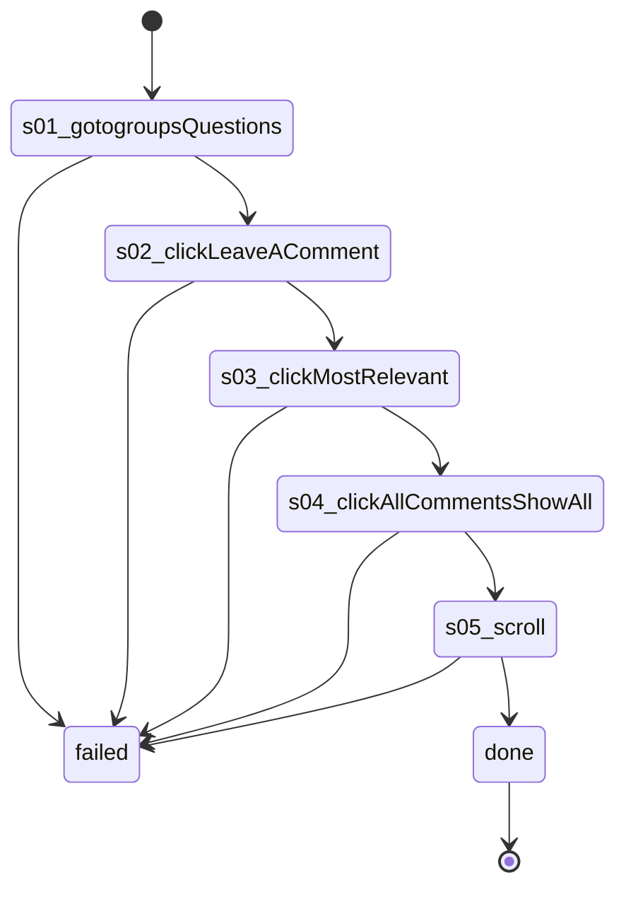

# Flow: `groupPostComments`

On a group's Open questions tab, open a post's comments, switch the sort to All comments and scroll them; read-only

Built by `log flow fromInspect` from the recording `C:/Users/0/.logCli/runs/inspect/20261020T153648_61594063207669/sequences/groupPostComments` (account groupPostComments). Run it on any account with `log flow run groupPostComments --account <a> --live`, or over MCP as the tool `flowGroupPostComments` (rule 31).

## Params

- `groupId` (text): the group's numeric id, from its URL

## Steps

| # | Step | Does | Confirmed by | Recorded |
| --- | --- | --- | --- | --- |
| 1 | `s01_gotogroupsQuestions` | open `https://www.facebook.com/groups/{groupId}/questions` | — | 25_gotoHttpsWwwFacebook, 22766 ms, rea `ev_3235ea8826b37f499f4706888546a12794cb18a245f8c9aa1cc6c8d84977b329` |
| 2 | `s02_clickLeaveAComment` | click button "Leave a comment" | — | 26_clickroleButtonLeaveA, 8438 ms, rea `ev_ec1bc8964578ad347bf7f0ba6cf1e12498db6d60d9d5e1f288c1f6fc9ac474c1` |
| 3 | `s03_clickMostRelevant` | click button "Most relevant" | — | 27_clickroleButtonMostRelevant, 6094 ms, rea `ev_f9e08ef5012157df1a9d331191c17d34ff3ccfa0997182f2c7ec868a233dcf90` |
| 4 | `s04_clickAllCommentsShowAll` | click menuitem "All comments Show all comments, including potential spam." | — | 28_clickroleMenuitemAllComments, 6843 ms, rea `ev_913de8ddf58c2715835c34d7287e81be5ec40c8d7eb0799bf83be8ff840abf0c` |
| 5 | `s05_scroll` | scroll | — | 29_scroll1X400, 9547 ms, rea `ev_d936645c5e69468f57d31581683a97916ca7650360f3cb1f7ae0ebe4104e9263` |

## Machine

