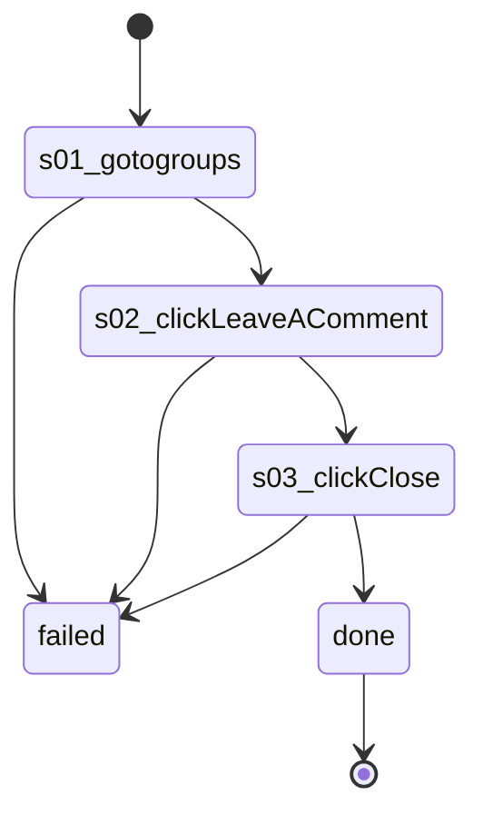

# Flow: `groupPostDialog`

On a group's Discussion feed, open a post in its dialog with Leave a comment (the comment box takes focus, nothing is typed) and close it

Built by `log flow fromInspect` from the recording `C:/Users/0/.logCli/runs/inspect/20261020T153648_61594063207669/sequences/groupPostDialog` (account groupPostDialog). Run it on any account with `log flow run groupPostDialog --account <a> --live`, or over MCP as the tool `flowGroupPostDialog` (rule 31).

## Params

- `groupId` (text): the group's numeric id, from its URL

## Steps

| # | Step | Does | Confirmed by | Recorded |
| --- | --- | --- | --- | --- |
| 1 | `s01_gotogroups` | open `https://www.facebook.com/groups/{groupId}/` | — | 01_gotoHttpsWwwFacebook, 27391 ms, rea `ev_08ee3372ed9790e46019fd8699391203ada2c19f39482b50711f064ea98496d9` |
| 2 | `s02_clickLeaveAComment` | click button "Leave a comment" | — | 47_clickroleButtonLeaveA, 12125 ms, rea `ev_93afc71785ac953dc1adeed873c000044dffb02f38da90b842a57366dc68e8aa` |
| 3 | `s03_clickClose` | click button "Close" | — | 48_clickroleButtonClose, 8016 ms, rea `ev_590978bd84c726d2ed9a85632fa2ddbcca6f32743a1380f0e032af00762a969e` |

## Machine

