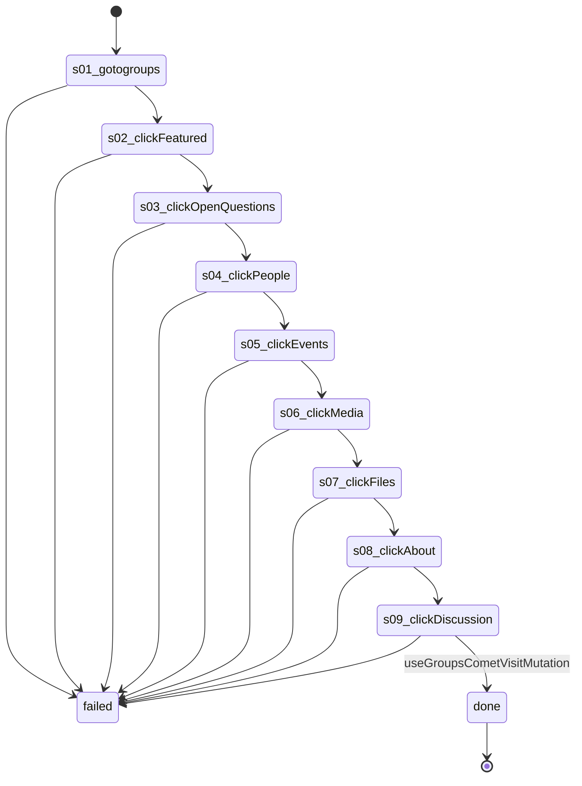

# Flow: `groupTabs`

Open each tab of a group the account is in (Featured, Open questions, People, Events, Media, Files, About) and come back to Discussion; read-only

Built by `log flow fromInspect` from the recording `C:/Users/0/.logCli/runs/inspect/20261020T153648_61594063207669/sequences/groupTabs` (account groupTabs). Run it on any account with `log flow run groupTabs --account <a> --live`, or over MCP as the tool `flowGroupTabs` (rule 31).

## Params

- `groupId` (text): the group's numeric id, from its URL

## Steps

| # | Step | Does | Confirmed by | Facebook must answer (rule 73) | Recorded |
| --- | --- | --- | --- | --- | --- |
| 1 | `s01_gotogroups` | open `https://www.facebook.com/groups/{groupId}/` | — | — | 01_gotoHttpsWwwFacebook, 27391 ms, rea `ev_08ee3372ed9790e46019fd8699391203ada2c19f39482b50711f064ea98496d9` |
| 2 | `s02_clickFeatured` | click tab "Featured" | — | — | 03_clickroleTabFeatured, 6750 ms, rea `ev_8f7b541988f83c6fee682e3d474475dcd0d2e3d582650804eb5a7191c2618cf2` |
| 3 | `s03_clickOpenQuestions` | click tab "Open questions" | — | — | 04_clickroleTabOpenQuestions, 14687 ms, rea `ev_521509ce58b866188322f8bd1ec0e7ad10888bb7438c7f31d6121867bcd0837c` |
| 4 | `s04_clickPeople` | click tab "People" | — | — | 06_clickroleTabPeople, 13969 ms, rea `ev_920ba26b1c72feaef7154ea78799b91bae189633071e2b3f78b694a35f6247de` |
| 5 | `s05_clickEvents` | click tab "Events" | — | — | 07_clickroleTabEvents, 8641 ms, rea `ev_8083e752561f801d4747b3674d7cbcdc8ac6c94831e1b7660b429c7d845b7559` |
| 6 | `s06_clickMedia` | click tab "Media" | — | — | 08_clickroleTabMedia, 8563 ms, rea `ev_b0a574c83338588761247539c7b116651547fae756bd5ce6ed327f9271f6ea2c` |
| 7 | `s07_clickFiles` | click tab "Files" | — | — | 09_clickroleTabFiles, 7672 ms, rea `ev_4ea1ce7042e53b2ebac1f32ee5c932c584b27a7dcf5e5357ea3f0a3ee8559e1b` |
| 8 | `s08_clickAbout` | click tab "About" | — | — | 10_clickroleTabAbout, 10875 ms, rea `ev_fbf06395a36d46155ff1f12a92591847ca93e6c3ebe46b81cbeb168ab3115661` |
| 9 | `s09_clickDiscussion` | click tab "Discussion" | [`useGroupsCometVisitMutation`](../groups/useGroupsCometVisitMutation.md) | `useGroupsCometVisitMutation` 2xx: `data.viewer_groups_tab_log_group_visit` is present | 11_clickroleTabDiscussion, 8468 ms, rea `ev_923e04f96d1d03fe700a57149f59ab2febcb52696ef7655447d0397cd597be63` |

## Machine

