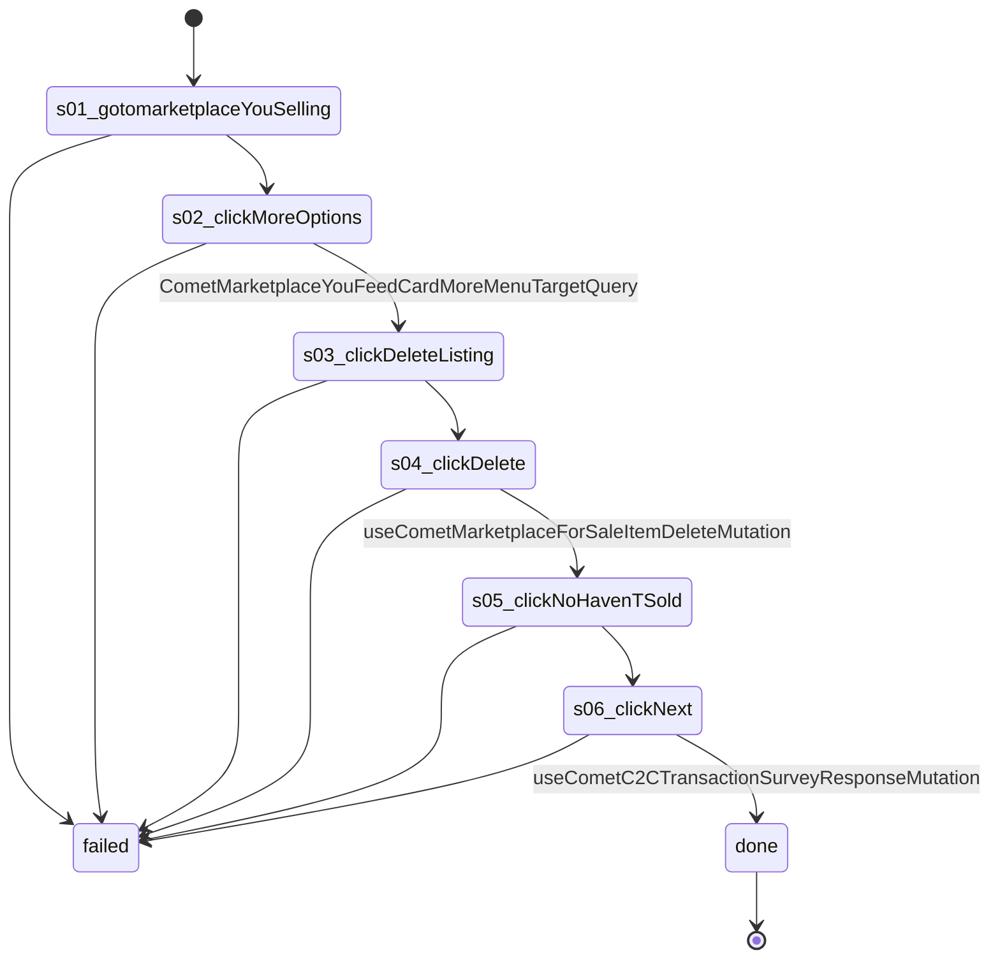

# Flow: `marketplaceListingDelete`

Delete one Marketplace listing from the Selling page: its More options menu, Delete listing, Delete, then "No, haven't sold" on Facebook's survey. Recorded on Bethlehem, 2026-10-23 (listing 1425935622848350).

Built by `log flow fromInspect` from the recording `C:/Users/0/.logCli/runs/inspect/20261023T173652_61594063207669` (account 61594063207669). Run it on any account with `log flow run marketplaceListingDelete --account <a> --live`, or over MCP as the tool `flowMarketplaceListingDelete` (rule 31).

## Params

- `listingTitle` (text): the listing's title exactly as on the Selling page
- `listingId` (text): the Facebook listing id (agencyListings.listingId); the menu and the delete must answer for this id

## Steps

| # | Step | Does | Confirmed by | Facebook must answer (rule 73) | Recorded |
| --- | --- | --- | --- | --- | --- |
| 1 | `s01_gotomarketplaceYouSelling` | open `https://www.facebook.com/marketplace/you/selling` | — | — | 01_gotoHttpsWwwFacebook, 24594 ms, rea `ev_fc2139f486875835db61fd22fc9581712b40983f7b041d4c849dd553967ec92d` |
| 2 | `s02_clickMoreOptions` | click button "More options for {listingTitle}" | `CometMarketplaceYouFeedCardMoreMenuTargetQuery` | `CometMarketplaceYouFeedCardMoreMenuTargetQuery` 2xx: `data.node.product_item.for_sale_item.id` = `"{listingId}"` | 03_clickE356, 8609 ms, rea `ev_1c89975e5e3b321897b01101e8cbe5a4dad9a19794fd0865f664d5b450042712` |
| 3 | `s03_clickDeleteListing` | click menuitem "Delete listing" | — | — | 04_clickE434, 10297 ms, rea `ev_d4682394d0b3ea3a8b0dc2274608959eb839c9d21aae72a6000665506034b876` |
| 4 | `s04_clickDelete` | click button "Delete" | `useCometMarketplaceForSaleItemDeleteMutation` | `useCometMarketplaceForSaleItemDeleteMutation` 2xx: `data.commerce_for_sale_item_delete.deleted_for_sale_item_id` = `"{listingId}"`; `data.commerce_for_sale_item_delete.deleted_for_sale_item_id` = what we sent as `variables.input.for_sale_item_id` | 05_clickE537, 8437 ms, rea `ev_a6d7052ff71634134b064e07a82cbf1800b3c063e95b58d233fc58ad7aec2844` |
| 5 | `s05_clickNoHavenTSold` | click radio "No, haven't sold" | — | — | 06_clickE602, 6312 ms, rea `ev_fdab7858d0d3d79fb4beb188df5955737372d5ef211d8c9eee503ee8a1ee98cd` |
| 6 | `s06_clickNext` | click button "Next" | `useCometC2CTransactionSurveyResponseMutation` | `useCometC2CTransactionSurveyResponseMutation` 2xx: `data.c2c_transaction_survey_response` is present | 07_clickE620, 6875 ms, rea `ev_f7e84175f73736f8cb27ac519c7d100d6f1f760da2ba9621e26a6e3b5b1fdd3c` |

## Machine

