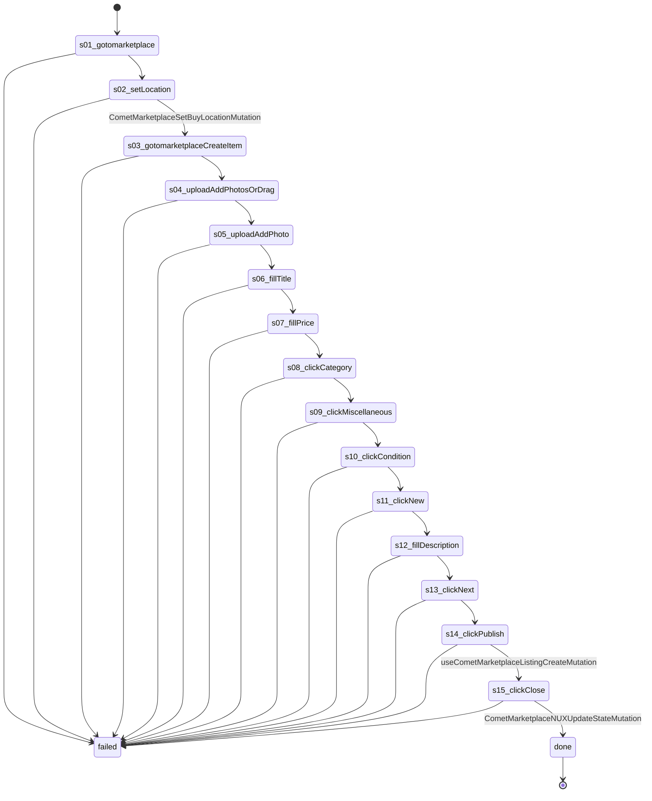

# Flow: `marketplaceListingPublish`

Publish one Marketplace listing in the account's open AdsPower browser: set the Marketplace location (City, State written out), open Create, two photos, title, price, category Miscellaneous, condition New, description, Next, Publish, close the Boost offer. Recorded on Bethlehem 2026-10-22 (listing 1425935622848350, held for review).

Built by `log flow fromInspect` from the recording `C:/Users/0/.logCli/runs/inspect/20261022T110738_61594063207669` (account 61594063207669). Run it on any account with `log flow run marketplaceListingPublish --account <a> --live`, or over MCP as the tool `flowMarketplaceListingPublish` (rule 31).

## Params

- `location` (text): the Marketplace location, "City, State" with the state written out ("Bethlehem, Pennsylvania")
- `photo1` (file): uploaded through button "Add photos or drag and drop"
- `photo2` (file): uploaded through button "Add photo"
- `title` (text): typed into textbox "Title"
- `price` (text): typed into textbox "Price"
- `description` (text): typed into textbox "Description"

## Steps

| # | Step | Does | Confirmed by | Facebook must answer (rule 73) | Recorded |
| --- | --- | --- | --- | --- | --- |
| 1 | `s01_gotomarketplace` | open `https://www.facebook.com/marketplace/` | — | `page /marketplace/` 2xx: `fields.buy_location.display_name` names the account's home city (else `marketplaceLocationWrong`) | 01_gotoHttpsWwwFacebook, 9329 ms, rea `ev_883b421fab42f69ac7b85774b2a38d61df529a8234cf3b4c527ff69e3e99af26` |
| 2 | `s02_setLocation` | setLocation | [`CometMarketplaceSetBuyLocationMutation`](../location/CometMarketplaceSetBuyLocationMutation.md) | `CometMarketplaceSetBuyLocationMutation` 2xx: `data.marketplace_set_buy_location.viewer.marketplace_settings.buy_location.reverse_geocode.city` names the account's home city (else `marketplaceLocationWrong`) | 10_clickE1174 |
| 3 | `s03_gotomarketplaceCreateItem` | open `https://www.facebook.com/marketplace/create/item` | — | `page /marketplace/create/item` 2xx: `fields.marketplace_new_seller_can_post_item` = `true` (else `marketplaceMayNotPost`); `fields.sell_location.reverse_geocode_detailed.country_alpha_two` = the account's home country (else `marketplaceLocationWrong`); `fields.sell_location.reverse_geocode_detailed.city` names the account's home city (else `marketplaceLocationWrong`) | 11_gotoHttpsWwwFacebook, 20047 ms, rea `ev_a0092efb66b957f30eaf9c87e8c603a08eb9df937cce78c74683b12e950bf0d2` |
| 4 | `s04_uploadAddPhotosOrDrag` | upload button "Add photos or drag and drop" with `{photo1}` | — | — | 13_uploadE155, 7047 ms, rea `ev_b2efe202299190db4bfdd725157f407330673ef6ffcac8702e2cf258a8ab9036` |
| 5 | `s05_uploadAddPhoto` | upload button "Add photo" with `{photo2}` | — | — | 15_uploadE460, 7328 ms, rea `ev_fc26424e2daf719dfc9b18e9306917e227ca8de815401de79e361f709434f318` |
| 6 | `s06_fillTitle` | fill textbox "Title" with `{title}` | — | — | 16_typeE232, 17657 ms, rea `ev_4b5985ac5a7cf1009395a4dc24cdbed1b99ca802050c53ebd6bff8de4491538d` |
| 7 | `s07_fillPrice` | fill textbox "Price" with `{price}` | — | — | 17_typeE241, 7297 ms, rea `ev_bd5c2cf9410ef5e98b30b32f20b68980ded9e1ece4a814114f3fb3dc8e47bf22` |
| 8 | `s08_clickCategory` | click combobox "Category" | — | — | 18_clickE249, 7547 ms, rea `ev_3b18f86931af1f538f8d92a73ff1f64d39710556ae7cd1171613cd620ec6679a` |
| 9 | `s09_clickMiscellaneous` | click button "Miscellaneous" | — | — | 19_clickE992, 13531 ms, rea `ev_46da423377f2bfbe1edaafd81bf5fd8284cbe04bb312602ed64fb5c7f42c4c81` |
| 10 | `s10_clickCondition` | click combobox "Condition" | — | — | 20_clickE264, 6109 ms, rea `ev_50126ac7aad5b71aeb75a11349ee06367df45a5531706fa2dfa6b1375c490182` |
| 11 | `s11_clickNew` | click option "New" | — | — | 21_clickE1157, 6235 ms, rea `ev_48388807c5240e6ff0a12e5e5c065c6468f2b80f9d2b0e6187440d998cbc6ff0` |
| 12 | `s12_fillDescription` | fill textbox "Description" with `{description}` | — | — | 23_typeE281, 7625 ms, rea `ev_7f9060167875b1c10f86bd2490dce8af8601ed85ab2d122cdfdde8de85899a01` |
| 13 | `s13_clickNext` | click button "Next" | — | — | 24_clickE367, 7078 ms, rea `ev_304d69ef2ffbafd4fe65053150c0bd7a754649e28a77f3209d7c4091846bd7d1` |
| 14 | `s14_clickPublish` | click button "Publish" | [`useCometMarketplaceListingCreateMutation`](../publishing/useCometMarketplaceListingCreateMutation.md) | `useCometMarketplaceListingCreateMutation` 2xx: `data.marketplace_listing_create.listing.id` is present (else `noListingId`) | 25_clickE1241, 8718 ms, rea `ev_f690809a6a60c7e4bf0d92cd883f0be2853a4cec8b9cb587b882a0a593d3edfd` |
| 15 | `s15_clickClose` | click button "Close" | [`CometMarketplaceNUXUpdateStateMutation`](../background/CometMarketplaceNUXUpdateStateMutation.md) | `CometMarketplaceNUXUpdateStateMutation` 2xx: `data.marketplace_nux_update_state.viewer` is present | 27_clickE1541, 6343 ms, rea `ev_db4931f97e51ebdef060a918af30dda6481c052c4c9bdf7a032115c0472e31b9` |

## Machine

