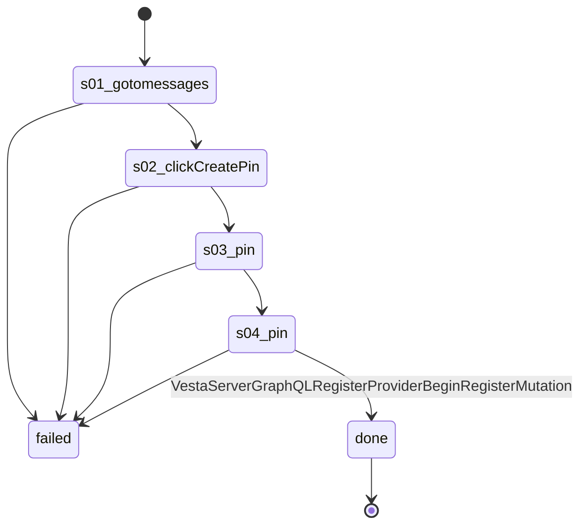

# Flow: `messengerPinCreate`

Messenger's Create a PIN: open /messages/, press Create PIN, type the account's PIN from Twenty, then again to confirm (rule 67). Recorded on Bethlehem 2026-10-22.

Built by `log flow fromInspect` from the recording `C:/Users/0/.logCli/runs/inspect/20261022T100521_61594063207669` (account 61594063207669). Run it on any account with `log flow run messengerPinCreate --account <a> --live`, or over MCP as the tool `flowMessengerPinCreate` (rule 31).

## Params

None.

## Steps

| # | Step | Does | Confirmed by | Facebook must answer (rule 73) | Recorded |
| --- | --- | --- | --- | --- | --- |
| 1 | `s01_gotomessages` | open `https://www.facebook.com/messages/` | — | — | 01_gotoHttpsWwwFacebook, 20547 ms, rea `ev_31ee052f4e1aa158657551e69b2d553d0a5bf8c7f5a80023f34474272e934eac` |
| 2 | `s02_clickCreatePin` | click button "Create PIN" | — | — | 03_clickE225, 7406 ms, rea `ev_baeb7441149ba17753b8f83e5843ba86a3fc57de0a03960c9e24a2e6b8ff983a` |
| 3 | `s03_pin` | pin | — | — | 05_pin, 8953 ms, rea `ev_3bf0c2437b290b07e199d761b06b8c3ece65248fc26d4dba415daa8b3f4b686a` |
| 4 | `s04_pin` | pin | [`VestaServerGraphQLRegisterProviderBeginRegisterMutation`](../background/VestaServerGraphQLRegisterProviderBeginRegisterMutation.md) | `VestaServerGraphQLRegisterProviderBeginRegisterMutation` 2xx: `data.fbid_based_auth_layer_vesta_begin_register.base64url_encoded_opaque_challenge` is present | 06_pin, 8593 ms, rea `ev_031e8c6efccc3f884348046897eb76e9e7ad4e489c82f4ccd3ac0af2bd1a1ba1` |

## Machine

