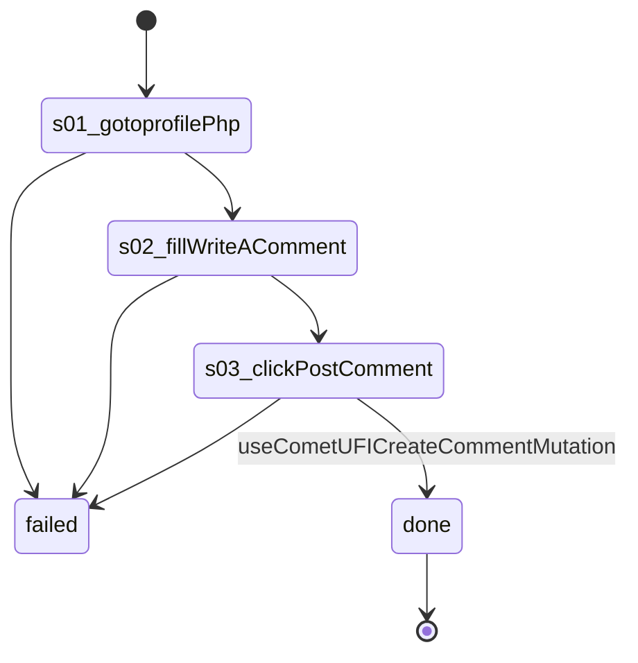

# Flow: `postComment`

Comment on the newest post on the account's own profile: type in its Write a comment box, Post comment (useCometUFICreateCommentMutation). Writes on Facebook (--live).

Built by `log flow fromInspect` from the recording `C:/Users/0/.logCli/runs/inspect/20261020T162343_61594063207669/sequences/postComment` (account postComment). Run it on any account with `log flow run postComment --account <a> --live`, or over MCP as the tool `flowPostComment` (rule 31).

## Params

- `comment` (text): typed into textbox "Write a comment…"

## Steps

| # | Step | Does | Confirmed by | Facebook must answer (rule 73) | Recorded |
| --- | --- | --- | --- | --- | --- |
| 1 | `s01_gotoprofilePhp` | open `https://www.facebook.com/profile.php?id={uid}` | — | — | 01_gotoHttpsWwwFacebook, 20672 ms, rea `ev_74b042e2afc0256a1336d27b608b10b6cf9940721c6ed74f02030277b7b8c36e` |
| 2 | `s02_fillWriteAComment` | fill textbox "Write a comment…" with `{comment}` | — | — | 07_typeE2129, 6500 ms, rea `ev_ccb036275699151565bb0c968034c2ac11d0b4097008f38a78bbd6eaa5c57783` |
| 3 | `s03_clickPostComment` | click button "Post comment" | [`useCometUFICreateCommentMutation`](../background/useCometUFICreateCommentMutation.md) | `useCometUFICreateCommentMutation` 2xx: `data.comment_create.feedback_comment_edge` is present | 08_clickroleButtonPostComment, 17219 ms, rea `ev_73b85d5dd1461e566a801bdac3cf500cc122a6bd707b6d0d3bfde325f19fba7d` |

## Machine

