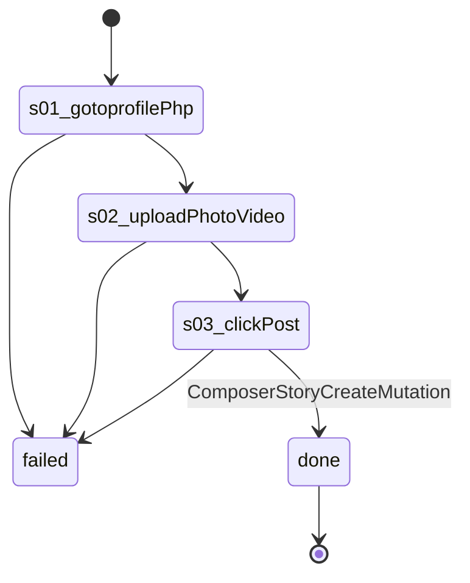

# Flow: `profilePhotoPost`

Post a photo on the account's own profile: Photo/video hands the file to the chooser, the upload finishes, Post, wait for ComposerStoryCreateMutation. Writes on Facebook (--live).

Built by `log flow fromInspect` from the recording `C:/Users/0/.logCli/runs/inspect/20261020T162343_61594063207669/sequences/profilePhotoPost` (account profilePhotoPost). Run it on any account with `log flow run profilePhotoPost --account <a> --live`, or over MCP as the tool `flowProfilePhotoPost` (rule 31).

## Params

- `photo` (file): uploaded through button "Photo/video"

## Steps

| # | Step | Does | Confirmed by | Recorded |
| --- | --- | --- | --- | --- |
| 1 | `s01_gotoprofilePhp` | open `https://www.facebook.com/profile.php?id={uid}` | — | 01_gotoHttpsWwwFacebook, 20672 ms, rea `ev_74b042e2afc0256a1336d27b608b10b6cf9940721c6ed74f02030277b7b8c36e` |
| 2 | `s02_uploadPhotoVideo` | upload button "Photo/video" with `{photo}` | — | 10_uploadroleButtonPhotoVideo, 8578 ms, rea `ev_0c7af96e561236535ace48a4976dc7cd05d9eaf842e9123f60dda34060ed1228` |
| 3 | `s03_clickPost` | click button "Post" | `ComposerStoryCreateMutation` | 12_clickroleButtonPost, 7250 ms, rea `ev_2a8ba1b7140302d1b1c31f71745ec0546284fd4bcf9064fa6162bab87c4b149a` |

## Machine

