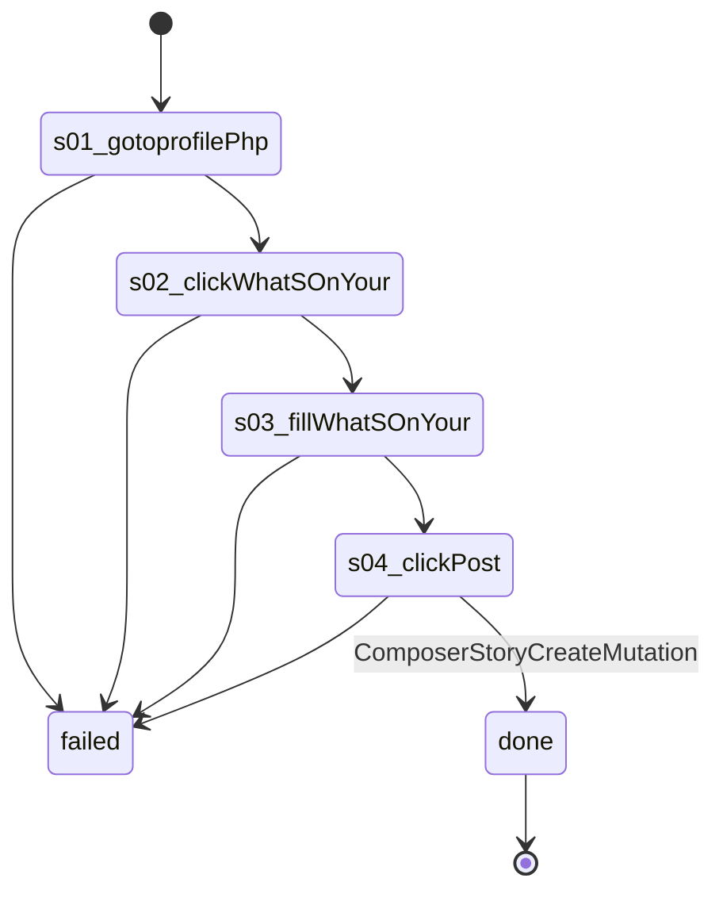

# Flow: `profilePost`

Post text on the account's own profile: open the composer, type the text, Post, wait for ComposerStoryCreateMutation. Writes on Facebook (--live).

Built by `log flow fromInspect` from the recording `C:/Users/0/.logCli/runs/inspect/20261020T162343_61594063207669/sequences/profilePost` (account profilePost). Run it on any account with `log flow run profilePost --account <a> --live`, or over MCP as the tool `flowProfilePost` (rule 31).

## Params

- `text` (text): typed into textbox "What's on your mind?"

## Steps

| # | Step | Does | Confirmed by | Facebook must answer (rule 73) | Recorded |
| --- | --- | --- | --- | --- | --- |
| 1 | `s01_gotoprofilePhp` | open `https://www.facebook.com/profile.php?id={uid}` | — | — | 01_gotoHttpsWwwFacebook, 20672 ms, rea `ev_74b042e2afc0256a1336d27b608b10b6cf9940721c6ed74f02030277b7b8c36e` |
| 2 | `s02_clickWhatSOnYour` | click button "What's on your mind?" | — | — | 03_clickroleButtonWhatS, 7656 ms, rea `ev_df49ccc8e80ad5810797670db468f1310e59e21c0f8bdc8e953618f8b016edf8` |
| 3 | `s03_fillWhatSOnYour` | fill textbox "What's on your mind?" with `{text}` | — | — | 04_typeE1681, 7125 ms, rea `ev_09a47d7f816b09cd0bd8472b3901e21bd5fabb33437de2f1a4d0bf0f8f87472a` |
| 4 | `s04_clickPost` | click button "Post" | [`ComposerStoryCreateMutation`](../background/ComposerStoryCreateMutation.md) | `ComposerStoryCreateMutation` 2xx: `data.story_create.story_id` is present | 05_clickroleButtonPost, 6406 ms, rea `ev_245e37597723003f411c6936861bffc355ba771de2a97f0db54082f1e560be28` |

## Machine

