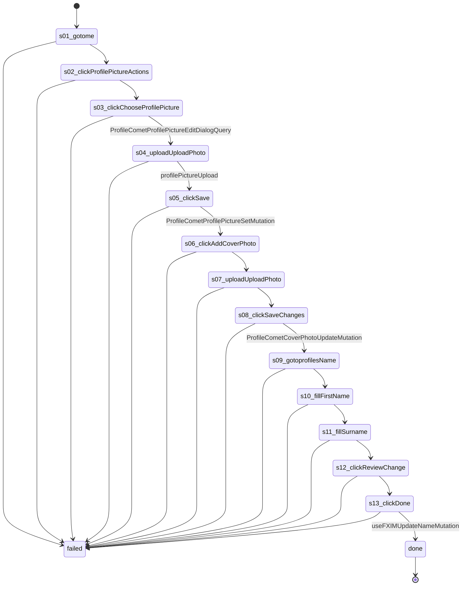

# Flow: `profileSetup`

Give an account its profile picture, cover photo and name, as recorded on Lancaster 2026-10-19 (rule 28): profile picture menu, Choose profile picture, Upload Photo, Save; Add Cover Photo, Upload photo, Save changes; Accounts Center name, Review change, Done.

Built by `log flow fromInspect` from the recording `C:/Users/0/.logCli/runs/inspect/20261019T111507_61593967241658` (account 61593967241658). Run it on any account with `log flow run profileSetup --account <a> --live`, or over MCP as the tool `flowProfileSetup` (rule 31).

## Params

- `profilePhoto` (file): uploaded through button "Upload Photo"
- `coverPhoto` (file): uploaded through menuitem "Upload photo"
- `firstName` (text): typed into textbox "First name"
- `lastName` (text): typed into textbox "Surname"

## Steps

| # | Step | Does | Confirmed by | Facebook must answer (rule 73) | Recorded |
| --- | --- | --- | --- | --- | --- |
| 1 | `s01_gotome` | open `https://www.facebook.com/me` | — | — | 01_gotoHttpsWwwFacebook, 28985 ms, rea `ev_8d5b627c0e4f842a58785cdaf9d9ffce58b4c4ace3f766bd858f0ebbea50010d` |
| 2 | `s02_clickProfilePictureActions` | click button "Profile picture actions" | — | — | 02_clickE141, 7078 ms, rea `ev_31fe39b50844e2fd8b48166e3a4c5dd3634369977ba2a867417c9417e3ffb3a0` |
| 3 | `s03_clickChooseProfilePicture` | click menuitem "Choose profile picture" | [`ProfileCometProfilePictureEditDialogQuery`](../profile/ProfileCometProfilePictureEditDialogQuery.md) | `ProfileCometProfilePictureEditDialogQuery` 2xx: `data.viewer.actor.id` = the account's id | 03_clickE1096, 6343 ms, rea `ev_22ab5500725e970a0cb541c1dc8da093c50cfe5d0bf3a739a02cc1c27cb780e3` |
| 4 | `s04_uploadUploadPhoto` | upload button "Upload photo" with `{profilePhoto}` | [`profilePictureUpload`](../profile/profilePictureUpload.md) | `profilePictureUpload` 2xx: `payload.profileID` = the account's id; `payload.fbid` is present | 04_uploadE1180, 5563 ms, rea `ev_e9f7a16b4c9b566b57a536e5049d8466a9c4e77e04ab61e3bd056a9d15a2ee16` |
| 5 | `s05_clickSave` | click button "Save" | [`ProfileCometProfilePictureSetMutation`](../profile/ProfileCometProfilePictureSetMutation.md) | `ProfileCometProfilePictureSetMutation` 2xx | 06_clickE1262, 5609 ms, rea `ev_0857cd848e933126fcf077d94d0c040c4682e19b8f2cd686ee61c283ca1c8947` |
| 6 | `s06_clickAddCoverPhoto` | click button "Add Cover Photo" | — | — | 09_clickE1272, 7422 ms, rea `ev_0cc4233ac9114e0ca6bd514680a8a78979e0870891e5ce2072835e0a8d7b094f` |
| 7 | `s07_uploadUploadPhoto` | upload menuitem "Upload photo" with `{coverPhoto}` | — | — | 10_uploadE1395, 5875 ms, rea `ev_7a0dd7626fcc03f9ce5694a1a9a7bfcf17a98323103c05f6513ec07d670bf90a` |
| 8 | `s08_clickSaveChanges` | click button "Save changes" | [`ProfileCometCoverPhotoUpdateMutation`](../profile/ProfileCometCoverPhotoUpdateMutation.md) | `ProfileCometCoverPhotoUpdateMutation` 2xx | 12_clickE1426, 5422 ms, rea `ev_53c096304d660489f7a065eb2f02d7616c4e4fe407fec2e1839ba9bb029bae68` |
| 9 | `s09_gotoprofilesName` | open `https://accountscenter.facebook.com/profiles/{uid}/name` | — | — | 14_gotoHttpsAccountscenterFacebook, 12062 ms, rea `ev_6d86e332410bffc269bbb4780a976d220529ecac4ba7d4663a1606c1c572d9a8` |
| 10 | `s10_fillFirstName` | fill textbox "First name" with `{firstName}` | — | — | 17_typeE156, 6359 ms, rea `ev_3267c5c28674f8b7a0dce62ea1fa13ac12b18c69830333d2ae8fe105975e6c87` |
| 11 | `s11_fillSurname` | fill textbox "Surname" with `{lastName}` | — | — | 20_typeE166, 5516 ms, rea `ev_6ebd0132c459a8e6d9bfd2e1f68f255455aae9f8b1ef26f7fdb20afb5b545e7f` |
| 12 | `s12_clickReviewChange` | click button "Review change" | — | — | 21_clickE208, 7422 ms, rea `ev_906aed5bd5d1bef6986b97364bb012a88db147ff703f3687b1c45872b06559df` |
| 13 | `s13_clickDone` | click button "Done" | [`useFXIMUpdateNameMutation`](../profile/useFXIMUpdateNameMutation.md) | `useFXIMUpdateNameMutation` 2xx | 23_clickE317, 5281 ms, rea `ev_066833ad38d033efa8d6f6929b2d3b983516997eab5adcaac78ca42688a8e036` |

## Machine

