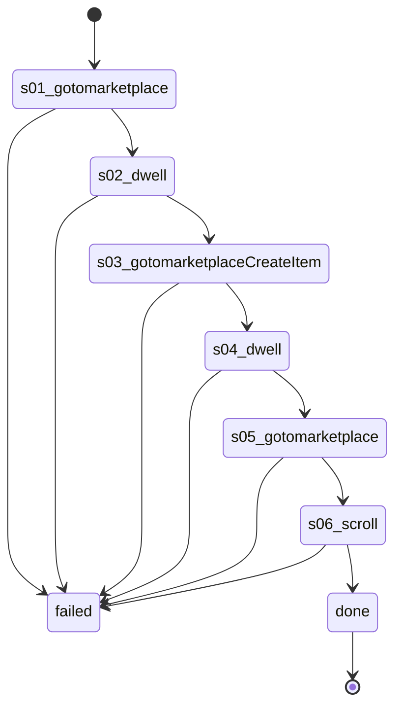

# Flow: `warmupCreateAccessCheck`

Warm-up createAccessCheck: Listaro's runStage3, account-warmup.ts:181-209, recorded on 61594063207669 2026-10-22 (rule 35).

Built by `log flow fromInspect` from the recording `C:\Users\0\.logCli\runs\warmup\20261022T091121_61594063207669` (account 61594063207669). Run it on any account with `log flow run warmupCreateAccessCheck --account <a> --live`, or over MCP as the tool `flowWarmupCreateAccessCheck` (rule 31).

## Params

None.

## Steps

| # | Step | Does | Confirmed by | Facebook must answer (rule 73) | Recorded |
| --- | --- | --- | --- | --- | --- |
| 1 | `s01_gotomarketplace` | open `https://www.facebook.com/marketplace/` | — | `page /marketplace/` 2xx: `fields.buy_location.display_name` names the account's home city (else `marketplaceLocationWrong`) | 11_gotoHttpsWwwFacebook, 23593 ms, rea `ev_15ef310b804cb8c7a58466aac6cc548bcc38404e39d2ff4fc262e407975550df` |
| 2 | `s02_dwell` | dwell | — | — | 12_dwell24s, 6516 ms, rea `ev_cac6289decfb3253c51e1027e560c200e106bfc6a4082824e5eb98be5222e709` |
| 3 | `s03_gotomarketplaceCreateItem` | open `https://www.facebook.com/marketplace/create/item` | — | `page /marketplace/create/item` 2xx: `fields.marketplace_new_seller_can_post_item` = `true` (else `marketplaceMayNotPost`); `fields.sell_location.reverse_geocode_detailed.country_alpha_two` = the account's home country (else `marketplaceLocationWrong`); `fields.sell_location.reverse_geocode_detailed.city` names the account's home city (else `marketplaceLocationWrong`) | 13_gotoHttpsWwwFacebook, 23625 ms, rea `ev_74fbe25295d2e676e928184ac9e635f7ff232d3a746fcfa4cf9126e04dcf1c8e` |
| 4 | `s04_dwell` | dwell | — | — | 14_dwell23s, 5797 ms, rea `ev_95fd02e1be8e43e6f24e30fcfeca2c0fd3ce8800d3c94f5888efe894fc5a7b5e` |
| 5 | `s05_gotomarketplace` | open `https://www.facebook.com/marketplace/` | — | `page /marketplace/` 2xx: `fields.buy_location.display_name` names the account's home city (else `marketplaceLocationWrong`) | 15_gotoHttpsWwwFacebook, 21969 ms, rea `ev_3276a151a4de6a672c9404023f59d68d8f85faf182cfb6069eb2434ba905e5f7` |
| 6 | `s06_scroll` | scroll | — | — | 16_scroll1X300, 9172 ms, rea `ev_c4a7e7c02d98bb8758f3b0c84ebcc60360a4d4a500c87f5fb7d63b142b9de475` |

## Machine

