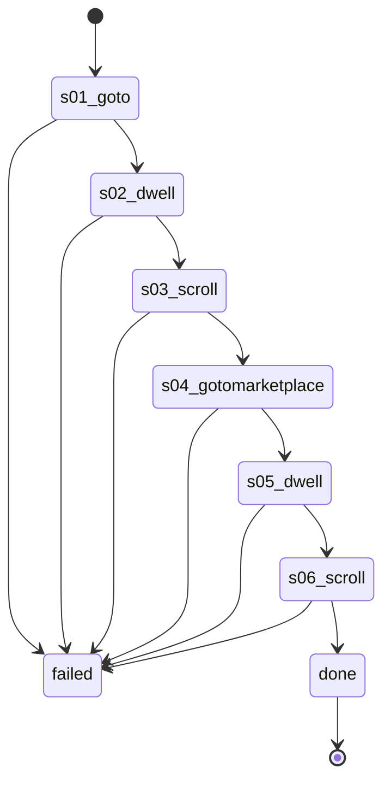

# Flow: `warmupFeedBrowse`

Warm-up feedBrowse: Listaro's runStage1, account-warmup.ts:92-130, recorded on 61594063207669 2026-10-22 (rule 35).

Built by `log flow fromInspect` from the recording `C:\Users\0\.logCli\runs\warmup\20261022T091121_61594063207669` (account 61594063207669). Run it on any account with `log flow run warmupFeedBrowse --account <a> --live`, or over MCP as the tool `flowWarmupFeedBrowse` (rule 31).

## Params

None.

## Steps

| # | Step | Does | Confirmed by | Recorded |
| --- | --- | --- | --- | --- |
| 1 | `s01_goto` | open `https://www.facebook.com/` | — | 01_gotoHttpsWwwFacebook, 51188 ms, rea `ev_e341cadab219a4d1edb87e0a6124f2b5162c089a0f15018b6ee042631fae405a` |
| 2 | `s02_dwell` | dwell | — | 02_dwell35s, 8359 ms, rea `ev_8b17ac975a97ee0782de3bebb8d729284eea306c4ae08d616d68f57e2dbe89e4` |
| 3 | `s03_scroll` | scroll | — | 03_scroll47X, 31453 ms, rea `ev_7ae1c0a30cf066f417fd1305af192253b09f82057d70298cc4fdfe4b8c0f2697` |
| 4 | `s04_gotomarketplace` | open `https://www.facebook.com/marketplace/` | — | 04_gotoHttpsWwwFacebook, 23610 ms, rea `ev_23709d00eac049d029c7267e2b4df5942d7dd6c775ad174cbe341099a3c3e798` |
| 5 | `s05_dwell` | dwell | — | 05_dwell35s, 7968 ms, rea `ev_9ccd48ac0491d60ab90e1fcb351b2aef0ce14971a6ef1aaf2f30e9887ddf4f3d` |
| 6 | `s06_scroll` | scroll | — | 06_scroll1X400, 10641 ms, rea `ev_20fa79f5a71e1927e5e84ecf5433de4525e0af0545a4b83c7229f87a32eb8ff9` |

## Machine

