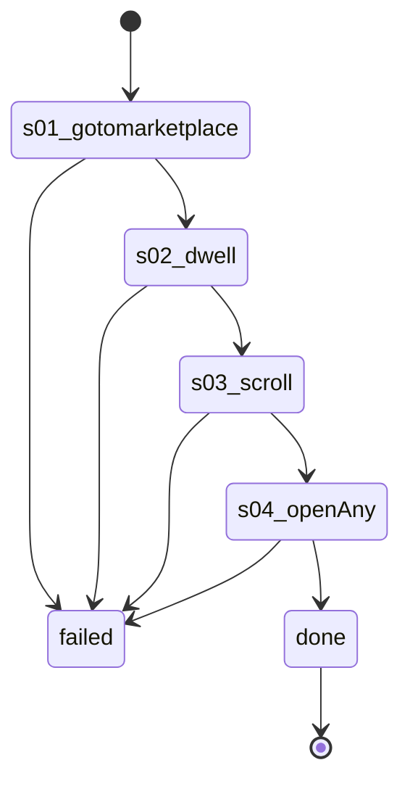

# Flow: `warmupMarketplaceBrowse`

Warm-up marketplaceBrowse: Listaro's runStage2, account-warmup.ts:135-174, recorded on 61594063207669 2026-10-22 (rule 35).

Built by `log flow fromInspect` from the recording `C:\Users\0\.logCli\runs\warmup\20261022T091121_61594063207669` (account 61594063207669). Run it on any account with `log flow run warmupMarketplaceBrowse --account <a> --live`, or over MCP as the tool `flowWarmupMarketplaceBrowse` (rule 31).

## Params

None.

## Steps

| # | Step | Does | Confirmed by | Facebook must answer (rule 73) | Recorded |
| --- | --- | --- | --- | --- | --- |
| 1 | `s01_gotomarketplace` | open `https://www.facebook.com/marketplace/` | — | `page /marketplace/` 2xx: `fields.buy_location.display_name` names the account's home city (else `marketplaceLocationWrong`) | 07_gotoHttpsWwwFacebook, 20454 ms, rea `ev_333611df173b5539eb2eb59c867db6e8dd91442af15889804f73ef66492469cf` |
| 2 | `s02_dwell` | dwell | — | — | 08_dwell35s, 8625 ms, rea `ev_4c10c5c422a3835699a05bb33c5eb3fd976ae86a58f246eae322fc82aa123a37` |
| 3 | `s03_scroll` | scroll | — | — | 09_scroll35X, 24203 ms, rea `ev_135b9d4f72da541ffb5c3dfad10bd9ca68c4f77b60bc55cb3e8cbff8e12c3bf3` |
| 4 | `s04_openAny` | openAny | — | `MarketplacePDPContainerQuery` 2xx: `data.viewer.marketplace_product_details_page` is present | 10_openany24X, 40656 ms, rea `ev_5ba0cd8eaeca0ca5907f2666947d4012493bf0f670964481b3a5eee96fd95245` |

## Machine

