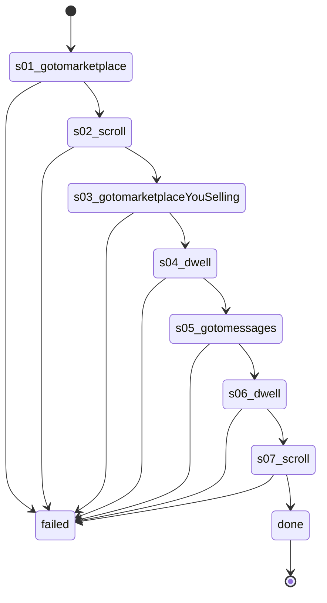

# Flow: `warmupMessagesVisit`

Warm-up messagesVisit: Listaro's runStage4or5 (stage 5), account-warmup.ts:214-246, recorded on 61594063207669 2026-10-22 (rule 35).

Built by `log flow fromInspect` from the recording `C:\Users\0\.logCli\runs\warmup\20261022T091121_61594063207669` (account 61594063207669). Run it on any account with `log flow run warmupMessagesVisit --account <a> --live`, or over MCP as the tool `flowWarmupMessagesVisit` (rule 31).

## Params

None.

## Steps

| # | Step | Does | Confirmed by | Recorded |
| --- | --- | --- | --- | --- |
| 1 | `s01_gotomarketplace` | open `https://www.facebook.com/marketplace/` | — | 21_gotoHttpsWwwFacebook, 22954 ms, rea `ev_965bc0e3fb58ce867ccd73708a95188d2510aed34b694b05f925aceec5d05411` |
| 2 | `s02_scroll` | scroll | — | 22_scroll47X, 24406 ms, rea `ev_a2451a6375caec28cd04791c67a3a179e20c585c82b992ae7f6b07e9b68a034c` |
| 3 | `s03_gotomarketplaceYouSelling` | open `https://www.facebook.com/marketplace/you/selling` | — | 23_gotoHttpsWwwFacebook, 18797 ms, rea `ev_87944fad03ad881236b0f70f9388cc39bb7fc0c4f37a6e34614060d3bf6107aa` |
| 4 | `s04_dwell` | dwell | — | 24_dwell24s, 7187 ms, rea `ev_6725cf1f5466e3a60178efde92611df2bf01367d3b8bfede1de127a1ddb1c427` |
| 5 | `s05_gotomessages` | open `https://www.facebook.com/messages/` | — | 25_gotoHttpsWwwFacebook, 11187 ms, rea `ev_46a1bfb437154469ec5a8e987feaafeae15869be2e545fbd6e88ffc8995824e1` |
| 6 | `s06_dwell` | dwell | — | 26_dwell23s, 6469 ms, rea `ev_6ecb4dd07b2554f4b42bb5031b997b09f06be9263873f2818aad526a2625d94b` |
| 7 | `s07_scroll` | scroll | — | 27_scroll1X200, 7641 ms, rea `ev_d27ea99c5886ec024edd47e333b6e025657d079733999782318f120664fe9ba3` |

## Machine

