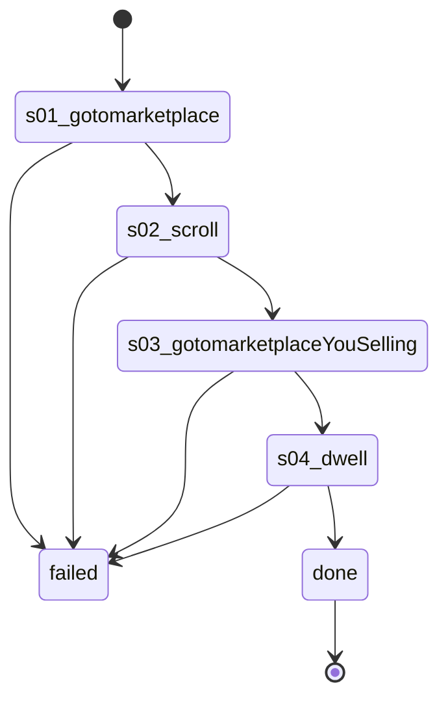

# Flow: `warmupSellingVisit`

Warm-up sellingVisit: Listaro's runStage4or5 (stage 4), account-warmup.ts:214-246, recorded on 61594063207669 2026-10-22 (rule 35).

Built by `log flow fromInspect` from the recording `C:\Users\0\.logCli\runs\warmup\20261022T091121_61594063207669` (account 61594063207669). Run it on any account with `log flow run warmupSellingVisit --account <a> --live`, or over MCP as the tool `flowWarmupSellingVisit` (rule 31).

## Params

None.

## Steps

| # | Step | Does | Confirmed by | Facebook must answer (rule 73) | Recorded |
| --- | --- | --- | --- | --- | --- |
| 1 | `s01_gotomarketplace` | open `https://www.facebook.com/marketplace/` | — | `page /marketplace/` 2xx: `fields.buy_location.display_name` names the account's home city (else `marketplaceLocationWrong`) | 17_gotoHttpsWwwFacebook, 24704 ms, rea `ev_d9351766fac493942cc0621ac21b317a38b335299ef37ff2d0ad9793da3141f8` |
| 2 | `s02_scroll` | scroll | — | — | 18_scroll47X, 21266 ms, rea `ev_c97f31377e9a64d9d5921ae3e157de0f96e4c31b590a4c7920064ac9c2ddcdcf` |
| 3 | `s03_gotomarketplaceYouSelling` | open `https://www.facebook.com/marketplace/you/selling` | — | `page /marketplace/you/selling` 2xx: `fields.current_marketplace.id` is present | 19_gotoHttpsWwwFacebook, 24218 ms, rea `ev_f2393440a0cd486d6ca181d75cb9c6ba9fbec88865d0433e017a6be80b1796b8` |
| 4 | `s04_dwell` | dwell | — | — | 20_dwell24s, 5344 ms, rea `ev_d2a4fd79c4aabb3bf4bd473b0cdc5110da20a4b19aa5ec8806966390f03708c3` |

## Machine

