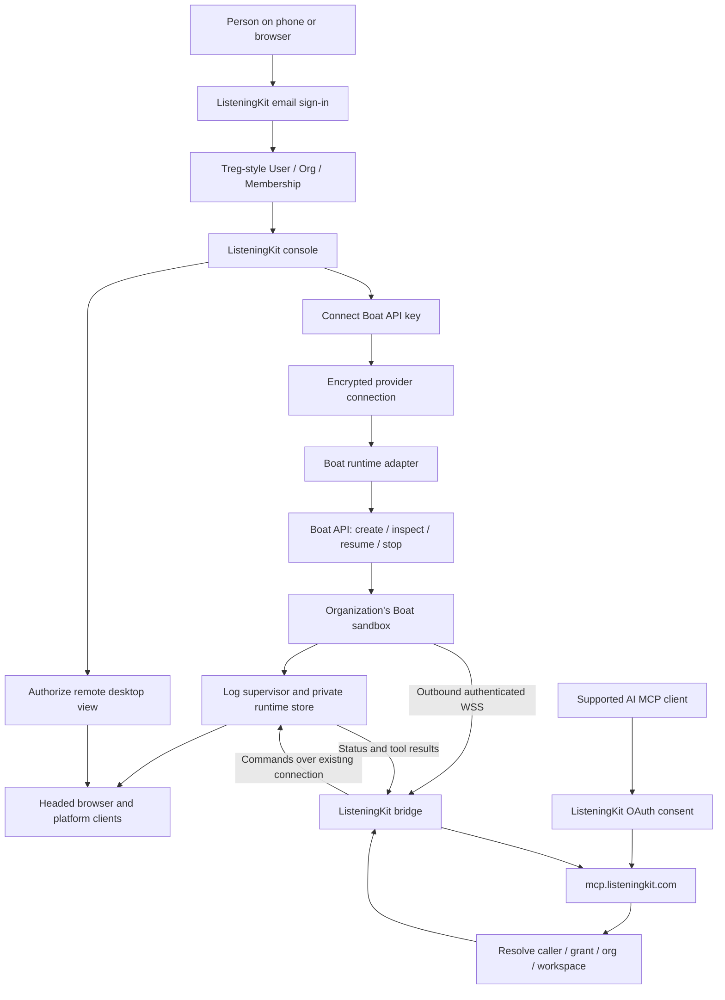
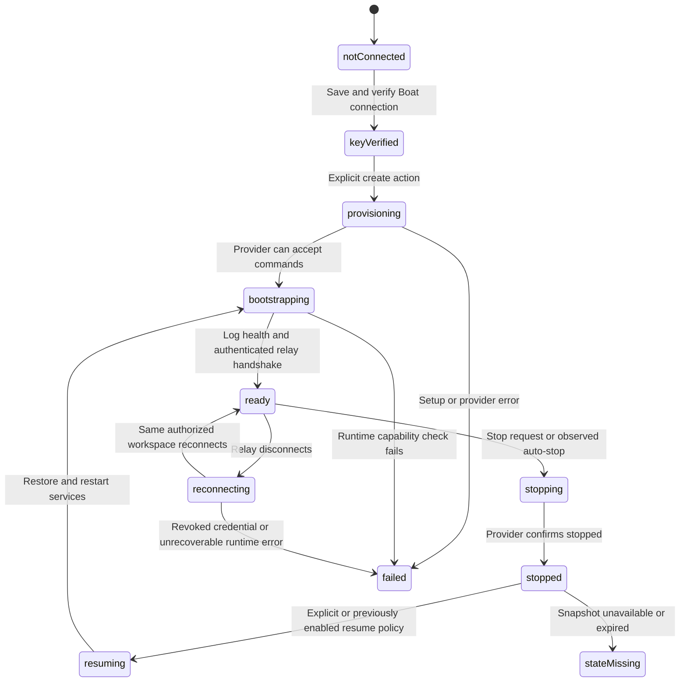

> Implementation reading order: [handoff and acceptance criteria](listeningKitHandoff.md), then [schema v2](listeningKitSchema.md). Those define native V1 scope and supersede broader legacy inventories or earlier field names in this companion. Deferred listings/CRM and future AI-provider identity are outside V1.

# Boat cloud runtime for ListeningKit hosted MCP — PR #113

## Authoritative data-boundary correction — 11 November 2026

Follow [listeningKitNativeData.md](./listeningKitNativeData.md): the Treg-shaped central PostgreSQL database holds login, teams, MCP consent, provider connections and minimal routing/recovery metadata only. Social accounts, credentials, conversations/messages, detailed jobs/results and private files live in the selected own-cloud or Boat workspace's local database/storage. Earlier central application-record or payload-summary proposals are superseded. The host relays authorized payloads without default durable retention; console private-data views require the runtime online.

Proposed architecture, 11 November 2026. Supplements the [Treg identity/database baseline](https://github.com/matthewdonsemail-lab/log/pull/113#issuecomment-6774123714). Documentation research only: no Boat account was connected, no key was requested, no sandbox was created, and no compute spend was started.

## What this adds

**A person can sign into ListeningKit with email, connect their own Boat API key, and run Log in a Boat sandbox behind `mcp.listeningkit.com`.** They do not need to sign into ListeningKit with Claude or ChatGPT, and they do not need a Claude/ChatGPT cloud workspace for this path.

Three independent connections:

1. **ListeningKit identity:** Treg-style user, organization, membership and website session.
2. **Compute:** a Boat API connection belonging to that ListeningKit organization, which provisions or attaches its authorized sandbox.
3. **MCP client:** ChatGPT, Claude or another supported client authorizes ListeningKit MCP access for the selected organization.

An AI model subscription is not the Boat compute credential. An MCP client grant is not a Boat API key. Existing provider workspaces can remain another runtime adapter when their attachment path is proven; Boat is an explicit alternative compute provider, not an implicit result of AI sign-in.

## Verified Boat capabilities and implementation limits

| Requirement | What the official documentation establishes |
| --- | --- |
| Create and manage sandboxes | Boat has a REST API, CLI and SDKs. Its [platform guide](https://docs.boat.dev/platform-guide.md) describes a product backend/database provisioning user sandboxes. ListeningKit retains its own backend and database. |
| Sandbox creation | [`POST /sandboxes`](https://docs.boat.dev/api/reference/sandboxes/create-sandbox.md) accepts `noEnv`, size, environment, setup script, snapshot settings and `ttlSeconds`. Persist a create request before sending it. Use `Idempotency-Key` with the same account/key/body for ambiguous create retries; Boat documents a 24-hour retention window. Never blindly retry a create after that window. |
| Isolated bootstrap | [Access and credentials](https://docs.boat.dev/environments/access.md) documents `noEnv: true`: account secrets, agent logins and Boat credentials are not inherited. Supply only the runtime's own bootstrap values. A clean template must contain no prior customer's browser profiles, raw captures or application secrets. |
| Service restart | [Always-on services](https://docs.boat.dev/long-running-tasks/always-on-services.md) documents enabled systemd services restarting after resume; a manually started process is insufficient. Boot the Log supervisor/bridge as a service. |
| Auto-stop | [Auto-stop](https://docs.boat.dev/long-running-tasks/auto-stop.md) and the create schema document a default deadline and explicit disabling/extension. The product must expose the chosen lifetime and compute behavior. A live WebSocket must not be treated as a documented auto-stop exemption. |
| State persistence | [What snapshots save](https://docs.boat.dev/snapshots/whats-saved.md) distinguishes persisted files from processes/memory and machine network identity. Put runtime state under a persistent path, not `/tmp`. Reopen the browser from disk and reconnect the relay after restore. |
| Stop/retention | [Stopping](https://docs.boat.dev/snapshots/stop.md) saves disk in the normal path; stopped disk is retained for at least 14 days and may later be cleaned up. Forced stop/snapshots-off can skip persistence. Specify retention and recovery; a snapshot is not indefinite data retention. |
| Resume | [Resume/fork](https://docs.boat.dev/snapshots/resume-and-fork.md) restores the newest snapshot. The resumed machine's IP may differ. Reconnect using sandbox identity and our workspace binding; never authorize through its former IP. |
| Readiness | [Readiness](https://docs.boat.dev/readiness.md) separates API-ready from restored services and setup completion. Require Log health plus the authenticated bridge handshake before ListeningKit reports `ready`. |
| Human browser interaction | [Desktop URL/embedding](https://docs.boat.dev/desktop-streaming/urls-and-security.md) documents a server-created `desktopUrl`, iframe embedding and a 10-minute initial admission window. Request a new URL on page load/reconnect/resume. This is a remote desktop stream of the workspace's actual browser. |
| Scoped key availability | [Scoped keys](https://docs.boat.dev/api/reference/account/create-scoped-api-key.md) describes actions/sandbox/environment restrictions and expiry, but explicitly documents `503 scoped_api_key_creation_disabled` until activated. Determine availability at implementation time; do not promise scoped key creation works for every account. |

These sources establish the infrastructure surface. Running this repo's actual browser driver and platform clients on Boat remains an implementation acceptance requirement, including installed binaries, persistent profiles, proxy gates and visible desktop behavior.

## Exact deployment and request path



**Hosted:** public site, Treg-shaped control service/PostgreSQL, encrypted Boat connection, lifecycle adapter, MCP authorization and bridge routing.

**Inside Boat:** Log, its runtime supervisor, platform libraries, headed browser, browser profiles/cookies, captures and runtime database. The sandbox initiates WSS to the hosted bridge, so no public Log port or inbound sandbox tunnel is needed for normal MCP dispatch. The provider desktop stream supplies the human interaction path separately.

`mcp.listeningkit.com` remains stable when a sandbox stops or reconnects. The MCP endpoint can return an explicit offline/setup outcome; a reachable endpoint does not imply the sandbox is running.

## Treg database mapping plus Boat additions

Keep Treg's [User](https://github.com/superdesigndev/treg/blob/3149cb1a23f6a0ce2d6ffab403f79f58855d3856/src/treg/models.py#L242), [Org](https://github.com/superdesigndev/treg/blob/3149cb1a23f6a0ce2d6ffab403f79f58855d3856/src/treg/models.py#L36), [Membership](https://github.com/superdesigndev/treg/blob/3149cb1a23f6a0ce2d6ffab403f79f58855d3856/src/treg/models.py#L294), [central caller resolution](https://github.com/superdesigndev/treg/blob/3149cb1a23f6a0ce2d6ffab403f79f58855d3856/src/treg/domain/identity/access.py#L268) and [MCP grant/refresh separation](https://github.com/superdesigndev/treg/blob/3149cb1a23f6a0ce2d6ffab403f79f58855d3856/src/treg/models.py#L1441).

For recoverable upstream credentials, model Treg's organization-owned, encrypted [`Secret`](https://github.com/superdesigndev/treg/blob/3149cb1a23f6a0ce2d6ffab403f79f58855d3856/src/treg/models.py#L791). A Boat key must be decryptable by the lifecycle adapter to call Boat; storing only a hash would make that impossible. Runtime bearer credentials, in contrast, can be stored as hashes for verification. Keep encryption keys outside the database.

The following are proposed ListeningKit extensions, not existing Treg models:

| Record | Minimum fields and invariants |
| --- | --- |
| `ProviderConnection` | `id`, `orgId`, `createdByUserId`, `provider: boat`, `secretId`, observed provider account reference, explicit provider billing context, verified capabilities, status, checked time. User-provided labels are not proof of account ownership. |
| `Workspace` | `id`, `orgId`, `providerConnectionId`, unique connection/sandbox binding, `sandboxId`, runtime version, lifecycle state, desired run policy, generation, last heartbeat. V1 has one selected active workspace per org. |
| `ProvisioningOperation` | `id`, `orgId`, `workspaceId?`, create request hash, idempotency key, provider request/sandbox reference, state, error and timestamps. Store before calling Boat. |
| `RuntimeCredential` | `workspaceId`, credential hash, generation, expiry and revocation. Never interchangeable with the Boat key or MCP token. |
| Pairing/bootstrap state | Reuse the Treg [`Ephemeral`](https://github.com/superdesigndev/treg/blob/3149cb1a23f6a0ce2d6ffab403f79f58855d3856/src/treg/models.py#L725) pattern and [`kv_take`](https://github.com/superdesigndev/treg/blob/3149cb1a23f6a0ce2d6ffab403f79f58855d3856/src/treg/ratestore.py#L95) for single-consumer bootstrap; bind it to org, workspace and the provisioning operation. |
| `Operation` | `orgId`, `workspaceId`, caller/grant identity, idempotency key, generation, action, status and result reference. Persist before runtime dispatch; distinguish unknown outcome from failed work. |

ListeningKit organization id and Boat organization/billing id are different fields. Do not change a Boat account's global active wallet per request: persist and send the explicit billing context supported by that endpoint. Other members can use the workspace only through their ListeningKit permissions; they never receive the owner's Boat key.

## User experience: connect, create and use

1. Sign into ListeningKit through email. Create/join a team using the agreed Treg flow.
2. In Settings -> Workspace, choose Boat. Enter the API key through a private credential field; submit over HTTPS to the control service. Never put it in chat, URLs, analytics or browser storage.
3. Backend verifies the connection through permitted read-only Boat calls. [`GET /me`](https://docs.boat.dev/api/reference/account/get-current-boat-user.md) supplies provider identity when the credential permits it; report missing permissions separately from an invalid key. Determine the lifecycle and desktop actions actually available.
4. Show the chosen account/billing context, sandbox size and auto-stop policy. **Saving a key does not start compute.** The explicit Create workspace action starts the billable provisioning flow. Attaching an existing authorized sandbox is a separate visible choice.
5. Persist the provisioning operation, then `POST /sandboxes` with `noEnv: true`, snapshots enabled and the persisted idempotency key. Start from a versioned clean Log template or an idempotent installer; do not run an unpinned remote script supplied by a tool caller.
6. Supply only the relay address, workspace reference and one-use bootstrap credential. The bootstrap installs/starts the supervisor, exchanges the credential for a scoped runtime identity and starts outbound WSS.
7. Verify provider state, setup completion, runtime health and bridge binding. Then mark Accounts as ready. Provider `ready` alone is insufficient.
8. Connect a social platform in Accounts. Obtain a fresh Boat desktop URL on the backend after membership checks, and display the real headed browser for the user to complete sign-in. Platform responses confirm success. Cookies stay in that workspace.
9. Connect ListeningKit to the AI application's MCP client through the existing consent design. Tool calls now route through the hosted MCP to that org's Boat runtime.

The Boat key is needed by the hosted lifecycle adapter, not by Log's normal social tool calls. Do not inject it into the runtime. Model credentials, if a chosen runtime feature needs them, are a separate explicit connection; this design does not require enabling Boat's integrated coding agents.

### Illustrative create request

```http
POST https://boat.dev/api/v1/sandboxes
Authorization: Bearer <server-side Boat credential>
Idempotency-Key: <persisted account-unique operation key>
Content-Type: application/json

{
  "type": "default",
  "noEnv": true,
  "snapshots": true,
  "ttlSeconds": 3600,
  "env": {
    "LISTENINGKIT_WORKSPACE_ID": "<workspace id>",
    "LISTENINGKIT_RELAY_URL": "wss://<configured bridge host>/<runtime endpoint>",
    "LISTENINGKIT_BOOTSTRAP_TOKEN": "<single-use scoped bootstrap>"
  }
}
```

This is a schema illustration, not an executed request or a full bootstrap. The size/lifetime shown are examples requiring the user's setup selection; the bridge hostname and runtime endpoint are not provisioned. Add the selected clean template/setup option and provider billing selector from the documented API at implementation time. Retire the bootstrap after exchange; ensure it cannot mint a second runtime identity after a restore.

## Lifecycle and persistence contract



- Install the runtime as an enabled systemd service. Persist Log state under a dedicated path such as `/home/user/.logCli`; resolve actual browser profile/data directories explicitly. Keep durable application logs outside excluded temporary/journal paths.
- On resume, inspect persisted identity and connection generation, reacquire required browser/profile locks, reopen existing profiles and reconcile in-flight operations. Preserve the repo's one-browser-per-account lifecycle and proxy/self-check gates. Never start a fresh competing browser for each MCP request.
- Boat IP is transport addressing; platform egress continues through the existing account proxy rules. A sandbox IP change must not silently replace a configured platform proxy.
- A fork can copy private files. V1 does not fork customer runtime disks or fail over by cloning them. Clean templates are separate from customer snapshots. Later fork support must revoke/regenerate runtime identity and prevent two active browsers for one account.
- A missing snapshot becomes `stateMissing`, with explicit recovery/reconnection. Do not create a fresh machine and report the old sessions as recovered.
- Before a normal stop, flush application state and reconcile writes. Observe the real stop result; a request or timeout alone is not confirmation. No force-stop, delete, or snapshots-off default.

**Run policy:** keep the configured auto-stop policy visible. A user who wants ongoing account hosts/watchers must explicitly enable an appropriate continuous runtime policy and its compute usage. Otherwise the hosted MCP reports stopped/offline and offers resume. Auto-resume may be added only as an explicit stored policy; a random tool call must not unexpectedly start paid compute. Account-specific active hours remain enforced inside the runtime.

## Proposed control API boundaries

These are ListeningKit endpoints to implement; they are not claimed to be existing Boat routes:

- Save/verify/rotate a Boat connection: owner/admin only; return masked metadata.
- Create/attach/resume/stop a workspace: explicit organization authorization, configured capability and persisted lifecycle operation.
- Obtain desktop access: membership plus explicit workspace-interaction permission; the URL grants desktop access, so do not send it to every viewer role or place it in generated tool output.
- Runtime bootstrap/connect: separate one-use bootstrap then workspace credential; no browser cookie or Boat key accepted as runtime identity.
- MCP dispatch: resolve current grant, membership and allowed action; route only to the bound workspace and reject stale connection generations.

Provider webhooks can later accelerate state updates using Boat's [webhook API](https://docs.boat.dev/api/reference/account/create-webhook.md) and its documented signing verification. V1 can use bounded polling of the selected sandbox plus runtime heartbeats; avoid requiring an account-wide webhook permission just to run one workspace. Neither a heartbeat nor a webhook replaces authorization checks or operation reconciliation.

## Implementation order and unresolved checks

1. Implement the Treg-shaped identity, organization, membership and MCP authorization baseline already specified.
2. Add encrypted provider connections and the Boat adapter for read-only verification and sandbox inspection.
3. Add create/attach/resume/stop operations with duplicate-create reconciliation, billing context and visible lifetime selection.
4. Build the versioned Ubuntu runtime installer/template, systemd supervisor, one-use bootstrap and outbound WSS bridge.
5. Wire Accounts to authenticated desktop interaction and real platform status; enforce user/team separation throughout.
6. Exercise actual stop/resume recovery, revoked key, failed setup, unavailable snapshot and lost create-response paths before advertising support.

**Not yet established by documentation alone:** AdsPower installation/license operation in Boat, the exact persistent browser paths, the provider's available key scopes for this account, actual WSS egress and reconnect behavior, remote desktop behavior on the target phone, and this repo's remaining Twenty-to-workspace isolation work. These are implementation tasks, not reasons to bind the product to Claude or ChatGPT sign-in.

The concrete design is now: **ListeningKit account -> team -> user-supplied Boat connection -> isolated cloud Log runtime -> outbound bridge -> hosted MCP -> authorized AI client**, with website identity, compute access and MCP consent independently modeled.

## Shared hosted MCP contract

[listeningKitHostedMcp.md](./listeningKitHostedMcp.md) specifies the common authorization, pairing, runtime routing, operation recovery and MCP page behavior for own-cloud and Boat workspaces.


## Decision: native application data, no Twenty dependency

As of 11 November 2026, [listeningKitNativeData.md](./listeningKitNativeData.md) supersedes earlier Twenty migration/compatibility ambiguity: the target hosted product uses the Treg-shaped PostgreSQL backend for application records and identity. Runtime-private storage remains in the selected workspace. Twenty is not a required service in the target design; removal and migration are implementation work.


