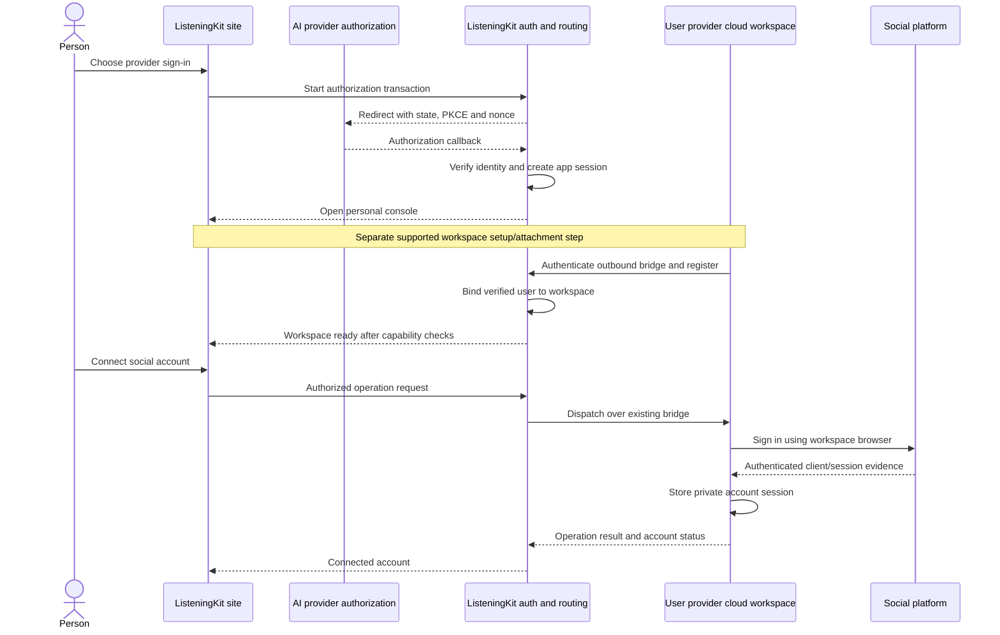

> Implementation reading order: [handoff and acceptance criteria](listeningKitHandoff.md), then [schema v2](listeningKitSchema.md). Those define native V1 scope and supersede broader legacy inventories or earlier field names in this companion. Deferred listings/CRM and future AI-provider identity are outside V1.

# ListeningKit sign-in, console and cloud workspace

## Authoritative data-boundary correction — 11 November 2026

Follow [listeningKitNativeData.md](./listeningKitNativeData.md): the Treg-shaped central PostgreSQL database holds login, teams, MCP consent, provider connections and minimal routing/recovery metadata only. Social accounts, credentials, conversations/messages, detailed jobs/results and private files live in the selected own-cloud or Boat workspace's local database/storage. Earlier central application-record or payload-summary proposals are superseded. The host relays authorized payloads without default durable retention; console private-data views require the runtime online.

Status: proposed product and architecture specification; implementation pending.
Owner: matt. Updated: 11 November 2026. Discussion: PR #113; hosted MCP dependency: #112.

## Implementation baseline

Follow [listeningKitTregArchitecture.md](./listeningKitTregArchitecture.md): Treg-shaped PostgreSQL control database and identity/auth service, email-code sign-in, explicit create/join-team flow, and organization-scoped resources. This supersedes the prior Clerk/Convex and automatic personal-organization proposal. AI provider sign-in stays a future extension. Screen and runtime-state details below remain applicable; user-scoped descriptions mean access through verified organization membership.

## 1. Intended experience

The person opens ListeningKit, signs in using the Treg-style email flow, creates or joins a team, and reaches that team's `/console`. The console contains Settings, Usage, Analytics, Accounts and Subscription. Their selected own-cloud or Boat workspace runs Log, its MCP tools, platform clients, browser and local state. The hosted service authorizes the user through team membership and routes calls over an outbound workspace connection. See [listeningKitHostedMcp.md](./listeningKitHostedMcp.md) for the authoritative shared protocol; AI-provider website sign-in remains a future extension.

The login page is the entry into the application. Marketing, documentation and MCP definition pages remain public. The console is authenticated. The ordinary console is a web application; the generated UI shown inside an AI application in the original drawing is a separate presentation surface that must use the same authorization and tool contracts.

Signing into ListeningKit must complete independently of workspace setup. A signed-in user can inspect connection status and resolve setup failures. Opening the console must never imply that a workspace exists or that Log is running.

## 2. User journey

The detailed provider-OAuth journey previously in this section is superseded by the accepted email OTP flow. The schema and API contract are in [listeningKitSchema.yaml](listeningKitSchema.yaml); its [reading guide](listeningKitSchema.md) maps the frontend and backend slices.

1. Open `/sign-in` (`/login` redirects here), enter email and receive a short-lived code.
2. Verify the code at `/verify`. First verified sign-in creates the user; returning sign-in resumes the same identity.
3. Create, join by invitation, or select a team at `/teams`. Verify membership server-side for each protected operation.
4. Enter `/console/accounts`. Team/workspace identity remains usable while the workspace is disconnected.
5. Complete supported own-cloud or Boat workspace setup under `/console/settings`, pair the runtime, then connect the accepted AdsPower mode. Show the actual browser/profile location.
6. Connect the MCP client under `/console/mcp`; preserve its validated authorization request across sign-in and team selection, then obtain consent for that client/team.
7. Run private account and platform operations through the selected workspace. Platform responses decide sign-in success and sessions remain private to that workspace/browser host.
8. Sign out or revoke a grant/runtime separately. Neither action silently deletes accounts or private data.

Future AI-provider identity can resolve to the same user/team model after a supported integration exists. It is not required for initial sign-in and supplies no implied compute entitlement.

## 3. Screen and route model

| Route | Content and behavior |
| --- | --- |
| `/sign-in`, `/verify` | Email entry, code verification, retry/expiry/rate-limit states. |
| `/login` | Compatibility redirect to `/sign-in`. |
| `/teams` | Create, join by invitation or select an authorized team. |
| `/console` | Resolve to Accounts after authentication/team selection. |
| `/console/accounts` | Workspace readiness, private accounts, platform sign-in operation progress. |
| `/console/settings` | Team/members/invites, supported workspace/provider setup, AdsPower connection and session controls. |
| `/console/usage` | Minimal service counts/timing from control storage; identify source and date range. |
| `/console/analytics` | Private metrics from the live workspace with provenance; unavailable while offline. |
| `/console/subscription` | `notConfigured` until an actual billing authority is implemented. |
| `/console/mcp` | Connector instructions, client/team consent and grant revocation. |

Shared console frame: ListeningKit name, the five navigation links, current user, workspace status and sign-out. On phones, navigation remains usable without a desktop sidebar. A connection failure keeps the frame and displays a recovery action. New sign-ins must not expose a previous user's cached account data.

## 4. Separate state models

Authentication, workspace connectivity and social account authentication are independent state machines. Authentication failure must not be reported as workspace failure, and a bridge reconnect must not sign the person out of ListeningKit.

### Application session

`signedOut -> requestingCode -> verifyingCode -> signedIn`

- Cancelled email verification returns to `signedOut` with a retry action.
- Invalid, expired or already-consumed codes create no session.
- A session expires or is revoked into `signedOut`; preserve only a safe internal return path.
- Logging out invalidates that application session and clears its private UI caches. It does not silently delete social accounts or stop their workspace.

### Workspace lifecycle

`notConnected -> awaitingConnection -> connecting -> ready`

`ready -> reconnecting -> ready | offline`

`connecting -> failed`; any observed loss of required persisted state -> `stateMissing`.

| State | User sees | Permitted behavior |
| --- | --- | --- |
| `notConnected` | Connect your workspace | Console navigation and identity/settings; no runtime calls. |
| `awaitingConnection` | Finish connecting in your provider workspace | Await a short-lived pairing authorization. |
| `connecting` | Connecting to your workspace | Validate ownership, handshake and runtime capabilities. |
| `ready` | Connected; last verified contact | Permit supported runtime calls. |
| `reconnecting` | Reconnecting; last successful contact | Reconcile in-flight operations; prevent duplicate dispatch. |
| `offline` | Workspace offline | Permit supported reconnect instructions; preserve stale data labels. |
| `failed` | Setup failed, with a specific cause | Retry the failed supported setup step. |
| `stateMissing` | Workspace data could not be recovered | Require an explicit recovery or account reconnection decision. |

A supervisor can restart a process while its workspace is running. Workspace suspension, replacement and filesystem persistence require provider-specific handling. Heartbeats indicate observed connectivity; they cannot guarantee continued compute.

### Social account sign-in

`notConnected -> openingLogin -> awaitingUser -> verifying -> connected`

Additional outcomes: `challengeRequired`, `cancelled`, `failed`, `sessionExpired`. The browser and platform responses decide success. If a challenge requires user input, the UI keeps the same sign-in operation open and tells the user what is required. Solver calls run from the workspace when supported and authorized by the existing tool rules.

## 5. Architecture and trust boundaries

Hosted control service owns application sessions, identity links, workspace ownership, pairing records and request routing. The cloud workspace owns Log runtime state, browser artifacts, platform credentials and `log.db`. Existing Twenty-backed account handling needs an explicit migration/compatibility decision before claiming workspace-only storage; the current owner-based installation cannot simply be exposed to multiple users.

A website hosted on a different origin cannot read a workspace browser's cookies. The social login must run in that workspace and be displayed using a supported remote browser interaction mechanism. The browser display/input transport remains a required implementation dependency. An ordinary HTML iframe is insufficient evidence that this mechanism exists.

## 6. Minimum logical data model

These are logical records; storage technology remains an implementation choice.

| Record | Minimum fields and invariants |
| --- | --- |
| `user` | `id`, creation time, account status. Application-owned identity. |
| `providerIdentity` | `userId`, `provider`, verified `issuer`, verified `subject`, `clientId` where identity is client-scoped. Unique within that provider's documented identity namespace. Email is display/contact data, not an account linking key. |
| `authTransaction` | Hashed state/session binding, PKCE verifier, nonce, provider, safe return path, expiry, consumed time. Single use. |
| `appSession` | Hashed opaque session identifier, `userId`, expiry and revocation state. Browser cookie is HttpOnly, Secure and appropriately SameSite. |
| `workspace` | `id`, `userId`, provider product/environment, runtime version, observed state, connection generation, last contact and capabilities. V1 attaches one active workspace per user; replacement is explicit. |
| `pairing` | Hashed one-time code, authenticated `userId`, intended workspace/provider binding, expiry and consumed time. |
| `operation` | Request id, authenticated `userId`, `workspaceId`, generation, command, deadline and observed outcome. No platform secrets in hosted operation payloads or logs. |
| `socialAccount` | Workspace-local platform id, stable account identity, observed status, verification time and private session reference. |

Different provider identities are linked only through an explicit authenticated linking flow. A matching email never merges accounts automatically. Future workspace multiplicity requires an explicit selection model; V1 must not choose an arbitrary live workspace.

## 7. Service contracts

- Session status returns only the signed-in user's identity and application session state.
- Workspace status returns observed state, capabilities, last contact and a supported next action.
- Pairing begins only in an authenticated application session. The runtime consumes the pairing code once and exchanges it for a workspace-scoped credential.
- Runtime commands authorize user ownership and required capability before dispatch. Caller-provided `userId` is never an authority.
- The bridge uses the prior PR #113 protocol proposal: `register`, `heartbeat`, `call`, `result`, `cancel`. Each call has a request id, workspace id, connection generation and deadline.
- Reconnect reconciles outstanding operation ids. A lost result for a social write becomes `outcomeUnknown` until checked; it is never blindly replayed.
- Console endpoints and MCP calls share authorization, ownership and runtime command execution. MCP authentication and website authentication are distinct entry paths into that same ownership model.
- Revoking a workspace invalidates its routing credential; a superseded connection generation cannot return valid results for new operations.

## 8. Provider capability gate

For each exact provider product, record evidence independently for: website identity sign-in; optional plan usage; workspace creation/attachment; install/start; outbound bridge; browser interaction; retained state after pause/replacement.

**ChatGPT identity:** official website documentation describes Authorization Code with PKCE and OpenID Connect. As checked on 10 November 2026, website Sign in with ChatGPT is a limited trial for selected commercial partners. The deployment needs its own approved registration and callback configuration. The website identity guide explicitly treats ChatGPT plan usage as a separate flow.

**Flow AI example:** its linked guide describes per-user ChatGPT plan authorization and server-side encrypted token storage. It is a useful reference for account-specific authorization. It does not establish that the OAuth callback provisions a provider cloud workspace for ListeningKit.

**Claude and Grok:** requested integrations; website identity authorization and workspace attachment are unverified in this specification. Their buttons remain unavailable until each exact supported flow and registration are established. No invented authorization endpoints or copied third-party client identities.

## 9. Ordered implementation slices and acceptance

1. **Identity and console:** working provider registration; sign-in, safe callback, persisted app session, five protected routes, sign-out and user isolation. Accepted when two users see only their own console state and cancellation/expired callbacks recover correctly.
2. **Workspace attachment:** one named provider product, real installation/startup, authenticated pairing and outbound bridge. Accepted when a console operation reads an actual workspace-local Log record, and another user is refused.
3. **Social sign-in:** supported browser presentation, existing account lifecycle/gates, private workspace session storage. Accepted when sign-in is confirmed by platform responses and a later read uses the saved session.
4. **Usage and analytics:** connect each displayed metric to actual runtime records. Accepted when values, source, freshness and unavailable/offline behavior are demonstrable.
5. **Recovery:** process restart, socket disconnect, workspace pause, workspace replacement and revoked credentials handled separately. Accepted when no duplicate social write occurs and missing state is clearly reported.
6. **Additional providers and billing:** activate each provider only after the same evidence exists. Subscription page reflects an actual ListeningKit billing integration when one is implemented.

These are future acceptance criteria, not checks performed during this specification task.

## 10. Decisions and dependencies before implementation

- Approved website authorization registration for the first provider.
- Exact provider cloud product and supported method to create or attach a workspace. No automatic provisioning promise until demonstrated.
- Supported method for the user to interact with the headed workspace browser from their phone.
- Persistence and recovery behavior for workspace-local data; restoration ownership and any transfer path must be specified before replacement can be called seamless.
- Migration from existing owner-only MCP/Twenty storage to isolated user workspaces.
- Actual source of ListeningKit subscription state; no assumption that an AI subscription pays for ListeningKit.

## Sources and existing work

- User's two attached drawings and 10 November 2026 clarification: provider sign-in leads into the five-page console.
- https://developers.openai.com/siwc/website (fetched 10 November 2026).
- https://github.com/sangleshubham/flow-ai/blob/main/docs/setup-chatgpt-signin.md (raw content fetched 10 November 2026).
- PR #113 architecture comment: https://github.com/matthewdonsemail-lab/log/pull/113#issuecomment-6773420404.
- Existing code baseline: `src/mcp/oauth/client.ts` restricts authorization to the server owner; `src/mcp/server/index.ts` executes in a shared server context. `site/apps/web/src/App.tsx` currently provides public routes, without this console.
- Existing implementation dependencies: #112 hosted MCP; #96/#97 local state/schema; #94 client continuity; #99 process overhead; #114/PR #115 Discord session behavior. Earlier PR #113 comments contain the provider transport issue evidence.

## Decision: native application data, no Twenty dependency

As of 11 November 2026, [listeningKitNativeData.md](./listeningKitNativeData.md) supersedes earlier Twenty migration/compatibility ambiguity: the target hosted product uses the Treg-shaped PostgreSQL backend for application records and identity. Runtime-private storage remains in the selected workspace. Twenty is not a required service in the target design; removal and migration are implementation work.

## Implemented local Connections reader

The local console now requests GET /api/console/connections. The development adapter and workspace-owner bearer-protected runtime HTTP route share src/observability/console/helpers/connections.ts. The projection reads the existing LOG_LOCAL_ACCOUNTS/default localAccounts.json through the same reader used by Log, then merges the existing protected session.json metadata from the platform runtime directories. No account/session migration or remote account lookup is performed. Session saved means a stored loggedIn observation, not a new validation of platform access.

The response contains account name, fixed platform, opaque display id, saved session state and last-checked timestamp. It never returns cookies, passwords, tokens, proxy addresses or browser profile ids. Provider configuration checks reuse local key resolvers and return only configured/notConfigured/unavailable; treg reads token presence in its existing local config, not the token value. No balance requests, paid calls, sign-in attempts or account writes are triggered. Existing configured providers, including additional locally configured media, data and infrastructure providers, render in Extensions. Local key management uses the existing private user environment file through src/auth/credentials/client.ts. GET returns fixed masks and configuration/persistence metadata. POST /api/console/credentials validates provider fields, atomically replaces supplied values and confirms readback before reporting saved. Save now requires the provider-specific authenticated read in site/apps/web/server/credentialValidation.ts before replacing the stored key. An accepted check confirms access at that moment, not future availability or adequate balance.

Frontend anchors: ConnectionsPage.tsx and connectionsData.ts under site/apps/web/src/pages/console. The UI shows real loading/error/empty states, supports explicit Refresh, and reloads metadata when revisited. Hosted team/session routing and authorization remain pending; the local reader is not central storage or a substitute for selected workspace authorization.

## Local credential management and explicit account checks

The Vite local adapter supports POST /api/console/connections/check for an opaque account id. Both mutation routes require a loopback socket and host, same-origin requests and the console JSON header. Account checks use one XState-controlled Log MCP stdio connection through bin/logMcp.ts, getGuide, logGet and logCall. Opening Connections never checks accounts remotely. Account activation and recorded session state remain separate. Cards show saved session status, last observation and an explicit check control. Attempts persist minimal state in the existing SQLite state table under consoleAccountCheck. Interrupted attempts display unknown rather than checking indefinitely. Recorded stops prevent automatic retries. Facebook retains its existing browser check requirement.

PR #118 (https://github.com/matthewdonsemail-lab/log/pull/118) was inspected for its hosted account projection and normal tool-handler boundary. It has not been merged into this branch. These mutation routes currently belong to the local Vite adapter; selected-workspace hosted operations and runtime HTTP mutation authorization remain separate integration work. No account check or credential replacement was executed during implementation.

New extension logos were downloaded from the providers' own sites: Jina https://jina.ai/icons/favicon-128x128.png; AssemblyAI https://www.assemblyai.com/favicon.ico; Parallel https://parallel.ai/icon.svg?icon.1d0de8d5.svg; 2Captcha https://2captcha.com/favicon.ico; Byteful https://byteful.com/safari-pinned-tab.svg. Assets are served from site/apps/web/public/logos.

### Extension credential form convention

All extensions share AddKeyDialog: one editable password input per credential with an accessible Font Awesome show/hide control inside it. The previous configured pill and separate replacement action are removed. The local POST /api/console/credentials/read endpoint returns only the selected provider fields into dialog memory, never into the Connections query cache or browser persistence. It shares the local mutation access guards and no-store headers. Closing the dialog clears values and reveal state.

Save shows an inline spinner and disables repeat submission while validating and persisting. Failure keeps the dialog and entered values, preserves the previous saved key and uses the shared toast above the dialog. Success closes the dialog and confirms the save by toast. Unchanged saved keys can also be checked; identical persisted values cause no file rewrite. The shared toast layer is above dialogs and uses readable text with live announcements.

Validation performs exactly one bounded authenticated provider read with no retries, redirects, generation, transcription or research job creation. Fixed probes cover model lists (TypeSafe/SubQ), image-tool listing (MemeLord), wallet reads (Fish/Jina/2Captcha), voice listing (Inworld), transcript metadata listing (AssemblyAI, limit one), monitor metadata listing (Parallel, limit one), organization listing (treg) and customer metadata (Byteful). Only acceptance/failure crosses back to the form; provider payloads are discarded. Rejection, throttling and inability to verify are separate safe error codes.

Contract sources checked for this change: https://api.typesafe.ai/openapi.json; https://docs.subq.ai/using-the-api/authentication/; https://docs.inworld.ai/llms.txt; https://www.assemblyai.com/docs/pre-recorded-audio/api-reference/transcripts/list; https://docs.parallel.ai/public-openapi.json; https://treg.to/openapi.json; https://2captcha.com/api-docs/get-balance. Existing Log adapters supply the MemeLord, Fish, Jina and Byteful request contracts. No real user key was revealed, validated or replaced during implementation.

### Connected profile presentation

Only the top Connected profile section supports Table/Cards, search and pagination. Its layout preference is stored in logConsoleConnectionsView. Both layouts use the same account statuses and actions. Tables have semantic headers, a caption and contained horizontal scrolling. Profile cards use quiet white surfaces and subtle borders.

Add a connection remains the original blue platform-card grid with its own platform filter. Extensions remains the original blue card grid, grouped by provider category with its existing Manage key actions. They stay visible below Connected and are not moved into tabs or affected by the profile layout toggle.

Implementation anchors: site/apps/web/src/pages/console/ConnectionsPage.tsx and ConnectionList.tsx. This change does not alter runtime metadata or credential storage.

The Connected toolbar includes ConnectionPlatformFilter, a Floating UI popover rendered through a portal with fixed positioning, viewport shifting and flipping, focus handling, Escape and outside dismissal. Native labelled checkboxes select one or more social platforms; no selection means all platforms. Platform counts come from the loaded account registry, X maps to the stored twitter identifier, and selection combines with account search before pagination. The filter affects both Connected layouts only. Changing or clearing selections resets pagination, and the trigger shows the active selection count. No remote platform calls are made by filtering.

Connected profiles show a dedicated Last checked column: a short date above a minute-level 24-hour time, with aligned digits and no repeated label in each row. The semantic time element retains the exact timestamp and exposes the full local date, time and timezone in its title. Missing observations show Never checked. Browser/service check notes sit with status, separate from the observation timestamp.

Browser check required is a distinct displayed profile status for accounts whose supported check requires the browser. It replaces the ordinary signed-in/out/unchecked badge and is not repeated as status subtext. Deactivated accounts, recorded stops and explicit checkpoint/restriction states retain priority. The saved native session observation and timestamp remain unchanged; requiring a browser is not a new authentication result. Both table and cards share this status presentation and search label.

Connected profile identity uses a larger, unframed platform logo beside the account name in both views. Platform names remain available to assistive technology and search, without visible subtitle text. The platform and extension catalog cards retain their existing presentation.

### Add connection modal

Each platform card Sign in action opens PlatformSignInDialog for the selected platform with its logo and title. The native modal dialog handles focus containment, Escape/backdrop dismissal and restores focus to its trigger; body scrolling is locked while open. It opens independently of the account-list query so a metadata error does not prevent viewing it. This is the sign-in presentation only: no console login-start/session-attachment endpoint exists on this branch, so final submission remains disabled. No platform login or account mutation is dispatched by opening the dialog.

The sign-in modal starts with two central choices for every platform: Continue with Username & Password and Paste cookies. The previous connection description, capability paragraph and unavailable paragraph are removed. Selecting a method opens the matching fields and a Back control; password visibility uses the shared Font Awesome eye convention. Fields are ephemeral, are removed when changing methods or closing, and are not persisted or sent by this presentation. Final authentication submission remains separate integration work, and is disabled rather than simulating account creation.

Both sign-in method buttons include an equal-height grey preview above the text: static username/password fields for credentials and a cookie document for pasted cookies. These previews are decorative, contain no real account data or nested interactive controls, and remain part of the same clickable method button.

The platform modal includes a brief description below the inline logo/title explaining username/password versus cookies from an existing signed-in browser. The description changes to match the selected form and is associated with the dialog for assistive technology. Each decorative method preview loops through illustrative entry, checking and session-ready stages on a shared seven-second Motion timeline. The examples use fixed demo text and masked values, never submitted credentials or runtime outcomes. Reduced-motion preferences replace both loops with a static entry preview.

Table profile actions use ConnectionActions: a labelled ellipsis trigger opens a portalled Floating UI menu with fixed positioning, viewport flip/shift, keyboard navigation, focus restoration and Escape/outside dismissal. The existing Check status action retains its guard and running/disabled states; disabled items explain the existing reason and cannot dispatch. Selecting an enabled action closes the menu. Card actions keep their existing visible button. The narrower table Actions column returns space to Status and Last checked.

### Browser check required: state map and modal

The current presentation requirement is derived from the Facebook platform, not a fresh runtime observation. Saved native session state and checkedAt remain separate evidence. Review browser check opens BrowserCheckDialog from the profile action in table or cards. It shows the saved result, the required browser flow and possible outcomes. Refresh saved status only re-reads Connections; it never starts a browser or dispatches a platform request. Deactivated, checkpoint/restricted and recorded-stop precedence and guards remain in force.

The intended session-only workflow is: browserCheckRequired -> accountBrowser -> readSession -> loggedIn | loggedOut | needsAttention | stopped | unknown. Reuse the account-owned browser, retain proxy/device/hours/launch gates and private step/HAR evidence, and derive the outcome from the platform answer. Checkpoints and refusals stop; interruption retains unknown and does not imply an automatic retry. Only confirmed observations update the saved session and timestamp. This map describes the required console browser-check operation, not a newly implemented runtime operation.

Current implementation evidence: src/cli/check/index.ts requires an existing inspect session plus account home/hours, then calls readMarketplace. src/facebook/marketplace/check/client.ts reads Marketplace status, Selling and seller inbox and retains legacy listing/account dependencies. It is broader than a session-only check and must not be silently dispatched by the modal. The lifecycle remains owned by src/marketplace/lifecycle/machine.ts; its generated tree is unchanged. No live browser was launched or checked for this UI change.

### AdsPower extension setup

AdsPower appears in the Browser extension group using the shared AddKeyDialog form and configured/not-configured metadata. It accepts a Local API URL and optional masked API key, checks the supplied endpoint before persisting private settings, and retains prior settings on failure. Browser setup closes the browser-check dialog before opening the shared extension form. There is no separate vendor-selection modal. AdsPower remains the default; existing explicit Camoufox account bindings remain supported. Additional vendor choices are deferred.

Official assets are stored locally: adsPower.svg from https://www.adspower.com/favicon.svg and camoufox.png from https://raw.githubusercontent.com/daijro/camoufox/main/browser/additions/browser/branding/camoufox/Assets.xcassets/AppIcon.appiconset/icon_256x256.png. The Camoufox asset is reserved for a later vendor entry.

Browser viewer transport loss enters an automatic reconnect state. The machine re-reads owner status every two seconds and reattaches the frame stream once available, with a spinner centered in the browser area. It also waits automatically for an existing owner whose viewer is not ready. Reconnect view and connection-lost UI are removed. Reconnection only reads status and frames; it never repeats a platform action, creates a browser, or clears a recorded checkpoint/refusal. Closing the dialog cancels its actor timers and requests.

Viewer diagnostics use the browser console prefix [browserCheck] for machine states, attempt counts, status request duration and phase, and stream errors. They exclude credentials, typed input, browser frames, URLs and private page payloads. Status and frame requests time out after twelve seconds. After five unsuccessful connection attempts the machine enters disconnected and replaces the spinner with a connection error. A running owner without a valid viewer descriptor emits an ownerDescriptor warning in the Vite server console; it is not restarted implicitly.

The browser-check machine now routes profileRequired to automatic account-scoped provisioning, verifies the saved AdsPower binding, then routes browserMissing to inspect.start and connects the viewer. Manual profile and open-browser footer buttons are removed. Provision and open are attempted once per dialog, with concurrent provisioning deduplicated on the server. A failed or unconfirmed binding stops instead of creating repeatedly. Status/frame retries remain separate from provisioning and launch.

Browser provisioning diagnosis: recorded AdsPower sync returned skip because the selected account home was CA while LOG_ADSPOWER_HOMES was US. A successful sync command does not prove a profile was created. The console now maps that recorded skip to browserProfileHomeExcluded, displays the country configuration blocker and does not retry provisioning or alter the home-country gate.

The connected-account table includes a Country column sourced from the local account registry homeCountry. Valid country codes display as country names; missing values display Not set. Session-only entries preserve any registry country when merged.

The account table also includes Proxy provider, derived privately from the saved proxy URL with the existing vendorOfProxy classifier. Only Byteful, 2Captcha, Unknown provider or Not set is rendered; proxy URLs, hosts, usernames and passwords are not returned to the console.

AdsPower Manage includes an Allowed countries text field backed by LOG_ADSPOWER_HOMES. It accepts comma-separated two-letter codes or explicit all, preserves the current value when opened, and saves with the shared browser settings form. Existing MCP sync reads saved configuration without requiring a healthy session restart. No account is provisioned or launched merely by saving settings.

AdsPower settings save requires a persisted LOG_ADSPOWER_HOMES readback on the server and a second private credentials read on the client. The dialog only closes and reports success when the normalized country value matches the submitted value. A stale save handler cannot report a confirmed save to the updated client.

Browser status responses include a bounded reason code, plain explanation and recorded timestamp for saved stops and missing setup/viewer states. API details are logged only in the browser console and server logs; no API response panel or diagnostic explanation is rendered in the modal. A previous console stopped/unknown outcome is explicitly distinguished from evidence that the current proxy or platform refused a request. No raw private response payload or credential is returned.

Legacy setup-stop recovery uses the account-specific private AdsPower timeline within two seconds before the saved console stop. Only an exact account skip caused by excluded home country with a successful sync exit identifies the earlier setup misclassification. That record is retained, but no longer treated as a platform stop; current provisioning and launch gates still decide the next operation. Unknown causes, interrupted operations, account restrictions and real platform stops remain blocked. The original country exclusion and recovery classification are logged only to diagnostics.

### Browser launch outcomes

| Recorded outcome | Machine state | Next operation |
| --- | --- | --- |
| Missing account profile | linking | One account-scoped provision, then verify saved binding |
| Browser absent | opening | One inspect.start through native gates |
| outsideActiveHours | waiting | Retain next eligible timestamp; no automatic launch retry |
| Owner conflict | waiting | Preserve current owner; no parallel browser |
| Proxy, fingerprint, kernel or launch-budget refusal | blocked | Retain exact native error code; preserve gate |
| Provider unavailable | unavailable | Configure provider; no silent driver fallback |
| Launch job lost, unsupported failure, or readiness unconfirmed | uncertain | Preserve result; reconcile through owner before any new write |
| Viewer transport interrupted | reconnecting | Retry status/frames only, at most five connection attempts |
| Platform checkpoint/refusal | blocked | Stop execution; no retry |
| Authenticated session not proven | session | Read recorded evidence; Continue remains disabled |

Launch results now retain a typed phase, sanitized error code, explanation, timestamp and optional next eligible time in the private console outcome record. They no longer turn every pre-launch refusal into a permanent platform stop. The observed launch failure was outsideActiveHours at 22:46 America/Vancouver, with the next opening at 2026-11-11T16:00Z. A legacy stop is recognized as that hours gate only from the exact account’s recorded native refusal adjacent to its saved timestamp. New logs emit the cause as a readable line, not only a collapsed object. API diagnostics remain in console/server logs only.

Viewer stream failure cannot cancel an in-flight input, resolver, verification or save operation. The operation finishes or returns uncertainty before the state machine reattaches the viewer. Unknown runtime states remain explicit; this state model does not assert every external platform state is known.

Active-hours browser restrictions were retired at the user’s request. prepareRun and browser preflight no longer apply that gate, and the console hours-wait state has been removed. Historical outsideActiveHours outcomes remain private evidence but do not block a new browser opening. Other native gates remain unchanged. This does not migrate the separate legacy host scheduler or direct API runtime.

Launch diagnostics recognize native error codes in both code-colon and Refused: code detail formats. The observed proxyTooSlow refusal measured 2593 ms against the 2500 ms limit; the sanitized outcome logs those values without the proxy address. While an operation is pending, browser-console elapsed-time messages and server job-status messages show that the runtime result is still awaited. Timers stop on completion/cancellation. Completed MCP job metadata is removed from its terminal result so a finished job is not mistaken for an operation still running. No proxy limit or account gate is changed by this diagnostic fix.

Console inspect.start now passes proxyMs: 5000 at the user’s explicit request. An earlier saved launchUncertain result can be reconciled from the same account’s failed inspectStart job ending within two seconds of that outcome. Only a proven proxyTooSlow refusal with measured latency within the new 5000 ms limit and an older lower threshold no longer blocks a newly requested launch. The original job and outcome remain intact; no governor counters or other gates are reset.

The browser check modal now contains only its header and browser viewer. The bottom send-text form, instructions, resolver, verification, continuation and configuration controls were removed at the user’s request. Mouse clicks, printable keys, navigation keys and paste are delivered directly from the canvas through a bounded serialized input queue to the existing recorded browser owner. Text batches remain private and are cleared on failure, lost authorization or dialog teardown. No automatic verification or completion was added in place of the removed controls. Console launches now explicitly set the Facebook home URL, and inspect readiness is emitted only after requested initial navigation succeeds.

### Recorded viewer pass

Point: the connected canvas displayed a blank page after a successful browser launch. Evidence: the account-owned inspect run 20261111T070053 recorded ready with no initial step; its 01_snapshot confirmed about:blank. Explain: the legacy Facebook inspect default deliberately omitted startUrl, and the console omitted an explicit URL. Fix: console inspect.start supplies https://www.facebook.com/; initial navigation must succeed before inspect publishes ready. The existing healthy owner was navigated through Log MCP, recording 02_gotoHttpsWwwFacebook with HTTP 200 and the Facebook sign-in form.

The shared browser preview captured the connected-account table, action menu, centered connecting/opening state, blank frame, live sign-in page, and cleaned viewer without bottom controls. Direct canvas click and typing were confirmed by native owner steps 03_viewerinputClick and 04_viewerinputText; the sample text was removed afterward. No credentials were entered and the sign-in form was not submitted. Signed-out is a valid observed state; authenticated-session completion has not been claimed. Read-only verification no longer requires an exact stale page revision; generation fencing and all action write checks remain enforced.

The browser viewer header now identifies Facebook with its logo, a connected Live browser indicator, a sanitized read-only page address, and Back/Reload controls. Query strings, fragments and credentials are never exposed in the address. Navigation dispatches recorded inspect steps through the existing owner and preserves the machine’s serialization and refusal gates. Back is disabled when history availability is unknown. A Click to take control cue appears inside the live interactive viewer and disappears on interaction; no bottom control panel is restored. No middle-dot separator is used.

Closing the browser-check modal now requests closure of its account browser. The XState closing state stops viewer/input activity, dispatches inspect.do stop through Log MCP, and waits until the original owner has completed cleanup and released its session registry before closing the modal. A close requested during a running operation is deferred until its result arrives. Session-start fencing refuses a changed owner; closure is idempotent and never kills unrelated processes. Failure enters closeFailed, keeps the modal available and logs browserCloseUnconfirmed. Closing does not clear a platform stop or reset governor/launch counts. The supported inspect.do sessionStartedAt input fences the command to the expected owner generation.

Live close verification: the modal entered Closing browser, the account inspect session ended with exit 0, its session registry record was removed, and the modal was dismissed only afterward. The close command retained the expected sessionStartedAt fence.

launchTooSoon is a temporary launchCooldown outcome, not a permanent browser block. The native gate now records its exact next eligible timestamp. Older wait-N-min messages use the original failed job time and a conservative wait calculation. Status stops returning that outcome after its retryAt; a newly requested modal opening can then pass through native launch validation. No automatic relaunch, launch counter reset or gap bypass is dispatched.

The Connections status in ConnectionsPage.tsx consumes validated launch outcome metadata from connectionsData.ts. A current launchTooSoon cooldown shows an amber Cooling down badge with its next eligible local time in both table and cards through ConnectionList.tsx. Deactivated and restricted/checkpoint states retain precedence. Closing the browser dialog refreshes account status; a timer refreshes the status at the next cooldown expiry without dispatching a browser launch. Expired cooldown records no longer appear as interrupted checks.

### Browser rejection mapping and account status boundary

Point: a profile-required view led to a generic browserCheckStopped rejection. Evidence: the private account-scoped AdsPower sync at 2026-11-11T07:49:11Z returned a skip entry with note status deactivated; the saved native accountStatus is DEACTIVATED with identityVerificationRequired. Explain: the console read row.status instead of normalizing accountStatus, then discarded the exact skip entry when no profile binding appeared.

The console projection now normalizes native accountStatus once at its boundary, retains supported native statuses, and returns only bounded status reason codes. Stopped account statuses are checked before profile provisioning. Profile sync selects the matching account entry: deactivated/banned/dead stays stopped, excluded country or missing locale is profileSetupBlocked, provider failure is providerSetupRequired, and missing binding or an unfinished operation is operationUncertain. No account flag or previous stop is cleared.

browserCheckMachine.ts defines a Record<BrowserPhase, string> so every contract phase must have a route. The complete routing contract is:

| Phase | Machine destination |
| --- | --- |
| profileRequired | linking once; setupBlocked if already attempted |
| browserMissing | opening once; uncertain if already attempted |
| profileSetupBlocked | setupBlocked |
| providerSetupRequired | setupRequired |
| waitingForOwner, launchCooldown | waiting |
| launchBlocked, stopped, needsAttention | blocked |
| launchUncertain, operationUncertain | uncertain |
| serviceUnavailable | disconnected |
| viewerUnavailable | bounded status reconnection, then disconnected |
| ready, signInRequired, needsResolution, unknown, verified | session with a viewer; uncertain without one |
| busy | session with its viewer; waiting without one |

API operation rejections carry a sanitized current view and a readable reason code/message. The client consumes that view instead of retaining the phase from before the rejection. Page/owner generation changes, busy owners, rejected input, unresolved completion, provider configuration, missing viewer and unconfirmed closure have explicit rejection mappings. Unrecognized failures remain operationUncertain; they never become a guessed success or an automatic repeated write. Transport failures during read-only connection have at most five attempts. Completion and closure require their confirming response before reaching a final machine state. Live observed stops leave the session route. Detailed diagnostics remain in browser/server logs.

### Add a connection previews

ConnectionsPage.tsx renders the platform cards in two columns from the small breakpoint and one column on mobile. PlatformConnectionTongue.tsx reuses the platform-native use-case animations from landing/PlatformDemos.tsx as clipped, slide-up tongues behind the blue cards. Its XState visibility stages stagger the two columns and stop/unmount offscreen playback. Each blue card keeps a larger white platform logo with no background tile, its description and existing sign-in dialog action. The preview does not add an inner scroll area or invoke a live platform action.

Platform card headers place the white logo, Schoolbell platform name and Sign in button on one row. Tongue internals use the Satoshi sans stack, including the reused demo roots that otherwise specify platform fonts. Slack fills the preview height and keeps its composer at the bottom.

Add a connection uses one white bordered container with the same inset heading/count and rounded search input as Connected, followed by the platform preview grid.

The platform tongue clips through an expanded viewport with 24px of space above and on either side for the animated scale and focus halo. Its native content keeps the same width and position; the bottom remains clipped behind the blue card.

Platform demo Step animations raise CSS zIndex to 30 before the focused scale/halo begins and hold that layer until both return to rest, then restore zero, synchronized with the scale and halo. The existing translateZ effect alone did not change sibling paint order. The preview remains inside its own animation stacking context beneath the blue card.

Focus stacking derives zIndex directly from the scale motion value: an enlarged step gets layer 30, and a resting step gets zero. This avoids an independently timed layer animation diverging from the visible highlight.

Live evidence for the focus correction: the previous keyframe implementation still computed z-index zero while scale exceeded 1.03 and the halo was visible. After binding the layer through useTransform(focusScale), 54 sampled enlarged frames all computed z-index 30, including the first and following X message rows. Browser snapshots captured the full highlight around the focused row. No live platform action was used.

Each platform connection article isolates its layers. The tongue is an isolated z-0 context, so focused steps at zIndex 30 stay above preview siblings but cannot escape above the foreground blue card at z-10. The bottom preview animation remains behind that blue card throughout its cycle.
