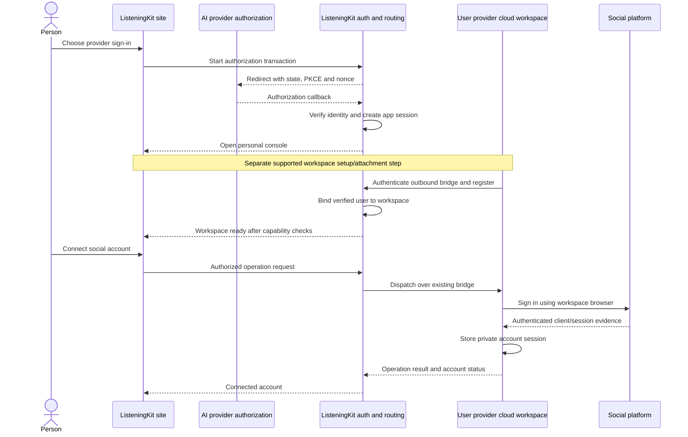

> Implementation reading order: [handoff and acceptance criteria](listeningKitHandoff.md), then [schema v2](listeningKitSchema.md). Those define native V1 scope and supersede broader legacy inventories or earlier field names in this companion. Deferred listings/CRM and future AI-provider identity are outside V1.

# ListeningKit sign-in, console and cloud workspace

## Authoritative data-boundary correction — 11 November 2026

Follow [listeningKitNativeData.md](./listeningKitNativeData.md): the Treg-shaped central PostgreSQL database holds login, teams, MCP consent, provider connections and minimal routing/recovery metadata only. Social accounts, credentials, conversations/messages, detailed jobs/results and private files live in the selected own-cloud or Boat workspace's local database/storage. Earlier central application-record or payload-summary proposals are superseded. The host relays authorized payloads without default durable retention; console private-data views require the runtime online.

Status: proposed product and architecture specification; implementation pending.
Owner: matt. Updated: 11 November 2026. Discussion: PR #113; hosted MCP dependency: #112.

## Implementation baseline

Follow [listeningKitTregArchitecture.md](./listeningKitTregArchitecture.md): Treg-shaped PostgreSQL control database and identity/auth service, email-code sign-in, explicit create/join-team flow, and organization-scoped resources. This supersedes the prior Clerk/Convex and automatic personal-organization proposal. AI provider sign-in stays a future extension. Screen and runtime-state details below remain applicable; user-scoped descriptions mean access through verified organization membership.

## 1. Intended experience

The person opens ListeningKit, signs in using the Treg-style email flow, creates or joins a team, and reaches that team's `/console`. The console contains Settings, Usage, Analytics, Accounts and Subscription. Their selected own-cloud or Boat workspace runs Log, its MCP tools, platform clients, browser and local state. The hosted service authorizes the user through team membership and routes calls over an outbound workspace connection. See [listeningKitHostedMcp.md](./listeningKitHostedMcp.md) for the authoritative shared protocol; AI-provider website sign-in remains a future extension.

The login page is the entry into the application. Marketing, documentation and MCP definition pages remain public. The console is authenticated. The ordinary console is a web application; the generated UI shown inside an AI application in the original drawing is a separate presentation surface that must use the same authorization and tool contracts.

Signing into ListeningKit must complete independently of workspace setup. A signed-in user can inspect connection status and resolve setup failures. Opening the console must never imply that a workspace exists or that Log is running.

## 2. User journey

The detailed provider-OAuth journey previously in this section is superseded by the accepted email OTP flow. The schema and API contract are in [listeningKitSchema.yaml](listeningKitSchema.yaml); its [reading guide](listeningKitSchema.md) maps the frontend and backend slices.

1. Open `/sign-in` (`/login` redirects here), enter email and receive a short-lived code.
2. Verify the code at `/verify`. First verified sign-in creates the user; returning sign-in resumes the same identity.
3. Create, join by invitation, or select a team at `/teams`. Verify membership server-side for each protected operation.
4. Enter `/console/accounts`. Team/workspace identity remains usable while the workspace is disconnected.
5. Complete supported own-cloud or Boat workspace setup under `/console/settings`, pair the runtime, then connect the accepted AdsPower mode. Show the actual browser/profile location.
6. Connect the MCP client under `/console/mcp`; preserve its validated authorization request across sign-in and team selection, then obtain consent for that client/team.
7. Run private account and platform operations through the selected workspace. Platform responses decide sign-in success and sessions remain private to that workspace/browser host.
8. Sign out or revoke a grant/runtime separately. Neither action silently deletes accounts or private data.

Future AI-provider identity can resolve to the same user/team model after a supported integration exists. It is not required for initial sign-in and supplies no implied compute entitlement.

## 3. Screen and route model

| Route | Content and behavior |
| --- | --- |
| `/sign-in`, `/verify` | Email entry, code verification, retry/expiry/rate-limit states. |
| `/login` | Compatibility redirect to `/sign-in`. |
| `/teams` | Create, join by invitation or select an authorized team. |
| `/console` | Resolve to Accounts after authentication/team selection. |
| `/console/accounts` | Workspace readiness, private accounts, platform sign-in operation progress. |
| `/console/settings` | Team/members/invites, supported workspace/provider setup, AdsPower connection and session controls. |
| `/console/usage` | Minimal service counts/timing from control storage; identify source and date range. |
| `/console/analytics` | Private metrics from the live workspace with provenance; unavailable while offline. |
| `/console/subscription` | `notConfigured` until an actual billing authority is implemented. |
| `/console/mcp` | Connector instructions, client/team consent and grant revocation. |

Shared console frame: ListeningKit name, the five navigation links, current user, workspace status and sign-out. On phones, navigation remains usable without a desktop sidebar. A connection failure keeps the frame and displays a recovery action. New sign-ins must not expose a previous user's cached account data.

## 4. Separate state models

Authentication, workspace connectivity and social account authentication are independent state machines. Authentication failure must not be reported as workspace failure, and a bridge reconnect must not sign the person out of ListeningKit.

### Application session

`signedOut -> requestingCode -> verifyingCode -> signedIn`

- Cancelled email verification returns to `signedOut` with a retry action.
- Invalid, expired or already-consumed codes create no session.
- A session expires or is revoked into `signedOut`; preserve only a safe internal return path.
- Logging out invalidates that application session and clears its private UI caches. It does not silently delete social accounts or stop their workspace.

### Workspace lifecycle

`notConnected -> awaitingConnection -> connecting -> ready`

`ready -> reconnecting -> ready | offline`

`connecting -> failed`; any observed loss of required persisted state -> `stateMissing`.

| State | User sees | Permitted behavior |
| --- | --- | --- |
| `notConnected` | Connect your workspace | Console navigation and identity/settings; no runtime calls. |
| `awaitingConnection` | Finish connecting in your provider workspace | Await a short-lived pairing authorization. |
| `connecting` | Connecting to your workspace | Validate ownership, handshake and runtime capabilities. |
| `ready` | Connected; last verified contact | Permit supported runtime calls. |
| `reconnecting` | Reconnecting; last successful contact | Reconcile in-flight operations; prevent duplicate dispatch. |
| `offline` | Workspace offline | Permit supported reconnect instructions; preserve stale data labels. |
| `failed` | Setup failed, with a specific cause | Retry the failed supported setup step. |
| `stateMissing` | Workspace data could not be recovered | Require an explicit recovery or account reconnection decision. |

A supervisor can restart a process while its workspace is running. Workspace suspension, replacement and filesystem persistence require provider-specific handling. Heartbeats indicate observed connectivity; they cannot guarantee continued compute.

### Social account sign-in

`notConnected -> openingLogin -> awaitingUser -> verifying -> connected`

Additional outcomes: `challengeRequired`, `cancelled`, `failed`, `sessionExpired`. The browser and platform responses decide success. If a challenge requires user input, the UI keeps the same sign-in operation open and tells the user what is required. Solver calls run from the workspace when supported and authorized by the existing tool rules.

## 5. Architecture and trust boundaries

Hosted control service owns application sessions, identity links, workspace ownership, pairing records and request routing. The cloud workspace owns Log runtime state, browser artifacts, platform credentials and `log.db`. Existing Twenty-backed account handling needs an explicit migration/compatibility decision before claiming workspace-only storage; the current owner-based installation cannot simply be exposed to multiple users.

A website hosted on a different origin cannot read a workspace browser's cookies. The social login must run in that workspace and be displayed using a supported remote browser interaction mechanism. The browser display/input transport remains a required implementation dependency. An ordinary HTML iframe is insufficient evidence that this mechanism exists.

## 6. Minimum logical data model

These are logical records; storage technology remains an implementation choice.

| Record | Minimum fields and invariants |
| --- | --- |
| `user` | `id`, creation time, account status. Application-owned identity. |
| `providerIdentity` | `userId`, `provider`, verified `issuer`, verified `subject`, `clientId` where identity is client-scoped. Unique within that provider's documented identity namespace. Email is display/contact data, not an account linking key. |
| `authTransaction` | Hashed state/session binding, PKCE verifier, nonce, provider, safe return path, expiry, consumed time. Single use. |
| `appSession` | Hashed opaque session identifier, `userId`, expiry and revocation state. Browser cookie is HttpOnly, Secure and appropriately SameSite. |
| `workspace` | `id`, `userId`, provider product/environment, runtime version, observed state, connection generation, last contact and capabilities. V1 attaches one active workspace per user; replacement is explicit. |
| `pairing` | Hashed one-time code, authenticated `userId`, intended workspace/provider binding, expiry and consumed time. |
| `operation` | Request id, authenticated `userId`, `workspaceId`, generation, command, deadline and observed outcome. No platform secrets in hosted operation payloads or logs. |
| `socialAccount` | Workspace-local platform id, stable account identity, observed status, verification time and private session reference. |

Different provider identities are linked only through an explicit authenticated linking flow. A matching email never merges accounts automatically. Future workspace multiplicity requires an explicit selection model; V1 must not choose an arbitrary live workspace.

## 7. Service contracts

- Session status returns only the signed-in user's identity and application session state.
- Workspace status returns observed state, capabilities, last contact and a supported next action.
- Pairing begins only in an authenticated application session. The runtime consumes the pairing code once and exchanges it for a workspace-scoped credential.
- Runtime commands authorize user ownership and required capability before dispatch. Caller-provided `userId` is never an authority.
- The bridge uses the prior PR #113 protocol proposal: `register`, `heartbeat`, `call`, `result`, `cancel`. Each call has a request id, workspace id, connection generation and deadline.
- Reconnect reconciles outstanding operation ids. A lost result for a social write becomes `outcomeUnknown` until checked; it is never blindly replayed.
- Console endpoints and MCP calls share authorization, ownership and runtime command execution. MCP authentication and website authentication are distinct entry paths into that same ownership model.
- Revoking a workspace invalidates its routing credential; a superseded connection generation cannot return valid results for new operations.

## 8. Provider capability gate

For each exact provider product, record evidence independently for: website identity sign-in; optional plan usage; workspace creation/attachment; install/start; outbound bridge; browser interaction; retained state after pause/replacement.

**ChatGPT identity:** official website documentation describes Authorization Code with PKCE and OpenID Connect. As checked on 10 November 2026, website Sign in with ChatGPT is a limited trial for selected commercial partners. The deployment needs its own approved registration and callback configuration. The website identity guide explicitly treats ChatGPT plan usage as a separate flow.

**Flow AI example:** its linked guide describes per-user ChatGPT plan authorization and server-side encrypted token storage. It is a useful reference for account-specific authorization. It does not establish that the OAuth callback provisions a provider cloud workspace for ListeningKit.

**Claude and Grok:** requested integrations; website identity authorization and workspace attachment are unverified in this specification. Their buttons remain unavailable until each exact supported flow and registration are established. No invented authorization endpoints or copied third-party client identities.

## 9. Ordered implementation slices and acceptance

1. **Identity and console:** working provider registration; sign-in, safe callback, persisted app session, five protected routes, sign-out and user isolation. Accepted when two users see only their own console state and cancellation/expired callbacks recover correctly.
2. **Workspace attachment:** one named provider product, real installation/startup, authenticated pairing and outbound bridge. Accepted when a console operation reads an actual workspace-local Log record, and another user is refused.
3. **Social sign-in:** supported browser presentation, existing account lifecycle/gates, private workspace session storage. Accepted when sign-in is confirmed by platform responses and a later read uses the saved session.
4. **Usage and analytics:** connect each displayed metric to actual runtime records. Accepted when values, source, freshness and unavailable/offline behavior are demonstrable.
5. **Recovery:** process restart, socket disconnect, workspace pause, workspace replacement and revoked credentials handled separately. Accepted when no duplicate social write occurs and missing state is clearly reported.
6. **Additional providers and billing:** activate each provider only after the same evidence exists. Subscription page reflects an actual ListeningKit billing integration when one is implemented.

These are future acceptance criteria, not checks performed during this specification task.

## 10. Decisions and dependencies before implementation

- Approved website authorization registration for the first provider.
- Exact provider cloud product and supported method to create or attach a workspace. No automatic provisioning promise until demonstrated.
- Supported method for the user to interact with the headed workspace browser from their phone.
- Persistence and recovery behavior for workspace-local data; restoration ownership and any transfer path must be specified before replacement can be called seamless.
- Migration from existing owner-only MCP/Twenty storage to isolated user workspaces.
- Actual source of ListeningKit subscription state; no assumption that an AI subscription pays for ListeningKit.

## Sources and existing work

- User's two attached drawings and 10 November 2026 clarification: provider sign-in leads into the five-page console.
- https://developers.openai.com/siwc/website (fetched 10 November 2026).
- https://github.com/sangleshubham/flow-ai/blob/main/docs/setup-chatgpt-signin.md (raw content fetched 10 November 2026).
- PR #113 architecture comment: https://github.com/matthewdonsemail-lab/log/pull/113#issuecomment-6773420404.
- Existing code baseline: `src/mcp/oauth/client.ts` restricts authorization to the server owner; `src/mcp/server/index.ts` executes in a shared server context. `site/apps/web/src/App.tsx` currently provides public routes, without this console.
- Existing implementation dependencies: #112 hosted MCP; #96/#97 local state/schema; #94 client continuity; #99 process overhead; #114/PR #115 Discord session behavior. Earlier PR #113 comments contain the provider transport issue evidence.

## Decision: native application data, no Twenty dependency

As of 11 November 2026, [listeningKitNativeData.md](./listeningKitNativeData.md) supersedes earlier Twenty migration/compatibility ambiguity: the target hosted product uses the Treg-shaped PostgreSQL backend for application records and identity. Runtime-private storage remains in the selected workspace. Twenty is not a required service in the target design; removal and migration are implementation work.

