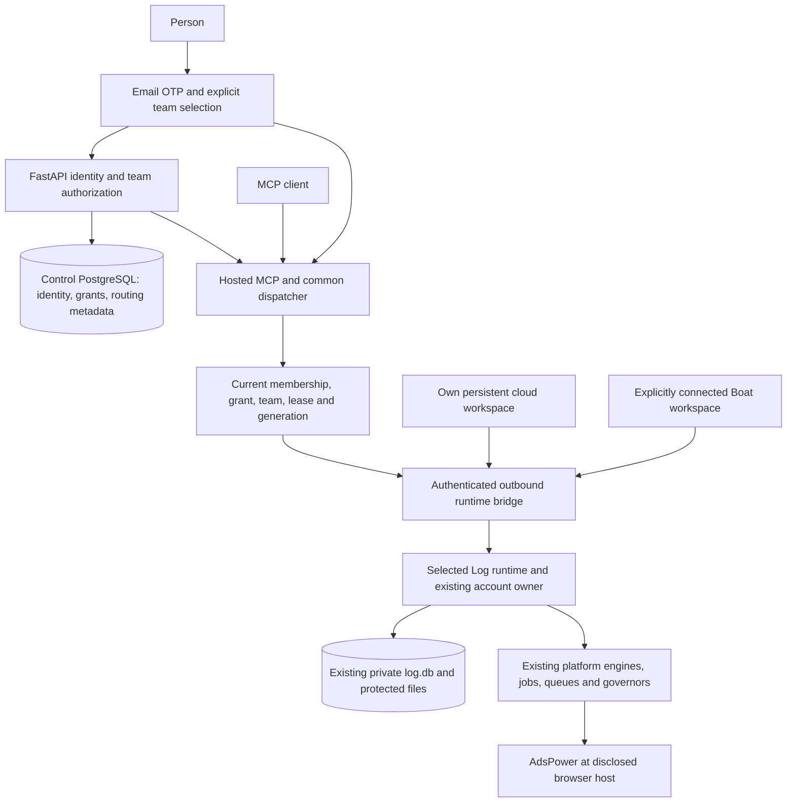

# Mandeep: implement native hosted Log

11 November 2026 · PR #113 · dependency: issue #112

**Assignment:** take over implementation of the hosted Log application from this specification. Deliver the email sign-in, team selection, persistent workspace connection and authorized MCP/console path described below. Matt owns product decisions and any account, billing or first-party consent actions.

## 1. What is ready, and what remains

This PR contains the MCP marketing page, current instruction cleanup and this implementation package. The package is a specification, not an already running authentication service. The existing CLI, platform engines and workspace SQLite provide the private execution foundation. New native account repositories, hosted auth/control, outbound bridge and authenticated console must still be implemented.

[Schema v2](listeningKitSchema.yaml) preserves 42 existing application tables and the 17-migration source snapshot. It proposes 23 control tables, six private additions and two browser-host broker tables. Proposed tables are not deployed tables. Append migrations from implementation HEAD; do not reuse snapshot version 17 as the next version.

**Reading order:** this assignment → [schema guide](listeningKitSchema.md)/YAML → [ownership](listeningKitNativeData.md) → [instance contracts](listeningKitInstanceContracts.md). Companion notes provide source references and deeper workflows. Where older wording differs, native schema v2 and the current ownership boundary take precedence. Resolve a genuine product change with Matt before implementing it.

## 2. Decisions already made

| Area | Contract |
| --- | --- |
| Application identity | Treg-shaped FastAPI + SQLModel/PostgreSQL; email OTP. Explicitly create, join or select a team. |
| Initial login | `/sign-in` → `/verify` → `/teams` → `/console/accounts`. Website login works before runtime setup. |
| AI clients | Authorize an MCP grant for one selected team. A website team switch never silently retargets that grant. AI-provider website OAuth is deferred. |
| Private state | Existing workspace `log.db`, private engine/session files and actual browser-host profile storage. No central private inbox, platform-cookie vault or tool-payload history. |
| Compute | Pair a supported persistent own-cloud runtime, or explicitly create/attach Boat compute with the team's authorized connection. One selected active workspace per team in V1. |
| Browser | AdsPower by default, provided access or user-owned installation/key. Its management key stays at that installation. Log pairing credentials are separate. |
| Schema scope | Platform agnostic. Preserve existing events, identities, chats/messages, attachments, jobs/queues, owner/claim/cursor and governor behavior. No agency prefixes or CRM/SMS model. |
| Legacy | Twenty is deprecated in the target. Current code dependencies must be removed explicitly for the native path, including refresh writes and generators. Deferred listing/campaign domains do not define V1 tables. |
| Hosting baseline | Render staging control PostgreSQL/services, following the documented Treg example; verify existing resource status before setup. Product-owned Resend email and one configured application origin. |
| Application origin | `https://app.log.listeningkit.com`, resource `/mcp`, outbound bridge `/bridge`. Earlier `mcp.listeningkit.com` examples are conceptual; derive discovery/audience/redirects from configured origin. |

## 3. Request and data flow

Private results pass transiently to the authorized client. Central operation metadata records routing/recovery status only. The runtime journal owns arguments, execution evidence and results. No cross-store transaction or exactly-once external platform effect is assumed.

## 4. Ordered implementation assignment

Deliver the slices in order, keeping the branch reviewable. Each slice records what changed, source anchors, completion evidence and any remaining constraint.

### A. Native private repositories and preserved storage

- Preserve [`src/storage/schema`](../../src/storage/schema), [`PlatformExtender`](../../src/storage/platform/types.ts) and current event/projection ingestion. Read the [DDIA reference](../datamodel/Designing%20Data-Intensive%20Applications.md) for authority, derived views, evolution and failure boundaries; map those principles to the existing structures.
- Replace the current `PlatformAccount = FacebookAccount` dependency and Twenty lookup in [`src/platformKit/session/client.ts`](../../src/platformKit/session/client.ts). Cover account reads, credential/session refresh writes and active callers; native startup must not instantiate the legacy client.
- Add only the missing private contracts: `platformAccounts`, `secrets`, `runtimeBindings`, `browserProfiles`, `operations`, `liveApprovals`. See each YAML table's keys, constraints and ownership. Keep mutable display names independent of stable `(platform, account)` identity.
- Use existing jobs/queues for execution and existing private governor/session formats through adapters. `operations` is the hosted authorization/idempotency/fencing envelope, not another scheduler.
- Isolate any needed import of supported account configuration. Preserve private source exports, show a dry-run mapping, deduplicate by stable identity, stop old writers and retain one writable authority. Never import old listing/CRM fields by default.

**Done when:** native account lookup and a refreshed session persist across restart without Twenty configuration or network access; old messages/keys, queues, governors and browser bindings retain their identities. Incompatible schema readers refuse safely.

### B. Control service, email identity and team authorization

- Create `python/controlService/` as the new backend domain and own Alembic migrations under `python/controlService/migrations/versions/`. Migration authority is separate from restricted application credentials. No production schema auto-create per worker.
- Implement the control tables and DTOs in YAML. OTP verification is atomic, rate limited, expires, consumes once and never logs raw codes. Store website sessions and revocation with secure cookie behavior.
- Implement explicit team create/join/select, invitations, roles and permission checks. Every lookup is scoped to the authenticated membership; a supplied team id grants nothing. Concurrent owner/member changes must preserve required ownership rules.
- Read the exact pinned Treg files in [the source map](listeningKitTregArchitecture.md): `src/treg/models.py`, `application/auth.py`, `application/signup.py`, `routers/auth.py`, `routers/orgs.py`, `domain/governance/teams.py` and `domain/identity/mcp_oauth.py`. Port the relevant behavior; do not copy Treg's entire product data model.

**Done when:** a new verified person can create/join/select a team, a returning person resumes the right identity, invalid/expired/reused OTP or invites refuse, and revoked membership prevents subsequent team access.

### C. Workspace bootstrap and paired outbound routing

- Implement bootstrap against the selected persistent workspace. Resolve DB/state/browser roots, retain installation identity, migrate compatibly, exchange short-lived pairing authority once and store the paired secret with restrictive permissions.
- Advertise actual runtime capabilities, acquire a fenced lease/generation and connect outbound WSS. No public inbound platform-engine or AdsPower management endpoint.
- Start with one gateway replica. Fence stale runtimes and current routes before effects; after disconnect/restart, reconcile the existing private journal before resuming queued work.
- Implement one dispatcher used by console and MCP. Carry request identity, team/workspace, permissions, generation, expiry, approval and idempotency; validate at dispatch and runtime execution. Same key/different arguments is a conflict.

**Done when:** one paired runtime returns an authorized read; offline runtime gives an accurate unavailable/setup state; stale generation, revoked grant or wrong team refuses; reconnect does not duplicate owners or replay an uncertain platform write.

### D. Hosted MCP authorization and minimal console

- Replace the single-owner/Twenty assumption in [`src/mcp/oauth/client.ts`](../../src/mcp/oauth/client.ts) with current team membership, scoped grant, resource/audience validation and selected workspace routing.
- Implement the specified PKCE/redirect/consent/token/refresh/revocation contracts. Keep website sessions, MCP grants, runtime pairing, provider keys and platform cookies separate.
- Build the [console routes and states](listeningKitConsole.md) from the YAML endpoint/DTO contracts. Implement login/team/workspace/account/settings journeys first. Clear cached private data and reject late responses when user/team/workspace changes.
- Mark analytics, usage, subscription and AI generative UI unavailable or deferred until their defined data/service exists. Do not invent billing products or store private data centrally to fill empty screens.
- Correct `/mcp` marketing/install claims to the actually delivered connection states. No implied AI subscription VM, automatic sandbox or working one-click connector before completion.

**Done when:** sign-in, explicit team choice, workspace setup/offline states, authorized private account view and MCP consent all work through the same authorization boundary, including revoked access and team switching.

### E. Compute and browser adapters

- Own-cloud and Boat use the same runtime contract. Apply [Boat lifecycle requirements](listeningKitBoatRuntime.md): isolated bootstrap, persistent mount, service resume, explicit lifetime, bounded retry/idempotency, restore and deletion behavior. Verify current Boat APIs at implementation time.
- Keep provision/create separate from attach and require the authorized compute action. An AI login is never evidence a VM was provisioned.
- Follow [AdsPower contracts](listeningKitAdsPower.md): user-owned key stays at its installation; provided access uses separately scoped broker/profile assignment and disclose where browser-managed state lives. Preserve existing browser lifecycle/gates and one account owner.

**Done when:** supported capabilities and storage location are reported truthfully for each enabled mode; expired/revoked pairing, broker authority or compute connection cannot silently launch or regain access. Unsupported browser/compute combinations return an actionable setup state.

### F. Complete the native cutover and deployment

- Use [the dependency audit](listeningKitTwentyCutover.md) to replace active runner/account/session/scaffold/knowledge/bootstrap/health paths. Classify reference/import-only and deferred feature code separately; do not delete private data or silently break existing installations.
- Native bootstrap, health and docs must not require Twenty secrets, generated account types or an upstream Twenty API. Update generators so new platforms use the same native repositories.
- Follow [provisioning](listeningKitProvisioning.md), run migrations once, install verified email/domain/secrets, deploy control/gateway/web and pair the first persistent runtime. Never copy a developer's `.logCli`, database or session/capture folder into an image.
- Document backup/restore, separate encryption-key recovery, revocation, data deletion and shutdown. Restore to the same workspace identity with the prior runtime fenced.

**Done when:** a fresh native installation completes the specified journey without the deprecated service; existing active private data remains usable; restart/reconnect/restore and revocation follow the documented contracts. Deployment claims include the actual environment and build SHA.

## 5. Configuration and provisioning handback

[The runbook](listeningKitProvisioning.md) owns exact deployment steps. Adopt these control environment names: `APP_ORIGIN`, `MCP_RESOURCE_URL`, `BRIDGE_PUBLIC_URL`, `MIGRATION_DATABASE_URL`, `DATABASE_URL`, `SESSION_SECRET`, `OTP_PEPPER`, `CONTROL_SECRET_ENCRYPTION_KEY`, `CONTROL_GATEWAY_SECRET`, `DISPATCH_SIGNING_KEY`, `RESEND_API_KEY`, `AUTH_EMAIL_FROM`, `AUTH_EMAIL_REPLY_TO`. Wire each variable in code; names in a document are not existing runtime support.

The runtime retains the existing `LOG_DB`/state-root contract and private AdsPower settings. Bootstrap stores a paired runtime credential and separately recoverable workspace encryption key in protected installation storage. Pin dispatch verification trust separately from the paired bridge credential. Do not reuse one credential for these roles.

Mandeep returns deployment/resource ids, migration revision, persistent roots, build SHA, domain/TLS/email readiness, enabled capability modes and **secret references only**. Verify reported earlier provisioning before reuse; do not recreate paid resources on assumption. Matt completes product account logins, billing, first OTP/consent and any platform challenge that requires him.

## 6. Evidence required before calling this implemented

At implementation review, demonstrate the cases below through agreed checks and authorized staging actions. This documentation handoff does not itself run platform actions or the proposed services.

- Fresh email sign-in; returning sign-in; invalid/expired/reused code; invite/address/team authorization errors.
- Current member/grant permissions; revoked membership/session/grant; wrong team/workspace; frontend stale-result isolation.
- Compatible/incompatible migrations; preserved existing identity and message records; native startup without legacy credentials.
- Runtime offline/reconnect/restart; lease expiry and stale fencing; idempotency collision; unknown write outcome reconciled before retry.
- Account session refresh persistence; existing governor/owner/claim behavior; private material absent from central DB, logs and images.
- Pairing/credential expiry and revocation; own-cloud or explicitly selected Boat readiness; actual AdsPower location and key separation.
- Consistent SQLite/WAL/private-file recovery with encryption keys handled separately and previous runtime fenced.

Follow repository checks and hooks. Add/run application tests only when Matt authorizes them or as required by existing commit/push hooks. Record exact evidence and failures; do not substitute checklists for observed results.

## 7. First takeover update

Mandeep's first update should name the picked-up PR head, acknowledge this scope/reading order, list the source paths for slice A, identify any actual contract conflict, and state the next implementation slice. No need to reselect auth/database vendors or redesign private storage. A genuine gap is recorded with one recommendation and its consequence for Matt.
