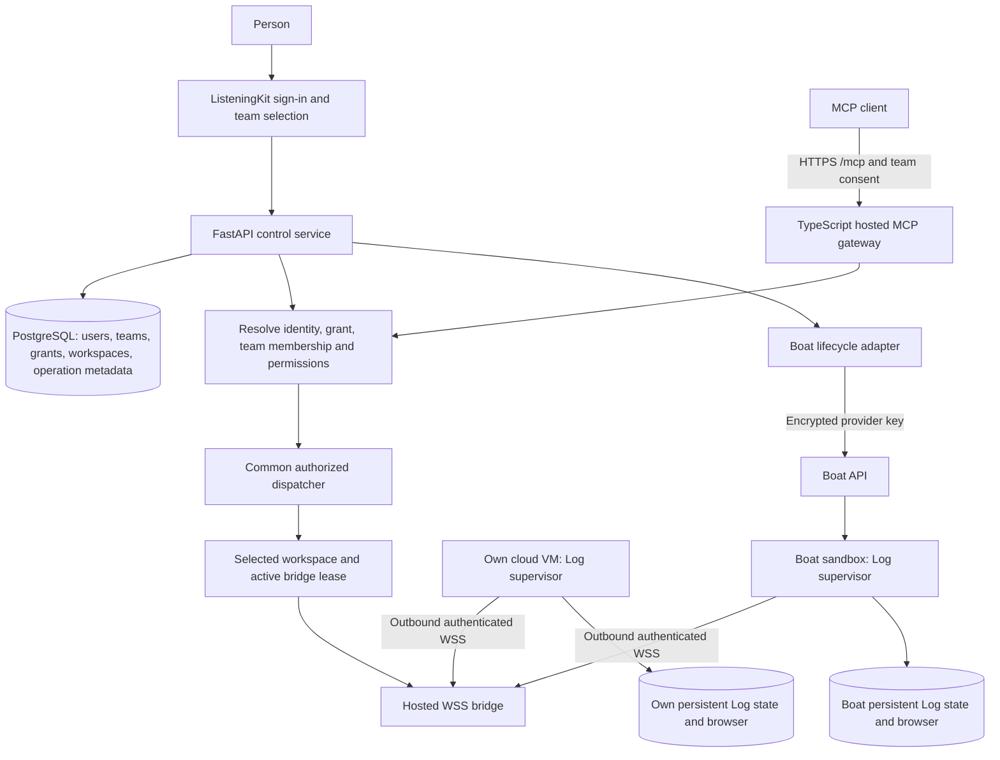
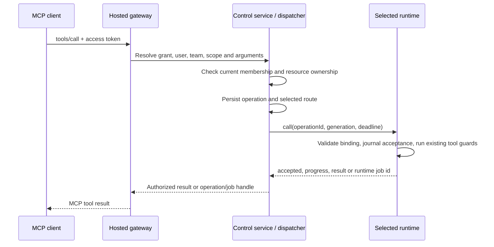
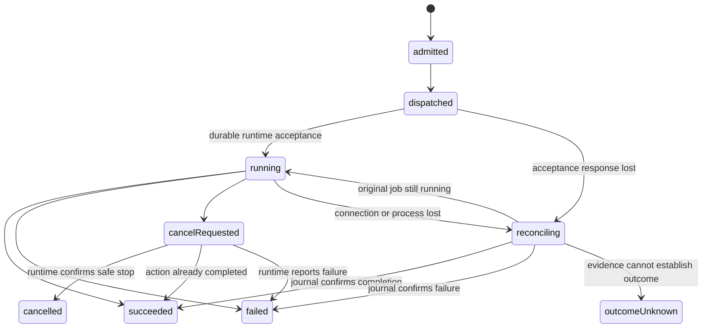

> Implementation reading order: [handoff and acceptance criteria](listeningKitHandoff.md), then [schema v2](listeningKitSchema.md). Those define native V1 scope and supersede broader legacy inventories or earlier field names in this companion. Deferred listings/CRM and future AI-provider identity are outside V1.

# Hosted MCP: one team, one selected cloud workspace, two compute paths

## Authoritative data-boundary correction — 11 November 2026

Follow [listeningKitNativeData.md](./listeningKitNativeData.md): the Treg-shaped central PostgreSQL database holds login, teams, MCP consent, provider connections and minimal routing/recovery metadata only. Social accounts, credentials, conversations/messages, detailed jobs/results and private files live in the selected own-cloud or Boat workspace's local database/storage. Earlier central application-record or payload-summary proposals are superseded. The host relays authorized payloads without default durable retention; console private-data views require the runtime online.

Updated 11 November 2026. Proposed architecture for PR #113 and issue #112; implementation pending.

This extends the accepted [Treg baseline](https://github.com/matthewdonsemail-lab/log/pull/113#issuecomment-6774123714) and [Boat runtime specification](https://github.com/matthewdonsemail-lab/log/pull/113#issuecomment-6774520426). It defines the hosted MCP connection and the `/mcp` page for both compute choices. It supersedes earlier console text implying automatic personal teams, AI-provider login as the initial entrance, or resources owned directly by a user instead of their selected organization.

## 1. What the user is connecting

The user signs into ListeningKit, creates or joins a team, and selects where that team's Log runtime lives:

- **Own cloud workspace:** install and pair Log inside a VM/workspace they already have access to. Their existing subscription only supplies compute if that specific product actually allows this runtime to run.
- **Boat:** connect a Boat API key and billing organization, then explicitly create or attach a sandbox. The backend's Boat adapter manages the supported lifecycle operations.

Both runtimes connect outbound to ListeningKit. An MCP client connects to the same hosted MCP address and consents to access one team. The host sends its calls to that team's selected workspace. Accounts, browser profiles and private captures live in that workspace.

Signing into an AI product does not itself create, expose or authorize a VM. Website login, compute credentials and MCP consent remain separate. Support for a named cloud product requires confirming installation, outbound WSS, persistence and any needed browser support. A product without those capabilities cannot be advertised as a supported runtime.

## 2. Shared architecture



The diagram shows alternative runtime locations. V1 selects exactly one active workspace per team; it does not broadcast calls to both. An explicit replacement increments the team's route version. Existing operations remain bound to the workspace that accepted them.

**Host:** identity, memberships, MCP grants, encrypted provider connections, workspace metadata, routing leases, operation summaries and authorized console views.

**Workspace:** Log execution, its private `log.db`, platform sessions, cookies, browser profiles, raw HAR/captures and job execution journal. Use a dedicated process, state directory and environment for this team's runtime. No shared server-owner credentials or shared home directory.

## 3. Four credentials with different jobs

| Credential | Authority and storage | Where accepted |
| --- | --- | --- |
| Website session | Treg-style user session; team access checked through current membership | Console/control service |
| MCP access/refresh credentials | Client grant, user, approved team, scopes and MCP resource; refresh rotation/revocation | Hosted MCP gateway |
| Workspace credential | One paired workspace, credential version and allowed bridge audience; hash at host, protected credential on runtime disk | Runtime bridge only |
| Boat API key | Encrypted recoverable provider secret owned by the team, restricted to authorized backend use | Boat API through lifecycle adapter |

No Boat key goes to the AI client or sandbox. The sandbox receives its own bootstrap/pairing authority. Neither an MCP session id nor a workspace id supplied in tool arguments establishes authorization.

MCP authentication uses discovery, client validation, consent, authorization code/PKCE, resource binding and revocation; implementation must target the supported [MCP authorization specification](https://modelcontextprotocol.io/specification/2025-11-25/basic/authorization). Website team switching does not silently retarget an existing MCP grant. To choose another team in an MCP client, explicitly authorize that team and initialize a new session.

## 4. The two setup flows

| Step | Own cloud workspace | Boat sandbox |
| --- | --- | --- |
| Choose compute | User selects an existing VM/workspace | User connects Boat key and explicit Boat billing organization |
| Prepare runtime | User runs the installer there with a persistent state path | Adapter creates/attaches an authorized sandbox; creation uses `noEnv: true`, deliberate snapshot/lifetime settings and a persisted idempotency key |
| Pair | Console issues short-lived one-use pairing approval for this team's pending workspace | Bootstrap redeems equivalent one-use authority for the sandbox/workspace binding |
| Connect | Supervisor starts and opens outbound WSS | Enabled service starts and opens outbound WSS |
| Ready | Credential, handshake, version, capabilities and runtime health confirmed | Same checks, plus observed Boat state; Boat API-ready alone is insufficient |
| Restart | User/provider starts the VM; service reconnects | Adapter resumes when explicitly requested; runtime restores and reconnects |
| Human interaction | Provider-specific authenticated desktop/browser path, if supported | Backend requests a fresh Boat desktop URL for the authorized sandbox |

Pairing consumption is atomic and also issues the credential in the same transaction. Show the target team and workspace before approval. Store no pairing secret in logs. Failed redemption response recovery requires explicit re-pairing/credential rotation; a consumed code cannot mint a second credential.

Own-cloud V1 is attach-only: no claimed ability to create, bill, start, stop or resume a third-party subscription workspace without a verified provider API. Boat lifecycle actions are explicit and separately authorized; an ordinary MCP tool call does not silently provision or resume paid compute.

Boat sources: [create](https://docs.boat.dev/api/reference/sandboxes/create-sandbox.md), [credential isolation](https://docs.boat.dev/environments/access.md), [services](https://docs.boat.dev/long-running-tasks/always-on-services.md), [snapshots](https://docs.boat.dev/snapshots/whats-saved.md), [resume](https://docs.boat.dev/snapshots/resume-and-fork.md), [desktop](https://docs.boat.dev/desktop-streaming/urls-and-security.md). See the Boat comment for retention, auto-stop and key-scope limits. Actual Log/browser compatibility on Boat remains to be demonstrated.

## 5. Runtime registration and routing protocol

Proposed internal protocol, versioned independently from MCP:

1. Runtime opens TLS WSS and authenticates with its workspace credential in a protected handshake, never a URL query string.
2. `register` supplies protocol version, runtime build, installation id, capabilities and local journal cursor. Server derives team/workspace from the credential and checks the expected installation binding. Runtime cannot choose another tenant.
3. Server atomically grants one active lease and a monotonically increasing `connectionGeneration`. A second connection from another installation is refused pending explicit replacement. Reconnect from the bound installation fences the old connection.
4. `heartbeat` maintains the lease. Proposed V1 defaults: every 15 seconds, lease expires after 45 seconds without renewal. Renewals and results must match the active generation. These are liveness defaults, not evidence that a platform operation succeeded.
5. `call`, `accepted`, `progress`, `result`, `cancel`, `cancelAck` and `reconcile` exchange operation state. Persist `accepted` before executing a side effect. Progress has monotonic sequence numbers; reconnect can request after the last cursor.
6. Reconnect first reconciles unfinished operations against the persistent runtime journal. Runtime accepts no new work until the handshake and reconciliation permit it.

Proposed call envelope:

```json
{
  "protocolVersion": 1,
  "operationId": "serverGeneratedOpaqueId",
  "workspaceId": "serverResolvedWorkspace",
  "routeVersion": 7,
  "connectionGeneration": 12,
  "toolName": "discordRead",
  "arguments": {"account": "selectedAccount", "channel": "selectedChat"},
  "actorUserId": "serverResolvedActor",
  "grantId": "serverResolvedGrant",
  "deadlineAt": "serverChosenAdmissionDeadline",
  "authorizationVersion": 3
}
```

The operation id is separate from an MCP JSON-RPC request id. Arguments are validated against the registered tool schema; never turn arbitrary client input into a shell command. The admission deadline prevents stale work from starting. A request timeout or disconnect after execution begins does not mean the action stopped.

V1 can run one bridge/gateway deployment with a PostgreSQL lease registry and atomic lease updates. For multiple replicas, store bridge owner/lease metadata centrally and deliver through authenticated internal RPC or a broker. An in-memory socket map alone cannot route across replicas. Persist route/generation checks before dispatch and enforce fencing at the runtime; do not adopt a stale response into a new operation. A completed old operation may be reconciled under its original workspace binding after reauthorization.

## 6. Every tool call takes the same authorization path



Console actions enter this same dispatcher with website session authority. Platform live-write approval, active hours, account governor, browser lifecycle/proxy rules and post-submit reconciliation still execute in the runtime. MCP consent alone does not approve every future social write.

Bind transport sessions to their authenticated principal/grant/team and check that binding on every request, including SSE/resume and deletion. Reject a different principal reusing a session id. A new runtime dispatch checks current permission again; changing routes between admission and acceptance invalidates the old dispatch. A replacement waits for known active work to finish or enters recovery for unknown work. Revocation blocks new dispatch immediately and requests safe cancellation of active work; it cannot undo an already submitted platform action.

## 7. Disconnection, jobs and cancellation



- **Offline before admission:** return `workspaceOffline`, the observed state and next action. V1 does not queue new social writes while offline. Own-cloud says start/reconnect; Boat offers an explicit resume action to an authorized team member.
- **Long run:** map hosted operation id to `(teamId, workspaceId, runtimeJobId)`. Preserve existing progress/status/cancel behavior behind authorized hosted handles. Never expose a runtime job id as an unrestricted global lookup.
- **Lost response:** same operation id can reconcile or return an existing journal result. It must never cause another platform submission. A fresh client request with a fresh id is a distinct request; no blanket exactly-once guarantee across client retries.
- **Unknown write outcome:** keep `outcomeUnknown` until platform evidence resolves it. Do not auto-repeat sends, posts, purchases or other effects. A gateway timeout, expired lease, PID loss or accepted cancellation request cannot establish non-execution.
- **Cancel:** stop at a safe runtime boundary and await confirmation. Preserve the existing rule that a published action is not retried or stopped after submission. Expiring client consent cannot retract it.
- **Progress recovery:** retain ordered, scoped runtime progress on persistent disk; control service keeps authorized summaries/cursors. If detailed logs have expired, return an explicit gap instead of inventing a continuous history.

## 8. Data additions to the Treg baseline

Keep Treg's `User`, `Org`, `Membership`, `OAuthClient`, `OAuthGrant`, `OAuthRefresh`, `Secret` and `Ephemeral` semantics. Add application-owned models:

| Model | Required binding and purpose |
| --- | --- |
| `providerConnection` | `orgId`, provider, encrypted secret reference, explicit provider account/org context, status, revocation timestamps |
| `workspace` | `orgId`, provider connection if managed, external id if any, installation id, state, capabilities, runtime version, last contact |
| `workspaceCredential` | `orgId`, `workspaceId`, token hash, version, issued/expiry/revocation timestamps |
| `workspaceLease` | Unique workspace binding, bridge instance, generation, expiry; atomic takeover/fencing |
| `workspaceSelection` | Unique `orgId`, selected workspace, route version; composite ownership enforced |
| `runtimeOperation` | `orgId`, actor/grant, immutable workspace/route, operation id, tool, effect classification, lifecycle status, runtime job mapping, progress cursor and result summary |

Use foreign keys/composite constraints so provider connections, workspace selection and jobs cannot cross teams. Index org/status/time and workspace/operation lookups. Pairing approvals use Treg's ephemeral namespace/expiry and single-consumer transaction pattern. Encrypt recoverable upstream secrets; hash verification-only credentials. Operation summaries need an explicit retention limit and redaction; raw captures stay private in the workspace.

Authorization covers tool discovery, guides, resources, saved flows, account selectors, browser views, media, job status, progress and cancellation. Tenant-customized guides and flows must come from the selected workspace. A global public guide can be served without runtime secrets. No server owner's AGENTS file, Twenty accounts or process log stream can appear in another team's result.

## 9. What `/mcp` should show

The public `/mcp` page explains the hosted service and presents sign-in. After sign-in/team selection, its connected view shows:

1. **Runtime choice:** own cloud workspace or Boat, with truthful provider-specific instructions.
2. **Readiness:** `unpaired`, `connecting`, `ready`, `offline`, `stopped`, `needsAttention` or `revoked`, last contact, selected workspace and the next available action. Report observed readiness; website login is insufficient.
3. **MCP connection:** one production HTTPS endpoint, copied from deployed configuration, and connect/consent instructions for clients actually supported. Do not invent a live hostname or imply ChatGPT website sign-in has approval.
4. **Accounts:** platform sign-in occurs in that runtime, with observed status and authorized access to the same browser when needed.
5. **Recovery:** reconnect/re-pair; explicit Boat resume if stopped; route replacement with unfinished operations visible.

Discovery: keep public, provider-independent help available offline. Publish a versioned tool catalog from the selected runtime's last confirmed manifest with an `offline` indication where client presentation permits. At execution, recheck current capabilities and schema version; return `workspaceOffline`, `runtimeUpgradeRequired` or `unsupportedCapability` as appropriate. Do not claim browser tools work in a shell-only workspace. Send tool-list changes when a compatible runtime changes the manifest.

The existing install/stdio instructions remain available as their own supported mode. Hosted readiness must be marked proposed until the service and pairing flow exist.

## 10. Exact sources and implementation boundaries

### Follow Treg directly

Pinned revision: `3149cb1a23f6a0ce2d6ffab403f79f58855d3856`.

- [Database integration: `src/treg/infra/db.py`](https://github.com/superdesigndev/treg/blob/3149cb1a23f6a0ce2d6ffab403f79f58855d3856/src/treg/infra/db.py): FastAPI/SQLAlchemy database boundary.
- [Org, User and Membership: `src/treg/models.py`](https://github.com/superdesigndev/treg/blob/3149cb1a23f6a0ce2d6ffab403f79f58855d3856/src/treg/models.py#L242): relational identity/team authority; `Org` at line 36 and `Membership` at line 294.
- [Session resolution: `domain/identity/session.py`](https://github.com/superdesigndev/treg/blob/3149cb1a23f6a0ce2d6ffab403f79f58855d3856/src/treg/domain/identity/session.py#L86) and [membership checks: `access.py`](https://github.com/superdesigndev/treg/blob/3149cb1a23f6a0ce2d6ffab403f79f58855d3856/src/treg/domain/identity/access.py#L268): common caller resolution.
- [Email authentication: `application/auth.py`](https://github.com/superdesigndev/treg/blob/3149cb1a23f6a0ce2d6ffab403f79f58855d3856/src/treg/application/auth.py#L273) and [explicit organization creation: `application/signup.py`](https://github.com/superdesigndev/treg/blob/3149cb1a23f6a0ce2d6ffab403f79f58855d3856/src/treg/application/signup.py#L384).
- [MCP authorization domain: `domain/identity/mcp_oauth.py`](https://github.com/superdesigndev/treg/blob/3149cb1a23f6a0ce2d6ffab403f79f58855d3856/src/treg/domain/identity/mcp_oauth.py), [consent use cases](https://github.com/superdesigndev/treg/blob/3149cb1a23f6a0ce2d6ffab403f79f58855d3856/src/treg/application/auth.py#L1116), [grant/refresh models](https://github.com/superdesigndev/treg/blob/3149cb1a23f6a0ce2d6ffab403f79f58855d3856/src/treg/models.py#L1441).
- [Encrypted secrets: `Secret`](https://github.com/superdesigndev/treg/blob/3149cb1a23f6a0ce2d6ffab403f79f58855d3856/src/treg/models.py#L791), [single-consumer `kv_take`](https://github.com/superdesigndev/treg/blob/3149cb1a23f6a0ce2d6ffab403f79f58855d3856/src/treg/ratestore.py#L95), [frontend team/session behavior](https://github.com/superdesigndev/treg/blob/3149cb1a23f6a0ce2d6ffab403f79f58855d3856/frontend/src/state/session.js#L51).

Treg supplies identity/control patterns. The persistent workspace bridge, runtime leases and social-operation reconciliation are Log additions; they are not claimed to exist in Treg.

### Change these Log boundaries

Pinned inspected Log revision: `4004558bdafcace630686df994d91254130659ab`.

- [`src/mcp/server/index.ts` tool handlers](https://github.com/matthewdonsemail-lab/log/blob/4004558bdafcace630686df994d91254130659ab/src/mcp/server/index.ts#L290) currently list local tools/resources and call the local runtime. Hosted handlers must dispatch through the scoped bridge; preserve local mode.
- [HTTP session setup in that file](https://github.com/matthewdonsemail-lab/log/blob/4004558bdafcace630686df994d91254130659ab/src/mcp/server/index.ts#L365) currently uses a process-local transport map and the same supplied execution context. Add authenticated session binding and route-aware dispatch.
- [`src/mcp/oauth/client.ts` owner check](https://github.com/matthewdonsemail-lab/log/blob/4004558bdafcace630686df994d91254130659ab/src/mcp/oauth/client.ts#L194) currently restricts sign-in to the Twenty server owner. Replace this hosted authority with Treg user/team/grant resolution.
- [`src/mcp/server/helpers/guardCall.ts`](https://github.com/matthewdonsemail-lab/log/blob/4004558bdafcace630686df994d91254130659ab/src/mcp/server/helpers/guardCall.ts) remains a runtime guard; it does not replace hosted tenant authorization.
- [`src/mcp/jobs/client.ts`](https://github.com/matthewdonsemail-lab/log/blob/4004558bdafcace630686df994d91254130659ab/src/mcp/jobs/client.ts#L88) provides local jobs/progress/cancellation. Add scoped hosted mappings and recovery without treating local PID state as proof of platform outcome.
- [Process log fan-out](https://github.com/matthewdonsemail-lab/log/blob/4004558bdafcace630686df994d91254130659ab/src/mcp/server/index.ts#L143) needs operation isolation; tenant logs must not fan out to unrelated calls.
- PR #113's [`site/apps/web/src/landing/mcp/McpPage.tsx`](https://github.com/matthewdonsemail-lab/log/blob/site/mcpPage/site/apps/web/src/landing/mcp/McpPage.tsx) and [`mcpContent.ts`](https://github.com/matthewdonsemail-lab/log/blob/site/mcpPage/site/apps/web/src/landing/mcp/mcpContent.ts) are the current marketing/page boundary. These branch links track the PR; backend links above are pinned.

## 11. Ordered implementation scope

1. Treg-shaped identity, database and team flow; isolate the existing Twenty/server-owner assumptions.
2. Tenant-scoped dispatcher and MCP grants/session binding; dedicated runtime state/configuration per workspace.
3. Own-cloud attach: installer, atomic pairing, service supervisor, WSS registration, leases and manifest/readiness.
4. Durable operation journal, progress/job mappings, reconciliation, safe cancellation and explicit unknown outcomes.
5. Boat adapter using the same runtime protocol, with explicit create/attach/resume/stop, credential isolation, persistence and desktop access.
6. Connect the `/mcp` view and console to the same contracts, then document supported clients/providers from demonstrated capabilities.

Implementation acceptance: two teams cannot cross-read tools with private metadata, resources, accounts, jobs or logs; pairing is consumed once; wrong-principal session reuse fails; old generations cannot start fresh work; replacement cannot redirect running operations; no new offline write is queued; lost acknowledgements do not repeat a platform effect; both runtime paths expose the same MCP contract; an unsupported cloud product is identified honestly.

This is the architecture/modeling deliverable. No hosted bridge, VM, Boat sandbox, credential migration or new database has been deployed by this comment.

## Decision: native application data, no Twenty dependency

As of 11 November 2026, [listeningKitNativeData.md](./listeningKitNativeData.md) supersedes earlier Twenty migration/compatibility ambiguity: the target hosted product uses the Treg-shaped PostgreSQL backend for application records and identity. Runtime-private storage remains in the selected workspace. Twenty is not a required service in the target design; removal and migration are implementation work.


