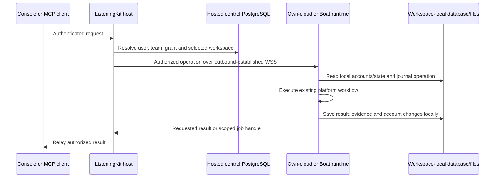

> Implementation reading order: handoff and acceptance criteria, then [schema v2](listeningKitSchema.md). Those define native V1 scope and supersede broader legacy inventories or earlier field names in this companion. Deferred listings/CRM and future AI-provider identity are outside V1.

# Data boundary: hosted control service and workspace-local application database

11 November 2026. Authoritative correction for issue #112 and PR #113. Proposed design; implementation pending.

**Move away from Twenty. Keep social account data, conversations, messages, listings and execution data in the database inside the user's selected cloud workspace. ListeningKit's central hosted database stores identity, team authorization and workspace routing, not a copy of those application records.**

The previous version of this proposal placed social records in central PostgreSQL. That was too broad and is superseded by this decision. Treg remains the baseline for the hosted identity/control architecture; it does not require centralizing the workspace's private application data.

“Local” means local to the cloud runtime: either the user's own supported VM/workspace or their connected Boat sandbox. It does not mean their laptop. “Hosted control database” means ListeningKit's separate central PostgreSQL service. Both are cloud-hosted, but they hold different data and have separate authority.

## AdsPower browser-host clarification

AdsPower remains the default with provided and bring-your-own access; see the accepted connection model. A provided browser on the operator's machine retains browser-managed state there and must be disclosed as a separate browser host. This does not satisfy the strict workspace-only profile arrangement. Hosted control PostgreSQL retains no platform cookies or AdsPower management keys. Log pairing uses separate short-lived authority.

## Exact storage boundary

| Data | ListeningKit hosted control database | Selected cloud workspace |
| --- | --- | --- |
| Users, organizations, memberships, invitations, website sessions | Authoritative Treg-style identity records | Only scoped runtime identity/binding needed for requests |
| MCP clients, grants, refresh families and revocation | Authoritative client consent and team permissions | Current validated execution authority; no separate user/team authority |
| Workspace registration, selection, credential hashes, leases and generation | Routing authority and observed availability | Workspace credential and installation identity |
| Boat provider connection | Encrypted provider API key and explicit billing organization | No Boat account API key |
| Social accounts, platform ids/names, settings and account status | No persisted account catalog | Workspace database is authoritative |
| Platform credentials, cookies, sessions, 2FA material, device/browser profiles | No platform credential store | Protected workspace storage |
| Conversations, messages, search indexes and attachments | No persisted conversation/message projection or search index | Workspace database/files |
| Listings, campaigns, groups, posts, comments and their relations | No persisted application records | Workspace database/files |
| Tool arguments and returned private content | Transit for authorized calls; no default payload persistence | Execution journal/results under workspace retention |
| Job details, event journal, detailed progress, private errors, captures/HAR | No persisted payloads or detailed private logs | Workspace-local durable journal and private files |
| Routing/recovery metadata | Opaque operation id, team/workspace/grant binding, tool identifier, lifecycle status, timestamps and progress cursor only | Full operation state, request, evidence and result |
| Usage | Minimal tool counts/timing needed for service operation; no messages, handles or tool arguments | Detailed private activity |

The host's operation metadata has a defined TTL and explicit column allowlist. Do not persist a generic request/result JSON column “for convenience.” A user/team identity is still personal information; this design does not claim the host stores no data about its users.

## Request path

The console's Accounts, inbox, listings and detailed job screens query the selected runtime through the same dispatcher. The central database cannot serve a private cached inbox when the workspace is offline. Its availability view can still show connection state and last contact.

The host can see payloads while relaying them in this design; it is not end-to-end encryption. “Not stored centrally” must cover request logging, reverse proxies, traces, error trackers, queues, temporary files, SDK debug logs and backups. Configure those paths to avoid capturing payloads. Any future durable relay buffer or new central projection requires an explicit architecture change and retention decision.

MCP transport buffers may hold responses transiently in memory for an active authorized session. Bound size/lifetime and discard at expiry/termination. After a host restart, clients reconnect and retrieve results from the workspace journal; there is no central durable payload replay store. Existing AI clients separately receive the returned content, so this boundary does not make a claim about their retention.

## Database and code approach

Use Treg's FastAPI + SQLModel/SQLAlchemy + PostgreSQL structure for the **control service**: users, teams, sessions, grants, provider connections and routing.

For the **runtime**, extend the existing workspace-local `log.db`/SQLite storage behind platform/domain repository interfaces. Inventory existing coverage first, then add missing social account, listing, conversation and group persistence. Avoid introducing a second workspace database by default. Each team's runtime uses its own persistent directory and installation identity; private credentials/files remain alongside it under appropriate access restrictions.

Replace `CommandContext.twenty` with vendor-independent repositories backed by that runtime-local storage. Runtime tools read/write those repositories directly. They do not send account or conversation CRUD to central ListeningKit APIs. Preserve existing platform identifiers, message deduplication, listing/conversation relations and tombstones/statuses.

Host-side authorization establishes user/team/grant/workspace authority. The runtime then checks that account/object handles belong to its bound workspace. Never accept a caller-supplied team or path as proof of access. Opaque handles are transport references, not permission by themselves.

### Exact source anchors

Inspected Log revision: `4004558bdafcace630686df994d91254130659ab`.

- [`src/storage/schema/client.ts`](https://github.com/matthewdonsemail-lab/log/blob/4004558bdafcace630686df994d91254130659ab/src/storage/schema/client.ts): existing local database foundation to extend.
- [`src/storage/platform/client.ts`](https://github.com/matthewdonsemail-lab/log/blob/4004558bdafcace630686df994d91254130659ab/src/storage/platform/client.ts) and [`src/storage/records/client.ts`](https://github.com/matthewdonsemail-lab/log/blob/4004558bdafcace630686df994d91254130659ab/src/storage/records/client.ts): inventory current persisted runtime state before adding tables.
- [`src/cli/runner/types.ts`](https://github.com/matthewdonsemail-lab/log/blob/4004558bdafcace630686df994d91254130659ab/src/cli/runner/types.ts): replace `CommandContext.twenty` with domain repositories.
- [`src/twenty/graphql/types.ts`](https://github.com/matthewdonsemail-lab/log/blob/4004558bdafcace630686df994d91254130659ab/src/twenty/graphql/types.ts) and [`client.ts`](https://github.com/matthewdonsemail-lab/log/blob/4004558bdafcace630686df994d91254130659ab/src/twenty/graphql/client.ts): existing account/listing/message/group contract and selected fields define the migration inventory, not central hosted tables.
- [`src/mcp/jobs/client.ts`](https://github.com/matthewdonsemail-lab/log/blob/4004558bdafcace630686df994d91254130659ab/src/mcp/jobs/client.ts): keep detailed jobs/results in workspace-local storage; hosted handles map to this workspace.
- [`src/mcp/server/index.ts`](https://github.com/matthewdonsemail-lab/log/blob/4004558bdafcace630686df994d91254130659ab/src/mcp/server/index.ts#L143): replace shared log fan-out with operation-scoped relay; do not centralize its payload logs.
- [`src/mcp/oauth/client.ts`](https://github.com/matthewdonsemail-lab/log/blob/4004558bdafcace630686df994d91254130659ab/src/mcp/oauth/client.ts#L194): hosted MCP login must no longer depend on the Twenty server owner.

Pinned Treg revision: `3149cb1a23f6a0ce2d6ffab403f79f58855d3856`.

- [Database/service boundary: `src/treg/infra/db.py`](https://github.com/superdesigndev/treg/blob/3149cb1a23f6a0ce2d6ffab403f79f58855d3856/src/treg/infra/db.py).
- [Identity/membership models: `src/treg/models.py`](https://github.com/superdesigndev/treg/blob/3149cb1a23f6a0ce2d6ffab403f79f58855d3856/src/treg/models.py#L242).
- [Membership checks: `domain/identity/access.py`](https://github.com/superdesigndev/treg/blob/3149cb1a23f6a0ce2d6ffab403f79f58855d3856/src/treg/domain/identity/access.py#L268).
- [MCP consent/grants: `domain/identity/mcp_oauth.py`](https://github.com/superdesigndev/treg/blob/3149cb1a23f6a0ce2d6ffab403f79f58855d3856/src/treg/domain/identity/mcp_oauth.py).

These Treg files are control-plane references. Workspace social data ownership and the bridge are Log-specific additions.

## Failure cases and their consequences

| Event | Required behavior |
| --- | --- |
| Workspace offline/stopped | Show offline state; private screens/tools cannot load until it reconnects. No central stale inbox fallback. |
| Bridge loses a write result | Reconcile the same operation against the workspace journal. Never repeat the social action automatically. |
| Host restarts | Restore authorization/routes from control records, reconnect runtime and fetch its result/progress. Payloads were not durably buffered centrally. |
| Runtime process restarts | Reopen its durable database and reconcile operations. A lost PID does not establish whether a platform action happened. |
| Workspace disk/snapshot is lost | Private data may be lost unless a separately configured private backup exists. Hosted routing metadata cannot reconstruct it. Do not claim backup is implemented. |
| Change VM or move to Boat | Explicit private data export/restore to the destination workspace; verify bindings and database compatibility, fence old execution, then change route. Changing a pointer does not move data. |
| Restore an old snapshot | Detect stale installation/credential state and reconcile operations; do not re-send actions merely because the snapshot predates their completion. |
| Team membership/grant revoked | Deny new access and revoke streams. Already returned content cannot be recalled. |
| Detailed logs/results expire | Return an explicit expired/missing result; no reconstruction from host analytics. |

Boat and own-cloud have the same data boundary. Persistence, retention and backup capabilities must be established for the selected environment. A VM being hosted does not imply durable disk or backup. Runtime secrets and private exports must never be baked into a reusable image.

## Implementation order and acceptance

1. Enforce the host's control-only schema/telemetry contract and Treg-style identity/team/MCP authorization.
2. Inventory Twenty consumers, existing local tables and private files. Define runtime repository coverage without assuming the existing SQLite schema already stores everything.
3. Add missing local repositories/migrations and remove Twenty calls from platform execution, scripts and Python paths used by the product.
4. Route console and hosted MCP reads/writes to the selected runtime; scope streamed output and durable operation recovery.
5. If carrying existing Twenty data forward, export only owner-selected records into an explicitly chosen workspace, preserving ids/relations. Protect credential migration and preserve source records. No automatic central import or dual writes.
6. Document runtime persistence, recovery and an explicit VM-to-Boat transfer procedure. New onboarding requires no Twenty installation/key.

Acceptance for later implementation: account/conversation/listing creation updates the workspace database; no private rows or payloads appear in the hosted database/logging/queues; two teams cannot cross-read runtime data; both runtime paths behave the same; offline and data-loss consequences are visible; lost acknowledgements cannot duplicate platform effects.

This document supersedes any earlier wording that centrally stores social account catalogs, conversation/message projections, listings or detailed job results. Existing code still has Twenty dependencies. This documentation change has not migrated data, deployed infrastructure or deleted existing records.

## Remaining instance contracts

[listeningKitInstanceContracts.md](./listeningKitInstanceContracts.md) specifies the remaining repository, isolation, permissions, execution, compatibility and operational requirements for an independent workspace.

