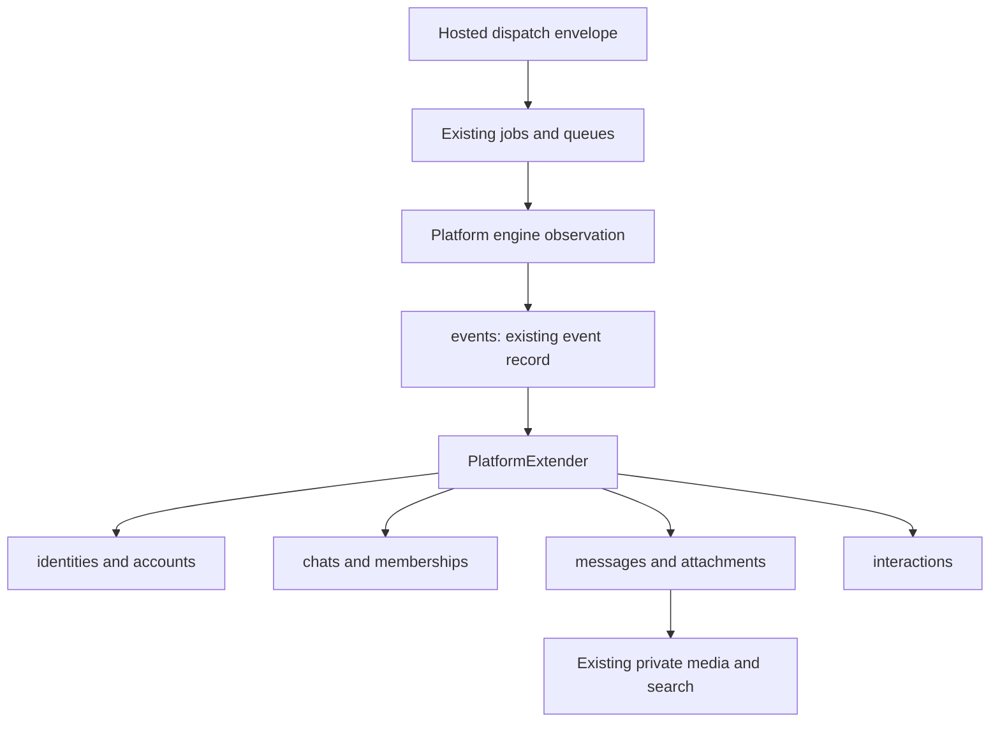

# Native Log schema and application contract

11 November 2026. Corrected specification for PR #113; supersedes the earlier broad schema draft.

## Foundation and scope

[The YAML schema](listeningKitSchema.yaml) starts with the current workspace **`log.db`**. It preserves the existing 42 application tables, indexes and 17 migrations. These definitions came from applying the checked-in migrations to a disposable in-memory database, without opening private data. Source revision: `4004558bdafcace630686df994d91254130659ab`.

This is a proposed implementation contract, not an executable migration or deployed backend. Its version is independent of SQLite's schema version. Allocate new migrations from the actual implementation HEAD.

The previous draft copied too much from generated Twenty objects. That was the wrong modeling basis. The current specification removes the old field inventory and the proposed listing, campaign, CRM, message-workflow, group-content and duplicate governor/knowledge/artifact tables. Old listing features are deferred until Matt returns to them. Legacy exports can inform a separately scoped importer; they do not define native tables.

## Data ownership

| Store | Owns | Implementation basis |
| --- | --- | --- |
| Hosted control PostgreSQL | Website identity, teams, OTP/sessions, MCP grants, pairing, runtime routing/leases, minimal recovery metadata and accepted encrypted Boat connection | Treg reference for control and identity only |
| Private workspace SQLite | Events, observed identities, chats/messages, attachments, interactions, coordination, queues/jobs, media/search, records/state and execution evidence | Existing `src/storage/schema` and `src/storage/platform` |
| Private workspace files | Engine sessions, governor files, configuration, captures and protected credentials | Existing `.logCli` and configured engine roots |
| Actual browser host | Browser profile files and installation management key; broker assignments/leases in provided mode | Existing AdsPower installation and accepted broker contract |

A workspace is the selected persistent cloud runtime, whether user-provided or Boat. It is not automatically an ephemeral AI chat execution container. One team selects one active workspace in V1. Private content is returned through the authorized bridge; it is not copied into a central inbox database.

## Existing native data flow

`PlatformExtender` already translates each platform into the shared event/chat/message/attachment/interaction model. Preserve its keys and ingestion behavior. Do not create a second message-body authority. SQLite `memberships` means platform room membership; control `memberships` means team authorization.

## Only the missing private contracts

| Proposed table | Why it is needed | Existing structure it must preserve |
| --- | --- | --- |
| `platformAccounts` | Execution configuration and optional credential references keyed by `(platform, account)` | Existing `accounts` is only the observed upstream `userId` mapping; chat/message identity stays unchanged |
| `secrets` | Private encrypted credentials with versioned references | Current engine formats and refresh semantics; key outside database |
| `runtimeBindings` | Installation/team/workspace binding and paired credential reference | Existing workspace DB and file roots |
| `browserProfiles` | Account-to-profile binding and actual browser location | Installation-owned browser files and profile identity |
| `operations` | Hosted request identity, deduplication, authorization/fencing and uncertain-outcome recovery | Existing `jobs`, `jobLines` and queues execute the work; this adds no replacement scheduler |
| `liveApprovals` | Exact operation/action authorization where required by existing live gates | Existing explicit authorization rules; no approval for ordinary reads |

These are proposed additions, not six already implemented tables. Each has a responsibility absent from the existing schema. No new lifecycle or governor table is required: the current private files remain authoritative through adapters. Existing `records` and `state` keep their current kind/scope unions; the specification does not silently add arbitrary kinds.

`account` is the existing engine identity key. Mutable display names stay separate. Renaming an identity requires explicit reconciliation; it must not disconnect existing messages, queues or session files.

## Actual dependency to replace

[`PlatformAccount`](../../src/platformKit/session/client.ts) currently aliases `FacebookAccount`, and `findPlatformAccount` queries Twenty. The local-account fallback also wraps the old client. Native implementation must replace account reads **and session refresh writes** with a direct workspace repository; native startup must not require the old client or generated domain types.

Import only active account configuration needed by current adapters. Preserve `(platform, account)`, upstream identity, credential references and browser bindings. Retain source exports privately, stop old writers at cutover, and avoid a second writable authority. Do not import old CRM/listing structures merely because their generated types exist.

## Frontend/backend contract

| Component | Responsibility |
| --- | --- |
| Control backend | OTP, team membership, sessions, scoped MCP grants, pairing and selected-workspace routing |
| Runtime backend | Native account/secret adapters, current SQLite ingestion and execution, private operation recovery |
| Browser adapter | Existing session lifecycle and provided/own AdsPower binding |
| Frontend | Sign-in, verification, team selection, workspace readiness, private account results, settings and MCP authorization |

Journey: `/sign-in -> /verify -> /teams -> /console/accounts`.

The YAML retains explicit endpoint/DTO contracts for these surfaces. Console and AI clients use the same registered dispatcher. Offline runtime means private data is unavailable; no central cached inbox is implied. V1 grants remain team-bound. A website team switch does not retarget a client's grant.

## Consistency and recovery

Apply DDIA's separation of authoritative records and derived views to the existing Log design. Preserve current events/projections and private job recovery; do not claim every operational table is reconstructible from events. No transaction spans PostgreSQL, SQLite and an external platform API.

- Consume OTP, pairing and authorization codes atomically.
- Fence routing by current workspace generation and current team/grant permissions.
- Journal dispatch identity before a platform effect; the same idempotency key with different arguments is a conflict.
- Preserve current jobs/queues, governors and browser/session evidence across restart.
- A timeout is an unknown outcome until the private journal and platform evidence resolve it; never blindly replay a write.
- Return private payloads transiently; keep central status metadata minimal.
- Clear frontend data on user/team/workspace changes.

## Implementation order

1. Preserve existing SQLite definitions and inventory current account/session read and refresh-write boundaries.
2. Implement the minimal native account/secret adapter and supported configuration import.
3. Implement control identity/team storage and OTP, grants and sessions.
4. Implement pairing, bridge, leases and operation envelope using current jobs/queues.
5. Implement frontend/CLI flows against the shared contracts.
6. Reconcile configuration, update active generators/defaults/guides and switch writers with a recovery snapshot.

Old listing/campaign and CRM/SMS behavior does not block this native V1. Keep those paths outside its exposed tool surface until separately specified.

## Document checks

Check YAML duplicate keys, declared fields/references/payload names, route uniqueness, exact current SQLite definition coverage, source paths and absence of legacy schema baggage. These are specification checks; no application tests, migrations of private data or deployments are performed here.

Companions: [native data boundary](listeningKitNativeData.md), [instance contracts](listeningKitInstanceContracts.md), [cutover dependency audit](listeningKitTwentyCutover.md), [AdsPower](listeningKitAdsPower.md), [Treg control references](listeningKitTregArchitecture.md).
