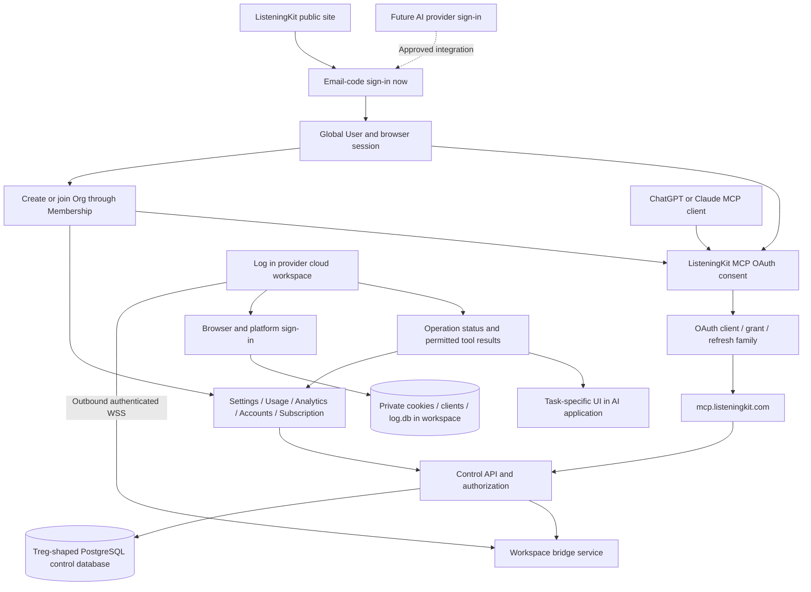

> Implementation reading order: [handoff and acceptance criteria](listeningKitHandoff.md), then [schema v2](listeningKitSchema.md). Those define native V1 scope and supersede broader legacy inventories or earlier field names in this companion. Deferred listings/CRM and future AI-provider identity are outside V1.

# Treg architecture baseline for ListeningKit — PR #113

## Authoritative data-boundary correction — 11 November 2026

Follow [listeningKitNativeData.md](./listeningKitNativeData.md): the Treg-shaped central PostgreSQL database holds login, teams, MCP consent, provider connections and minimal routing/recovery metadata only. Social accounts, credentials, conversations/messages, detailed jobs/results and private files live in the selected own-cloud or Boat workspace's local database/storage. Earlier central application-record or payload-summary proposals are superseded. The host relays authorized payloads without default durable retention; console private-data views require the runtime online.

Updated 11 November 2026. Architecture specification; implementation pending.

## Decision and correction to the earlier proposal

**Use Treg's identity, organization, membership, credential and MCP authorization architecture as the baseline.** This replaces the earlier recommendation to introduce Clerk/Convex and automatically create a personal organization. Those were adaptations; matt has now asked to model the database and application behavior directly on Treg.

The proposed control backend follows Treg's FastAPI + SQLModel/SQLAlchemy + PostgreSQL structure. Retain ListeningKit's existing React site and TypeScript MCP/runtime components, integrating them with that control service through authenticated interfaces. A direct Python service port is a closer implementation route than translating the same system into Convex. This is a proposed service boundary, not a claim that the service already exists. Do not add a second user/team authority in Twenty, Clerk or Convex alongside it.

**ChatGPT sign-in is optional future identity integration.** The interest form was submitted with `matt@trylisteningkit.com`, requested “Sign in only,” and linked this PR. Receipt was confirmed; approval/client credentials remain pending. Email-code sign-in supplies the initial entrance. Future provider identity must resolve to the same user and memberships.

## Pinned source of truth

All references below point to the inspected Treg revision [`3149cb1a23f6a0ce2d6ffab403f79f58855d3856`](https://github.com/superdesigndev/treg/tree/3149cb1a23f6a0ce2d6ffab403f79f58855d3856). The links retain their meaning if Treg's main branch moves. Each source is an implementation reference; ListeningKit additions are identified separately.

## Exact source map: database and backend

| Responsibility | Treg source to model | ListeningKit behavior |
| --- | --- | --- |
| Database sessions and engine configuration | [`src/treg/infra/db.py`](https://github.com/superdesigndev/treg/blob/3149cb1a23f6a0ce2d6ffab403f79f58855d3856/src/treg/infra/db.py), including [`get_session`, line 369](https://github.com/superdesigndev/treg/blob/3149cb1a23f6a0ce2d6ffab403f79f58855d3856/src/treg/infra/db.py#L369) | SQLModel/SQLAlchemy sessions against the shared control database; PostgreSQL for the hosted service. Treg also supports SQLite; runtime `log.db` remains a separate workspace store. |
| Global person | [`User`, models.py line 242](https://github.com/superdesigndev/treg/blob/3149cb1a23f6a0ce2d6ffab403f79f58855d3856/src/treg/models.py#L242) | A user exists independently of teams: unique email, verified-email timestamp, suspended state and token version. |
| Resource owner | [`Org`, models.py line 36](https://github.com/superdesigndev/treg/blob/3149cb1a23f6a0ce2d6ffab403f79f58855d3856/src/treg/models.py#L36) | Organization owns resources. Sign-in creates only a user; explicitly create or join a team before team operations. |
| Membership and roles | [`Membership`, models.py line 294](https://github.com/superdesigndev/treg/blob/3149cb1a23f6a0ce2d6ffab403f79f58855d3856/src/treg/models.py#L294) | Unique `(userId, orgId)` relationship, owner/admin/member/viewer roles; hashed membership credential and applicable tool/project restrictions. Permissions belong to membership. |
| Invitations | [`Invite`, models.py line 496](https://github.com/superdesigndev/treg/blob/3149cb1a23f6a0ce2d6ffab403f79f58855d3856/src/treg/models.py#L496) and [`org invitation routes`, orgs.py line 502](https://github.com/superdesigndev/treg/blob/3149cb1a23f6a0ce2d6ffab403f79f58855d3856/src/treg/routers/orgs.py#L502) | Joining a team creates membership after the appropriate identity/invite checks; it never makes every signed-in person a member. |
| Expiring state | [`Ephemeral`, models.py line 725](https://github.com/superdesigndev/treg/blob/3149cb1a23f6a0ce2d6ffab403f79f58855d3856/src/treg/models.py#L725), [`ratestore.py`](https://github.com/superdesigndev/treg/blob/3149cb1a23f6a0ce2d6ffab403f79f58855d3856/src/treg/ratestore.py) | Persistent namespaced state for OTPs, rate windows and pairing. Expiry survives restarts. For single-consumer credentials use the [`kv_take` delete/return primitive, line 95](https://github.com/superdesigndev/treg/blob/3149cb1a23f6a0ce2d6ffab403f79f58855d3856/src/treg/ratestore.py#L95); do not assume every helper is atomic merely because it uses a database. |
| Verified user creation | [`find_or_create_user`, application/signup.py line 73](https://github.com/superdesigndev/treg/blob/3149cb1a23f6a0ce2d6ffab403f79f58855d3856/src/treg/application/signup.py#L73) | Resolve the proven email identity through one use case. Preserve unique-user and suspension checks. |
| Email sign-in | [`start_email_login` and `verify_email_login`, application/auth.py lines 273 and 324](https://github.com/superdesigndev/treg/blob/3149cb1a23f6a0ce2d6ffab403f79f58855d3856/src/treg/application/auth.py#L273), exposed by [`routers/auth.py`, line 99](https://github.com/superdesigndev/treg/blob/3149cb1a23f6a0ce2d6ffab403f79f58855d3856/src/treg/routers/auth.py#L99) | Email start -> verify -> proven user -> signed browser session. Preserve code lifetime, attempt bounds and throttling behavior. Adapt email delivery to ListeningKit configuration. |
| Browser and CLI credential separation | [`domain/identity/session.py`](https://github.com/superdesigndev/treg/blob/3149cb1a23f6a0ce2d6ffab403f79f58855d3856/src/treg/domain/identity/session.py), [`make_session`, line 86](https://github.com/superdesigndev/treg/blob/3149cb1a23f6a0ce2d6ffab403f79f58855d3856/src/treg/domain/identity/session.py#L86), [`make_identity`, line 97](https://github.com/superdesigndev/treg/blob/3149cb1a23f6a0ce2d6ffab403f79f58855d3856/src/treg/domain/identity/session.py#L97) | Separate session and identity audiences, expiry and token-version revocation. A browser cookie is not an interchangeable CLI/runtime credential. Configure a persistent signing secret for hosted service instances. |
| Central authorization | [`domain/identity/access.py`](https://github.com/superdesigndev/treg/blob/3149cb1a23f6a0ce2d6ffab403f79f58855d3856/src/treg/domain/identity/access.py), [`require_identity`, line 147](https://github.com/superdesigndev/treg/blob/3149cb1a23f6a0ce2d6ffab403f79f58855d3856/src/treg/domain/identity/access.py#L147), [`require_member`, line 268](https://github.com/superdesigndev/treg/blob/3149cb1a23f6a0ce2d6ffab403f79f58855d3856/src/treg/domain/identity/access.py#L268) | Resolve a verified caller and membership on each protected request. Browser selects a team; team credentials carry their scope. A supplied team id/header cannot grant membership. |
| Create/list teams | [`application/signup.py: create_org`, line 384](https://github.com/superdesigndev/treg/blob/3149cb1a23f6a0ce2d6ffab403f79f58855d3856/src/treg/application/signup.py#L384), [`routers/orgs.py`, line 408](https://github.com/superdesigndev/treg/blob/3149cb1a23f6a0ce2d6ffab403f79f58855d3856/src/treg/routers/orgs.py#L408), [`domain/governance/teams.py`](https://github.com/superdesigndev/treg/blob/3149cb1a23f6a0ce2d6ffab403f79f58855d3856/src/treg/domain/governance/teams.py) | Create organization plus owner membership in a transaction; return only teams the person can access. Preserve concurrency/uniqueness behavior. |
| CLI authorization/pairing | [`application/auth.py: start_cli_login`, line 380](https://github.com/superdesigndev/treg/blob/3149cb1a23f6a0ce2d6ffab403f79f58855d3856/src/treg/application/auth.py#L380), [`approve_cli_login`, line 451](https://github.com/superdesigndev/treg/blob/3149cb1a23f6a0ce2d6ffab403f79f58855d3856/src/treg/application/auth.py#L451), [`HTTP routes`, line 444](https://github.com/superdesigndev/treg/blob/3149cb1a23f6a0ce2d6ffab403f79f58855d3856/src/treg/routers/auth.py#L444) | Model browser approval of a CLI connection on Treg's start/poll/choose-team/approve flow. Workspace attachment additionally binds a specific runtime and workspace. |
| MCP clients | [`OAuthClient`, models.py line 1367](https://github.com/superdesigndev/treg/blob/3149cb1a23f6a0ce2d6ffab403f79f58855d3856/src/treg/models.py#L1367) | One client model for dynamic registration and client metadata documents, followed by the same authorization/consent flow. |
| MCP grant and refresh history | [`OAuthGrant`, line 1441](https://github.com/superdesigndev/treg/blob/3149cb1a23f6a0ce2d6ffab403f79f58855d3856/src/treg/models.py#L1441), [`OAuthRefresh`, line 1459](https://github.com/superdesigndev/treg/blob/3149cb1a23f6a0ce2d6ffab403f79f58855d3856/src/treg/models.py#L1459) | Grant family holds current team authority; refresh rows retain issued-team provenance. Store refresh hashes, rotate, detect reuse and revoke the family. |
| MCP protocol and consent | [`domain/identity/mcp_oauth.py`](https://github.com/superdesigndev/treg/blob/3149cb1a23f6a0ce2d6ffab403f79f58855d3856/src/treg/domain/identity/mcp_oauth.py), [`authorization use cases`, auth.py line 1116](https://github.com/superdesigndev/treg/blob/3149cb1a23f6a0ce2d6ffab403f79f58855d3856/src/treg/application/auth.py#L1116), [`OAuth HTTP routes`, line 1046](https://github.com/superdesigndev/treg/blob/3149cb1a23f6a0ce2d6ffab403f79f58855d3856/src/treg/routers/auth.py#L1046) | Registered redirect validation, PKCE, consent, resource/audience checks, token exchange and revocation. Website login and MCP client consent remain distinct flows. |
| Usage attribution | [`CallRecord`, models.py line 528](https://github.com/superdesigndev/treg/blob/3149cb1a23f6a0ce2d6ffab403f79f58855d3856/src/treg/models.py#L528), [`org_usage`, orgs.py line 1316](https://github.com/superdesigndev/treg/blob/3149cb1a23f6a0ce2d6ffab403f79f58855d3856/src/treg/routers/orgs.py#L1316) | Organization-owned activity attributed to the acting user/tool. Adapt recorded operations to Log; a provider API call journal alone does not describe a persistent browser workflow. |

### Frontend references

- [`frontend/src/state/session.js`](https://github.com/superdesigndev/treg/blob/3149cb1a23f6a0ce2d6ffab403f79f58855d3856/frontend/src/state/session.js): email start/verify, current session, selected team, logout and `switchOrg` (line 51). Switching teams clears sensitive prior-team state; asynchronous results from older loads must not overwrite the new selection.
- [`frontend/src/state/team.js`](https://github.com/superdesigndev/treg/blob/3149cb1a23f6a0ce2d6ffab403f79f58855d3856/frontend/src/state/team.js): create team, members, invites and access controls.
- [`frontend/src/pages/TeamPage.vue`](https://github.com/superdesigndev/treg/blob/3149cb1a23f6a0ce2d6ffab403f79f58855d3856/frontend/src/pages/TeamPage.vue): team presentation reference. ListeningKit keeps React and implements the corresponding behavior with its five console pages.

## Database contract to carry over

Translate field names at the project boundary to the repository's camelCase convention; preserve relationships, constraints and meaning. The initial subset is explicit, not a claim to copy every Treg commerce/catalog table.

| Model | Initial contract |
| --- | --- |
| `User` | `id`, unique `email`, `emailVerifiedAt`, `suspended`, `tokenVersion`, timestamps. One person, independent of orgs. |
| `Org` | `id`, unique `slug`, `name`, `previousSlug?`, `suspended`, timestamps. Owns team resources. |
| `Membership` | `id`, FK `userId`, FK `orgId`, unique pair, `role`, `tokenHash`; preserve relevant tool access fields when exposing those operations. |
| `Invite` | Preserve Treg's invitation model and acceptance checks when enabling join/invitation UI. |
| `Ephemeral` | Composite key `(namespace, key)`, payload and expiry; separate namespaces and credential audiences for different ceremonies. |
| `OAuthClient` | Client identity, kind, metadata and registered redirect URIs. |
| `OAuthGrant` | Grant-family identity and mutable current organization authority. |
| `OAuthRefresh` | Unique token hash, family/client/user references, immutable issued organization, resource, scope, expiry and retirement history. |

Add `ApiKey` and its management path when exposing managed keys, referencing [`ApiKey`, models.py line 436](https://github.com/superdesigndev/treg/blob/3149cb1a23f6a0ce2d6ffab403f79f58855d3856/src/treg/models.py#L436). Keep distinct credential classes distinct; a membership credential, browser session, OAuth refresh token and runtime credential have different uses.

## Mapping your Excalidraw into this architecture

The left side of the drawing maps to Treg's identity/team system. The hosted MCP entry maps to Treg's OAuth client/grant system. ListeningKit's console and generated UI consume the same authorized service contracts. The browser/platform/cookie path runs inside the connected cloud workspace. The selected presentation surface does not establish runtime ownership.

### ListeningKit-specific additions — not claimed to exist in these Treg files

| Addition | Required relationship and behavior |
| --- | --- |
| `Workspace` | FK `orgId`, `createdByUserId`, provider product, runtime version, status, connection generation and last contact. A workspace is an execution environment, not an organization or login identity. |
| Workspace pairing | Adapt Treg CLI browser approval; bind approval to org, user and runtime challenge. Use expiring, single-consumer state. Issue a separate scoped runtime credential after approval. |
| Runtime credential | FK `workspaceId`, credential hash, expiry, revocation and generation. An org key alone must not impersonate any other runtime. |
| Operation record | FK `orgId` and `workspaceId`, actor or MCP grant reference, idempotency key, action, state, timestamps and result reference. Persist before dispatch; reconnect reconciles unknown outcomes rather than repeating social writes. |
| Optional future external identity | FK `userId`, unique verified `(issuer, subject)`. Explicit linking to an authenticated user; never infer ownership solely from an untrusted email. This is an extension, not a Treg model we found. |

Control database stores ownership, grants, workspace metadata and operation status. The workspace retains raw platform sessions, browser state and local runtime data. The bridge handles persistent connections and routes to the workspace selected by verified org/grant ownership. Signing into a provider does not itself allocate or keep a cloud computer running; each provider runtime needs a proven attachment path.

## Exact application flows

### 1. Website sign-in and team choice

1. `/auth/email/start` delivers a code with expiry and attempt/rate state.
2. `/auth/email/verify` proves the email, resolves the global user and creates a browser session.
3. Fetch `/auth/me` and accessible `/orgs`.
4. With no memberships, show create/join team. Follow Treg: do not silently create a personal organization.
5. Creating a team commits the organization and owner membership together. An accepted invitation creates the appropriate membership.
6. Selecting a team opens its console. Every protected request resolves membership again. Clear previous-team data while switching.

Sources: the email, session, signup, team and access files linked above. This replaces the earlier Clerk `ensureUser` transaction and automatic personal-team flow.

### 2. Connect the cloud runtime

1. Runtime starts a pairing request; user opens its approval page and signs in if needed.
2. User selects an accessible organization and approves that specific runtime.
3. Backend consumes pairing once and issues the workspace credential.
4. Runtime initiates outbound WSS; bridge validates it and binds the connection generation to the workspace.
5. Accounts shows the observed connection state. It requests platform sign-in through the runtime and receives confirmed status.
6. Captcha/challenge progress uses the existing platform workflow. Cookies remain in that same workspace; no cookie-transfer step is needed between a hosted login browser and a separate VM in this chosen architecture.

Treg supplies the pairing/approval pattern; workspace binding and persistent transport are ListeningKit work. Platform secrets currently in Twenty need an explicit migration/integration plan before multi-user operation; this document does not claim that migration is done.

### 3. AI application connects to MCP

1. MCP client discovers ListeningKit authorization metadata and registers/resolves its client.
2. User authenticates to ListeningKit and consents for a chosen team.
3. Authorization code plus PKCE is exchanged for scoped credentials.
4. Each request resolves the grant and current user/team permission, then routes to that team's authorized workspace.
5. Refresh rotation, family revocation and issued-team history follow Treg's separation.

This can be developed independently of “Sign in with ChatGPT” website identity access. Client availability/distribution and provider workspace attachment must each be verified independently.

## Implementation slices and completion criteria

1. **Port identity/database core:** Treg-shaped User/Org/Membership/Ephemeral models, relational constraints, sessions, email use cases and central caller resolution. Translate source naming into repository conventions; preserve semantics.
2. **Port team experience:** create/list/join/select team, membership roles and invitations as exposed. Connect React console routes to that authority.
3. **Port MCP authorization:** client metadata/registration, consent, authorization codes, PKCE, grant/refresh families, revocation and resource checks. Replace the existing server-owner assumption with org-scoped dispatch.
4. **Add workspace bridge:** pairing, scoped runtime credentials, WSS routing, connection generations and persisted operation reconciliation.
5. **Wire Accounts and generated UI:** platform login occurs in the workspace, with observed progress and results available through the same contracts.
6. **Add AI provider identity later:** approved provider integration links to the existing user. No provider identity is required for the initial product.

Acceptance criteria for implementation: a user with no team enters team setup; two users cannot access each other's teams/workspaces; a team switch drops late prior-team results; pairing can be consumed once; revoked/suspended users and revoked grants fail; refresh reuse follows the family policy; reconnect cannot duplicate a completed write; website login alone never reports a workspace as ready.

**This comment specifies the implementation baseline. No authentication service, database migration or runtime bridge has been deployed by this documentation work.** The earlier console specification remains useful for screens and runtime states; this decision supersedes its interim auth provider and automatic-organization assumptions.

## Boat compute provider

[listeningKitBoatRuntime.md](./listeningKitBoatRuntime.md) specifies the user-supplied Boat API key path, sandbox lifecycle, persistent runtime, desktop interaction and hosted MCP bridge independently of AI-provider sign-in.

## Shared hosted MCP contract

[listeningKitHostedMcp.md](./listeningKitHostedMcp.md) specifies the common authorization, pairing, runtime routing, operation recovery and MCP page behavior for own-cloud and Boat workspaces.

## Decision: native application data, no Twenty dependency

As of 11 November 2026, [listeningKitNativeData.md](./listeningKitNativeData.md) supersedes earlier Twenty migration/compatibility ambiguity: the target hosted product uses the Treg-shaped PostgreSQL backend for identity, team authorization and routing only. Existing SQLite log.db and private files remain the selected workspace data foundation. Twenty is not a required service in the target design; removal and migration are implementation work.

## Consolidated schema contract (11 November 2026)

[listeningKitSchema.yaml](listeningKitSchema.yaml) maps the complete current SQLite schema and proposed control/workspace/broker tables. [listeningKitSchema.md](listeningKitSchema.md) explains implementation ownership. This is a proposed Log contract, not a verbatim Treg schema port: V1 grants are team-bound and switching website teams does not change a client grant; a different team requires new client authorization/consent. Treg's mutable grant reference above describes its source implementation. The native data boundary remains authoritative: operation payloads/results stay in workspace storage; control keeps only its allowlisted operation metadata.

## Native model scope correction

Treg is the control/identity reference only. The corrected schema preserves existing Log SQLite tables and platform adapters. It removes the earlier generated-object field inventory and defers old listing/campaign and CRM/SMS models. See [the native schema guide](listeningKitSchema.md).
