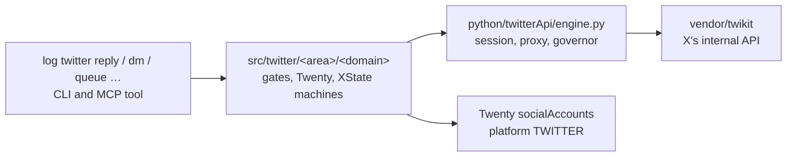

# X (Twitter) in log

log runs X accounts without a browser: it calls X's internal API directly with the account's saved session, through the vendored twikit library. This page explains how X fits into log's usual shape (command, engine, library, Twenty), which commands exist, how sends and queues work, and how X's answers are read. Read it if you work on the X commands or want to know how a reply or DM actually goes out.

## Status

Steps 1 to 4 of the plan below are built:

- the engine (`python/twitterApi/engine.py`: ping, follows, reply, quote, like, dm, each answer read into one event);
- `log twitter session check`, `follows`, `reply`, `quote`, `like`, `dm` and `queue`, each an MCP tool, with a `…Live` version for the sends and `queue run`.

Step 5, retiring the earlier X controller, is left.

Two things are vendored:

- `vendor/twikit`: a fork of twikit (MIT, commit `6a73ab9`, 2026-05-17). We maintain it ourselves. Its transport is curl_cffi impersonating Safari, the way fbk's is, not httpx. `bun run check:twikitTransport` and `vendor/twikit/tests/test_transport.py` check this.
- `vendor/twitterController`: the earlier X controller's scripts and tests as they were, the code being ported.

## The idea in one line

The X controller already does on X what log does on Facebook through fbk: it calls the platform's internal API with an account's saved session, with no browser. So X goes in the same way. twikit is the engine in `vendor/`, and log's commands, MCP tools, hooks and Twenty sit around it, as `log twitter <command> …`.

## What the X controller does

The controller is an earlier skill that **sends** what a person has already approved, from any X account in Twenty, through twikit:

| Script | What it does |
| --- | --- |
| `send_approved_reply.py --action ping` | Checks the saved session still works (read-only). |
| `--action reply / quote / dm / like` | Sends one approved reply, quote, DM or like, recording who approved it. |
| `--action follows` | Read-only: does each handle follow the account (`friendships/show`)? |
| `sequence.py build/show/check/approve/run/status` | A queue of approved messages, sent one at a time 90-150 s apart. `approve` stores a fingerprint of every recipient and every line of copy, and any edit voids it. |
| `random_run.py plan/run/nudge` | Spreads a queue over a time window at random times, as a state machine (`planned → waiting → liking/replying → cooling → finished`, `halted`), with cool-offs when X blocks and a nudge that sends the next N now. |

Its habits match log's:

- Finding people and posts is done by a separate search tool, never through twikit.
- Nothing is sent without a named approver.
- Cookies come from Twenty `socialAccounts` and are never printed.
- Copy is checked against the house style before it goes out: lowercase, no commas, no full stops, no em dashes.

### How X answers

| Answer | Meaning |
| --- | --- |
| 226 | Looks automated. |
| 344 | Daily limit reached; wait a day. |
| 385 | The post is gone. |
| 433 | Replies are turned off. |
| HTTP 429 with `x-rate-limit-reset` | Too many requests; wait until the reset time. |
| HTTP 401, code 32 | The session is dead. |
| HTTP 200 with an empty `create_tweet` result | X quietly dropped the reply. |

## How it fits log's shape

The same three layers Facebook has, platform first:

| Layer | Facebook | X |
| --- | --- | --- |
| The library | `vendor/fbk` (one surface per family) | `vendor/twikit` (one `Client`, 114 calls) |
| The engine | `python/directApi/engine.py`: reads the session's login state first, then calls one surface | `python/twitterApi/engine.py`: `ping` first, then one twikit call |
| Per account | `~/.logCli/fbk/<account>`: governor and token cache | `~/.logCli/twitter/<account>`: governor; refreshed cookies merged back into Twenty |
| The gate | `directGate` (session, proxy in the home country, active hours) | `twitterGate`: platform TWITTER, not deactivated, `auth_token` and `ct0` saved. No proxy. |
| The result | `socialAccounts.sessionState` | The same field (`loggedIn`, `loggedOut` for 401/32, `restricted` for 226) |
| Declared in | `DIRECT_ROUTES`, `commandEngine` | The same, with the engine kind `directApiOnly`: X has no browser path |

Example: `log twitter reply --account <a> --tweet <url> --text "<copy>" --approvedBy <name> --live`.

1. The gate checks the account.
2. The engine pings the session.
3. The style check passes.
4. twikit sends the reply.
5. X's answer decides the result. A sent id is success. An empty result is a drop, and the account cools off. A 401 marks the session `loggedOut` in Twenty.

## The commands

These cover what the controller does today, by area.

| Command | Area/domain | From the controller | Live version |
| --- | --- | --- | --- |
| `log twitter session check --account <a>` | `twitter/account/session` | `--action ping` | none |
| `log twitter follows --account <a> --handles <h,…>` | `twitter/graph/follows` | `--action follows` | none |
| `log twitter dms --account <a> [--waiting] [--conversation <id>]` | `cli/twitter/dms` | new (twikit's `dm/inbox_initial_state`, `dm/inbox_timeline` and `dm/conversation`) | none |
| `log twitter followers --account <a> [--limit <n>]` | `cli/twitter/followers` | new (twikit's `get_user_followers`, 100 a page) | none |
| `log twitter reply` / `quote` | `twitter/post/send` | `--action reply / quote` | `twitterReplyLive`, `twitterQuoteLive` |
| `log twitter dm --userId <id>` | `twitter/post/send` | `--action dm` | `twitterDmLive` |
| `log twitter like` | `twitter/post/send` | `--action like` | `twitterLikeLive` |
| `log twitter queue build / show / check / approve / status / plan` | `twitter/queue/plan` | `sequence.py`, `random_run.py plan` | none |
| `log twitter queue run / nudge` | `twitter/queue/run` (XState) | `random_run.py run / nudge` | `twitterQueueRunLive` |
| the house style check | `twitter/copy/style` | `check_style` | none |

- **Without `--live`, a send is a dry run:** the target, the text and its style are checked, and X isn't contacted.
- **`--live` needs `--approvedBy`,** and the engine also refuses a send without both.
- **Queue files keep the controller's format.** Their snake_case keys are read and written back in camelCase, and the approval fingerprint is computed the same way the controller's Python does it, so a queue the controller approved stays approved.

What every platform's commands share stays shared: the copy rules (beside `facebook/marketplace/copy`) and the governor.

## How the queue runner works

`random_run.py` was already a state machine (python-statemachine). It becomes an XState machine in `src/twitter/queue/run/machine.ts`, run through `observability/trace` like every long-running process, so `log watch` and the live log show each step.

- **States** stay the same: `planned`, `waiting`, `liking`, `replying`, `cooling`, `finished`, `halted`.
- **Each send** is one engine call, and its answer is the event: `sent`, `dropped` (an empty result), `throttled` (429, with its reset time), `dailyLimit` (344), `gone` (385, 433), `automated` (226), `sessionDead` (401/32).
- **Random times** use the system random source and the drawn gaps. A cool-off pushes everything left later by the length of the pause.
- **Cool-offs** go into the account's governor. fbk's `RequestGovernor` already paces with heavy-tailed gaps, caps and lasting cooldowns, and takes its settings as an object. X's settings (its daily send limit and its 2h/6h/12h and 24h waits) are a second configuration of the same class, kept per account like Facebook's.
- **Approval** keeps the fingerprint: a queue edited after `approve` is refused until it's approved again.
- **A halt** sends an alert to the team chat, as the controller's alert does now.

## Twenty

X accounts are `socialAccounts` rows with platform `TWITTER`. They need cookies set; they don't need a proxy or home country. After each run, X's refreshed cookies are merged back into the row, as the controller does.

## Not yet

The warm-up, X listening (searching and reading posts), a browser path for X, and rea request docs for X. They'll come later, in the same shape.

## The plan, in order

1. **The engine:** `python/twitterApi/engine.py` around `vendor/twikit` (the session from Twenty, the governor, the session ping, the answer read into an event), with `log twitter session check` as its first command. It changes nothing on X.
2. **`follows`:** the controller's one read.
3. **`reply`, `quote`, `like` and `dm`,** each with its `…Live` tool and the style check.
4. **The queue** (plan, approve, run, nudge) as the XState machine above.
5. **Retire `vendor/twitterController`** once each script has its command, pointing the skill at `log twitter …`.

## Decisions

- **No proxy for X.** X accounts call X directly, as the controller does. The rule that a browser never opens without a proxy stays Facebook's.
- **The name.** The platform word is `twitter` (matching Twenty's `TWITTER`).

The rules behind this are in AGENTS.md.
