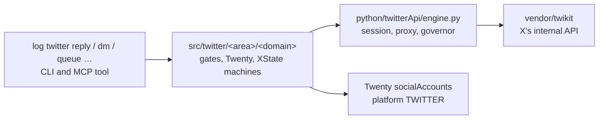

# Twitter as a log-cli platform: the plan

Status: 2026-10-25. Steps 1 to 4 are built: the engine (`python/twitterApi/engine.py`: ping, follows, reply, quote, like, dm, each answer read into one event), `log twitter session check`, `follows`, `reply`, `quote`, `like`, `dm` and `queue`, each an MCP tool (the sends and `queue run` with their `…Live` twins). Step 5 (retiring the controller's skill) is left. The library is in: `vendor/twikit` (unclecode's fork of twikit, MIT, commit `6a73ab9`, 2026-05-17, the same one the skill installs) and `vendor/twitterController` (the skill's scripts and tests as they were, the code being ported). We maintain `vendor/twikit` ourselves (rule 81): its transport is curl_cffi impersonating Safari, as fbk's is, not httpx, checked by `bun run check:twikitTransport` and `vendor/twikit/tests/test_transport.py`.

## In one line

twitter-controller already does on X what log-cli does on Facebook through fbk: it calls the platform's internal API with an account's saved session, no browser. So X goes in the way fbk did. twikit is the engine in `vendor/`, and our commands, MCP tools, hooks and Twenty sit around it, as `log twitter <command> …`.

## What twitter-controller is

A skill (`.agents/skills/twitter-controller`, now `vendor/twitterController`) that **sends** what a person already approved, from any X account in Twenty, through twikit:

| Script | Does |
| --- | --- |
| `send_approved_reply.py --action ping` | checks the saved session still works (read-only) |
| `--action reply / quote / dm / like` | sends one approved reply, quote, DM or like, with the approver recorded |
| `--action follows` | read-only: does each handle follow the account (`friendships/show`) |
| `sequence.py build/show/check/approve/run/status` | a queue of approved messages, sent one at a time 90-150 s apart. `approve` stores a fingerprint of every recipient and every line of copy, and an edit voids it |
| `random_run.py plan/run/nudge` | spreads a queue over a window at random times, as a state machine (`planned → waiting → liking/replying → cooling → finished`, `halted`), with cool-offs on X's blocks and a nudge that sends the next N now |

Its rules match log-cli's: discovery is treg's, never twikit's (rule 53); nothing is sent without a named approver (rules 8, 10); cookies come from Twenty `socialAccounts` and are never printed (rule 21). Copy is checked against the house style before it goes out: lowercase, no commas, no full stops, no em dashes.

What X answers, as the controller reads it: 226 automated, 344 daily limit (wait a day), 385 gone, 433 replies off, HTTP 429 with `x-rate-limit-reset`, 401 code 32 dead session. And one with no code at all: HTTP 200 with an empty `create_tweet` result, which means X quietly dropped the reply.

## The shape it maps to

The same three layers Facebook has, platform first (rules 63, 64):

| Layer | Facebook today | Twitter |
| --- | --- | --- |
| The library | `vendor/fbk` (surfaces per family) | `vendor/twikit` (one `Client`, 114 calls) |
| The engine | `python/directApi/engine.py`: reads the session's login state first, then calls one surface | `python/twitterApi/engine.py`: `ping` first (the controller's `check_session`), then one twikit call |
| Per account | `~/.logCli/fbk/<account>`: governor and token cache | `~/.logCli/twitter/<account>`: governor; refreshed cookies merged back to Twenty |
| The gate | `directGate` (session, proxy in the home country, hours) | `twitterGate`: platform TWITTER, not deactivated, `auth_token` + `ct0` saved. No proxy (rule 80) |
| The result | `socialAccounts.sessionState` | the same field (`loggedIn`, `loggedOut` for 401/32, `restricted` for 226) |
| Declared in | `DIRECT_ROUTES`, `commandEngine` | the same, with a new engine kind `directApiOnly`: X has no browser path |

Example: `log twitter reply --account matthewsoldit --tweet <url> --text "<copy>" --approvedBy matt --live`. The gate checks the account, the engine pings the session, the style check passes, twikit sends, and the answer decides (rule 73). A sent id is ok. An empty result is a drop, and the account cools off. A 401 marks the session `loggedOut` in Twenty.

## The families

Twitter's families are what the controller does now, by area. Discovery stays treg's.

| Command | Area/domain | From | Live? |
| --- | --- | --- | --- |
| `log twitter session check --account <a>` | `twitter/account/session` | `--action ping` | no |
| `log twitter follows --account <a> --handles <h,…>` | `twitter/graph/follows` | `--action follows` | no |
| `log twitter reply` / `quote` | `twitter/post/send` | `--action reply / quote` | `twitterReplyLive`, `twitterQuoteLive` (rule 8) |
| `log twitter dm --userId <id>` | `twitter/post/send` | `--action dm` | `twitterDmLive` |
| `log twitter like` | `twitter/post/send` | `--action like` | `twitterLikeLive` |
| `log twitter queue build / show / check / approve / status / plan` | `twitter/queue/plan` | `sequence.py`, `random_run.py plan` | no |
| `log twitter queue run / nudge` | `twitter/queue/run` (XState) | `random_run.py run / nudge` | `twitterQueueRunLive` |
| the house style check | `twitter/copy/style` | `check_style` | no |

Without `--live` a send is a dry run: the target, the text and its house style are checked and X is not contacted. `--live` needs `--approvedBy`, and the engine refuses a send without both too. A queue file keeps the controller's shape: its snake_case keys are read and written back in camelCase, and its approval fingerprint is computed the way the controller's Python computes it, so a queue the controller approved stays approved.

What every platform's commands share stays shared: the copy rules beside `facebook/marketplace/copy`, and the governor.

## Sequencing: how the runner becomes ours

`random_run.py` already is a state machine (python-statemachine). It becomes an XState machine in `src/twitter/queue/run/machine.ts`, run through `observability/trace` like every process that runs over time (rule 6), so `log watch` and the live log show each step (rule 26).

- **States** stay as they are: `planned`, `waiting`, `liking`, `replying`, `cooling`, `finished`, `halted`.
- **Each send** is one engine call. Its answer is the event: `sent`, `dropped` (an empty result), `throttled` (429, with its reset time), `dailyLimit` (344), `gone` (385, 433), `automated` (226), `sessionDead` (401/32).
- **Random times** keep the system random source and the drawn gaps. A cool-off moves what is left later by the pause.
- **Cool-offs** go into the account's governor. fbk's `RequestGovernor` already paces with heavy-tailed gaps, caps and persistent cooldowns, and it takes its config as an object. A twitter config (X's daily send limit, its 2h/6h/12h and 24h waits) is a second config of the same class, kept per account like Facebook's.
- **Approval** keeps the fingerprint: a queue edited after `approve` is refused until it is approved again.
- **The halt** tags matt in buzz, as the controller's alert does now.

## Twenty

X accounts are `socialAccounts` rows with platform `TWITTER`. There are 2 today, both with cookies set, and none has a proxy, home country or status. The controller merges X's refreshed cookies back into the row after each run, and that carries over.

## Not now

The warm-up, X listening (searching and reading posts: #26's first half), a browser path for X, and the rea request docs for X. They come later, on the same shape.

## Order

1. The engine: `python/twitterApi/engine.py` around `vendor/twikit` (the session from Twenty, the proxy, the governor, the session ping, the answer read into an event), and `log twitter session check` as its first command. It changes nothing on X.
2. `follows`: the controller's one read.
3. `reply`, `quote`, `like` and `dm`, each with its `…Live` tool and the style check.
4. The queue (plan, approve, run, nudge) as the XState machine above.
5. `vendor/twitterController` retires once each script has its command: the skill points at `log twitter …`.

## Decided (matt, 2026-10-25)

- **No proxy for X.** X accounts call X directly, as the controller does today. Rule 12 stays Facebook's (rule 80).
- **Name.** The platform word is `twitter` (Twenty's `TWITTER`, the skill's name).
