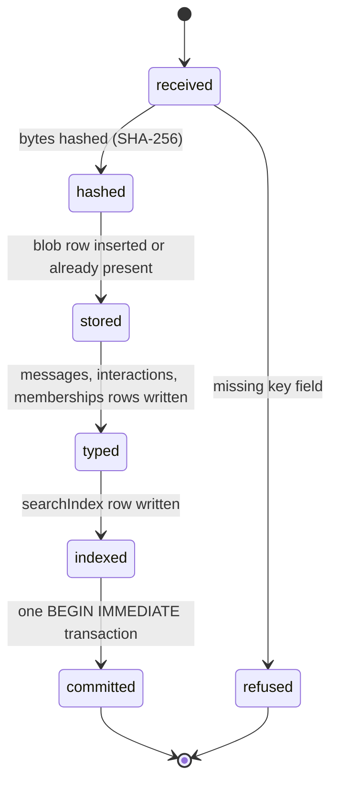
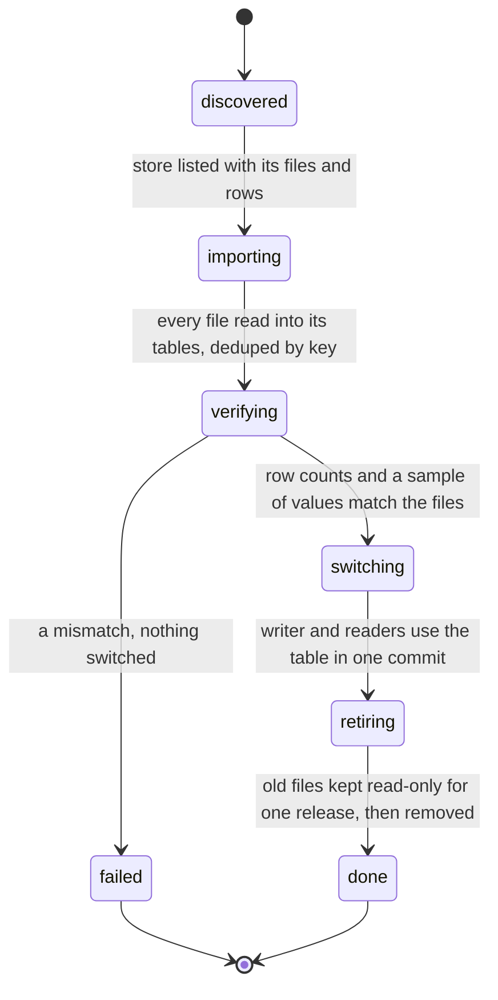
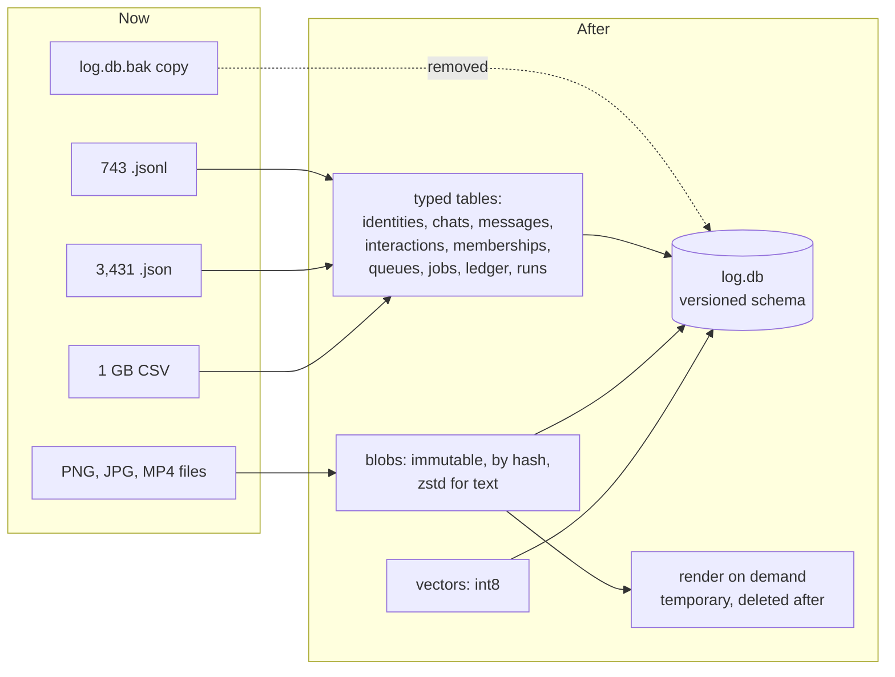

# Unify storage: what's wrong with how log stores data, and the schema it moves to

The `unifyStorage` branch's design: issues #96 (one database) and #97 (one shape for every platform's data). It comes before rapport (#95), because rapport can't be built on a store that has no schema.

Everything below was measured on the owner's machine on 2026-11-08 (`~/.logCli`, Bun 1.4.0).

## The principles (matt, 2026-11-08)

1. **Every system is held to a p95 and p99.** A read or write that has no target, and isn't measured, isn't done.
2. **No large JSON reads, and no data stored as JSON.** Parsing a whole file to find one thing is slow, and gets slower as it grows.
3. **Store the compact source and render on demand.**
   - If data can be kept in a smaller form and turned into something an AI can see (an image, a chart, a page), keep the small form.
   - Render it through a tool call only when it's needed, as a temporary file that's deleted after.
   - That saves storage.
4. **Data is immutable and recalled by its bytes.** Content is stored once under the hash of its bytes, and everything else points at the hash. Nothing is overwritten in place.
5. **No loose files that outside parties can read.** Data scattered across thousands of files in the home folder can be read, copied or changed by anything on the machine. This is a design flaw of the earlier systems, not a detail.
6. **Schema first.** Every table, key and index is written down, with the query it serves, before any code is written against it.
7. **State machines are built around the schema.** Each machine's states and events map onto rows and columns that already exist, never onto a loose structure that drifts.

SQLite (`log.db`, rule 134) is the right base. It's the first version, though, and it doesn't meet these principles yet.

## What's there today, measured

### The footprint

`~/.logCli` is **2.0 GB**:

| Where | Size | What |
| --- | --- | --- |
| `datasets/` | 1,081 MB | raw CSVs (KuaiRand, rule 50): two files are 492 MB and 374 MB |
| `twitter/<account>/media` | 167 MB | X Chat media, mostly `.mp4` (one is 70 MB) |
| `runs/kept` | 139 MB | 1,585 JSON files from kept runs; the largest, a single `exchanges.json`, is 32 MB |
| `rea/` | 138 MB | rea's readings of platform clients |
| `search/` | 126 MB | HNSW and BM25 index files (two 32 MB `.hnsw` files for the voice index) |
| `listings/` | 90 MB | listing copy and images |
| `log.db` | 63 MB | the one database |
| `log.db.bak-20261107T165106` | 61 MB | **a loose full copy of the database**, readable by anything |
| `mcp/jobs` | 55 MB | 647 `.json` + 647 `.jsonl` |
| `conversations/` | 21 MB | 542 JSON files: about 116,000 messages |

Files by kind: **743 `.jsonl`, 3,431 `.json`, 1 `.db`.** Media: 22 PNG (45 MB), 61 JPG (67 MB), 8 MP4 (87 MB), 70 M4A (10 MB), 39 OGG (4 MB), 5 WAV (6 MB).

### Read times

From `$TEMP/storeBench.ts`, which reads every file of each store and runs real queries against `log.db`:

| Read | p50 | p95 | p99 | max |
| --- | --- | --- | --- | --- |
| One conversation store file (543) | 0.16 ms | 0.63 ms | 4.81 ms | 14.6 ms |
| One kept run JSON (1,585) | 0.19 ms | 1.81 ms | 5.75 ms | **119.6 ms** |
| One job JSON (647) | 0.14 ms | 0.39 ms | 0.72 ms | 3.8 ms |
| One queue JSON (89) | 0.12 ms | 0.27 ms | 0.32 ms | 0.3 ms |
| **The whole conversation store** (to find anything in it) | | | | **168 ms** for 116,379 messages |
| `log.db`: last 100 events of one chat, **without** platform and account | 4.70 ms | 6.51 ms | 7.38 ms | 8.9 ms (**full table scan**) |
| `log.db`: FTS5 search | 0.09 ms | 0.62 ms | 0.62 ms | |

Each small file reads fast. The trouble is:
- **There's no index across files.** Any question ("everything this person said", "every chat that mentions the dialer") parses all of them. That's 168 ms today, and it grows with every message.
- **Big files have long tails.** A 32 MB JSON costs 120 ms to read for one value inside it.
- **`log.db` has its own problem.** `eventsByChat` is `(platform, account, conversationId, seq)`, so a query by conversation alone does `SCAN events`. It's fine at 4,981 rows, and it will cost about 100x that at the half-million rows a full backfill brings (Part 2 of #95).

### Inside `log.db`

| Table | Size | Note |
| --- | --- | --- |
| `embeddings` | 56 MB of 63 MB | 11,904 Jina vectors (1,024 dims) and 659 MiniLM (384), stored as float32 **with their source text beside them** |
| `events` | 3.4 MB | 4,981 rows; `payload` is a JSON string (1.46 MB of it) |
| `timings` | 1.1 MB | event timings (rule 134), next to `spans` (rule 165): two timing stores |
| `searchIndex` | 1.3 MB | FTS5 |

- **No schema version.** `PRAGMA user_version` is `0`.
- **Migrations are re-run on every open.** The only one is an `ALTER TABLE events ADD COLUMN source` in `MIGRATIONS` (`src/inbox/store/client.ts:35`), retried each time the database opens. Nothing records which migrations have run.

## The critique, store by store

| # | Store | What's wrong | Which principle |
| --- | --- | --- | --- |
| 1 | `conversations/*.json` (542 files) | The real message history lives in whole-file JSON. Every update rewrites the file, and every lookup parses all of it. It isn't in `log.db`, so nothing can join it with events, claims or people | 1, 2, 6 |
| 2 | `events.payload` | JSON stored as text inside the database: the same flaw, moved indoors. Fields every query needs (sender id, handle, text, reply-to, attachments) sit in a blob the engine can't index. This is why only X records people (#95 Part 2) | 2, 6 |
| 3 | `eventsByChat` index | Doesn't match how the code reads, so reads that don't name the platform and account scan the table | 1 |
| 4 | `twitter/*/live.jsonl` + `.hookSessions/*.json` | An append log read by byte offset, with one offset file per session (67 of them). It reimplements `cursors`, without transactions | 2, 6 |
| 5 | `queues/*.json` (89) | Queue state is rewritten whole by the run, the hook and `queue edit`, with no transaction between them. A held item and a send can race (rules 107, 109, 114) | 2, 6, 7 |
| 6 | `mcp/jobs/*.json` + `*.jsonl` (1,294) | Every job leaves two files forever. A crash mid-append loses the tail. `jobStatus` parses the file to find a line | 2 |
| 7 | `runs/kept/**` (1,585 JSON, 139 MB) | Raw exchanges kept as pretty JSON (one is 32 MB). Screenshots are stored as PNGs even though the page snapshot and HAR they came from are kept too | 2, 3 |
| 8 | Screenshots and images (22 PNG, 61 JPG, 112 MB) | Kept forever as full images. Most can be re-rendered from what they were made from (an aria snapshot, HTML, a chart's data) when an AI needs to look | 3 |
| 9 | `embeddings` (56 MB) | float32 vectors with their full source text, and two embedders' vectors side by side. A vector needs neither the text (it's hashed for lookup) nor 32 bits per dimension to rank well | 1, 3 |
| 10 | `datasets/*.csv` (1.08 GB) | Raw CSVs read once to build persona tables (rule 50) and then left on disk at full size | 3 |
| 11 | `log.db.bak-…` (61 MB) | A full copy of every message and claim, sitting loose next to the original | 5 |
| 12 | Ledgers in loose `.jsonl` (`billing/answers`, `captcha/attempts`, `proxyTraffic`, `launchResets`, `governorResets`) | Money and account-safety records that rules depend on (24, 37, 41, 51, 94, 164), with no transaction, no index and no protection from edits | 2, 4, 5 |
| 13 | Schema drift | No version number, migrations retried on every open, columns added with `ALTER` and no record. Code and data can disagree with nothing to catch it | 6 |
| 14 | Two timing stores (`timings`, `spans`) and two inbox stores (`events`, `pending.jsonl` still on disk) | The same fact in two places, so they drift | 6 |
| 15 | Machines built on files | `inbox/watch`, `twitter/queue/run`, `mcp/jobs` and the run store hold their state in files. The machine's state and the stored state are separate, so a crash between them leaves them disagreeing | 7 |

## The design

### One database, versioned

- **One file, `log.db`**, WAL, `BEGIN IMMEDIATE` for every write (as now).
- **`PRAGMA user_version` is the schema version.** Migrations live in `src/storage/schema/migrations/NNNN_<name>.sql`, each applied once inside a transaction, which then bumps the version. Nothing is retried on open.
- **A `schemaVersion` check at start.** If the code expects version N and the file is at M < N, the missing migrations run. If M > N (old code, new data), log refuses to start and says so.
- **A schema test.** Every table's DDL is compared against `src/storage/schema/tables.ts`, so code and data can't drift.

### Immutable bytes: the blob store

Every piece of content (a message's media, a capture, a page snapshot, a transcript's audio, an embedding's source) is stored **once, by the hash of its bytes**, inside `log.db`:

```sql
CREATE TABLE blobs (
  hash TEXT PRIMARY KEY,
  kind TEXT NOT NULL,
  codec TEXT NOT NULL,
  size INTEGER NOT NULL,
  storedSize INTEGER NOT NULL,
  bytes BLOB NOT NULL,
  createdAt TEXT NOT NULL
) WITHOUT ROWID;
```

- `hash` is the SHA-256 of the **original** bytes, so the same file sent twice is stored once.
- `codec` is `raw`, `zstd` or `gzip`. Text-like content (snapshots, HTML, HAR, JSON from a platform) is stored zstd-compressed (`Bun.zstdCompressSync`, built into Bun 1.4.0, checked). Already-compressed media (JPG, MP4, OGG) is stored `raw`.
- **Rows are never updated.** A changed thing is a new hash.
- Content over 64 MB is split into `blobChunks (hash, n, bytes)` so no single row is huge. Today that's only the 70 MB MP4.
- Everything that used to be a file path now holds a `hash`.

This answers principles 4 and 5: content is recalled by its bytes, and it isn't a loose file anything can open.

### Store the source, render on demand

| Kept | Rendered when an AI needs to see it | Then |
| --- | --- | --- |
| A page's aria snapshot and HTML (zstd) | a screenshot, through the browser driver (`page.setContent` and screenshot) | deleted after the call |
| A chart's rows | a PNG through the existing chart path | deleted after |
| A run's step exchanges (zstd, by hash) | a readable summary or an image of the timeline | deleted after |
| A received image or video (raw, by hash) | itself (it can't be rebuilt) | kept |

New rendering goes through one tool, `log storage render <hash> --as png|text`, which writes to a temporary folder and deletes the file when the call ends. A screenshot is only stored as an image when nothing it came from is kept.

### Vectors: half the database today

- **Stored as int8 with a scale** (`vector BLOB` of 1,024 bytes, plus a `scale REAL`), not float32: 4x smaller. Ranking is checked against float32 on the same queries before switching (the p95 and recall numbers go in the PR).
- **No source text beside the vector.** The text's hash points at its blob.
- **One embedder per use.** A vector from a model nobody queries any more is dropped when its index is rebuilt (rule 137 already rebuilds on model change).

### Typed columns, not JSON payloads

Every field a query or a machine reads is its own column. `payload` keeps only the platform's raw answer, compressed in `blobs` and referenced by `rawHash`, for rule one's "read the internal API".

### The schema

Each table is listed with the query it serves and its p95 target. Indexes are written from the queries, not the other way round.

```sql
CREATE TABLE identities (
  platform TEXT NOT NULL,
  userId TEXT NOT NULL,
  handle TEXT,
  displayName TEXT,
  personId TEXT,
  firstSeenAt TEXT NOT NULL,
  lastSeenAt TEXT NOT NULL,
  PRIMARY KEY (platform, userId)
) WITHOUT ROWID;
CREATE INDEX identitiesByPerson ON identities (personId);
CREATE INDEX identitiesByHandle ON identities (platform, handle);

CREATE TABLE chats (
  chatId TEXT PRIMARY KEY,
  platform TEXT NOT NULL,
  account TEXT NOT NULL,
  conversationId TEXT NOT NULL,
  kind TEXT NOT NULL,
  name TEXT,
  serverId TEXT,
  backfilledAt TEXT,
  UNIQUE (platform, account, conversationId)
) WITHOUT ROWID;

CREATE TABLE messages (
  seq INTEGER PRIMARY KEY,
  messageKey TEXT NOT NULL UNIQUE,
  chatId TEXT NOT NULL,
  platformMessageId TEXT,
  senderPlatform TEXT NOT NULL,
  senderUserId TEXT NOT NULL,
  fromOwner INTEGER NOT NULL,
  sentAt TEXT NOT NULL,
  text TEXT NOT NULL DEFAULT '',
  replyToKey TEXT,
  source TEXT NOT NULL,
  rawHash TEXT,
  receivedAt TEXT NOT NULL
);
CREATE INDEX messagesByChat ON messages (chatId, seq);
CREATE INDEX messagesBySender ON messages (senderPlatform, senderUserId, seq);
CREATE INDEX messagesBySentAt ON messages (sentAt);

CREATE TABLE attachments (
  messageKey TEXT NOT NULL,
  n INTEGER NOT NULL,
  kind TEXT NOT NULL,
  name TEXT,
  hash TEXT,
  durationMs INTEGER,
  describedHash TEXT,
  PRIMARY KEY (messageKey, n)
) WITHOUT ROWID;

CREATE TABLE interactions (
  seq INTEGER PRIMARY KEY,
  interactionKey TEXT NOT NULL UNIQUE,
  platform TEXT NOT NULL,
  account TEXT NOT NULL,
  kind TEXT NOT NULL,
  actorUserId TEXT NOT NULL,
  targetRef TEXT,
  at TEXT NOT NULL,
  rawHash TEXT
);
CREATE INDEX interactionsByActor ON interactions (platform, actorUserId, seq);

CREATE TABLE memberships (
  platform TEXT NOT NULL,
  roomId TEXT NOT NULL,
  userId TEXT NOT NULL,
  firstSeenAt TEXT NOT NULL,
  lastSeenAt TEXT NOT NULL,
  PRIMARY KEY (platform, roomId, userId)
) WITHOUT ROWID;
CREATE INDEX membershipsByUser ON memberships (platform, userId);

CREATE TABLE queues (
  queueId TEXT PRIMARY KEY,
  platform TEXT NOT NULL,
  account TEXT NOT NULL,
  action TEXT NOT NULL,
  minGapSeconds INTEGER NOT NULL,
  createdAt TEXT NOT NULL,
  state TEXT NOT NULL
) WITHOUT ROWID;

CREATE TABLE queueItems (
  queueId TEXT NOT NULL,
  n INTEGER NOT NULL,
  action TEXT NOT NULL,
  targetUserId TEXT NOT NULL,
  textHash TEXT NOT NULL,
  dueAt TEXT,
  state TEXT NOT NULL,
  heldFor TEXT,
  draftedAt TEXT NOT NULL,
  sentMessageKey TEXT,
  addedBy TEXT NOT NULL,
  PRIMARY KEY (queueId, n)
) WITHOUT ROWID;
CREATE INDEX queueItemsDue ON queueItems (state, dueAt);

CREATE TABLE jobs (
  jobId TEXT PRIMARY KEY,
  tool TEXT NOT NULL,
  state TEXT NOT NULL,
  startedAt TEXT NOT NULL,
  endedAt TEXT,
  exitCode INTEGER,
  inputHash TEXT NOT NULL
) WITHOUT ROWID;

CREATE TABLE jobLines (
  jobId TEXT NOT NULL,
  n INTEGER NOT NULL,
  at TEXT NOT NULL,
  stream TEXT NOT NULL,
  line TEXT NOT NULL,
  PRIMARY KEY (jobId, n)
) WITHOUT ROWID;

CREATE TABLE ledger (
  seq INTEGER PRIMARY KEY,
  kind TEXT NOT NULL,
  provider TEXT,
  platform TEXT,
  account TEXT,
  at TEXT NOT NULL,
  amount REAL,
  unit TEXT,
  outcome TEXT NOT NULL,
  detailHash TEXT
);
CREATE INDEX ledgerByKind ON ledger (kind, at);

CREATE TABLE transcripts (
  audioHash TEXT PRIMARY KEY,
  provider TEXT NOT NULL,
  text TEXT NOT NULL,
  wordsHash TEXT,
  durationMs INTEGER,
  createdAt TEXT NOT NULL
) WITHOUT ROWID;

CREATE TABLE runs (
  runId TEXT PRIMARY KEY,
  action TEXT NOT NULL,
  account TEXT,
  browser TEXT,
  startedAt TEXT NOT NULL,
  endedAt TEXT,
  outcome TEXT,
  findingsHash TEXT
) WITHOUT ROWID;

CREATE TABLE runSteps (
  runId TEXT NOT NULL,
  n INTEGER NOT NULL,
  action TEXT NOT NULL,
  startedAt TEXT NOT NULL,
  ms INTEGER,
  snapshotHash TEXT,
  harHash TEXT,
  exchangesHash TEXT,
  readingHash TEXT,
  PRIMARY KEY (runId, n)
) WITHOUT ROWID;

CREATE TABLE vectors (
  textHash TEXT NOT NULL,
  model TEXT NOT NULL,
  dims INTEGER NOT NULL,
  scale REAL NOT NULL,
  vector BLOB NOT NULL,
  PRIMARY KEY (textHash, model)
) WITHOUT ROWID;
```

The tables that stay as they are (`owners`, `claims`, `cursors`, `positions`, `gaps`, `actions`, `alerts`, `spans`, `searchIndex`, `media`, `people` until it's replaced by `identities`) move under the same versioned migrations. `events` stays as the push channel's raw inbox, but each event is also written as typed rows (`messages`, `interactions`, `memberships`) in the same transaction. Readers move to the typed tables.

### p95 and p99 targets

Measured by `bun scripts/storage/benchStorage.ts` (added on this branch). The p95 and p99 rule is the one the context layer already follows (rule 159).

| Path | Today | Target p95 | Target p99 |
| --- | --- | --- | --- |
| Last 100 messages of one chat | 4.7 / 6.5 / 7.4 ms (scan, 4,981 rows) | ≤ 2 ms at 500,000 rows | ≤ 5 ms |
| Everything one person said, all platforms | 168 ms (load every file) | ≤ 10 ms | ≤ 25 ms |
| Queue's next due item | file parse | ≤ 1 ms | ≤ 3 ms |
| `jobStatus` after line N | file parse | ≤ 1 ms | ≤ 3 ms |
| A run step's capture by hash | 120 ms max (32 MB JSON) | ≤ 15 ms (zstd decode) | ≤ 40 ms |
| Append one event with its typed rows | n/a | ≤ 3 ms | ≤ 8 ms |
| Nearest 50 vectors (int8) | n/a | measured before and after; recall within 1% of float32 | |

### The machines, built on the schema

Each machine's states are columns in its table:





The first is the write path for anything a platform sends. The second runs once per store being moved. Queue items, jobs and runs keep their state in their `state` column, and the XState machine that drives them reads and writes that column in the same transaction as the work. So a crash can't leave them disagreeing.



## Order

1. **Schema and migrations.** `src/storage/schema` (tables, versioned migrations, the schema test), plus `benchStorage.ts` with today's numbers as the baseline.
2. **Blobs.** The blob store and `log storage render`.
3. **Messages.** `identities`, `chats`, `messages`, `attachments`, `interactions` and `memberships` written by every watcher in the same transaction as `events`. This fixes "only X records people" (#95 Part 2).
4. **The conversation store.** Imported into `messages`, then removed.
5. **The X live feed and hook offsets** move to `interactions` and `cursors`.
6. **Queues**, then **jobs**, then the **ledger**, then **transcripts**, then **runs** (captures into `blobs` and `runSteps`).
7. **Vectors** to int8, checked against float32.
8. **Datasets.** The CSVs are read once into compact tables and removed.
9. **The loose `log.db.bak` copy** goes. Backups become `VACUUM INTO` into one dated file, made only when asked.
10. **`check:oneDatabase`** (from #96) in pre-commit, pre-push and CI.

## Open for the owner

- **Encryption at rest.** Principle 5 is about outside parties reading the data. One file with the right permissions is a big step up from thousands of loose files. Whether `log.db` should also be encrypted is the owner's call.
- **Retention.** How long raw captures (HAR, exchanges) stay in `blobs` once a run is analysed. Rule 66 prunes them from disk today.
