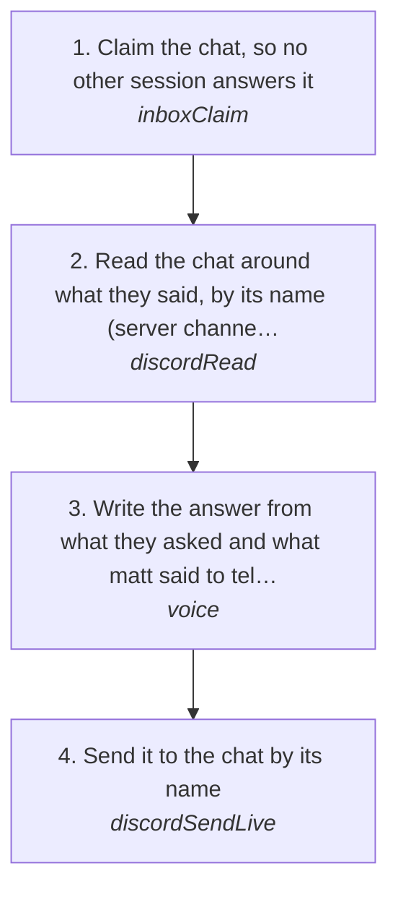

# Answering someone in a Discord chat or channel

Answer what someone said to the account in a Discord DM, group or server channel, with words: a question about what matt is building, a reply to something he posted, a mention. The chat is read first, the answer is written from what was said there and what matt has told you, gated like every send, and sent through the account's one session. No meme and no voice note (those are [memeReply](memeReply.md) and [voiceNote](../inbox/voiceNote.md)).

How the owner asks for it: "message the guy in <chat> who just mentioned me", "reply to <someone> in <chat>", "explain what I'm trying to do to <someone> in <chat>", "answer him in the general"

## Run it from a fresh context

Say: **"go on docs/useCases/discord/channelReply.md for <chat>"**. The agent reads this page and runs the steps.

## The steps

<!-- stepsDiagram: written by `bun run docs:build` from the steps table below, not edited by hand -->

<!-- /stepsDiagram -->

| # | Step | Tool | Done when |
| --- | --- | --- | --- |
| 1 | Claim the chat, so no other session answers it | `inboxClaim` { platform: "discord", account, chat: "<chat id>", event: "<event id from the hook>" } | this session holds the chat |
| 2 | Read the chat around what they said, by its name ("<server> #<channel>" for a server channel) | `discordRead` { account, channel: "<chat as matt says it>", limit: "25" } | what they said, what came before it, and who it answers |
| 3 | Write the answer from what they asked and what matt said to tell them, in his words and length, then gate it | `voice` { to: "<who>", context: "<what they said and what came before>", text: "<draft>" } | `PASS`, or matt's own words he gave for this message |
| 4 | Send it to the chat by its name | `discordSendLive` { account, channel: "<chat as matt says it>", text: "<draft>", approvedBy: "matt", confirmLive: true } | Discord answers `sent` with the message id |

## What to know

- **matt's own words.** When matt says what to tell them, the answer is his words, kept as close to how he said them as reads right. When the gate still refuses his own words, `overGate` on `discordSendLive` sends that exact message: the gate's read is skipped and the AI artifact check still runs (rule 152).
- **A server channel is a room.** Answer the person who asked, in the channel, without talking to the room as if it were a DM (rule 155).
- **One message per line.** A draft on several lines goes out one message per line, and the send stops the moment they write back (rules 90, 130).
- **Name the chat.** A server channel is named "<server> #<channel>", never its id (rule 155). `voice` can't find a server channel by name, so gate a channel reply with `to` and `context` only.
