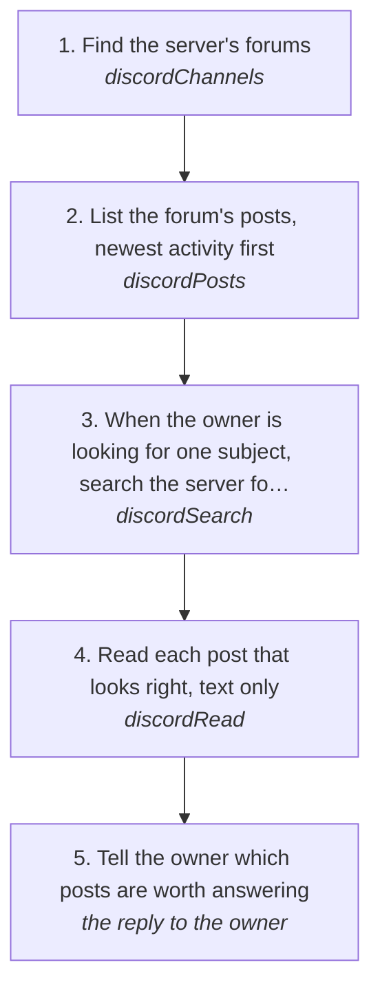

# Going through a Discord forum for posts worth answering

Find a forum in a server, list its posts, read the ones that look right, and tell the owner which are worth answering and why: someone asking for help with something the owner has built or knows, a question nobody answered yet, a problem log solves. This page reads and sends nothing; answering one is [serverReply](serverReply.md).

How the owner asks for it: "look at the <server> forum and find the one about <problem>", "go through the forum in <server> and tell me which posts to respond to", "list the posts in <server> #<forum>", "find posts in <server> asking for help with <thing>"

## Run it from a fresh context

Say: **"go on docs/useCases/discord/forumPosts.md for <server>, looking for <what>"**. The agent reads this page and runs the steps.

## The steps

<!-- stepsDiagram: written by `bun run docs:build` from the steps table below, not edited by hand -->

<!-- /stepsDiagram -->

| # | Step | Tool | Done when |
| --- | --- | --- | --- |
| 1 | Find the server's forums | `discordChannels` { account, server: "<server>" } | the `forum` and `media` channels, with their tags; when the owner named the forum, that one |
| 2 | List the forum's posts, newest activity first | `discordPosts` { account, channel: "<server> #<forum>", limit: 50 } | each post's title, author, tags, replies, open or closed, and opening message |
| 3 | When the owner is looking for one subject, search the server for it too | `discordSearch` { account, server: "<server>", query: "<words>", channel: "<server> #<forum>" } | the posts whose replies mention it, not only their titles |
| 4 | Read each post that looks right, text only | `discordRead` { account, channel: "<server> #<forum> > <post title>", limit: 50, noMedia: true } | what was asked, what was answered, and whether the owner already wrote there |
| 5 | Tell the owner which posts are worth answering | the reply to the owner | each one named as `"<server> #<forum> > <title>"`, who asked, when, what they need, whether anyone answered, and why it fits |

## What to know

- **Judge from the list first.** The opening message, tags and reply count come with every post in step 2, so open only the ones that could fit. A closed or locked post can't be answered.
- **Worth answering** means someone asked something the owner can really help with, nobody has solved it, and it's recent enough that they're still there. A post where the owner already wrote is the owner's; say so instead of suggesting it.
- **Search reaches the replies.** A post's title can hide what it's about; step 3 finds posts where the subject comes up anywhere in them.
- **Name every post.** `"<server> #<forum> > <post title>"`, never its id. `discordPosts` keeps each post's name, so `discordRead` finds it straight after.
- **Nothing is sent from this page.** To answer one, follow [serverReply](serverReply.md) with the post as the channel.
- What each part of a server is: the `discordServers` skill in the discord guide.
