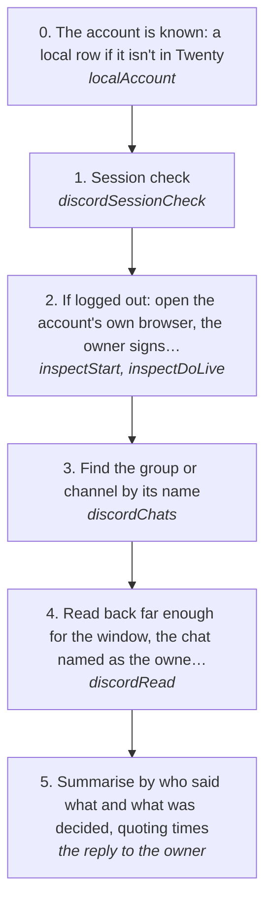

# Reading a Discord group chat without Twenty

Catch up on what was said in a Discord group or channel over the last few hours, on the account's own session, with the account kept in a local file instead of Twenty. This page reads and sends nothing.

How the owner asks for it: "read the <group> chat over the last <N> hours", "what did <someone> set up in <group>"

## Run it from a fresh context

Say: **"go on docs/useCases/discord/groupChatRead.md for <group>, last <N> hours"**. The agent reads this page and runs the steps.

## The steps

<!-- stepsDiagram: written by `bun run docs:build` from the steps table below, not edited by hand -->

<!-- /stepsDiagram -->

| # | Step | Tool | Done when |
| --- | --- | --- | --- |
| 0 | The account is known: a local row if it isn't in Twenty | `localAccount` { action: "add", platform: "discord", account: "<account>", adsPower: "<profileId>" } | `log localAccount list` shows it |
| 1 | Session check | `discordSessionCheck` | `loggedIn` |
| 2 | If logged out: open the account's own browser, the owner signs in, then stop it to save the session | `inspectStart` { account }, then `inspectDoLive` stop | the session check answers `loggedIn` |
| 3 | Find the group or channel by its name | `discordChats` | the group by its name, with its members; a server channel as "<server> #<channel>" |
| 4 | Read back far enough for the window, the chat named as the owner says it, never its id | `discordRead` { account, channel: "<name>", limit } | the oldest message read is older than the window, or the answer says `stopped` |
| 5 | Summarise by who said what and what was decided, quoting times | the reply to the owner | every claim names its message time and author |

A busy group runs about 100 messages an hour, so a 5 hour window needs a limit near 500 to 800 (the cap is 1000). `--after` filters within the messages read, it doesn't reach further back.

## What the runs taught

- **Twenty doesn't have to hold the account.** `LOG_ACCOUNTS=local` leaves Twenty out entirely, and a session captured by `inspectStart` saves back to the local file.
- **A 429 stops the read.** The answer keeps what was read and says `stopped`, with Discord's status, and a 429 pauses the account. Nothing retries (rule 94), and no script calls Discord with the account's token. Any refusal stops `log search index` across every chat the same way, keeping what it had read.
- **A browser profile that won't start for low disk** needs space freed and the browser app restarted, never its cache deleted: that can wipe the session.
- **A chat is named, never passed by id.** A `discordRead` with a bare id is refused by the chat-names hook (rule 155): pass "A", "aeo" or "<server> #<channel>", and the tool finds the id in the kept chat list.
- **The read comes from the .db when it is current.** Once the account has caught up and the chat was backfilled, `discordRead` answers from the .db in milliseconds and says so; Discord is read only to fill a chat the .db doesn't hold yet (rule 160).
- **A message with no text is never answered blind.** An empty message with no attachment saved (a sticker, a call, an embed) is told to the owner as it is, and nothing is drafted until it can be placed.
- **Secrets posted in the chat** (keys, tokens) are never repeated in the summary; tell the owner to rotate them.
