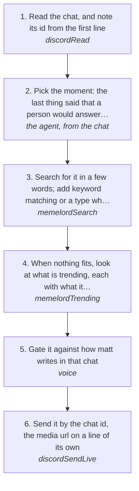

# Replying with a meme in a Discord chat

Answer a moment in a Discord group or DM the way people there already do: with a meme. The chat is read first, Memelord finds a template that fits what was just said, the meme is gated like any other send, and it goes out as its media url, which Discord shows inline. Only Memelord's free tools are used (rule 41). The extension itself is described in [docs/extensions/memelord.md](../../extensions/memelord.md).

How the owner asks for it: "respond with memes in the <chat>", "drop a meme in <chat> about that", "read <chat> and meme it"

## Run it from a fresh context

Say: **"go on docs/useCases/discord/memeReply.md for <chat>"**. The agent reads this page and runs the steps.

## The steps

<!-- stepsDiagram: written by `bun run docs:build` from the steps table below, not edited by hand -->

<!-- /stepsDiagram -->

| # | Step | Tool | Done when |
| --- | --- | --- | --- |
| 1 | Read the chat, and note its id from the first line | `discordRead` { account, channel: "<chat as matt says it>", limit: 25 } | the latest messages are read and the chat id is known |
| 2 | Pick the moment: the last thing said that a person would answer with a reaction | the agent, from the chat | one message, named with its time and author |
| 3 | Search for it in a few words; add keyword matching or a type when needed | `memelordSearch` { query: ["<the moment>"], method: "combined", limit: 8 } | a template whose name and description fit the moment |
| 4 | When nothing fits, look at what is trending, each with what it means | `memelordTrending` { limit: 8 } | a template that fits, or no meme is sent |
| 5 | Gate it against how matt writes in that chat | `voice` { to: "<chat>", with: "<chat>", context: "<the moment and the meme>", text: "<media url>" } | `PASS` |
| 6 | Send it by the chat id, the media url on a line of its own | `discordSendLive` { account, channel: "<chat id>", text: "<media url>", approvedBy: "matt", confirmLive: true } | Discord answers `sent` with the message id |

## What the runs taught

- **His taste ranks the results.** Search leads with matt's taste and ranks each template by it (deep fried, larping, streamer reacts like FlightReacts, Zias and Bloo, shitposts, and the memes he has sent, rule 120): pick from the top. On "waiting" it put Skeleton Underwater first and Sad Kermit last.
- **Short queries find more.** "deciding how much money to charge a client" found one weak clip; "money" with `method: "combined"` found eight still memes (2026-11-02, the log group).
- **Send by the chat id.** A chat named in words makes the engine list every chat first, which is one more call, and the account's governor then waits a random gap before the send (about 30 s on 2026-11-02). With the id the send is one call.
- **A meme can joke about money; it never names a price** (rule 108). On 2026-11-02 matt asked the log group "how much shall i charge", and the answer sent was Floyd Mayweather's Cash Stacks, not a number.
- **One meme, then wait.** The chat answers back; never send a run of memes (rule 94).
