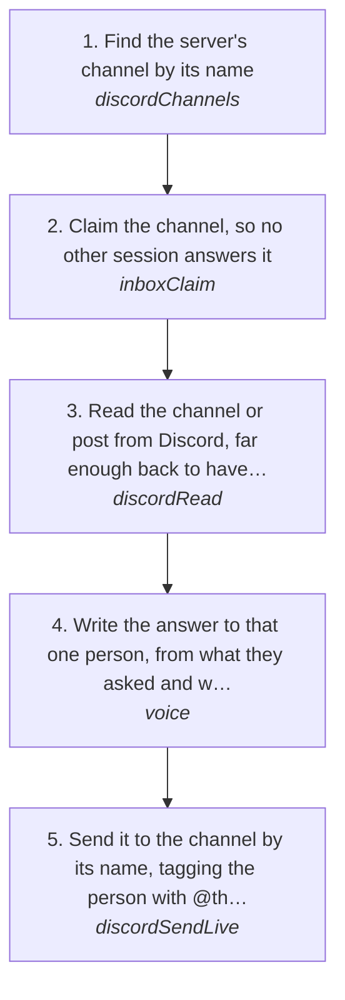

# Replying in a Discord server channel

Answer someone in a channel of a Discord server: a mention of the account, a reply to its message, or a question in a channel matt is part of, like "paulchrisluke #general". A server channel is not a group chat. It is a room inside someone else's server, with members who never joined a conversation with matt, an owner and its own rules, so it is read, answered and sent differently from a DM or a group DM. DMs and group DMs are [channelReply](channelReply.md).

How the owner asks for it: "reply to <someone> in <server>", "answer him in the general", "message the guy in <server> #<channel> who mentioned me", "reply in the <server> server", "find what <someone> said in <server> and answer it"

## Run it from a fresh context

Say: **"go on docs/useCases/discord/serverReply.md for <server> #<channel>"**. The agent reads this page and runs the steps.

## A server channel, a group DM and a DM

| | Server channel | Group DM | DM |
| --- | --- | --- | --- |
| What it is | A channel inside a server: a room with an owner, mods, rules and members who aren't in a conversation with matt | A private chat of a few people matt is in, with no server and no owner but its members | matt and one person |
| How it is named | `"<server> #<channel>"`, like `"paulchrisluke #general"` | its name, or the members' names when it has none | the person |
| In `discordChats` | `kind: "channel"`, with `server` and `serverId` | `kind: "group"` | `kind: "dm"` |
| What the watcher keeps | only mentions of the account and replies to it; the rest of the channel is never stored | every message | every message |
| Where a read comes from | always from Discord, never log.db, since log.db holds only those mentions and replies | log.db when the account is caught up and the chat backfilled | the same as a group DM |
| `search` finds | only the mentions and replies the watcher kept, and what an earlier read stored | the whole conversation | the whole conversation |
| A send while the account is behind | refused with `accountBehind` until the account catches up | that one chat is caught up, then it sends | the same as a group DM |
| Who the answer is for | one person in a room everyone reads: tag them | everyone in the group | the person |
| The page | this one | [channelReply](channelReply.md) | [channelReply](channelReply.md) |

## The steps

<!-- stepsDiagram: written by `bun run docs:build` from the steps table below, not edited by hand -->

<!-- /stepsDiagram -->

| # | Step | Tool | Done when |
| --- | --- | --- | --- |
| 1 | Find the server's channel by its name | `discordChannels` { account, server: "<server>" } | the channel by its name and kind; for a forum, the post from `discordPosts`, named `"<server> #<forum> > <post title>"` |
| 2 | Claim the channel, so no other session answers it | `inboxClaim` { platform: "discord", account, chat: "<channel id>", event: "<event id from the hook>" } | this session holds the channel |
| 3 | Read the channel or post from Discord, far enough back to have what they said, what it answers and anything matt already said after it | `discordRead` { account, channel: "<server> #<channel>", limit: "50" } | their message with its `fromId`, the messages before it, and none from matt after it |
| 4 | Write the answer to that one person, from what they asked and what matt said to tell them, in his words and length, then gate it | `voice` { to: "<who>", context: "<what they said and what came before>", text: "<draft>" } | `PASS`, or matt's own words he gave for this message |
| 5 | Send it to the channel by its name, tagging the person with `<@their fromId>` | `discordSendLive` { account, channel: "<server> #<channel>", text: "<@fromId> <draft>", approvedBy: "matt", confirmLive: true } | Discord answers `sent` with the message id |

## What to know

- **It is someone else's room.** The server has an owner and rules. Answer what was asked and stay in the channel's topic. A pitch or a sales line in someone's server is not a reply: paulchrisluke, the owner of the paulchrisluke server, told matt on 9 Nov 2026 not to use his Discord for selling services.
- **Tag the one person.** Everyone in the channel reads every message, so the answer starts with `<@their fromId>` (from the read in step 3), the way matt tags people there ("have you ever made generative ui before <@379607746510848000>", paulchrisluke #general, 11 Nov 2026). The AI artifact check passes a mention. Never talk to the whole room as if it were a DM.
- **The read is always live.** log.db keeps only the mentions and replies from a server channel, so `discordRead` reads the channel from Discord every time and says so. Up to 1000 messages, 100 a page. A 429 stops the read and pauses the account (rule 94).
- **Finding an old conversation in a server.** Log's own `search` doesn't hold a server's history, only the mentions and replies the watcher kept. Use `discordSearch` on the server: [serverSearch](serverSearch.md). Reading a channel back to look for something is the slow way: Paul's widgets advice took a 400-message read of "paulchrisluke #general" on 12 Nov 2026.
- **When matt is already there, leave it to him.** If his own message comes after theirs, he is answering: send nothing and release the claim with `inboxRelease` { platform: "discord", account, chat: "<channel id>" }. A send releases the claim by itself.
- **A send waits for the account.** A send to a server channel needs the account caught up; while it is behind, Discord isn't contacted and the answer is `accountBehind`. Wait for the catch-up, never go around it (rules 94, 105).
- **The voice gate can't find a server channel by name.** Gate with `to` and `context` only, never `with`.
- **matt's own words.** When matt says what to tell them, the answer is his words. When the gate still refuses them, `overGate` on `discordSendLive` sends that exact message; the AI artifact check still runs (rule 152).
- **One message per line.** A draft on several lines goes out one message per line, and in a busy channel other people's messages can land between them. Keep a server answer to one or two lines (rule 90).
- **Name the channel, never its id.** The chat-names hook refuses an id: `"<server> #<channel>"`, or `"<server> #<forum> > <post title>"` for a forum post (rule 154).
- **Forums and threads.** A forum holds posts, each its own conversation: answer inside the post, never in the forum. What each part of a server is: the `discordServers` skill in the discord guide; going through a forum for posts to answer: [forumPosts](forumPosts.md).
