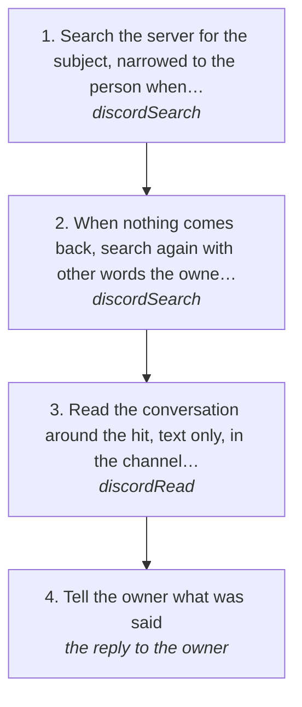

# Finding a conversation in a Discord server

Find what someone said in a server, or a conversation the owner had there, with Discord's own search across every channel, forum post and thread at once, then read around it. This is how "the conversation I had with <someone> about <a topic> in the <server> server" is found in one search instead of reading a channel back hundreds of messages. This page reads and sends nothing.

How the owner asks for it: "find the conversation I had with <someone> in <server> about <thing>", "what did <someone> say in <server> about <thing>", "search <server> for <words>", "read through the <server> server and find <thing>"

## Run it from a fresh context

Say: **"go on docs/useCases/discord/serverSearch.md for <server>, looking for <what>"**. The agent reads this page and runs the steps.

## The steps

<!-- stepsDiagram: written by `bun run docs:build` from the steps table below, not edited by hand -->

<!-- /stepsDiagram -->

| # | Step | Tool | Done when |
| --- | --- | --- | --- |
| 1 | Search the server for the subject, narrowed to the person when the owner names one | `discordSearch` { account, server: "<server>", query: "<words>", from: "<who>" } | hits with their time, author, text and where each one is (`"<server> #<channel>"` or a post) |
| 2 | When nothing comes back, search again with other words the owner or they would have used | `discordSearch` { account, server: "<server>", query: "<other words>" } | the hit, or two searches with nothing |
| 3 | Read the conversation around the hit, text only, in the channel or post it names | `discordRead` { account, channel: "<where the hit is>", limit: 60, noMedia: true } | the whole exchange: what was asked and every answer |
| 4 | Tell the owner what was said | the reply to the owner | who said what, when (the owner's time), quoted closely, and what it means for what the owner asked |

## What to know

- **Search first, always.** Discord's search covers the whole server, including forum posts and threads; Log's own `search` only holds the mentions and replies the watcher kept from servers. Reading a channel back to look for something is the slow way.
- **Search matches words.** Use the words they would have typed: "widgets", not "generative UI components". Try a second set before saying it isn't there.
- **`from` narrows to one person by name.** It is matched on the hits' authors, so a short name works ("paul").
- **The answer names where each hit is.** Read it there with `discordRead`, which names the channel or post it read.
- **Voice notes and images:** a hit in a voice note shows as its attachment. Read that spot without `noMedia` to have it transcribed.
- What each part of a server is: the `discordServers` skill in the discord guide.
